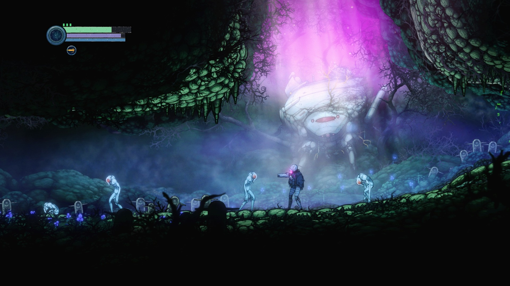
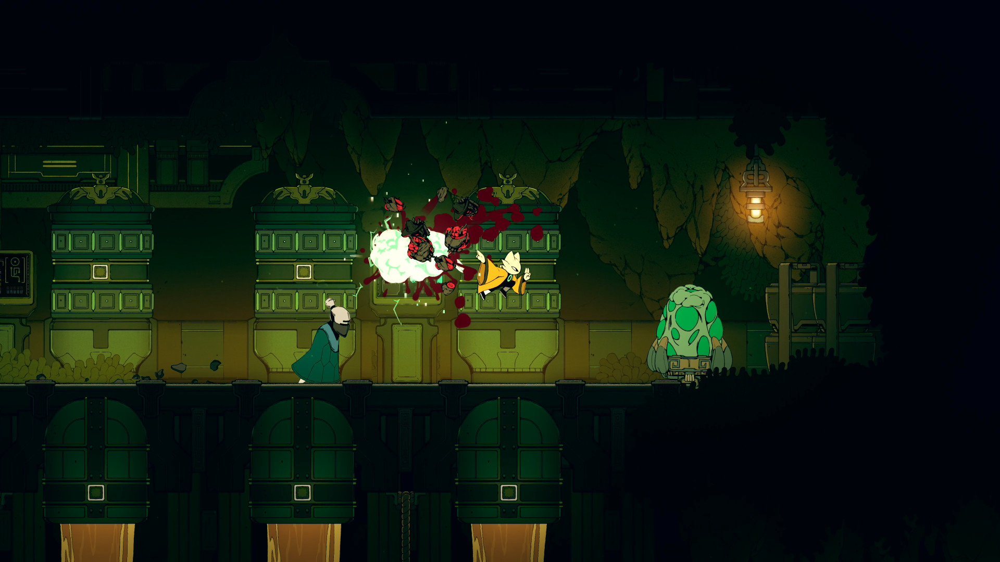
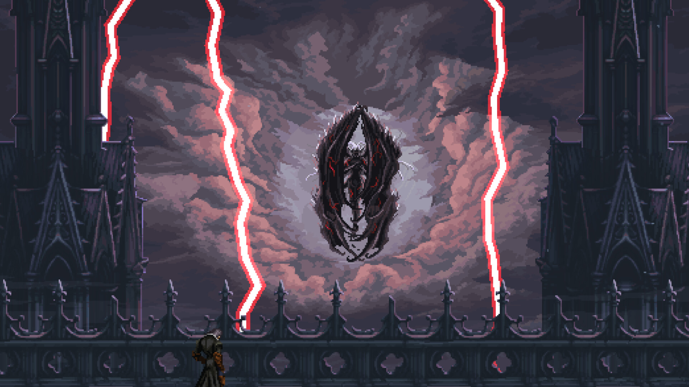
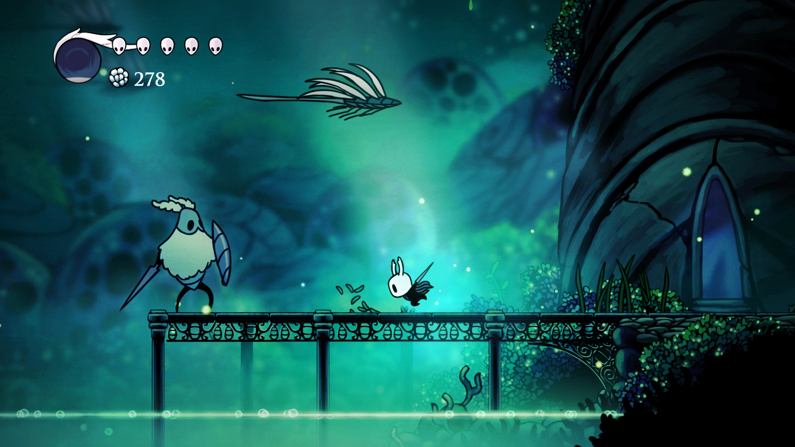

# 暗場與互動物件的同類作品參考

2026-10-20 實際檢視各作兩張 Steam 正式商店圖片，保存以下五張。這是圖片觀察，不是玩家偏好民調，也不能從截圖推斷各作的引擎、補光、碎裂或保存實作。圖片只供研究，沒有放進本作遊戲素材。

[來源頁、原圖 URL、日期與 SHA-256](../../pm/Nest-Egg-BG/attachments/readability-references-2026-10-20/sources.json)。五款作品分屬五個開發團隊；商店網站相同不代表團隊相同。

## Ghost Song／Old Moon

紫色洞口、青色霧與地面、較亮敵人皮膚和較暗主角衣甲分層。採用角色／背景的明暗區分，保留本作自己的色盤。

## 九日／赤燭

暖燈安裝在牆面，綠色背景和黃衣主角分開。採用光源支撐、場景物件材質與戰鬥高亮的主次。

## The Last Faith／Kumi Souls

深色頭目位在較亮天空前，攻擊光與建築輪廓分開。採用暗剪影也可讀的原則，不把加亮當唯一解。

## Dead Cells／Motion Twin

箱體、平台、毒池、角色與武器各有亮度層次。採用清楚的可站上緣與威脅順序，不讓每個物件同樣亮。

## Hollow Knight／Team Cherry

深色輪廓、淺色頭面、後方青光與有支撐的平台分開。採用角色、敵人、地面同時驗證，不能只看整張平均亮度。

