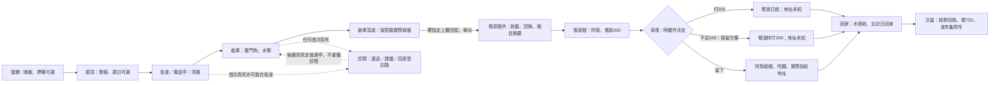

# 第一章「傘」收尾與分支正式製作稿

2026-10-10；輸入 checkout `2c90b9e2593fe47c00cd7aec1bff08f96e5da780`。這份補足第一章缺少的交盤、復原館事實變體、宵夜選擇與正式任務語義，供 ST-9 的故事來源 owner 接入。它是文稿與預期狀態契約，尚未生成場景、旗標、任務、關卡或交易；沒有引擎、截圖、手把、母語或真人遊測通過的宣稱。

採用順序：本次已裁定條件 → [全章因果](../20-campaign-experience/CAMPAIGN_NARRATIVE.md)／[首章審查](../20-campaign-experience/FIRST_CHAPTER_REVIEW.md) → [二章完整稿](SCRIPT_CH02.md)／[二章審查](CH02_SCRIPT_REVIEW.md) → [可讀性](DIALOGUE_READABILITY.md) → 本稿 → [一章審查](CH01_SCRIPT_REVIEW.md)／[舊分鏡](SCRIPT_CH01.md)的未衝突情感細節。[逐章審查門檻](../20-campaign-experience/SCRIPT_REVIEW_GATE.md)優先於舊固定三次過場／八分鐘間隔。現有 `Story.CHAPTER_PATHS` 仍載入舊章與過場；本稿不聲稱它們已停用，也不以93場總載入誤認正式第一章只有這些內容。

## 1. 因果與價目決策

凜接鷺的八百信用點差事，想把錢存進替老 K買晴岸住處的帳。她穿過街道，擊倒倉庫看門狗，利用已開水閘取得保險箱裡的一片實體資料盤。鷺在簡報先交代回程走倉庫上層通道，出口接復原館外的委託交接櫃。凜在櫃前交盤、拿回執，才知道盤內有一筆市集代收沒有付款附件。這晚只完成取盤差事的驗收，次晨由鷺與老 K核對800−80=720；查附件是第二章的新工作，不能把取盤報酬在第一章先發一遍。

交完盤後凜到旁邊的夜間店歇腳。阿梨並非委託人，不接盤、不碰回執、不替鷺付款。她有夜班、甜湯、想開攤的日子，也有尚未解決的收帳爭議。玩家可以接受她下班後的宵夜，或付清今晚餐酒就回家；錢不夠時能保留欠條。兩路都能回家，只有留下並確實聽到地址的人才知道她住處。回家時水燒乾，老 K去裝水後又問凜何時回來；凜仍只看見一次不尋常的忘事，沒有得到錨人身份的答案。

| 衝突／來源 | 本稿製作決策及其界線 |
|---|---|
| 舊稿 §18價目「復原餐120、酒80」，凜與正式 `ch1_t_ali_1` 都選「湯和酒我都要」；§19離開路卻未給有效宵夜價，並說昨夜已付、另付宵夜 | 今晚唯一可付帳是**餐酒200（120+80）**。在館內明說價格、點餐後才建立帳單；宵夜麵由阿梨私人招待，**麵價0，不另收不存在的宵夜費**。原稿遞錢未收的畫面改為留待結帳的紙單，不先扣、再以返款增生信用點。這是基於原價目的本輪收斂，正式經濟資料仍待生成／報表驗證 |
| 舊稿留下時把昨晚錢推回 | 留下路阿梨在下班後用自己當班可招待的一份餐酒額度結清200，另請一碗麵；不當作凜已付200再得200。招待名額是她的工作權限，一晚一份，不是無限商店折扣。玩家知情選留下才接受；不把所有客人的餐酒變免費 |
| 缺錢、零錢、死亡耗盡可能無法付200 | 選「把200記成欠條，先回家」無現金變動、無利息、無抵押；也可返回選留下。欠條另存，不在720、第二章代墊40或阿梨私帳自動抵扣；第二章回訪主動確認後可付一次，不需要先清才查帳 |
| 二章 S07採「敲兩下再一下」，舊一章說三下再兩下 | 以已審二章為準，一章實際說出的暗號也是**兩下再一下**；已知地址缺值不能預設真。舊檔只帶不同暗號時下次阿梨重講新暗號，不造未知者已聽過 |
| 晚飯四十、巢蛋27,400、房價480,000 | NE-231來源盤點經root轉交：新輪可花現金0；既有「交40」只是氣泡與完成旗標，沒有扣款。**第一晚老 K照顧凜，這頓免收**；下面明確覆寫 `ch1_b_dinner` 不存在交易的遞錢台詞。40僅是舊稿日常價目背景，本稿不承諾未來用餐功能；本章不建晚飯欠條或扣款、不要求先攢錢才吃飯。本稿不補發存款、不修改升級價；480,000仍是房價，27,400只是已存款敘述，不是可花現金 |
| 復原／雨的代價 | 首次真正死亡由灰衣人運去診間建檔；之後按實際登記亭復原。普通復原沿既有5%及上限、首次免費、劇情必死免費。系統不說凜每次必失憶，不指名老 K，不把雨的機制、鷺214、汐或父女未來結果提前說出 |

**主線完成條件**：晚飯 → 簡報 → 實際清路／開倉庫機關 → 實際取得盤 → 交接櫃收盤 → 凜確認回執與待查摘要 → 認識阿梨、知道帳單 → 作宵夜選擇並完成所選結果 → 回家章末。主線沒有地址、可選追問、現金餘額、武器升級或額外死亡門檻。

### 第一晚晚飯的必要替換（沿用 `ch1_b_dinner`，不新增一場或一筆交易）

起因：凜結束店內訓練，走到廚房吃飯；老 K知道她準備再出門，凜習慣把飯錢也當必須付清的帳。地點與接觸沿廚房既有桌、碗筷；本段沒有四枚硬幣、收入畫面或抽屜入款演出。普通氣泡不鎖操作，離開後回訪接未完段，不用現金作觸發條件。

| 拍 | 對白／動作／完成生產者 |
|---|---|
| 1 | 老 K把碗放穩：「今天的飯煮好了喔。這頓我煮給你，不用交四十。」凜的手停在外套袋口：「那我先記著。」 |
| 2 | 老 K把筷子往她那邊推：「不是叫你記一筆，叫你趁熱吃。明天的事明天再說。」凜鬆開袋口，接過筷子：「好，我先吃。」 |
| 3 | 凜把紅蘿蔔挑到碗邊。老 K說：「我把紅蘿蔔切很細了啊。」凜說：「還是看得到。」 |
| 結果 | 最後一句完成或玩家明確略過已開始的資訊段，沿用 `ch1_dinner_done=true`；可上屋頂。cash變動0、晚飯欠條0、巢蛋入帳0。中斷不寫完成，已完成回訪只讀既有提醒，不重建碗或帳。 |

40信用點的其他用餐功能不在本稿範圍，也不是交付承諾。原稿抽屜存款的遠景伏筆可沿原有環境保留，本次凜沒有放錢進去，不能用鏡頭捏造40收入。

## 2. 空間、節奏與玩家操作

戰鬥／機關沿現有二十二遭遇與水位持久，不為本稿加敵人或強迫看門狗致死。交接櫃是戰後目的與核對，復原館與麵攤是玩家可停留的谷；不讓戰鬥尾端自動連播館內長談。資訊交談明列其閱讀中斷，只有玩家確認放盤、開始對話／電影才鎖操作；接近預告可離開。一般路牌、單據與氣泡無21:9，戰鬥視野不能遮。

| 段號／內容 | 必要性與新增資訊 | 固定演出＋首次閱讀估計 | 鎖／略／再次成本 |
|---|---|---|---|
| F01簡報補句 | 必要，說清報酬與回程去處 | 0＋20秒，合既有簡報 | 主動交談；略資訊同brief完，中斷不完 |
| F02盤與上層路 | 必要，持有盤有實體生產者 | 2＋15秒；取物由玩家做 | 動畫短鎖2秒；不略過互動代取 |
| F03交接櫃 | 必要，盤／回執／摘要／付款分開 | 6＋45秒分兩小段 | 明確放盤、取回執、存摘要；略資訊不代確認交易 |
| F04館內首見 | 必要，按真實復原經歷打招呼，價格／稱呼 | 5＋50秒 | 主動對話；點餐/接待確認自己選，略不代扣 |
| F05甜湯與下班 | 必要，晚上的陪伴與工作分清 | 4＋35秒；可選補談另20秒 | 主動短談；可略已確認資訊，無報酬 |
| F06宵夜決定 | 必要，兩路／缺錢都有可行結果 | 0＋15秒說明；選擇無倒數 | 返回保留未決，略停在選項 |
| F07付帳離開／欠條 | 必要分支，付錢或承諾各有不同帳 | 3＋30秒 | 確認金額／欠條後完成，返回不算已走 |
| F08留下吃麵／地址 | 必要分支兼SQ1，善意與私生活是她決定 | 8＋65秒，兩段主動對話 | 略已選資訊同結果；未選不留，不提前地址 |
| F09回家 | 必要章末，忘事是具體小事 | 12＋40秒 | 電影可略同終態；回訪不重演忘事 |
| O01週日／O02標籤／O03聲音／O04灰布 | 可選，私人的時間／舊物／相似錄音／無名照顧者 | 逐段10–40秒閱讀；固定0–3秒 | 可返回，無主線門檻；不要求重複死亡 |

以上是製作估計；F03、F04、F08不是各長一整段自動過場，選項與物件操作分拍。新稿增加首次資訊與可選閱讀，不能當已測全章時長。略後保留角色位置、面向與鏡頭正常值；必要新動作先用有支撐的站姿／遞物備案，不修改角色底層。

## 3. 逐場完整原創稿

臺詞單句≤56字；模態對話每三句夾動作／翻頁／操作。以下是完整意思的原創繁中，字幕語感只參考日常問答、錢與小事，不移植參考作品句子。講者 `terminal` 是交接櫃無情緒合成聲；`recording` 是既有錄音，不能顯尚未知的姓名。長帳單是可捲動文件，非氣泡。

### F01　鷺把回程也寫進差事（擴充 `ch1_t_egret_1`）

起因：晚飯已完成、凜主動找屋頂鷺。凜知道老 K抽一成，但不知道盤內容；鷺知道委託回程、金額、驗收方式，不知道凜錨人。地點：`ch1_rooftop` 既有茶座，鷺的茶放有支撐的箱桌，凜站在乾地；她不取得傘。已有倉庫／看門狗介紹保留，下面替換「帶回來」的模糊指令，不新增第二次brief完成。

| 拍 | 對白／動作／玩家參與 |
|---|---|
| 1 | 鷺把簡報紙角壓在茶杯底：「倉庫保險箱裡有一片資料盤，今晚把它取出來。驗收是八百，不是看一眼就算。」凜說：「一成照舊，先別算進我能花的錢。」 |
| 2 | 鷺在紙上畫回程線：「拿到盤後走倉庫上層出口。那條路到復原館外的交接櫃，不用帶著盤再穿一次路障。」凜指屋頂下方：「復原館就是電話亭旁邊那間夜間店？」 |
| 3 | 鷺說：「對，交接櫃在店外，不是交給店裡的人。櫃子收盤後吐回執，明早我跟你對錢。」她收起筆，茶仍在桌面。凜說：「盤放櫃裡，回執留我這裡。我記好了。」 |
| 結果 | 本次完整簡報結尾才 `ch1_heard_brief=true`；開前門，HUD「沿街道前往碼頭倉庫。」無800／720入帳，週日支線不讀為門。 |

略過資訊有同一份可查簡報與路線；中斷不開前門。回訪鷺：「上層出口接交接櫃，回執別留在櫃裡，明早還要對。」既有晴岸談話仍可另聊，不重複發委託。

### F02　拿到的是一片盤（修訂 `ch1_g10_disk`）

起因：保險箱守衛機關實際完成、保險箱可互動；不是走進 `ch1_vault` 就成功。燈只能看得到安全鎖狀態與盤徽章，不能先讀整本帳。凜武器收掛，手去接實體盤；保險箱開口與盤接觸可見，不做憑空掉盤動畫。

| 拍 | 對白／動作／玩家參與 |
|---|---|
| 1，未拿 | 燈在可移動通訊說：「保險箱可以開了，盤還在裡面，別只顧著找上層出口。」HUD「打開保險箱，取出資料盤。」此句沒有宣告已持有。 |
| 2，拿取 | 玩家確認取物；盤從保險箱移到凜故事道具欄，保險箱world拾取狀態與持有紀錄同時保存。凜說：「收帳人的徽章還貼在上面。」燈說：「那是記帳用的資料盤，天穹要核哪一筆，得等交接櫃驗收。」 |
| 3，已拿 | 凜說：「我先把盤送到櫃子，錢明早再對。」燈說：「上層通道亮了。走到出口前還有守衛，別把盤當通行證。」兩句不假稱上層遭遇已清。 |
| 結果 | 真正拾取後 `ledger_disk_obtained=true`，故事物 `ch1_data_disk`一片；無改裝券／800／720／巢蛋現金新增。上層出口需真持有盤，且現有通路實際可走；既有機關獎沿原結算。 |

盤不能賣、當、丟棄或消耗作普通武器素材。未拿而碰出口：「資料盤還在保險箱，取出後再走上層通道。」已拾取重訪只空槽與「保險箱已經空了，盤的交付另有回執。」取得後死亡保留盤，交付後死亡不能讓保險箱再生一片。

### F03　藍燈櫃與一張乾紙（完整交盤；與二章 S00共用同一入口）

起因：F01指路、F02真持盤、沿倉庫上層出口到 `ch1_lounge` 入口段。先看到外牆招牌與青燈櫃，凜仍能走到它前面／返回操作；阿梨尚未出場。鷺、燈只在通訊。櫃高0.9H、投盤口0.55H、盤寬0.12H，前方站立空間≥1H。檐、固定櫃腳、通往夜間店的實際門，沒有室內雨幕穿桌。現有LevelData尚是室內一張圖，**入口段館外舞臺與櫃子待關卡owner接入**；第6節給空格候選，不能聲稱已有。

**正式拆段契約**：F03是文稿段號，不能生成一個單場中途落盤的長場。拍2–3為獨立「確認並收盤」交互／完成場景；拍4為獨立「取回執」；拍5–7為獨立「保存摘要」。建議ID為 `ch1_t_handoff_accept`、`ch1_t_handoff_receipt`、`ch1_t_handoff_summary`，實作時收斂到正式命名。每段僅在完整完成或已明確確認後略過至段尾，原子保存本段結果；未完成時撤回**本段入口**快照，不撤回前段。收盤段尾才同存盤轉移與驗收，下一段入口已無盤；取紙段尾同存回執，摘要段尾才同存授權與整體handoff。不得在單場動畫中途先扣盤，再被整場入口snapshot還原。

| 拍 | 原創完整對白／動作／玩家操作 |
|---|---|
| 1，接近 | 燈氣泡：「藍燈櫃是交盤用的，店門在旁邊。」凜氣泡：「我先把盤交了，再找地方擦乾。」兩句各≤30字，同屏≤2、不鎖。 |
| 2，檢視 | 玩家在櫃前互動。頁面顯示「碼頭保險箱取回委託／報酬800／待實體驗收／下一個結算時段：次晨」。終端說：「請確認交付資料盤，接收完成後原盤由委託方保管。」選「交付這片資料盤」／「先退出」。略過不能選交付。 |
| 3，放盤 | 明確交付後凜站穩，手將盤放入口，櫃沿不穿手，鎖聲一次。終端說：「資料盤已接收，徽章與委託編號一致。驗收回執已建立。」到這一句收盤段結束，才提交物理交付事務：盤離凜、櫃持有，`ch1_disk_delivered=true`，回執在櫃內可重印。段尾提交前退出撤回到持盤入口；段尾已提交則從取紙段繼續，不能還盤。 |
| 4，取紙 | 紙捲伸出小半張，玩家取回執。燈說：「回執出來了，鷺姐明早替你對錢。我把電子副本也留著，雨別讓紙黏成一塊。」凜把乾紙夾到筆記：「盤交了，錢我明天再核。」取紙段尾 `ch1_disk_receipt_taken=true`與故事物回執同存，無加錢。 |
| 5，待查 | 鷺通訊接入：「盤裡有一筆市場修繕代收沒付款附件。明早上屋頂再談，今晚先把取盤這筆做好。」凜問：「沒附件是沒付，還是收了沒記？」鷺說：「現在只能說缺一張紙，不能替那個人認欠款。」 |
| 6，閱覽 | 玩家在終端按「保留可閱覽摘要」。只有自己委託範圍的欄位，不把整盤／私人病歷交玩家。摘要全文見下。燈說：「這份摘要準你查批號，不是要你再去拿同一片盤。」凜說：「我留批號和缺的那欄，明早先領錢，再去找收據。」 |
| 7，小事 | 終端打印角被風吹，凜按回筆記。鷺說：「旁邊有熱湯，你把紙收好，別把回執泡進去。」凜說：「我把帳夾裡面，湯放外面。」不告知阿梨姓名或強替她付餐費。 |
| 結果 | 摘要確認後 `ch1_market_summary_known=true`、只讀授權記錄成立；F03整段 `ch1_handoff_done=true`。HUD「進復原館歇腳，和吧臺的人說話。」取盤報酬狀態仍pending；二章S00若一章已做只讀本結果，不能重接收、重給盤、重發錢。 |

**回執全文（文件）**：「委託：碼頭保險箱資料盤取回。實體已驗收，原盤由委託方保管。報酬800信用點，次晨核對。一成抽成由老 K依既有約定處理；預計凜淨額720，尚未入帳。閱覽授權限市場修繕代收批號M17與付款附件，非原盤持有權。」

**摘要全文（文件）**：「市場修繕代收批號為M17，記錄本金為200信用點。本期利息為20信用點，代收簿記載待收120信用點，但付款附件缺失。以上為待查記錄，不等於合法待付結論。須在市集代收處找同批收據、租攤合約與代收簿核對；本頁無法證明已付金額。查核安排與額外報酬次晨另行說明。」這裡不給已付120答案；二章玩家親取收據後才知道100本金+20利息已付、合法剩100。摘要不把M17等同阿梨全部私債，不寫父女姓名或判決。

**完整回訪**：已交未取紙，終端「原盤已接收，請取驗收回執。」；已有回執未存摘要，燈「紙已拿到，還有缺附件那頁可以留。」；全部已完，終端「驗收紀錄已保存，次晨到當舖核對報酬。」鷺「今晚交的盤不會再算第二片，剩下的是明天的紙。」無盤／未驗收顯F02取得目標，不假設阿梨代收；物品損毀按第7節復核。

### F04　阿梨問的是今晚，不替凜填死法（修訂 `ch1_t_ali_1`）

起因：F03交接已完成、凜走入館內主動與吧臺阿梨交談。阿梨只看到衣物、呼吸、是否有診間紙帶；不知凜受誰錨定、不知道戰鬥與死亡次數。只根據凜實際回答切首見變體，不在入口氣泡先說她已復原。

入口 `ch1_b_lounge`：「想擦乾就進來，桌邊有乾布。」不先端點過的餐。桌0.43H、吧檯座面按現有stage量測，坐點由玩家選坐後腳有支撐；阿梨擦杯先放桌再回話，凜故事欄有回執、無盤。低暖光、玻璃外雨、杯碗聲，沿現有 `safe_clinic`候選，不宣稱已試聽。

| 實際經歷 | 第一段完整問答（只選一組） |
|---|---|
| A：首次在街道／看門狗等處死過，診間建檔完成；之後真在電話亭普通復原過 | 阿梨：「剛從電話亭回來嗎？你可以先把外套上的水擦掉。」凜：「我後來在亭子醒過，最早那次是被送到診間。」阿梨：「你想說最早那次，還是先吃一口熱的？」凜：「先吃，盤已經交到外面的櫃了。」 |
| B：至此僅首次真死，可能在水坑；由診間建檔後重返倉庫，沒有普通亭復原 | 阿梨：「你手上是初次建檔的紙帶，診間送你出來了？」凜：「灰衣人把我送過去，我醒來後走回倉庫，沒有在亭子醒過。」阿梨：「那你這一路又走了一遍。先把紙帶收好，湯不用跟著趕。」凜：「回執在本子裡，手上這張我也收。」 |
| C：未有任何真正死亡；若玩法允許無死解水坑／後續版本迴路 | 阿梨：「外面下了一整夜，你是來等復原的人，還是自己路過？」凜：「我是來交盤的，今天還沒用到復原。」阿梨：「這裡也收沒復原過的客人。你想吃餐，還是只坐一下？」凜：「我先看價目，坐著算完這筆。」 |

本輪水坑設計存在劇情必死，但C為不假造死亡的完整備用；**不是本稿宣稱當前無死路線可達**。A不能只憑death_count≥2認定，需普通亭復原完成事實；B不能指「剛從診間」假裝前面沒返回倉庫。若來源未記路型，問句保守用「外面下了一整夜，你想先歇一下嗎？」凜回「我先歇一下，盤已經交了。」不根據UI/過場播放推論死過。

| 拍 | 共用後半：價目、名字與點餐 |
|---|---|
| 1 | 阿梨把菜單放到乾桌：「復原餐是一碗補身的熱湯，連肉和麵包是一百二十，酒八十。兩樣一起兩百，離店前再結。」凜說：「湯和酒我都要，兩百先記這一晚。」點餐確認提示完整200；這不是購買復原權。 |
| 2 | 明確點餐後才建立 `ch1_lounge_ordered=true`、餐酒單200，**此時不扣錢**。阿梨端湯、酒杯各一次，凜把回執放遠：「這邊留給碗，紙不要碰到湯。」菜單標示未結賬，一眼能查，不偷偷讓玩家負債。 |
| 3 | 阿梨：「您怎麼稱呼？」凜：「我叫凜。」阿梨：「我叫阿梨，是梨子的梨。老人說別分梨吃，會把人分開。」凜：「我把名字記著，梨我自己吃。」她不是姓名猜謎或拯救道具。 |
| 結果 | 初見與已確認接待結尾 `ch1_met_ali=true`；館出口前需F05晚間結束，但不強要未死玩家承認死法。兩百暫待結，零現金可明確選記到結帳時，宵夜有免費／欠條退路。無地址、無支線信用點、無死亡／復原費。 |

若玩家選「先只坐一下」可返回，無訂單／債；必要接待可繼續問F05，不鎖離館。再想點餐有相同菜單。**未點餐者F06金額0**、F07可直接離開，F08仍能受邀留下；不憑SKIP代點湯酒、生成200欠條。正式主要路線以玩家確認湯酒為一條，保留只坐的可行退出，避免「能選其實不能拒絕」。

### F05　湯甜，是因為有人放了一顆梨（修訂 `ch1_t_ali_2`）

起因：F04初見後，點餐者凜真的喝湯；未點只坐者看到阿梨收湯鍋。阿梨先有自己的下班時間與決定；回執無關她工作。玩家主動問「這湯怎麼是甜的？」；只坐變「妳收鍋時還放梨？」阿梨回答「梨放進去煮久一點，冷了也沒那麼澀。這是我以前學的做法。」不一次講梨嬸全部生平。

| 拍 | 對白／動作／結果 |
|---|---|
| 1 | 凜轉碗／看鍋：「這種做法，客人會一直點吧？」阿梨把杯歸架：「有人只喝一口，有人想坐到雨小，我都先問。」凜指外頭：「雨要是不小呢？」 |
| 2 | 阿梨把工作胸牌放櫃邊：「我也有下班的時候。今晚已經到了，不會把你坐多久都記成工錢。」凜說：「餐酒的兩百我記著，坐著的不用另開一張。」未訂單版「我只坐了一會兒，沒有餐酒這筆。」 |
| 3，真死可問 | 凜：「妳不問我今天怎麼死的？」阿梨：「你想講，我就聽。你想先把湯喝完，我也不用替你補一個故事。」凜：「先讓我喝完，明早還有帳。」未死版凜：「妳不問我為什麼跑這麼晚？」阿梨：「你想講才講，坐一下不需要先交代差事。」 |
| 4 | 站起前阿梨指店外麵攤：「外頭剩一碗麵，我下班後才吃。你想留下就一起，不想等也能先走。」凜說：「我到門口再決定，先把紙收好。」她不是一進麵攤就被塞麵。 |
| 結果 | 晚間接待完成 `ch1_lounge_evening_done=true`，阿梨收杯、移動到館外宵夜席；館出口開到 `ch1_stall`。只有一個阿梨，不讓館內／攤位同時刷NPC或一轉場就改衣。錢未結，地址未知。HUD「到麵攤，決定留下或先回家。」 |

如略F05已確認資訊，接待結尾同真實點餐記錄；不補未點的物品／200。回訪已認識且未離店：「湯鍋我收了，麵在外頭，走不走你自己決定。」回訪隔天不稱「今晚我下班」或再次觸發首次名稱。

### F06　要不要把今晚留長一點（新宵夜選擇入口，替換進場強推麵）

起因：館夜班結束、兩人已走到外頭；`ch1_stall`阿梨在攤後，最後一碗留在鍋邊，沒有憑空在凜手上。使用原有攤車當借用的下班宵夜灶，阿梨尚沒自己的正式攤位。油紙傘同一把靠棚柱／掛實鉤，不給凜。

入口氣泡 `ch1_b_stall`改：「這碗麵還熱，你要留下嗎？」玩家沒選留下時，舊 `ch1_t_ali_4`「吃完再走」不播。主動對話：

阿梨把空椅拉出，沒有碰凜：「你想先回家，還是留下吃一碗？麵是我請的，不加在餐酒那張。」凜看夾著回執的本子：「我想先把今晚這張說清楚，明天那張另算。」阿梨：「今晚餐酒兩百，沒有另收陪坐或宵夜錢。你留下，這份我用今天的招待額度結；你先走，可以付清，也可以把欠條留著。」未訂單改「你今晚只坐了一會兒，沒有餐酒帳。想回家就回，麵還是我請的。」

| 選項標籤 | 同頁說明（完整玩家文字） | 下一段 |
|---|---|---|
| 「結清餐酒，先回家。」／無帳時「先回家，改天再聊。」 | 有單：「確認支付200信用點；不取得阿梨地址。」無單：「今晚沒有餐酒帳，不會扣款。」 | F07；不足不自動欠款，提示並可轉欠條 |
| 「留下來吃一碗麵。」 | 「接受阿梨今晚的招待，餐酒由她結清；宵夜不收錢。」未點餐不提替結款 | F08 |
| 「先返回，讓我想一下。」 | 「暫不作決定，回家目標保留；可以再和阿梨說話。」 | 未決；不開門、不寫地址、不扣錢 |

選擇無倒數、預設焦點只首項不是預設結果。skip停在未決選項，不隨機選付、吃或欠；返回真正退出模態而恢復操作。門鎖提示「先和阿梨說清楚今晚的帳，或選擇留下；沒有錢也能保留欠條回家。」只坐無帳版「先和阿梨說一聲再回家，也可以留下吃麵。」

選去留是一次明確完成的決定，與宵夜整段完成分開：選後保存 `ch1_supper_choice=leave/stay`，尚未 `ch1_supper_done`。付帳確認前、欠條確認前或接受招待前可用「回去想一下」把這個未結結果的選擇改回unset，再選另一條；這個返回有明確操作，不能由讀檔猜測。已支付、已簽欠條或已接受招待後，必須恢復所選路的剩餘收尾，不再開F06讓同一晚另付一次或改成另一條。未點餐者接受麵的確認也是留下分拍的實際結果，保存其續段入口，無帳單可用也不靠gifted推論已留。

### F07　把帳結清，或寫一張不加息的欠條（完整離開路）

起因：玩家在F06明確選回家，阿梨尚未告訴地址；凜不坐宵夜椅、不自動吃一碗。價錢是已點餐酒200，不是麵。對話後明確支付／欠條確認才 `ch1_supper_done`，一按選項不能先扣。

| 條件／拍 | 完整對白與行動 |
|---|---|
| 有單1 | 凜把菜單轉到兩項：「餐一百二十，酒八十，今晚就兩百。麵我不吃，先回家。」阿梨說：「你不用替那碗麵留錢，我留給自己。」她沒有偷塞人情帳、沒有羞辱離開。 |
| 可付2 | 確認窗「支付200信用點，結清今晚餐酒並回家。」玩家確認後實際扣200一次、單據paid；阿梨劃掉待付欄：「收到了，回去別把濕紙放爐邊烘，字會掉。」凜說：「明天我要拿紙對錢，今晚先讓它乾。」 |
| 缺錢2 | 確認前金額<200，凜停手：「我現在不夠兩百，不拿明天的錢當今天已經付了。」阿梨把單挪回桌：「那就先留著，不加利息。你也可以坐下，今晚我請。」選「保留200欠條，先回家。」／「回去選留下吃麵。」／「先返回。」 |
| 欠條3 | 再確認「保留200信用點餐酒欠條；現在不扣款、不加息，之後可主動付清。」凜寫「餐酒200／未付」，阿梨收一份副本：「你自己寫清楚就好，沒有復原服務替你簽這張。」凜說：「這張我自己記，不放進委託回執。」 |
| 無單 | 凜說：「我今晚只坐了，沒有點餐。先回家，下次再說。」阿梨收空椅：「那就沒有餐酒這張。門口地滑，走外側那塊乾板。」沒有支付確認和欠條，零錢亦完成。 |
| 最後 | 阿梨說：「我下次還在這裡，你想喝湯再來。」凜說：「我記住這間店，不把下次也先答應了。」只有約定再見，不告私地址、不說「欠著」是地址暗號。 |
| 結果 | 實際支付交易／欠條確認／無帳告別各完成之後 `ch1_supper_choice=leave`、`ch1_supper_done=true`。賬狀態paid200／owed200／none分開；有訂單paid or owed才適用。**`knows_ali_address`保持既有真值或未知，不寫false蓋掉已知**。本輪新玩家未知。回家門讀supper_done，兩百不算任務獎勵。 |

完成態回訪，paid：「今晚的兩百已經結了，麵是我的，你回家吧。」owed：「欠條我留著，今晚不會再加，你先回家。」none：「你沒有點餐，不用為那張空椅留錢。」這三句不會開啟F08補地址；跨章另有真正拜訪第二次機會。

### F08　那就欠著，不要替我把話講完（完整留下路）

起因：F06明確選留下，阿梨的招待額未被本輪另一結帳用掉；只有玩家選擇才能接受。凜把本子放在乾角，回執不是餐券。阿梨先劃掉紙上200、寫「當班招待」；未點餐不生成單。用站姿遞碗、玩家選坐點→坐到支撐椅，不讓拉椅把凜移進桌底。固定吃麵演出≤8秒可略，地址在後半實際說出後提交，前半不預知。

**正式拆段契約**：拍1–2為獨立「接受招待」交互／完成場景（建議 `ch1_t_supper_stay_host`）；拍3為獨立「吃麵」（`ch1_t_supper_stay_meal`）；拍4–7為獨立「夜話與地址」（`ch1_t_supper_stay_address`）。未點餐者同樣明確接受麵的邀請，招待段不造200帳。各段只在段尾保存：招待段保存實際招待或無訂單邀請結果，吃麵段保存已吃麵事實，最後段完整說出並記錄地址及宵夜完成。下一段入口snapshot包含前段已提交結果；中斷最後段不回退已吃麵或招待，也不提前寫地址。不得要求單場先gifted落盤再回退至尚未招待的入口。

| 拍 | 完整原創臺詞／動作／玩家參與 |
|---|---|
| 1 | 凜說：「我留下。麵是妳請，今晚那份也算妳請？」阿梨把餐酒單翻到招待欄：「是我自己決定的一份，今晚還沒用。你不用把明天的報酬押給我。」未點餐凜：「我留下，麵就這一碗？」阿梨：「還有湯，你想添再跟我說。」 |
| 2 | 阿梨在紙單寫下當班招待。凜摸紙角：「那我欠妳一碗麵，下次換我請。」阿梨：「那就欠著，你願意下次再坐，我就留一張椅子。」她說的是人情，不開信用點債、利息、任務付帳罰款。製作結果：招待段尾保存餐酒單gifted200；錢無增減。 |
| 3 | 玩家吃麵／略已選吃麵。凜看底部梨片：「麵裡也放梨，你不怕人只記得甜？」阿梨說：「有人記得甜就再來，有人嫌甜就告訴我。我想開自己的攤，得先有人願意說不好吃。」凜：「這碗我吃完了，還沒找到不好吃的地方。」不發租攤成功、永久麵增益或第二章試湯獎。 |
| 4 | 阿梨把油紙傘從乾椅搬到棚鉤，空出位置：「我最近被收帳人盯上，去問租攤的事，也被叫回去對帳。」凜說：「他們要妳還多少？我明天也去市集查一張缺的收據。」阿梨：「本金我認，已經付過的又被寫進去。那張我得自己看，不能聽誰說就再付。」她只知自己帳爭議，不知道M17答案。 |
| 5 | 凜把筆放下：「妳想我幫妳付，還是先看妳那張？」阿梨說：「今晚先不用替我做。你明天有委託，先把你的紙對完；我的事，我想清楚會自己說。」這是第一次學問但不代完成第二章SQ1-A2，不能提前承諾她需要兩項租攤許可全部。 |
| 6 | 凜說：「妳收了攤，平常去哪裡？」阿梨：「我住市集後樓三樓，從代收處旁的外梯上去。敲兩下再一下，我就知道是你。」凜：「我把三樓和外梯記下，沒有答應今晚就去。」阿梨：「我只是告訴你，不替你排明天。」凜確認記下地址；此拍不單獨落盤，到拍7夜話段尾才寫 `knows_ali_address=true`與地點線索，不傳送、不開第二章住處。 |
| 7 | 凜合上本子：「回執放委託那頁，妳的名字放後面，不寫價錢。」阿梨把碗收到攤上：「這一頁留一點空，下次想說的事還裝得下。」舊 `ch1_t_ali_4`只這裡可作為短收尾，改「麵吃完就先回家，明天的帳留給明天。」 |
| 結果 | 點餐者gifted200已提交，麵已經接受／吃完，地址確實說出並記錄；`ch1_supper_choice=stay`、`ch1_supper_done=true`、`sq1_first_supper_done=true`，回家門開。人情欠麵是日誌敘述，不是owed200。有單gifted，無單none。地址節點本章無額外信用點／XP，避免重用成長系統未核小中尺度；獎勵就是實地址與這段關係，不給支線空XP。 |

若中斷發生在招待後、地址前，禮物結帳保留，回來從後半吃麵／收椅繼續，不扣回200、不提前寫地址；若玩家主動略已選的後半資訊，仍完整交代地址到日誌並提交，與播放完同知情。未知地址不會只因為點F08場景ID就變真。回訪「我住市集後樓三樓，外梯上去，兩下再一下；路你記著，今晚先回家。」已知者可重看但無新獎勵。她仍自行帶走自己的油紙傘。

### F09　水沒有燒好，是燒乾了（修訂 `ch1_c14_home` 的連續性）

起因：F07或F08完成，凜親手沿回家門進 `ch1_pawnshop_dawn`，地面無戰鬥威脅；鏡頭不以地址判斷能不能來。老 K在爐前，不知道她宵夜選擇或盤內賬（除非凜現在真的告訴）；故事道具只有回執、摘要、可選地址／欠條，沒有盤。爐與壺實際支撐、凜用關火動作備案，不改底層角色。

| 拍 | 對白／演出／接觸 |
|---|---|
| 1 | 凜進門把本子放乾桌，不拿傘。壺無水、低蒸氣／熱痕，不能仍滾著大量水。凜說：「老 K，壺裡沒水了，先把火關掉。」她去關爐，老 K轉頭：「你已經回來了啊，我本來想留一壺。」 |
| 2 | 凜把鍋移到耐熱墊，視線到他的手：「我回來了，盤也交了，錢明早對。」老 K說：「八百那張有回執就收好，別拿來墊鍋喔。」他只知道先前委託金額，不知私帳或她自己付多少。 |
| 3 | 老 K拿空壺：「這壺燒乾了，不能算水好了。我去裝，今晚不用等它再滾。」他走去後側**現有水缸／水龍頭**，不演跨進地下室才裝水。地下室門仍鎖；門縫微光只能作既有伏筆，需要資源owner做，不為了壺強開門。 |
| 4 | 老 K把有水的壺放回關火爐面，身後視線停3秒。回頭問：「你什麼時候回來的？」凜握著筆記，筆沒翻開：「剛才，我站在這裡叫你關火。」不說已燒好水，不由旁白解釋耗損是誰。 |
| 5 | 老 K看已關的開關：「我聽見了喔。明天先吃飯，再把帳對。」他把另一個乾杯推她手邊，沒倒未煮的熱水；凜收本：「飯留著，錢我明早再算。」沒有唱出具名錨人、沒有凜假裝又死一次。 |
| 6 | 鏡頭回漏水桶、乾杯與傘桶，老 K哼半段既有旋律，最後一音偏離；只是聲音需求。章末卡「第一章　傘　完／下一章　鷺／明早到當舖核對交盤回執，再上屋頂談市集附件。」 |
| 結果 | 完整／略電影同 `ch1_home_done=true`、`ch1_complete=true`，廚房燈／爐關、壺有水但未沸、物品保持。沒有結算720，沒有自動加載舊level_02。未有正式第二章入口的包保存完章並回主選單，下一章正式可用才到其次晨場。 |

回訪老 K：「回執放乾的那格，飯在鍋裡，明早再算喔。」不再問何時回來、不重複章末交易。未來二章S01原「鍋我換過」可作為夜間後處理，不能用這場中途突然換另一口壺掩蓋物件連續性。

### O01　週日不是一張空白班表（可選完整追問）

起因：F01完整brief後主動選擇「問鷺今晚與週日的事」；沒問可以離開，不鎖主線。地點既有屋頂，鷺收杯／看手錶，真實只知道自己的私人行程；不說棠、病房／用盡。凜說：「妳今晚不跟去，是又接了別張差事？」鷺笑一下：「今晚去看一個人，差事明天才算。週日我也不排活。」她把簡報紙推回凜，不把私人地點畫上。

凜說：「每個週日都不排，這張表是誰替妳留的？」鷺用杯擋住紙邊：「我自己留的。有人肯讓我坐一會兒，不能每次坐到一半就接電話。」凜說：「那我明天找妳，不把週日也排進去。」鷺說：「這句你記著，下次有價高的別又說很快就做完。」末尾她望遠塔：「茶喝掉，不然等你算完，又說熱的不是這杯。」

答完 `asked_egret_sunday=true`，SQ2-B0只知「今晚見人／週日不接案」；無金錢／XP、無姓名圖鑒，第二章S04是新增資訊而非補本章獎。略資訊只在明確選追問後同答完；退出未完不寫。回訪「週日我留給那個人，今天先把你的差事做完。」不問分支鷺「我今晚有自己的事，回執明早對。」

### O02　標籤寫的是等誰來（四物完整可選短稿）

起因：當舖貨架玩家主動讀，每件物品仍老 K保管，不自動拿走；腳在地、抬頭看標籤，櫃腳與紙層接實。每件第一次讀才獨立記，不能靠重複同一件把計數堆到四。先展示完整標籤再老 K一句，不一口氣全自動講完；日誌可重看。

| 物件／標籤全文 | 原創完整對白與人物小事 |
|---|---|
| 懷錶：「送貨員押來的懷錶。他說遲到二十分鐘會被罵，三年沒有贖回。」 | 凜：「錶都不走了，你還留二十分鐘？」老 K把針轉到原位置：「他說明天來，我就留到明天喔。櫃子裡多一格，又不會趕人走。」 |
| 吉他：「押來時已經沒有弦。主人說，彈的人不在了。」 | 凜：「沒有弦，也算一件樂器？」老 K摸掉標籤上的灰：「以前彈的人很大聲啦。我聽過，就不用再寫價錢告訴自己。」不指鷺／棠或死亡事實 |
| 雨衣：「碼頭舊雨衣。主人說，這件曾替另一個人擋過水。」 | 凜：「這個袖口破了，水還是會進去。」老 K把袖口向內折：「那就先替它折好，別讓人穿上才發現。我沒說穿著就不會死喔。」不授與防水／不死能力 |
| 船錢罐：「船錢，留給回不來的人渡河用的。」 | 凜：「這罐也算在可賣的貨裡？」老 K把罐移回底架：「這個不賣。有人回不來，還是要留一筆給他走完路。」凜不取走硬幣、不獎勵罐內金額 |

四件各seen後 `sq8_first_labels_done=true`；計數由四個布林派生顯示0–4，不另設可能不同步的任意累加值；本章無額外錢／XP，獎勵是標籤收藏。第五章主路有替代證據、不讀四全seen為地下室門。重複讀只顯示原標籤與「這件我留著，主人來了才好找。」不重演長段、不給物品、不能重新刷計數。漏水桶與傘桶另作環境無獎：老 K「別修那個桶，滴水聲是我的鬧鐘喔。」；傘桶介紹禾是曾住這裡的人，不隱去初次專名說明；凜只說「我用不到傘，先放在這裡。」不裝傘。

### O03　燈的聲音沒有跟著長一樣（可選兩次短追問）

起因有兩種有效入口：玩家在街角電話亭主動聽既有錄音並與燈通訊，**未死亦可**；或首次診間F建檔後聽錄音、主動選問。錄音知識來自親耳/字幕，不是必須再死二次。角色知道聲音相似，不知12歲錄音來源、凜付帳人或累計賬。

| 段／選擇 | 完整原創對話 |
|---|---|
| 第一次「問燈為什麼像錄音」 | 凜：「剛才錄音裡那個聲音跟你很像，你也替他們錄過？」燈：「我只在耳機裡陪你走，亭子播的是舊錄音。港區的喇叭本來都一樣難聽。」凜：「你把我的耳機也罵進去了。」燈：「那顆喇叭真該換，我沒有改口。」 |
| 第二次「再問錄音是不是他」／「先不問」 | 凜：「我不是問喇叭。我想知道，說歡迎回來的人是不是你。」燈手上鍵聲停一拍：「以前的聲音不一定跟現在一樣，我現在不想說這段。你可以先把路走完。」凜：「那我記相似，不替你寫答案。」燈：「這樣記就好，回執也別忘了。」他保留身份，不用說謊的全知旁白 |
| 先不問 | 凜：「路線先接著，我回頭再問聲音。」燈：「耳機我不掛，你走到下一盞燈再看。」未第二問不寫第二完成，但以後可以回來問 |

第一次答完 `ch1_lamp_voice_asked=true`；第二次答完 `sq5_lamp_voice_noticed=true`，無金錢／XP；收藏只說未確認聲音相似。重要當前主線不被閒談替換。鏡頭不鎖亭外危險，問答在亭內安全位置／診間完成後；已經進入戰鬥延後到安全再允許。重複已問只燈「那段舊聲音我還沒想講，你記相似就好。」不無限停頓重演，不增death_count，不要求自殺拿主證據。

### O04　一杯茶，下面還壓著灰布（可選真正取物）

僅首次診間建檔後**玩家主動檢查托盤**，不是每次復原自動多一片。起因：灰衣人運送後留下茶與擦過臺沿的破灰布角；凜不知道姓名/僱主。托盤0.43H臺面固定，茶杯0.06H，灰布角在杯側壓住、不穿杯底。診間stage不是當前可玩LevelData，這個交互可作為建檔結尾的可返回物件菜單，正式引擎是否支持由ST-22/故事owner接；不冒充已可觸達地圖NPC。

玩家選擇「看杯邊的布角」。凜：「這杯還熱，杯邊怎麼壓了一塊布？」燈：「送你來的人留下的，診間的人只說他放完就走。」玩家看到灰布角，選擇「收起布角」／「留在托盤」。收起時凜挪杯到托盤另側、手拿布角：「布沒有名字，我先留著，茶不拿走。」燈：「先讓它乾，不要跟濕紙夾一起。」實際物品 `ch1_grey_cloth`取出與 `has_grey_cloth=true`同存，托盤空側持久；沒有先全場set_flag說有布。

留盤凜：「我先不拿，杯子留這裡。」燈：「你要走就先穿好裝備，門口會有人指電話亭。」無held、無獎；錯過仍能走主線，第五章收屍人的主路有獨立證據；未死者不造布到背包。回憶收藏可重看茶托，但不能藉非真實回放領取灰布。第五章回到診間真物件若還在可再取，須後章地圖owner寫真實接點。

## 4. 首次復原場的必要修訂界線

本稿不重製原演員骨架，也不讓灰布／聲線可選選擇阻斷初次登記。現有 `ch1_c09_wake`完成生產者沿用；必要對話需修正以下事實與後續branch生產數據：

凜：「誰把我送到這裡？我沒在這間診間登記。」燈：「灰衣人用貨車把你送來，裝備也放在臺邊。你是第一次復原，要先建檔。」凜坐起，看裝備位：「我在街角備份過，還不能直接回亭子？」未備份改「我還沒登記亭子，下次要走回這裡？」燈：「備份能存你走過的地方，初次建檔是另一件事。這次完成後，下次才在登記的亭子醒來。」

凜問費用，燈：「初次建檔免信用點費，之後復原照登記費扣。復原還有記憶的代價，誰承擔得看連結，不能只看你新身體。」凜：「我以為保單連這個也算好了。」燈：「我只知道你這次登記能過，保單那頁得你自己留著。」凜仍有誤信，系統不確認她無人在承擔、不把主要磨損寫凜失憶、不主動指名K。

固定十一分鐘若僅是故事運輸時長可保留為「送來的單子記十一分鐘」，不能當玩家真實計時；本稿建議「建檔完成，裝備在臺邊」避免固定即時計數謊言。衣物、槍、已持盤/回執若在死亡時有都保留並由運送袋／身邊裝備解釋，未有不拍出。只有建檔結尾或明確略完成資訊才登記復原點，寫 `ch1_first_death_done=true`；普通death不回診間、不重複免費。特別水坑劇情必死交易的free理由不同于首次；之後普通短復原費提示在free事件中用「水閘已保留，這次不收復原費。」不能說收過。

F04 A/B/C讀取實際首次建檔、普通亭復原完成與本輪真實死數；訓練扶起不算真死。當前已知欄位若僅death_count不夠區分，新增**事實事件記錄**歸ST-22/NE-230，不以UI猜測；作者只規定語義，不新造第二套death計數。第2/3/10次一般死亡短演出、費用上限與世界持久沿既有規則，F03後物品/餐帳不隨真死倒回。

## 5. 正式主支線與單一生產者矩陣

這裡是將來 `tools/story/build_ch1_story.py` 輸出 `quests` 的完整語義。正式現有quests=0；本稿不是fixture。`location.cell`見第6節候選，完成旗標必須由真實場景/物件/機關寫出；UI只讀。每個必要階段即使zero現錢也有可行目標；未發布的第二章不是偽可行地點。

| 任務ID／kind／完整標題 | background／reward（玩家文字） | 逐步生產者、前置／公開與完成 |
|---|---|---|
| `ch1_meet_egret`／main／「吃完飯，上屋頂找鷺。」 | 「鷺帶來碼頭的差事。老 K已留晚飯，吃完再上屋頂聽簡報。」／「聽完簡報即可出門，報酬在驗收後核對。」 | visible從新遊戲/序章正常與略完成進入一章，無地址條件；步1晚飯F既有 `ch1_dinner_done`，步2F01 `ch1_heard_brief`；complete=brief。若晚飯未完「先回廚房吃晚飯，再上樓找鷺。」 |
| `ch1_take_disk`／main／「到碼頭倉庫取回資料盤。」 | 「鷺要保險箱裡的一片盤，市集今晚封路，燈帶你走碼頭。」／「取得資料盤後，到復原館外交接櫃驗收。」 | visible/requires=brief；步街道清路真實Encounter/Mechanism完成（新語義 `ch1_street_route_open`）、倉庫隔牆真實完成（`watchdog_defeated`來自gate）、水閘實際保持開放（`ch1_flood_gate_open`來自mechanism）、F02真取盤 `ledger_disk_obtained`。不得單進區完成。complete=obtained；未解看門狗提示其gate，水坑給現有安全備份說明；不讀first_death為強迫門 |
| `ch1_handoff_disk`／main／「把資料盤交到館外交接櫃。」 | 「鷺安排上層出口接復原館。櫃子收盤後留回執，凜明早憑它核對錢。」／「保留驗收回執與市場待查摘要；800報酬次晨另行結算。」 | visible/requires=obtained；步走上層真實到櫃的交互點、F03接收delivered、F03取回執receipt、F03儲存summary→handoff_done。complete=handoff_done，原盤交付狀態不代回執/授權。缺盤回保險箱／已交缺紙可印 |
| `ch1_close_evening`／main／「和阿梨說好今晚的去留。」 | 「盤已驗收，旁邊的夜間店能歇腳。阿梨下班後邀你吃麵，你可以留下或把帳說清楚先走。」／「兩種決定都能回家；阿梨的地址只有她實際告知後才會記下。」 | visible/requires=handoff_done；步F04met、F05evening_done、F06明確選擇、F07或F08supper_done；complete=supper_done。0錢F07owed或F08gift，未點餐no賬可走。blocked「今晚的去留還沒說好。」suggestion「到麵攤和阿梨說話；沒有錢也能保留欠條。」 |
| `ch1_go_home`／main／「回當舖，把回執收好。」 | 「今晚的事已經說好，明早要對報酬。先回家，老 K還等著燒水。」／「完成第一章，下一步是次晨核對回執。」 | visible/requires=supper_done；步回家門F09home_done、章末complete；complete=ch1_complete。門讀supper_done而非address；未handoff損毀舊檔先恢復驗收，不假完章 |
| `ch1_next_morning`／main銜接／「明早核對回執，再查市集附件。」 | 「原盤已交，摘要顯示市場修繕代收缺付款附件。鷺約好明早先核對800報酬與80抽成。」／「報酬淨額720只在次晨確認後入帳。」 | visible=ch1_complete；`ch2_previous_job_settled`由二章S01確認生產，不由一章寫。二章可用:實際next場當舖點；未有二章包:明確章末/主選單「第二章尚未包含在這個版本，第一章進度已保存。」無假地圖路線。此銜接不得使所有任務已完/空HUD，不先給ch2界面fixture |
| `sq8_ch1_labels`／side／「讀讀老 K留下的四張標籤。」 | 「貨架上有沒賣出的舊物，老 K還記得它們在等誰。」／「收錄四件舊物的標籤，物品仍留在當舖。」 | 玩家主動接第一物才公開；四件各seen→O02sq8_first_labels_done；不需要四全seen進主線或地下室 |
| `sq2_ch1_sunday`／side／「問鷺為什麼留著週日。」 | 「她今晚不跟去，週日也不排差事。你可以問，也可以讓她留著自己的事。」／「記下週日不接案的線索，不提前知道她要見誰。」 | brief後主動問公開；O01asked_egret_sunday完成。未問不公開棠、無獎或主門 |
| `sq5_ch1_voice`／side／「問燈為什麼像電話亭錄音。」 | 「亭子裡的舊聲音與耳機裡的燈相似。相似不等於已經知道錄音者。」／「記錄聲音線索，答案尚未確認。」 | 真實聽錄音後/主動問公開；O03first/second各完成；第二done完成本章節點。無死入口可用但需真實亭互動 |
| `sq6_ch1_cloth`／side／「看看診間茶杯邊的灰布。」 | 「送凜來的人留下熱茶，布角沒有名字。你可以收起，也可以留下。」／「實際收起後保留灰布角，不自動知道送來的人。」 | 僅初次診間真可檢視才公開；O04實物has_grey_cloth完成，留盤不偽完成；miss不鎖第五章 |
| `sq1_ch1_supper`／side／「留下吃麵，聽阿梨說自己的事。」 | 「阿梨下班後邀凜吃一碗麵。接受之前不用替她還債，也不用替她作明天的決定。」／「她實際告知住處與暗號後，將地址記進本子。」 | F06邀約才公開；F08吃麵與對話sq1_first_supper_done完成，地址單獨生產；F07離開不算本節點完成，不鎖主線。後章S07真實登門可補address，但不補本章吃麵seen |

SQ節點原稿「成長系統後小/中獎」在未核經濟前不輸出假數值；本輪選擇資訊/關係/實物作為獎勵，**第一章新增可選現金0／XP0**，二章新節點20/40等不受改動。F02原文字曾說改裝券/巢蛋增本稿不用，既有Enemy/箱子/頭目掉落不改；root落地前核對實際數據與經濟owner避免同一個戰鬥額另發。

| 值／初始 | 唯一生產者與完成時點 | 讀取／保存與重置 |
|---|---|---|
| 既有 `ch1_dinner_done=false`／`ch1_heard_brief=false` | 既有晚飯結尾／F01完整簡報結尾 | 樓梯／前門／主線1；略同結尾，中斷不寫；新輪清 |
| `ch1_street_route_open=false`／`watchdog_defeated=false`／`ch1_flood_gate_open=false`（語義待對映既有持久機關） | 實際路障清除／看門狗gate打開／水閘完成保持開放，機關生產 | 主線2／環境；不由radio/看卡/進區代寫；死亡持久、新輪清 |
| `ledger_disk_obtained=false`／故事物 `ch1_data_disk` | F02實際保險箱取物事務，取得歷史保留 | F02/F03/主線2；歷史不等於持有：交付後物品0而obtained仍true；新輪清 |
| `ch1_disk_delivered=false` | F03拍3接收完成與盤移除同事務 | 櫃回訪／二章不再交/原盤去重；普通死亡/重讀保留 |
| `ch1_disk_receipt_taken=false`／物 `ch1_delivery_receipt` | F03拍4實際取紙與電子副本 | 摘要／次晨720復核；缺紙可再印無發錢；新輪清 |
| `ch1_market_summary_known=false`／物 `ch1_market_summary`／只讀授權 | F03拍6確認保存完整待查M17摘要 | 二章S01/S03/任務因果；UI不能反推出已付120；無原盤復制 |
| `ch1_handoff_done=false` | 接收＋回執＋摘要各事實成立後F03結尾 | F04／主線3；缺其中不以其它強完 |
| `ch1_lounge_ordered=false`／帳 `ch1_lounge_bill=none` | F04明確訂單→open200；只坐none | F06/F07/F08金額；none不得200、未確認不寫；新輪清 |
| `ch1_met_ali=false`／`ch1_lounge_evening_done=false` | F04接待／F05晚間結尾 | 館出口／宵夜；首見variant按真事實，舊met不能代ordered |
| 帳 `open200/paid200/owed200/gifted200/none`／`ch1_lounge_tab_settled=false` | F07實際支付paid或欠條owed／F08阿梨招待gifted；二章主動結欠才paid | 金錢扣/不扣唯一；F07回訪/二章欠條/NE-231。全程獨立於main720、代墊40和阿梨債 |
| `ch1_supper_choice=unset`／`ch1_supper_done=false` | F06明確作決定保存choice；未結結果時明確返回可改unset；F07離開結果或F08後半結果實際完成才done | 分拍續段／回家門／二章生活反應；choice不單獨當門，交易或接受麵後不能重選；unset略停選項 |
| `knows_ali_address=false`／實地址與暗號記錄 | F08夜話獨立段完成（拍6說出、拍7段尾保存），或二章S07同樣獲知 | 地址相關近路／後章救援；缺值不預設真，拒絕不清已有true；夜話未完不留中途寫值 |
| `sq1_first_supper_done=false` | F08麵接受且關係對話到結尾 | 本章side完成／後章回應，與address分開；二章補地址不補第一章吃麵 |
| `ch1_home_done=false`／`ch1_complete=false` | F09回家結尾／章末儲存完成 | 次晨入口與主目標，不自動舊level02；略電影同狀態、回放無獎 |
| `ch2_previous_job_settled=false`／交易 `ch1_dock_job_payment` | **二章S01**實confirm800−80=720事務 | 第二/三章只讀，第一章不生產。舊已結交易只復核，不重給 |
| `asked_egret_sunday=false` | O01答完 | 二章S04/回訪/side；不揭名/鎖門；新輪清 |
| 四件 `ch1_label_watch/guitar/raincoat/fare_seen=false`／`sq8_first_labels_done=false` | O02各主動讀完成；四全完成派生 | labels0–4顯示/五章變化/side，不讀為必需證；新輪清 |
| `ch1_lamp_voice_asked=false`／`sq5_lamp_voice_noticed=false` | O03一次/二次答完 | 當前side／四章聲線反應，不讀為死次數；新輪清 |
| `has_grey_cloth=false`／物 `ch1_grey_cloth` | O04真實收起和物品同事務 | 第五章調查/side；未死無物，收藏回播無give；新輪清 |
| 真實死亡／初次建檔／普通亭復原事實（既有服務） | NE-230實際死亡與復原完成事件 | F04首見/首次vs普通費/第2/3/10次；不共享訓練、鷺或回放計數。新增記錄只給現有服務單owner |

所有新值新遊戲清；普通死亡、換區、重開、章節回訪保持已提交結果。scene seen/once只表示已看，不得代替拿物、扣款或驗證回執。確切命名在生成階段對照已有旗標表收斂，不能留下兩個相同意義卻不互通的值；連續性掃描必須覆蓋選項、物件、交易與機關生產者。

## 6. 真實LevelData位置候選與素材責任

以下只**靜態讀取目前layout**：各 `segments` 每行橫向拼接；foot cell是非實心格、下格有實心/平臺支撐。未執行跳躍/碰撞/門/戰鬥可達，也未有新櫃等實體；location最終以生成的LevelData與運行審計為準。每點寫出實際資源路徑，不能用H代號／stage像素當cell。

| 事件／步 | 實際level／腳底cell候選 | 來源與可達／製作界線 |
|---|---|---|
| 晚飯 | `res://data/levels/ch1_pawnshop.tres` `[89,19]` | 同廚房trigger82與桌90附近，地面20為#；先走實際通路，原晚飯trigger不搬 |
| 簡報／週日 | `res://data/levels/ch1_rooftop.tres` `[53,17]` | 鷺E `[54,17]`左側，樓梯T `[3,17]`；下排平臺。NPC站位候選，不把紙攤在空中 |
| 街道清路／往倉庫 | `res://data/levels/ch1_street.tres` `[203,19]` | 右口N `[204,19]`左側，回home在另一端；實際flag讀路障機關，不讀到203完成 |
| 看門狗隔牆 | `res://data/levels/ch1_warehouse.tres` `[81,16]` | 電話亭C77、看門狗A83附近；安全候選需避actor／碰撞，真實gate完成旗標由owner給 |
| 水坑／水閘 | `res://data/levels/ch1_warehouse.tres` `[117,16]` | trigger117的坑前觀察點下方仍為#；119的pit2點下方已是空格，不拿它當安全腳底。R `[107,10]`與W `[123,22]`機制、水位改變後支撐未runtime驗；目標指安全觀察點而非淹死點 |
| 真資料盤 | `res://data/levels/ch1_vault.tres` `[40,16]` | layout y字符真正item，resource `ch1_data_disk.tres`；這一點不是進區P4。物件contact與flag需正式接 |
| 上層出口 | `res://data/levels/ch1_vault.tres` `[119,8]` | L `[120,8]`左側平臺；需穿實際walkway遭遇與攀登，不因紙上坐標直接可達 |
| 交接櫃／回執／摘要 | `res://data/levels/ch1_lounge.tres` `[8,19]` | P4與intro trigger12之間的空格、地20為#，供新櫃與館外入口段候選；**現圖indoor未有館外後巷/櫃/門**。NE-178映接線、BG-21場景props；不能先聲明是已存在櫃 |
| 阿梨首見／館接待 | `res://data/levels/ch1_lounge.tres` `[29,19]` | Y `[30,19]`左側、bar27。外段與內段實門/檐需要明確；選坐才坐、counter前後遮擋給舞臺owner |
| 麵攤決定／兩路 | `res://data/levels/ch1_stall.tres` `[20,19]` | Q21左側、cart18、table26；P4入口、Z44回家門。不能把actor放凜同格導致重疊 |
| 回家 | `res://data/levels/ch1_pawnshop_dawn.tres` `[75,19]`（前門內側），F09爐前`[97,19]` | 與同mapF74/爐98、水缸83一致；起始過場stage自有支撐不是把stage像素當cell。door讀supper_done |
| 四標籤 | `res://data/levels/ch1_pawnshop.tres` `[32,19]`、`[35,19]`、`[36,19]`、`[45,19]` | shelf33/器具49候選邊；避開38格的既有教學觸發字元。當前沒有四個故事互動物件。BG-21/故事owner安排不同物件但不改角色rig |
| 聲音追問，無死入口 | `res://data/levels/ch1_booth_alley.tres` `[25,19]` | C `[26,19]`，真實錄音互動後安全對話；普通路應不強制backup才過，但錯誤欄位需保守臺詞 |
| 灰布角，診間 | **沒有現存可玩診間LevelData可填cell** | `ch1_revival_room`stage已有檢查臺/actor站起，但不是地圖。使用F建檔內主動物件菜單；正式quest無法地圖標時可把side目標設真實通往診間的亭/入口 `[25,19]`並完整提示「本次建檔時查看托盤」，不能稱站那格就得布。未接前該side不可作為正式可達驗收 |
| 次晨720／章際 | `res://data/levels/ch1_pawnshop_dawn.tres` `[42,19]`（遷移候選）；二章正式level由ST-19定義 | K43前櫃已有地面，但二章不是本稿生成的一章dawn永遠重複。真實二章level存在後重新定位，未包含時顯示保存完章終態 |

| 新增/重用資源 | 用途、支撐與預算 | Owner／備案 |
|---|---|---|
| 委託交接櫃1套＋盤插槽＋紙捲＋電子頁 | F03目的地、實盤接收、紙可取，櫃腳固定地面/牆；青光不可把臉曝白。物體組不為每句造新大圖 | BG-21/BG-20提供場景物，NE-178入口段/路，ST-9交互；未有插盤動作先站姿確認＋盤圖滑到槽，腳與手接觸仍需驗證 |
| 既有盤與新回執/摘要/帳單/欠條各一份 | 物品/交易真相與可讀全文；紙桌上有背面層，擺盤不穿桌。新asset不需要角色改貼圖 | ST-9生成物品/文件；缺圖給全文及具體路徑警告，不能讓內容缺而假給完成 |
| 現有館／麵攤／當舖props | 湯碗、酒杯、椅、紙單、油紙傘掛鉤、關火／裝水真實支撐；阿梨招待是動作與紙記，不白閃返款 | ST-10舞臺與NE-240動作，原角色owner；站姿遞物備案，不搶NE-222/221/218/79/80/81/90/224/242 |
| labels四頁、voice記錄、灰布角已有resource | 標籤是讀不是賣；灰布真物菜單只在初次；句子長頁不擠氣泡 | ST-9內容/ST-22交互能力；未有地圖診間不能用fixture或stage像素偽造位置 |
| 雨、櫃鎖、紙捲、杯碗、椅腳、爐開關、水、哼唱 | 每個cue有相應動作；F03低純雨→F04暖低曲→F09桶聲與哼唱，字幕/選擇不被蓋。無音源/試聽驗收宣稱 | NE-154/196音源與路由；本稿不下載／操作ComfyUI／加錄音身份 |

角色衣物、義體、槍掛點／姿勢資源都沿原owner，本文只列動作需求；沒有新裸體／成人場面，成人工作邊界沿既有MATURE，不用成人或兒童內容作任務獎。阿梨27歲、凜成年，二章小薇12歲僅安全家庭戰場；第一章不預告其代價。

## 7. 分支、略過、死亡、退出讀檔、損毀矩陣

所有結算需同一個正式存檔快照中的故事、世界、成長與導航狀態；此表是**預期文稿走讀**，不是實際磁碟／engine測。F03/F08依前述契約拆成不同完成場景或交互，每段尾原子落盤，不在一個長場中途另存。每個結果事件ID已提交重試只是讀，不給錢/盤/折扣第二次。完成後讀檔恢復到安全站點、普通鏡頭，未完回到本段入口快照；前段已完成則從下一段開始，不撤回前段。電影開啟前快照不寫結果。普通死亡先結算再推進待演事實，不用結尾獎勵抵銷同幀死亡費。

| 編號／情境 | 狀態與恢復位置 | 錢／物／門／必要目標 |
|---|---|---|
| M01新遊戲／序章正常／序章略 | 全新一章門與可選初值，訓練safe倒地不算真死；真現金0仍能吃老 K這次免收的晚飯 | 吃飯→鷺目標非空，晚飯扣0欠0；無plate/800/address/假教學完成；氣泡付款不能冒充交易 |
| M02簡報開始／中斷／略資訊／完成回訪 | 未完回roof未brief；略真實確認對話到尾brief；已完短句 | 未brief前門鎖有來源提示，不提前發800，不讀Sunday |
| M03進vault沒碰盤／碰盤前退出／取得後退出 | 前都盤在slot，後盤凜持有＋world空slot | 不以進區發盤；每態目標真取盤／真交盤 |
| M04已取盤連死2、3、10次／水閘劇情必死 | 盤保留，已有機關狀態保持，ordinary vs scripted fee separate | 首次建檔only一次，之後真實亭；盤0/1不隨重試增。不得強反復死拿O03/04 |
| M05未持盤碰上層口／已有盤但未清walkway | 門/危險按現實地圖；未盤提示保險箱 | 不因坐標/mode跳上層就清戰，不用new weapon/地址門 |
| M06F03顯示交付確認前退出／skip | 在櫃安全點，仍持盤，delivered=false | 不消盤，不派回執，不偷偷選確認 |
| M07F03接收動畫途中／接收前當機 | 未接收事務，盤仍屬於凜，從確認前恢復 | 一片原盤可再交，沒有賠錢、零盤死結 |
| M08接收完成後當機、紙沒取 | delivered=true，盤凜0，回執已建立但receipt=false | 櫃可打印/取同ID一張；不能重新入盤。目標取回執 |
| M09取紙後、摘要前退出／略 | receipt真／物保留，回櫃摘要步驟 | 不再打取盤；摘要未確認不summary，next objective非空 |
| M10摘要保存後／櫃回訪／二章S00重複入口 | handoff done，各物與授權保持 | 盤不再給/收；一章無720。二章直接S01，不再播放第二次F03 |
| M11阿梨首見A／B／C、路線記錄缺 | A需普通亭真醒；B僅診間後返回；C真0death或保守提問 | 不稱未死剛復原、不稱B亭醒、不用次數硬猜who。主線可met |
| M12F04有訂單200／只坐no單／點單確認前略 | 僅明確點單open200；no單none；skip停確認 | 無即扣/假債；未點F07free可以走/F08可留；晚間結束單獨完成 |
| M13F05已met但未evening／離開對話／略資訊 | 保留met/order，回館接待後半；資訊略同真實當前結尾 | 館出口讀evening，不以oldmet提前全部完；未點不補餐酒 |
| M14F06未選擇／選項skip／返回／退出再讀 | unset，安全麵攤點；回家門仍鎖 | 目標決定去留/清楚無錢退路，不假地址，不自動付/吃/欠 |
| M15選離開，餘額≥200，支付confirm前退出 | 訂單open，沒扣、沒supper；回支付確認 | 無負債、無自動結；可以返回選擇留下 |
| M16實際扣200後立即當機／再付／回訪 | paid200同supper result提交；回麵攤完成態 | 從存檔金錢扣一次；門開/回家目標；未知地址不憑付款獲得 |
| M17餘額199/1/0，點付／再選欠條 | 不足confirm不扣，回三選擇；明確欠條才owed200+supper | 無negative/強當；0錢總能leave owed或stay gift；欠條不auto抵720/40 |
| M18選欠條後再反復對話／二章手動結 | 一章完成態只能短反應，owed保留；二章真實確認後paid | 一次−200，不補第一章地址/吃麵，不把欠條利息加成阿梨債 |
| M19no單離開／no單留下 | none、離開無支付；留下只有麵關係與地址段 | 無憑空200債/gift現金；兩route都門開後回家 |
| M20選擇留下但招待前退出 | open200/none原賬，未supper，從F08入口 | 未選結果不消當班招待；無−200+200假返款 |
| M21招待已提交、地址前退出／讀／死亡邊界 | gifted200保留，F08後半入口；同阿梨/麵席 | 無新禮物/給錢/地址；目標繼續夜話。安全區不放戰鬥傷害 |
| M22F08全部資訊主動略／地址講完/記錄前中斷 | 略只明確留下後做同吃麵/地址/結束結果；前中斷address false、後確認true | address內容在日誌確實可讀；沒有隨機代選。門supper不address |
| M23留下完成→回訪／讀已知地址／曾舊已知再離開 | stay結果保留，already true地址不被leave寫false | 不重複給SQ或錢；拒絕不抹本輪真實已知。第一次leave未知可二章S07真補 |
| M24 paid/owed/stay/no單 四種回家 | F09同一次章末，K無知私生活，不讀地址觸發 | 同回家門、same next720 pending；盤仍0、欠條獨立；不播舊level02 |
| M25F09裝水中退出／略／已完成回看 | 未完dawn電影入口，壺/爐按入口重演；略同關爐有水未沸；done短句 | no二次720/鍋/死亡，不重複空眼神當新事件 |
| M26二章S01確認前／後退出／第三章再核 | 前payment pending，後事務already720；下一stage據真實完成 | 800−80一次。若legacy同ID已結，readonly；未知不憑flag孤值再發720 |
| M27週日不問／問中斷／問完回訪 | 完整答完才asked；保留未問可二章新問 | 無主線門/姓名/本章獎補發 |
| M28四標籤任意24順序／重複一種4次 | unique seen集合，完成只四different；讀取原物 | 不拿錢/物、不刷計數，地下室主線無四全鎖 |
| M29聲線一次／二次／亭無死／問中斷 | 真實heard→asked→noticed，安全問答可續 | 不需死亡增加，未知錄音人，不給main鑰匙 |
| M30灰布看見未拿／取前退出／取後／收藏回放 | held只實物收起與托盤world一起；回放readonly | 最多一布，不看flag直接復制；miss第五章主路仍有證據 |
| M31盤held欄位缺但slot_taken／delivered憑證有效 | 先按接收/保險箱事務核對；已交保持0、打印回執；真取未交恢復同一盤持有 | 日誌指 `story.items.ch1_data_disk`/`world.vault`具體欄位；不造second盤或second款 |
| M32全部盤證據缺／舊檔已章末但沒有正式交付 | 不猜已交；委託終端提供「核對保險箱取回紀錄」；若無proof退F02真保險箱/可回程入口，不能單向出口鎖死 | 必須由NE-230/NE-178給可行返回/恢復事務，未經runtime不能結案；0錢不需買恢復 |
| M33地址/暗號缺／未知／first_death欄位缺 | 地址按真對話/拜訪記錄復講，不預設真；死亡來源保守問句/真實服務修復 | 第六章安全救援另有保守回退，不用假知情；不把flag缺當free每次初死 |
| M34賬單欄位損壞／coins結果缺 | paid/gifted/owed按正式交易記錄復核，無proof回結帳核對不再扣／發 | 具體日誌 `transactions.ch1_lounge_bill`，保留合法記錄與可通主路；none不猜200債 |
| M35換章／退出程式再繼續／導航恢復 | 全輪世界/Story/Progression恢復後再restore同navigation | 正式quests與seen位置保留，no fixtures；缺二章包明確終態/選單，不假空HUD/可達future |

實作驗收必須覆蓋M01–M35與交接分拍的每個提交邊界，跑真實磁碟退出／繼續，不能用把所有旗標設true的假順序模擬。缺資源可退完整文字/靜音並指出路徑；缺關鍵事實/地圖通路是阻斷，要修生產者，不靠保險式真地址或自動發錢蒙過去。

## 8. 本輪通讀與下游放行

本人自查通讀：F01–F09、O01–O04逐場誰／哪裡／做什麼／為何已寫；物理取盤、交盤、回執、摘要與次晨款有不同提交拍；A/B/C復原經歷與未點餐者都有完整臺詞；F07付款／欠條／no單與F08留下都能回家；O支線不作主門。主要人物五種聲音有可見動機：凜整理金額/頁、老 K留飯/杯、鷺壓紙/笑著留私人時間、燈看路/停鍵聲、阿梨問去留/自己劃招待欄。沒有靠碎句代替情緒，也不憑未來事實嚇玩家。

2026-10-10 已獨立通讀並放行本稿：第一晚晚飯免收、餐酒點餐才成立200、留下接受一次當班招待且沒有現金退款、未點餐可自由告別、兩下再一下暗號統一。F03與F08拆不同完成場景／交互，每段只在段尾提交。正式生成以本稿為準；此放行是製作腳本審查，不是玩家、母語、實機或任務驗收。之後按最新主線入口與ST-22單owner接口接選擇、交易、物件及整輪存檔，NE-178補櫃外段與門、NE-223讀真實quests；角色owner仍保留。文稿放行不等於ST-2/9票完成。

本輪只寫本文與 [CH01_CLOSURE_REVIEW.json](CH01_CLOSURE_REVIEW.json)。無執行來源或生成輸出修改，無票狀態、commit/push、引擎／網絡／ComfyUI操作。文稿靜態檢查與來源SHA列在審查JSON；StoryLint/CutsceneChecker/Continuity/QuestMap/affected suites、真實HDR與原生截圖、姿勢/音訊/實物接觸、手把及首次玩家時長均未做，留在對應正式內容／章包驗收范圍，不能以這裡的靜態候選與手算宣布通過。
