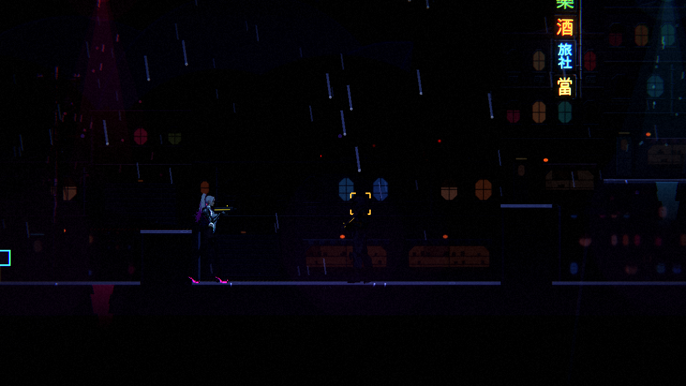
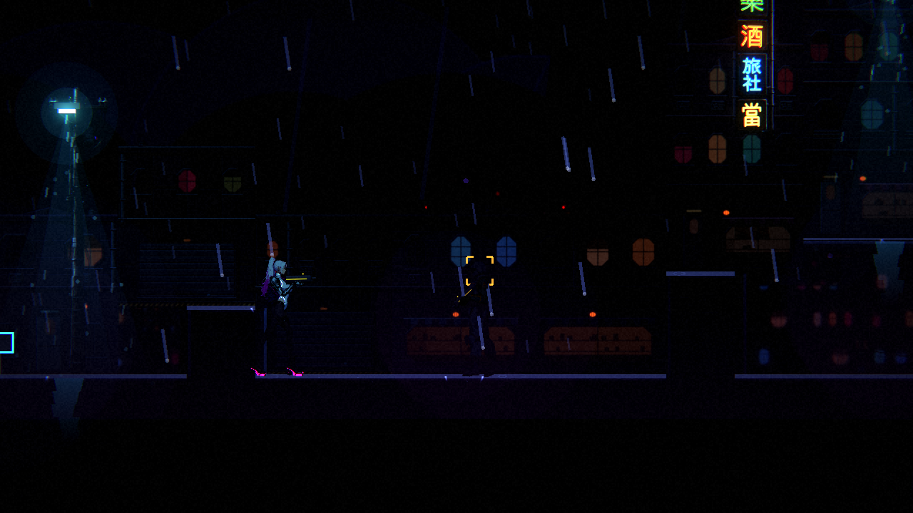

# 第一章環境與暗場驗證（ST-6）

2026-10-08，整合基準 `3dc68526`（保留 ST-15 與 BG-17）。沿用目前第一章，不重新建立地圖、場景素材或水坑。

## 目前正式範圍

章節名單取自 `data/combat/chapter_rosters.json`。ST-14 已將倉庫拆成前廳與深處；現在是九張 LevelData、八份獨立幾何，天亮當舖重用當舖地圖。復原室是死亡過場，不是額外一張地圖。

| 資料 | 格數 | 場景物件數 | 主材質／既有物件來源 |
|---|---:|---:|---|
| ch1_pawnshop | 112×24 | 19 | concrete；pawnshop_front、pawnshop_kitchen、basement_door、harbor_street |
| ch1_rooftop | 72×24 | 8 | rooftop；rooftop |
| ch1_street | 208×24 | 10 | asphalt；harbor_street |
| ch1_booth_alley | 56×24 | 9 | asphalt；anchor_phone_booth |
| ch1_warehouse | 166×24 | 8 | concrete、hangar_wall；dock_warehouse |
| ch1_vault | 124×24 | 1 | concrete、hangar_wall；dock_warehouse（另有實體道具、文件與補給） |
| ch1_lounge | 56×24 | 9 | facility_floor、facility_panel；revival_lounge |
| ch1_stall | 48×24 | 7 | asphalt、sky_dawn；dawn_noodle_stall |
| ch1_pawnshop_dawn | 112×24 | 19 | concrete、白天主題；重用當舖物件與幾何 |

物件數只計地圖 JSON 的 `props`；敵人、NPC、提示牌、出入口、機關及拾取物不在此數字內。既有 Chapter1MapSuite、EnvironmentSuite 檢查實體資源、材質、支撐面及區域連接。

## 產生器一致性

把 `tools/level/` 與 `data/` 複製到 Python TemporaryDirectory，在副本執行 `build_ch1.py`，逐檔比對重建前後的 data 位元組，新增／變更檔案為 0。整合 BG-17 後，原產生器重建會讓八張環境主題遺漏 `source_width`；已將既有背景的原始寬度補回產生器（天空 4096、遠／中景 2560、前景 1280），並逐張核對原始素材尺寸。修正後的隔離重建再次為 0 差異，正式環境主題輸出沒有改動；沒有重新設定匯入政策或音樂。

## 可重現的渲染檢查

```sh
godot --path . --rendering-method forward_plus res://tools/ch1_readability_check.tscn -- --quality=high --out=/absolute/output/path
```

`--level=ch1_street --spots=市集` 可縮小範圍。篩選沒有命中、取樣落在無地面的格子、探針偏離站立位置、圖片／報告寫入失敗均以非零代碼結束，避免空集合被視為通過。

沿用 ContrastProbe 的算法與門檻：玩家 0.60、地面邊緣 1.00、敵人 0.45；每點 16 次、間隔 0.2 秒。安全區不放入不存在的敵人；街道、倉庫、深處以現有清掃兵作代表，不能代替六種敵人的全部動作驗證。

量測使用真實 Level、地形、場景物件與區段光影；隱藏 HUD／文字提示並停用檢查場景的頭目與增援觸發，避免亮文字或受擊位移污染取樣。正式遊戲資料及遭遇行為保持原設定。每點還核對玩家／敵人腳底與預定地面，偏離超過 4 像素即判無效。開始前略過故事演出，固定向右的瞄準方向；這是靜態取樣，不是主線實玩。

本環境為獨立 Linux 雲端，Godot 4.7、Forward+、Vulkan llvmpipe 軟體渲染、邏輯畫面 640×360／PNG 1280×720、亮度 0.5、光影 high；沒有 GPU、實體手把或可試聽音訊。沒有操作 ComfyUI，也沒有使用同機 Windows GPU。不同 GPU 的量測需要用相同設定重新核對。

## 結果與交接

結果、14 張原始 PNG 與材質／物件配置記錄放在 `pm/ST/images/ST-6-readability/`。數值不能取代逐區實玩、物件比例與角色接觸驗證。Session 2 的 ST-15 全文與可讀性基線已合入並保留；ST-1／ST-4 待人審的設計不視為批准。角色部件、NE-222 開場姿勢及其產生器交接仍交 Session 1，不在此票修改。

市集原取樣點的玩家對比為 0.56，低於既有 0.60 門檻。將既有第 56 欄／第 8 列的燈具移到第 54 欄／第 12 列，貼近既有電線桿頂部；不增燈、不改光影設定、敵人或素材。相同條件重測市集為 0.72，碼頭入口也仍通過。修前／修後原始截圖：





| 區域／取樣點 | 玩家 ≥0.60 | 地面 ≥1.00 | 清掃兵 ≥0.45 | 站立有效／結果 |
|---|---:|---:|---:|---|
| ch1_pawnshop／後空地 | 0.73 | 9.98 | — | 有效／通過 |
| ch1_pawnshop／店面 | 0.82 | 3.04 | — | 有效／通過 |
| ch1_pawnshop／廚房 | 1.29 | 3.76 | — | 有效／通過 |
| ch1_rooftop／屋頂水塔 | 0.85 | 8.67 | — | 有效／通過 |
| ch1_street／市集 | 0.72 | 4.35 | 0.56 | 有效／通過 |
| ch1_street／碼頭入口 | 0.76 | 1.68 | 0.63 | 有效／通過 |
| ch1_booth_alley／電話亭 | 0.63 | 1.21 | — | 有效／通過 |
| ch1_warehouse／看門狗前廳 | 0.70 | 17.28 | 0.86 | 有效／通過 |
| ch1_warehouse／閘門廳 | 0.69 | 17.17 | 0.57 | 有效／通過 |
| ch1_vault／倉庫深處 | 0.65 | 17.04 | 0.77 | 有效／通過 |
| ch1_vault／上層走道 | 0.73 | 17.37 | 0.85 | 有效／通過 |
| ch1_lounge／復原館 | 0.86 | 12.38 | — | 有效／通過 |
| ch1_stall／宵夜麵攤 | 0.86 | 10.40 | — | 有效／通過 |
| ch1_pawnshop_dawn／天亮店面 | 0.79 | 2.49 | — | 有效／通過 |

九區先以整合基準拍攝並量測；燈具修正只影響街道，街道兩點另以完全相同設定重拍。合併報告保留此取樣時間說明；修前完整報告保存在 `pm/ST/attachments/ST-6-readability-before.json`，不把修前的失敗宣稱為一次全區通過。最後 14 點站立有效且符合原門檻。

舊關卡屋頂的玩家與敵人位置不一定同高；現在依各自所在欄的地面定位，避免敵人被放到屋頂下方後落到別層而誤報。舊第一章屋頂重測通過。完整回歸 78 組／50,397 項，0 失敗；整合 NE-95 後相關回歸 8 組／28,011 項，0 失敗。
