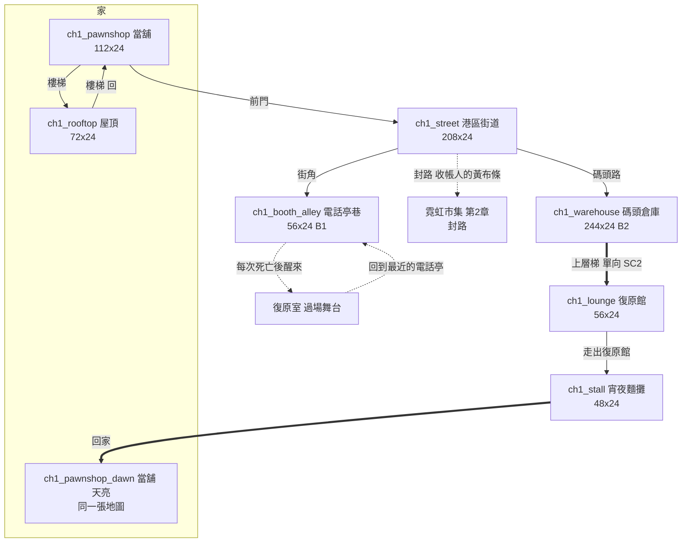

# 第一章「傘」地圖與關卡設計

> 來源：2026-10-05 使用者要求「先幫我把第一章的遊戲做出來，包含地圖的完整設計」；補充說明：場景立繪（BG-11 的場景背景與專屬物件）已經有了，**整個地圖的框架與大小要依故事框架與地圖設計重新設計**；敵人要合理分佈，不要第一章就把所有種類放出來，道具也只放該放的；道具圖示要重畫。
> 依據：[MAP.md](MAP.md)（《惡靈古堡》式交錯地圖）、[EVENTS.md](EVENTS.md)（1.01～1.13）、[SCRIPT_CH01.md](SCRIPT_CH01.md)（分鏡與台詞）、[SIDEQUESTS.md](SIDEQUESTS.md)、[UMBRELLA.md](UMBRELLA.md)、[BOSSES.md](BOSSES.md)（看門狗）、[PUZZLE.md](PUZZLE.md)（水位謎）。
> 票：ST-4（設計）、ST-5（區域與出入口）、ST-6（地圖資料）、ST-7（敵人與頭目）、ST-8（道具與圖示）、ST-9（劇情接上）。

## 0. 現況與取捨（這份設計為什麼長這樣）

| 項目 | 現況 | 這份設計的處理 |
|---|---|---|
| 關卡 | 一關＝**一條由左到右的長條地圖**（350×24 格），沒有門、沒有傳送、沒有分區 | 新增**區域系統**：每個區域是一張獨立的小地圖，用**門／出入口**相連（ST-5）。這正是 MAP.md 的「場景重複出現、交錯、傳送」的基礎 |
| 場景立繪 | 43 張 1536×864 的場景背景、430 個專屬物件。背景畫的是**劇情舞台**（人在畫面裡很小），**不是關卡的背景** | 場景背景用在**過場舞台**（ST-9）；關卡用**地形材質＋建築立面＋該場景的專屬物件**組出來，物件的尺寸本來就是依真實高度換算過的 |
| 敵人 | 15 種散在舊 Demo；第一、二章共用 8 種，違反 NE-97 | 第一章**只用 5 種**（§4），其餘留給後面的章 |
| 道具 | 沒有彈藥拾取；背包圖示是 32×32 像素圖，場景裡的拾取物只是 6～16 px 的程式繪製小方塊 | 道具只放必要的；圖示重畫（§5） |
| 保存 | 沒有存檔；死亡重生時敵人重生、世界狀態還原到檢查點 | 區域系統加上**本輪的世界狀態**：殺掉的敵人、開過的閘門、頭目血量**在死後保留**（呼應「世界不會因為你死而重置」） |
| 舊第一章 | `level_01`（雨夜 Demo）被多個測試寫死 | **不覆蓋**舊關卡；新增 `ch1_*` 區域組，新遊戲從它開始；舊關卡在 NE-178 處理完前保留 |

## 1. 設計原則

| # | 原則 | 說明 |
|---|---|---|
| 1 | **一個場景一張圖** | 每個故事場景（當舖、屋頂、街道…）是一個區域，玩家走到邊緣的門就進入下一個，**像《惡靈古堡》一樣認識每個房間** |
| 2 | **家是起點，也是終點** | 第一章從當舖開始、在當舖結束（凜走回家，水燒乾了） |
| 3 | **教學藏在地形裡** | 每個機制先在一個沒有敵人的地方單獨出現（見 §6 的教學順序） |
| 4 | **敵人少、種類少、一次一種新的** | 第一章只有 5 種敵人，每一區最多一種新敵人（§4） |
| 5 | **死亡很便宜，所以重來的路要短** | 第一次死亡在倉庫前廳；從電話亭走回去不超過約 30 秒（街道只有一條主路） |
| 6 | **世界記得你做過什麼** | 打倒的敵人不重生、開過的閘門保持開啟、頭目的傷保留（回復一部分） |
| 7 | **不放第一章不該有的東西** | 沒有新槍（只有手槍與一把匕首）、沒有衝鋒槍／步槍／霰彈槍、沒有機甲、沒有商店 |

## 2. 區域總覽

### 2.1 區域表

螢幕可視範圍是 **32×18 格**（鏡頭放大 1.25 倍）。「螢幕數」＝寬度 ÷ 32。

| 區域 id | 場景（BG-11） | 地圖代號 | 尺寸（格） | 螢幕數 | 類型 | 事件 |
|---|---|---|---|---|---|---|
| `ch1_pawnshop` | `pawnshop_front`、`pawnshop_kitchen`、`basement_door` | H1、H2 | 112×24 | 3.5 | 據點（含教學場） | 序幕、1.01、1.02、1.04 |
| `ch1_rooftop` | `rooftop` | H7 | 72×24 | 2.25 | 探索／演出 | 1.03 |
| `ch1_street` | `harbor_street` | H5 | 208×24 | 6.5 | 探索＋戰鬥教學 | 1.06 |
| `ch1_booth_alley` | `anchor_phone_booth` | H6 | 56×24 | 1.75 | 安全區（存檔點） | 1.05；每次死亡後重生處 |
| `ch1_warehouse` | `dock_warehouse` | H8 | 244×24 | 7.6 | 頭目＋水位謎 | 1.07、1.09、1.10 |
| `ch1_lounge` | `revival_lounge` | H10 | 56×24 | 1.75 | 演出（可走動） | 1.11 |
| `ch1_stall` | `dawn_noodle_stall` | H23 | 48×24 | 1.5 | 演出（可走動） | 1.12 |
| `ch1_pawnshop_dawn` | 同 `ch1_pawnshop`（天亮的版本，同一張地圖換光影） | H1、H2 | 112×24 | 3.5 | 結尾 | 1.13 |

**復原室**（H9）不是區域：它是每次死亡後播出的過場舞台（白房間）。

### 2.2 連接圖

實線＝一直通行的門；虛線＝有條件；粗箭頭＝單向；數字是第一次通過的順序。



### 2.3 玩家走的順序（主線）

| 順序 | 事件 | 區域 | 怎麼進來 |
|---|---|---|---|
| ① | 序幕、1.01 開場教學、1.02 晚飯 | `ch1_pawnshop` | 新遊戲 |
| ② | 1.03 屋頂：鷺 | `ch1_rooftop` | 店內樓梯 |
| ③ | 1.04 出門 | `ch1_pawnshop`→`ch1_street` | 前門 |
| ④ | 1.05 電話亭 | `ch1_booth_alley` | 街角 |
| ⑤ | 1.06 戰鬥教學 | `ch1_street` | 回到街道 |
| ⑥ | 1.07 看門狗、第一次死亡 | `ch1_warehouse` | 碼頭路 |
| ⑦ | 1.08 復原室 | 過場，醒在 `ch1_booth_alley` | 死亡 |
| ⑧ | 1.09 看門狗戰完、1.10 水位謎與資料盤 | `ch1_warehouse` | 走回去（街道→倉庫） |
| ⑨ | 1.11 復原夜 | `ch1_lounge` | 倉庫上層梯（單向） |
| ⑩ | 1.12 宵夜 | `ch1_stall` | 走出復原館 |
| ⑪ | 1.13 回家、章末 | `ch1_pawnshop_dawn` | 「回家」 |

> **劇情順序的修訂**：為了讓看門狗的血量保留、水位謎有「安全的地方」，倉庫的路線改成 **前廳（頭目）→ 頭目打倒後打開的隔牆 → 閘門廳（水位謎，B2）→ 保險箱 → 上層梯**。因此 SCRIPT_CH01 與 EVENTS 的 **1.09 與 1.10 對調**：1.09＝看門狗戰完（機械的嘆氣，燈：「只有一頭」），1.10＝水位謎與資料盤。對白不變，只是順序。（已同步修改。）

## 3. 逐區設計

地圖符號：`#` 地形、`=` 單向平台、`P` 玩家起點、`C` 電話亭、`D` 門、`g` 敵人（以資料決定種類）、`i` 醫療針、`c` 信用點、`B` 頭目區、`~` 水、`░` 道具擺設。每格 ASCII 代表 **4 格**（比例尺：1 字元＝4×4 格的區塊）。

### 3.1 `ch1_pawnshop` 當舖（112×24，據點＋教學場）

**由左到右：後空地（教學）→ 店面 → 廚房**，用門洞相連（不是三張圖：內部走動不需要載入）。這樣玩家的路線（開場在店面 → 往左教學 → 往右回店面 → 走進廚房吃晚飯 → 廚房右端的樓梯上屋頂）剛好由左往右，劇情觸發點 `&` 也依既有規則由左往右依序觸發。（實作時從「廚房在左」改成這個方向；原因是 `&` 只能由左往右消耗。）

```
x:  0        31          79                   111
    ┌後空地────┬─店面────────┬─廚房──────────────┐
    │ 木箱 木箱 │░貨架░櫃台    │░桌 爐 冰箱     S樓梯│
    │ ═平台 刀 │ P  K  工作檯 F│ &晚飯          │
    #######################################
     教學（露天）  H1 開場     H2 晚飯、樓梯
```

| 段 | 範圍（格） | 內容 |
|---|---|---|
| **後空地** | x1～30 | 露天（有雨）；**射擊教學**的木箱兩個、**單向平台**（x12～17）上放單分子匕首（選擇性）、三個提示牌（射擊與換彈、衝刺、單向平台與近戰） |
| **店面 H1** | x32～78 | 出生點 P（x=40，櫃台左邊）；貨架、櫃台、工作檯、漏水桶、傘桶；**地下室的門**（x=43，鎖著：「漏水，別開。」）；**前門 F**（x=74）通往街道，**聽完屋頂的差事之前是關的**（旗標 `ch1_heard_brief`，「先去屋頂：鷺在等你。」）；零錢兩堆、當票存根 |
| **廚房 H2** | x80～110 | 入口有 `&`：走進來觸發**晚飯**（C1-02）；**樓梯 S**（x=108）通往屋頂，**吃完晚飯之前是關的**（旗標 `ch1_dinner_done`，「先吃晚飯。老 K 在等。」） |

| 項目 | 內容 |
|---|---|
| 敵人 | **無** |
| 道具 | 單分子匕首（後空地平台，**選擇性**）、信用點 ×2、當票存根（文件）×1 |
| 提示牌 | 5 個：移動與跳躍、背包、射擊與換彈、衝刺、單向平台與近戰 |
| 燈光 | 店面與廚房 `pawnshop_warm`（暖黃）；後空地用較冷的 `rooftop` |
| 音樂 | `safe_pawnshop` |
| 劇情 | 序幕＋C1-01 是進場過場；晚飯 C1-02 是廚房入口的觸發點 |
| 天亮版 | `ch1_pawnshop_dawn` 同一張地圖，換 `mezzanine_gray` 光影；從麵攤「回家」走進前門 F，播出 C1-14 後結束本章 |

### 3.2 `ch1_rooftop` 屋頂（72×24，探索／演出）

```
x:  0          24             48          71
    D樓梯 ░晾衣繩    ░水塔鷺       ░天線
    ###   =====     ##########    ########
    ##########  ~~縫~~ ####################
          屋頂 A       屋頂 B（鷺在這）
```

| 項目 | 內容 |
|---|---|
| 結構 | 兩段屋頂，中間隔著一條 3 格寬的**縫**（要跳）；屋頂 B 有水塔、天線、晾衣繩 |
| 角色 | **鷺**（NPC，坐在水塔邊，x=44）：走近觸發 1.03（過場，含選項）；結束後她留在原地，之後可以再按互動聽一句短話 |
| 敵人 | **無** |
| 道具 | 信用點 ×2（x=20、62）；破傘的茶杯（擺設） |
| 燈光 | `rooftop`；遠處的塔與雨 |
| 音樂 | `calm_rooftop` |
| 門 | 左端樓梯 `D`→當舖（x=2） |
| 說明 | 這是整章唯一一個沒有任何威脅、也沒有教學的地方：**讓玩家看見塔與城市** |

### 3.3 `ch1_street` 港區街道（208×24，探索＋戰鬥教學）

整章**最長**的區域，也是**戰鬥教學**的主場。一條主路，兩側是店面與雨棚，用高低差製造掩護。

```
x:   0   30    52           110       150    180      207
     D當舖   D電話亭       雨棚         封路    D倉庫
     ┌──┐   ┌──┐       ═══   ═══      ┌黃布條┐   ┌─┐
 ####│##│###│##│########################│####│###│#│####
      安全區   教學①②③④           收帳人×2     (倉庫)
```

| 段 | 範圍（格） | 內容與教學 |
|---|---|---|
| **安全區** | x1～48 | 前門 `D`←→（x=6）；**電話亭巷 `D`**（x=34）；提示牌；**回音派傳單員**（NPC，x=22，環境敘事）；沒有敵人 |
| **教學①：射擊** | x49～80 | 一名清掃兵（x=66），單獨一個；地面平坦、有一個矮箱子可以掩護；教「射擊」「掩護」 |
| **教學②：衝刺與格擋** | x81～120 | 兩名清掃兵（x=96、108），中間有雨棚；醫療針（x=112，在第一場戰鬥之後）；護盾電池（x=116）；教「衝刺」「格擋」「完美格擋」 |
| **教學③：近戰** | x121～145 | 一名清掃兵在雨棚上（x=132，要用跳與近戰靠近）；教「近戰」 |
| **收帳人的路障** | x146～180 | **兩名收帳人槍手**（x=156、172，第一次看到新的敵人種類）；右側是**市集的封路**（黃布條，`D` 鎖著：「收帳人封路。」）；信用點、傳單 |
| **碼頭路** | x181～207 | 一台**無人機**（x=186，在高處盤旋，第一次遇到）；一個隱藏的小房間（x=184～190，裂縫牆，內有大額信用點）；倉庫的大門→倉庫（x=204） |

| 項目 | 內容 |
|---|---|
| 敵人 | 清掃兵 ×4、收帳人槍手 ×2、無人機 ×1（**共 7 名**） |
| 道具 | 信用點小堆 ×5、大堆 ×1（隱藏）、醫療針 ×1、護盾電池 ×1、文件 ×2（回音派傳單 x=22、收帳通知單 x=150） |
| 提示牌 | 衝刺、格擋、完美格擋、近戰（各一個，放在對應的教學段之前） |
| 燈光 | `market`（霓虹）；碼頭路漸變成 `freight` |
| 音樂 | 平靜 `calm_market`，戰鬥 `combat_alleys` |
| 門 | 當舖（x=6）、電話亭巷（x=34）、倉庫（x=204）、市集（鎖，第二章） |
| 說明 | 市集封路的「收帳人」就是第二章的敵人；這裡先讓玩家看見他們 |

### 3.4 `ch1_booth_alley` 電話亭巷（56×24，安全區）

```
x:  0         20     28        55
    D街道   ░電話亭   ░復原室門
    ###  ░垃圾袋  C   ▒鐵門
    ###########################
```

| 項目 | 內容 |
|---|---|
| 結構 | 一條小巷：左端回街道，中間**電話亭 B1**（`C`），右端一扇**復原室的小鐵門**（擺設，每次死亡後凜從這裡醒來） |
| 敵人 | **無**（安全區：死亡後重生不被圍攻） |
| 道具 | 信用點 ×2；新聞架（擺設，可讀報紙：「降雨量創新高」，T2） |
| 燈光 | `neutral`＋電話亭的青色光 |
| 音樂 | `safe_booth` |
| 劇情 | 1.05（第一次拿起話筒時的過場）；**之後每次死亡都從這裡重生**（B1），直到 B2 啟用 |

### 3.5 `ch1_warehouse` 碼頭倉庫（244×24，頭目＋水位謎）

整章**最大**的區域，也是**唯一一個有鎖的路線**：前廳（頭目）→ 隔牆 → 閘門廳（水位謎）→ 保險箱 → 上層梯。**實作的尺寸**：地面在第 17 列（水坑要挖 6 格深，比跳躍高度 5.5 格深，所以進了坑只剩踏板這條路），屋頂 4 列，室內淨高 13 格；水坑寬 11 格（x118～128），踏板在坑底正中，閘 C 在 x=133；上層走道在第 9 列，由三段階梯平台走上去。

```
x:   0     20            72  74            150  152         200  220 243
     D街道 ░貨櫃    ┌看門狗廳┐ 隔牆   ┌─────閘門廳────────┐  ┌保險箱┐ 梯
         ░B2外    ======平台====  ║     閘A  閘B  水坑 閘C  │  ┌─┐ D上
 ####################################║##############~~~~###############
        前廳（頭目）                隔牆       水位謎            保險箱
```

| 段 | 範圍（格） | 內容 |
|---|---|---|
| **前廳（看門狗廳）** | x1～72 | 貨櫃堆成平台（可掩護）、吊車、探照燈；**看門狗**（迷你頭目，x=50）在大廳裡巡邏，不鎖場（可以逃回街道）；醫療針（x=18）；信用點 ×3 |
| **隔牆** | x73 | 一道厚閘門（`watchdog_gate`）：**看門狗倒下才打開**（機械的嘆氣之後，閘門升起） |
| **閘門廳（水位謎）** | x74～150 | 見 §7。**B2 電話亭**在入口（x=76）；閘 A、閘 B、水坑、閘 C；文件「水閘維修日誌：堤」（x=100，隱藏在配電箱後）；無人機 ×2 在高處；收帳人打手 ×2 在水坑兩側 |
| **保險箱** | x151～200 | 水位謎解開後走進**已經漲滿的房間**：貨櫃浮到對岸；保險箱在對岸（取得**資料盤**，1.10） |
| **上層梯** | x201～243 | 沿吊車的上層走道往右（高處，x=205～235）；右端 `D`→復原館（**單向**：之後從復原館不能回來） |

| 項目 | 內容 |
|---|---|
| 敵人 | 前廳：看門狗（迷你頭目）＋清掃兵 ×2；閘門廳：收帳人打手 ×2、無人機 ×2（**共 6 名＋看門狗**） |
| 道具 | 醫療針 ×1（x=18，頭目之前）、信用點小堆 ×5、文件 ×1（堤的日誌）、資料盤（關鍵道具） |
| 提示牌 | 水位刻度（牆上的數字）、閘門提示「這扇門需要有人站在開關上」 |
| 燈光 | `freight`；水位謎的房間有水面反光；頭目戰用 `alarm` |
| 音樂 | 平靜 `calm_freight`，頭目 `boss_warden`（暫代） |
| 門 | 街道（x=2）；復原館（x=241，單向） |
| 保存 | **看門狗的血量保留**（死後回來它仍帶傷，每次死亡回復其已損血量的 30%）；殺掉的清掃兵／打手不重生；閘門開了就保持開啟 |

### 3.6 `ch1_lounge` 復原館（56×24，演出，可走動）

```
x:  0          16        28        44      55
    D後巷    ░沙發   ░吧台 阿梨    ░包廂簾   D街
    ###########################
```

| 項目 | 內容 |
|---|---|
| 結構 | 低燈的夜店：吧台（阿梨在後面擦杯子）、卡座、包廂簾子、牆上價目表；**油紙傘靠在牆角** |
| 角色 | **阿梨**（NPC，x=30）；兩三個背景客人（只有剪影，不能互動） |
| 事件 | 進入時自動播出 1.11（復原夜，含基底層／露骨層）；之後可以走動、和阿梨再說一句短話（「吃了沒？」） |
| 敵人／道具 | 無 |
| 燈光 | 低燈，紫粉與暖黃（新增 `lounge` 設定，沿用 `market` 的霓虹色調再壓暗） |
| 音樂 | `safe_clinic` 暫代（BGM-10：低音量港區爵士，之後新曲） |
| 門 | 右端 `D`→街（天亮）：走出去 → `ch1_stall` |

### 3.7 `ch1_stall` 宵夜麵攤（48×24，演出，可走動）

| 項目 | 內容 |
|---|---|
| 結構 | 復原館門口的小麵攤（頂棚下掛著一把油紙傘）、兩張桌子、一座電線桿 |
| 事件 | 進入時自動播出 1.12（選擇：付錢離開／留下吃宵夜） |
| 角色 | **阿梨**（端麵） |
| 門 | 右端 `D`「回家」→ `ch1_pawnshop_dawn` |
| 燈光 | 灰藍的清晨（沿用 `mezzanine_gray` 調暗一點） |
| 音樂 | BGM-11（獨奏鋼琴，新曲；暫無） |

### 3.8 `ch1_pawnshop_dawn` 當舖（天亮）

同一張地圖（`ch1_pawnshop`），換光影（清晨灰藍）與**進場過場 1.13**（水燒乾了、老 K 空眼神、地下室的光）；過場結束後播出章末卡，**本章結束**。

## 4. 敵人

### 4.1 第一章的名單（5 種）

第一章**只用這 5 種**，其餘留給後面的章（NE-97）。

| 敵人 | 資料 id | 類型 | 出現區域 | 教玩家 |
|---|---|---|---|---|
| **清掃兵** | `sweeper`（以現有「天穹保全」資料為底） | 遠程步兵 | 街道、倉庫前廳 | 射擊、掩護、衝刺、格擋 |
| **收帳人·槍手** | `collector_gunner`（新資料，手槍） | 遠程，射速較慢、血較厚 | 街道（路障）、倉庫 | 「新種類」：優先順序（打誰先） |
| **收帳人·打手** | `collector_brute`（新資料，近戰） | 近身衝擊，有前搖 | 倉庫閘門廳 | 近戰的對手、完美格擋的練習 |
| **無人機** | `drone`（現有） | 飛行俯衝 | 倉庫閘門廳（高處） | 往斜上方瞄準 |
| **看門狗** | `watchdog`（新資料，頭目） | 迷你頭目 | 倉庫前廳 | 見 [BOSSES.md](BOSSES.md) |

不放：衝鋒槍／步槍的敵人、機甲、自爆蟲、狙擊手、電擊犬、砲台、擲彈兵、偽裝箱、探照無人機（留給後面的章）。

### 4.2 難度曲線

| 順序 | 位置 | 敵人 | 數量 | 說明 |
|---|---|---|---|---|
| 1 | 街道教學① | 清掃兵 | 1 | 單獨，教射擊 |
| 2 | 街道教學② | 清掃兵 | 2 | 教衝刺與格擋 |
| 3 | 街道教學③ | 清掃兵（雨棚上） | 1 | 教近戰與高度 |
| 4 | 路障 | **收帳人槍手** | 2 | 第一個新種類 |
| 4b | 碼頭路 | **無人機** | 1 | 往斜上方瞄準；在倉庫之前先見過一次 |
| 5 | 倉庫前廳 | 清掃兵 ×2、**看門狗** | 2＋頭目 | 第一次死亡 |
| 6 | 閘門廳 | **收帳人打手**、無人機 | 2、2 | 最後的新種類（打手）；無人機已經見過 |
| 合計 | | | 13＋看門狗 | 街道 7、倉庫 6；每 100 格約 3.2 名（舊 Demo 為 8.6），符合第一章的平緩曲線 |

### 4.3 擺放規則

- 每一區的第一個敵人**離入口至少 18 格**，進場先有一段安全的路。
- 教學中的第一個新機制出現前，**前 9 格內沒有敵人**（沿用既有的「示範物件周圍無敵人」測試規則）。
- 同一畫面（32 格）最多 2 名遠程敵人同時攻擊。
- 醫療針放在**第一場戰鬥之後**，不放在戰鬥之前。

## 5. 道具與收集

### 5.1 清單

| 道具 | 數量 | 位置 | 說明 |
|---|---|---|---|
| 小槍（P-9 手槍） | 起始 | 出生就有 | 子彈用不完 |
| 單分子匕首 | 1 | 當舖後空地（選擇性） | 唯一的近戰武器，教「快速連擊」 |
| 醫療針 | 3 | 街道 1、倉庫前廳 1、閘門廳 1 | 在戰鬥之後或安全處 |
| 護盾電池 | 1 | 街道教學②（格擋教學處） | |
| 信用點小堆（10） | 約 16 | 各區零散 | 提供第一次改裝（工作檯）約需 100 |
| 信用點大堆（40） | 2 | 街道隱藏房、倉庫隱藏處 | |
| 文件／收集品 | 5 | 當舖（懷錶標籤等屬於互動，不算）、街道傳單、收帳通知單、堤的日誌、電話亭巷報紙 | 新故事的短文（≤ 220 字） |
| 資料盤 | 1（關鍵道具） | 倉庫保險箱 | 第二章用 |
| 灰布角 | 1（關鍵道具） | 復原室的茶杯（過場） | SQ6-F0 |
| 船錢罐（互動） | — | 當舖貨架 | 不是拾取 |

不放：任何新槍、彈藥、改裝券、機甲、能力解鎖。

### 5.2 道具圖示

現有的背包圖示是 32×32 像素圖（手寫程式繪製），場景裡的拾取物只是 6～16 px 的程式小方塊（醫療針是粉紅方塊、信用點是黃色菱形、文件都長一樣）。**第一章重畫：**

| 類 | 做法 |
|---|---|
| 背包圖示 | 重畫為 **64×64** 像素圖（原本 32×32 太小），逐項手繪細節；用專案調色盤；1 像素外框；高光與霓虹色點 |
| 場景拾取物 | 每種道具一張**場景小圖**（約 24×24，帶發光層與輕微漂浮），取代程式繪製的方塊 |
| 重畫的範圍 | 第一章用到的：信用點（小／大）、醫療針、護盾電池、醫療包、**文件（每種各自的圖）**、資料盤、灰布角、船錢硬幣、單分子匕首、手槍（背包圖示）、傘（第八章預備） |
| 工具 | 以 Python（Pillow）程式繪製後輸出 PNG（超採樣向量描繪再縮小並量化），腳本放進 `tools/`，可重複產生；之後可以被手繪或 AI 圖覆蓋同名檔案 |

詳見 ST-8。

## 6. 教學順序

| 順序 | 區域 | 教 | 怎麼教 |
|---|---|---|---|
| 1 | 當舖後空地 | 移動、跳躍、射擊、換彈、衝刺 | 提示牌＋靶（木箱）＋沒有敵人 |
| 2 | 當舖店面 | 工作檯（改裝）、互動 | 老 K 的旁白 |
| 3 | 電話亭巷 | 存檔（電話亭） | 一句話提示 |
| 4 | 街道教學①～③ | 射擊與掩護、衝刺、格擋與完美格擋、近戰 | 燈的通訊＋提示牌；一次一種新的 |
| 5 | 倉庫前廳 | 頭目戰的讀招（跳壓、橙色部位） | 第一次必死，死亡畫面說明機制 |
| 6 | 閘門廳 | 開關與閘門、水位、**以死解謎** | 起承轉合（§7） |

## 7. 水位謎（閘門廳）

PUZZLE.md 的「起承轉合」落在這個房間：

```
x:  74   80   88      100    108       120     128   140 150
    B2  開關A 閘A     ░日誌   開關B     閘B   ▒水坑▒ 閘C  ▒保險箱
 ##########################################~~~~~~#####
                                      ┌─坑底：踏板─┐
```

| 階段 | 內容 | 機制 | 教 |
|---|---|---|---|
| **起** | 閘 A 擋路；開關 A 在旁邊的小凹槽，**踩上去閘 A 就打開** | 現有的開關與閘門（頻道 `a`） | 開關與閘門 |
| **承** | 閘 B 擋路；開關 B 在高處的平台，要先從貨櫃跳上去（要避開頭頂的無人機）。打開閘 B 後水位**上升一格**，漂浮的貨櫃變成踏腳石 | 開關＋水位（新：**水坑**，水位依頻道變化） | 順序與水位：先開哪個，水往哪邊流 |
| **轉** | 閘 C 在水坑的另一邊，關著；開關 C 的**踏板在坑底**，踩著它閘 C 才開，**但踩下去水坑會漲滿**：你會淹死 | 新：**踏板＋漲水**（踩下後 2 秒內漲到頂，玩家溺斃）；閘 C 的狀態**死後保留** | **以死解謎**：「站上去，你會死。閘門會一直開著。」 |
| **合** | 你死了；從 **B2** 復原；走回水坑：水已經漲滿，閘 C 開著；漂浮的貨櫃浮到對岸；打開保險箱 | 世界狀態保留（水位、閘門） | 世界不會因為你死而重置 |

**不死的解法（第四章之後才需要）**：第一章只有一個解法（死一次）。第四章起的以死解謎都會附另一種解法，見 PUZZLE.md。

## 8. 世界規則（本章的存檔語意）

| 規則 | 內容 |
|---|---|
| **存檔點** | 電話亭 B1（電話亭巷）、B2（倉庫閘門廳入口，1.10 啟用） |
| **死亡** | 回到最近的**已啟用**的電話亭；播出死亡畫面序列與復原室過場；信用點扣 5%（不是回溯到存檔當下的數字） |
| **世界保留** | 殺掉的敵人不重生；開過的閘門、水位保持；頭目的傷保留，但每次死亡回復其已損血量的 30%；撿過的信用點與道具不重生 |
| **離開再回來** | 區域離開時存下狀態，回來時還原；跨區域的世界狀態在本輪保存，開始新遊戲才歸零 |
| **與舊關卡的差別** | 舊關卡死後敵人重生、世界還原到存檔；新區域組以資料欄位選擇用哪一種（舊關卡不受影響） |

## 9. 需要的引擎功能（開票）

| 票 | 功能 | 說明 |
|---|---|---|
| **ST-5** | 區域與出入口 | 門（互動或走進）、區域切換（轉場）、依出入口放置玩家、**本輪世界狀態**（敵人、拾取、機關、頭目血量）、電話亭記錄所在區域、死亡回到該區域、進場過場後自動出門、區域結束就通關；多目錄道具庫；旗標儲存 |
| **ST-6** | 第一章地圖資料 | 8 個區域的地圖與關卡資料、環境主題、光影、音樂與環境音對應、提示牌、`FIRST_LEVEL` 改為新遊戲入口 |
| **ST-7** | 敵人與頭目 | 清掃兵、收帳人（槍手、打手）、看門狗（迷你頭目：血量保留、打倒後開啟隔牆）；音效登記 |
| **ST-8** | 道具與圖示 | 新故事的道具資料；水坑與踏板（以死解謎）；重畫的圖示 |
| **ST-9** | 劇情接上 | 新的第一章腳本資料（含舞台）、互動物件短台詞、選項與旗標、死亡畫面序列 |

## 10. 測試

| 項目 | 內容 |
|---|---|
| 地圖 | 每個區域可解析、無警告；起點、出入口、電話亭、門的目標都存在且互相對得上；每個出入口站得穩；主路徑可通行（跳躍高度與坑寬在能力內） |
| 流程 | 從新遊戲開始，依序走完 ①～⑪ 的路線（機器人式走查）；死亡後從正確的電話亭醒來；世界狀態保留 |
| 敵人 | 第一章名單恰為 5 種；與其他章名單不重複；每區最多 1 種新敵人；教學段前 9 格無敵人 |
| 道具 | 只有清單上的道具；沒有新槍與彈藥 |
| 數量 | 敵人總數與密度符合 §4.2（街道 7、倉庫 6＋看門狗）；每個入口與電話亭周圍 18 格內沒有敵人；新種類第一次出現相隔至少 20 格 |
| 難度 | 輔助、標準、硬核三種難度都能通關 |

## 11. 待你決定

| # | 問題 | 我的建議 |
|---|---|---|
| 1 | 場景立繪用在**過場舞台**、關卡用地形＋專屬物件組，這個做法是否同意？（立繪的比例是劇情舞台，直接當關卡背景人物會變得太小） | 同意 |
| 2 | 看門狗改成**不鎖場的迷你頭目**（打倒後打開隔牆），倉庫路線改為前廳→閘門廳，1.09 與 1.10 對調，是否同意？ | 同意 |
| 3 | 第一章 13 名敵人（街道 7、倉庫 6）加迷你頭目，平緩的曲線是否合適？ | 合適；試玩後再調 |
| 4 | 死亡信用點扣 5%、殺掉的敵人不重生（區域組專用），是否同意？ | 同意 |
| 5 | 看門狗目前沒有「兩腿一尾」的立繪，先用現有的重型機甲（監管者）外觀暫代，是否同意？ | 同意；之後換新立繪 |

## 12. 實作狀態（2026-10-05）

| 項目 | 狀態 |
|---|---|
| 區域與出入口、持久世界（ST-5） | 完成 |
| 八個區域的地圖、環境主題、光影、音樂（ST-6） | 完成；產生器 `tools/level/build_ch1.py`；沒有 GPU 無法截圖，畫面請在有顯示的環境確認 |
| 敵人（ST-7） | 資料、行為、音效、特效、圖鑑完成；看門狗暫用看守長的招式與監管者骨架，**兩個部位與橙色發光機制**待頭目共用元件（BOSSES.md） |
| 道具與水坑（ST-8） | 水坑（踏板、漲水、溺斃、貨櫃浮橋、持久）與重畫的圖示完成；產生器 `tools/art/build_item_icons.py` |
| 劇本資料（ST-2、ST-9） | 21 個場景以資料播出；`tools/story/build_ch1_story.py`；**選項與旗標分支、可互動物件的短台詞、死亡畫面序列（ST-3）尚未做**，先用預設的那條路線寫成線性場景 |
| 待確認 | §11 的五題（先照建議實作，要改請告訴我） |
