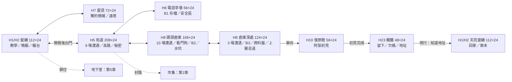

# 第一章地圖審查稿（2026-10-08，ST-4）

以 ST-11／ST-14 已合入的區域與 `data/levels/ch1_*` 核對；沿用 [CH01_LEVEL.md](CH01_LEVEL.md) 原版面與設計理由，以下最新尺寸、當地座標、連接與配置取代舊稿的八區、13 名敵人與單張倉庫資料。本文為審查稿，使用者确认仍保留。事件完整對照見 [CH01_SCRIPT_REVIEW.md](CH01_SCRIPT_REVIEW.md)。

## 一頁動線

九份關卡資料，八種版面（天亮當舖沿用夜間地圖）；H9 診間是首次死亡舞台，沒有獨立可走動關卡。新遊戲仍從當舖開始；ST-16 序章尚未交付，不算已串接。

## 設計條件與節奏

- 每格 16 px，全圖高 24 格。碼頭倉庫實際 **166×24**，深處 **124×24**；水坑／踏板／閘門 C 同圖，跨圖後只接保險箱與走道。
- 街道 9、倉庫 10、深處 3，共 **22 場**；鎖場 4 場（街心、路障、保險箱、走道）。六種敵人資料：清掃兵、收帳人槍手、打手、無人機、看門狗、督察。督察在街道與深處重用，不算兩種新敵人。
- 教學曲線四技巧：掩護、格擋／衝刺、近戰、空中；引入→練習→組合→考驗沿用 `ch1_design.json`。地圖各場成員／增援 ≤6，近戰及遠程攻擊令牌各 ≤2；實際難度仍須遊測。
- 街道迴圈：階梯→屋頂帶→街道；裂縫牆秘密；高處信用點是看得見、需绕行的獎勵。倉庫吊車為地標，貨櫃頂、暗室、水坑浮橋形成垂直探索；拆分後不聲稱深處走道直接落回前廳。
- 休息區有地標與小獎勵，沒有強加秘密或鎖場；環境與音樂表沿用原稿，倉庫深處使用倉庫環境主題／音樂。
- Godot 4.7 `pacing_report` 實際讀資料估計：首次 **30.3 分鐘**、熟練 **19.4 分鐘**、22 場／每分鐘 **0.73**、過場預算佔 **6.9%**。街道最長無遭遇 9 秒、倉庫 5 秒、深處 3 秒。過場 ≤5% 的建議目標未達，不冒稱已達標；三場實際文本估時交 ST-15，真人通關時間未測。

## 水位謎與持久世界

| 拍點 | 玩家理解與當地機關 | 驗收／交接界線 |
|---|---|---|
| 起 | 開關 A 讓閘 A 開啟，先認識同頻道機關 | 提示要說「操作開關會開門」，不只寫「開關，門」 |
| 承 | 高處開關 B；貨櫃與無人機讓玩家組合跳躍、觀察與戰鬥 | 舊稿的每一閘獨立漲水屬構想；實際漲水以踏板水坑資料為準 |
| 轉 | 水坑底踏板觸發漲水並開閘 C，凜溺斃 | 在到達前說清必須踩板、會死一次、開門狀態會保留 |
| 合 | 電話亭復原後水位／門保留，貨櫃浮橋可通行，再走深處取資料盤 | 先在 B2 備份；第一次死亡先經初次建檔，後續不重播診間 |

初次死亡免收費；之後持久世界區域扣信用點 5%，上限 250、不負債。頭目保留傷勢但回復已損血量的 30%；已死普通敵人／拾取物／機關狀態保留，新遊戲才清除。電話亭是存檔与復原點，第一章沒有快速傳送。資料與程式已存在，ST-4 只核對設計，不重做保存或機關。

## 五個原未決議題，改為具體選項

| 原問題 | 現況／建議審查選項 | 替代選項與影響 |
|---|---|---|
| 場景立繪與關卡 | 保留：立繪做過場舞台，關卡由地形、建築與專屬物件組成 | 直接用立繪鋪關卡會改角色比例與可走空間，需另做美術／關卡驗證 |
| 看門狗與順序 | 保留：不鎖場的迷你頭目，倒下升隔牆，1.09 在 1.10 之前 | 改為鎖場增加死亡壓力，交戰鬥組；不默認強制必死 |
| 密度與時間 | 審查最新 22 場／六類敵人／三張戰鬥圖，30.3 分鐘估計；舊 13 名敵人方案已被使用者增加戰鬥要求取代 | 若體感太密，減街道末段或深處增援；若太空，再加探索內容；需同條件遊測，不以估計冒稱體感 |
| 死亡與存檔 | 保留首次免費、之後 5%／上限250、敵人不重生、頭目回傷30% | 提高費用會壓低新手改裝；降低費用會減少失敗代價，須經濟對帳 |
| 看門狗外觀 | 保留現有監管者骨架／看守長招式暫代；兩腿一尾、兩部位橙色弱點是新美術／共用頭目需求 | 專屬外觀與弱點需對應組接手，不將暫代冒稱完整頭目設計 |

另兩項需一起審查：三段過場預算佔比 6.9% 超過建議 5%；付錢離開支線尚未接入正式章節資料，未來回家門應讀「宵夜完成」，不能只讀地址。ST-5～9 與 ST-11～14 的已完成成果保持；後續只接未完成界線，沒有重开新票或改其他 Session 核心檔案。

## 最新資料配置清單（格座標 x/y，從 0 起）

下表由此次實際關卡、地圖 legend、音樂映射讀取；用於比對原稿版面，不是新增實作。
### pawnshop：112×24

| 內容／資料 | 格座標 |
|---|---|
| pawn_front / res://data/levels/ch1_street.tres / ch1_heard_brief / 先去屋頂：鷺在等你。 | 74/19 |
| pawn_basement / 地下室正在漏水，請別開門。 | 43/19 |
| pawn_stairs / res://data/levels/ch1_rooftop.tres / ch1_dinner_done / 先吃晚飯。老 K 在等。 | 108/19 |
| shops/ch1_pawn | 56/19 |
| props/credits_small | 24/19, 67/19 |
| npcs/ch1_old_k | 86/19 |
| story_items/doc_pawn_stub | 71/19 |
| weapons/melee/melee_dagger | 14/15 |
| props/ch1_crate | 5/19, 9/19 |
| 電話亭 | 無 |

### rooftop：72×24

| 內容／資料 | 格座標 |
|---|---|
| npcs/ch1_egret | 54/17 |
| roof_stairs / res://data/levels/ch1_pawnshop.tres | 3/17 |
| props/credits_small | 20/17, 62/17 |
| 電話亭 | 無 |

### street：208×24

| 內容／資料 | 格座標 |
|---|---|
| street_warehouse / res://data/levels/ch1_warehouse.tres | 204/19 |
| props/ch1_secret_wall | 187/19 |
| enemies/collector_brute | 133/19 |
| props/credits_small | 184/19, 203/19 |
| enemies/drone | 104/9, 186/11, 148/13, 184/14 |
| consumables/shield_cell | 188/19 |
| story_items/doc_echo_flyer | 22/19 |
| enemies/sweeper | 143/9, 78/15, 66/19, 84/19, 98/19, 111/19, 138/19 |
| street_home / res://data/levels/ch1_pawnshop.tres | 6/19 |
| consumables/med_injector | 121/19 |
| street_booth / res://data/levels/ch1_booth_alley.tres | 34/19 |
| enemies/collector_gunner | 166/14, 177/14, 90/19 |
| street_market / 收帳人封路。 | 186/19 |
| story_items/doc_collection_notice | 185/19 |
| props/credits_large | 139/9, 191/19 |
| enemies/ch1_inspector | 168/19 |
| props/ch1_enc_street_plaza | 105/19 |
| props/ch1_arena_street_plaza | 92/19, 118/19 |
| props/ch1_enc_street_blockade | 167/19 |
| props/ch1_arena_street_blockade | 152/19, 182/19 |
| 電話亭 | 無 |

### booth_alley：56×24

| 內容／資料 | 格座標 |
|---|---|
| booth_street / res://data/levels/ch1_street.tres | 4/19 |
| props/credits_small | 18/19, 44/19 |
| story_items/doc_rain_news | 36/19 |
| 電話亭 | 26/19 |

### warehouse：166×24

| 內容／資料 | 格座標 |
|---|---|
| props/ch1_switch_a | 83/16 |
| wh_street / res://data/levels/ch1_street.tres | 3/16 |
| props/ch1_switch_b | 107/10 |
| wh_vault / res://data/levels/ch1_vault.tres | 162/16 |
| props/ch1_flood_pit | 123/22 |
| props/ch1_gate_a | 90/16 |
| enemies/collector_brute | 95/16, 114/16 |
| props/credits_small | 28/16, 66/16, 68/16, 113/16 |
| enemies/drone | 108/6, 100/7, 123/7 |
| enemies/sweeper | 30/16, 38/16, 137/16, 140/16 |
| consumables/med_injector | 24/11, 9/16 |
| enemies/collector_gunner | 23/11, 47/13, 116/16 |
| story_items/doc_dike_log | 84/16 |
| props/ch1_gate_b | 112/16 |
| props/ch1_gate_c | 133/16 |
| props/ch1_gate_watchdog | 73/16 |
| enemies/watchdog | 56/16 |
| 電話亭 | 77/16 |

### vault：124×24

| 內容／資料 | 格座標 |
|---|---|
| wh_upper / res://data/levels/ch1_lounge.tres | 120/8 |
| vault_prev / res://data/levels/ch1_warehouse.tres | 3/16 |
| props/ch1_secret_wall | 114/16 |
| props/credits_small | 70/8, 26/16, 90/16 |
| enemies/drone | 90/6, 52/9 |
| enemies/sweeper | 72/8, 84/8 |
| consumables/med_injector | 47/16, 80/16 |
| enemies/collector_gunner | 96/8, 28/16 |
| props/credits_large | 118/16 |
| story_items/ch1_data_disk | 40/16 |
| enemies/ch1_inspector | 37/16 |
| props/ch1_enc_warehouse_vault | 34/16 |
| props/ch1_arena_warehouse_vault | 22/16, 46/16 |
| props/ch1_enc_warehouse_walkway | 90/8 |
| props/ch1_arena_warehouse_walkway | 65/8, 115/8 |
| 電話亭 | 7/16 |

### lounge：56×24

| 內容／資料 | 格座標 |
|---|---|
| lounge_exit / res://data/levels/ch1_stall.tres / ch1_met_ali / 先和阿梨說話。 | 52/19 |
| npcs/ch1_ali_lounge | 30/19 |
| 電話亭 | 無 |

### stall：48×24

| 內容／資料 | 格座標 |
|---|---|
| npcs/ch1_ali_stall | 21/19 |
| stall_home / res://data/levels/ch1_pawnshop_dawn.tres / knows_ali_address / 先吃點東西，和阿梨說話。 | 44/19 |
| 電話亭 | 無 |

### pawnshop_dawn：112×24

| 內容／資料 | 格座標 |
|---|---|
| pawn_front / res://data/levels/ch1_street.tres / ch1_heard_brief / 先去屋頂：鷺在等你。 | 74/19 |
| pawn_basement / 地下室正在漏水，請別開門。 | 43/19 |
| pawn_stairs / res://data/levels/ch1_rooftop.tres / ch1_dinner_done / 先吃晚飯。老 K 在等。 | 108/19 |
| shops/ch1_pawn | 56/19 |
| props/credits_small | 24/19, 67/19 |
| npcs/ch1_old_k | 86/19 |
| story_items/doc_pawn_stub | 71/19 |
| weapons/melee/melee_dagger | 14/15 |
| props/ch1_crate | 5/19, 9/19 |
| 電話亭 | 無 |

ST-15 文字同步：配置表中的鎖門說明已跟生成器更新為完整句子。ST-3 引擎已合入，但上述離開分支尚未接入章節來源；不能把引擎測試樣本當正式故事分支。地圖、配置與未決選項不變。
