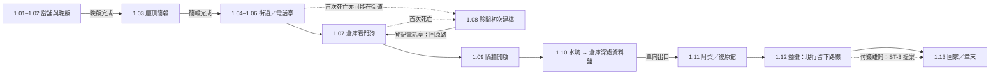

# 第一章「傘」劇本審查稿（2026-10-08，ST-1）

本稿沿用 [SCRIPT_CH01.md](SCRIPT_CH01.md) 的事件、角色、分鏡、五個支線種子與音訊 cue，核對至 `6f4805be`。它補正舊稿與已合入 ST-12／ST-13／ST-14 的差異，供使用者審查，尚非使用者定稿。

採用順序：完整句子規則 [DIALOGUE_READABILITY.md](DIALOGUE_READABILITY.md) → 本稿的事件與分支界線 → [CH01_NARRATIVE_V2.md](CH01_NARRATIVE_V2.md) 的敘事手法 → [CH01_PACING_V2.md](CH01_PACING_V2.md) 的玩法 → 舊稿的情感、構圖與聲音細節。舊稿中的「每場都做過場」「凜短到一個詞」、舊死亡序列與旧時長不能再作製作規格。

## 事件、地圖與通行條件

| 事件 | 最新地圖／場景 | 玩家做什麼與前因 | 通行／分支界線 |
|---|---|---|---|
| 序幕 | `ch1_c01_open` 雨港鏡頭 | 雨、水位三點二與章名引入港區 | 已合併進 ≤20 秒開場；另行完整序章由 ST-16 交付 |
| 1.01 | H1 `ch1_pawnshop`；`ch1_c01_open` | 老 K 是養大凜的當舖老闆；鷺帶來工作；凜到後空地試槍 | 教學、櫃台已存在；貨架互動支線仍為提案 |
| 1.02 | H2 同一地圖廚房；`ch1_b_dinner`、`ch1_t_oldk_*` | 晚飯四十信用點、紅蘿蔔與老 K 的惦記 | 晚飯播完寫 `ch1_dinner_done`，樓梯才開 |
| 1.03 | H7 `ch1_rooftop`；`ch1_b_roof`、`ch1_t_egret_*` | 鷺交代碼頭倉庫的資料盤；晴岸是凜想替老 K 買房的日照區住宅 | 簡報寫 `ch1_heard_brief`，前門才開；週日追問分支未實作 |
| 1.04 | H1→H5 `ch1_street`；`ch1_b_street_in` | 凜回想老 K 的問傘，出門去碼頭 | 保留「凜不拿傘」；不是拿老 K 的傘出門 |
| 1.05 | H6 `ch1_booth_alley`；電話亭 | 撥號備份；B1 是街角存檔點 | 初次建檔仍必須經診間；不是第一次死就從電話亭醒來；沒有快速傳送 |
| 1.06 | H5 街道；`ch1_g06_*`、`ch1_k_plaza`、`ch1_k_blockade` | 通訊員燈帶路；市集封路，向碼頭前進並練習掩護、格擋、近戰 | 九場遭遇；路障解開後往倉庫 |
| 1.07 | H8 `ch1_warehouse`；`ch1_g07_dog` | 看門狗是倉庫保全機甲；不鎖場，保留傷勢 | 「幾乎必死」是待審設計，程式沒有強制死亡；第一死可能早於看門狗 |
| 1.08 | H9 診間舞台；`ch1_c09_wake` | 灰衣人用貨車送凜來初次建檔；天穹技術復原，之後電話亭復原 | 任何首次死亡都觸發；播完才寫 `ch1_first_death_done`、登記復原點；第一次免收費 |
| 1.09 | H8 倉庫；`ch1_c11_watchdog` | 擊倒看門狗後隔牆升起，燈提到三頭紀錄 | 機關世界狀態持久；不是舊稿假定的必須第二戰 |
| 1.10 | H8 倉庫→倉庫深處 `ch1_vault`；`ch1_g10_*`、`ch1_k_vault`、`ch1_k_walkway` | 先解水坑：踏板漲水、死後閘門與水位保留；再取保險箱資料盤 | 水坑及閘門同圖；深處有新電話亭；資料盤在深處；上層出口單向到復原館 |
| 1.11 | H10 `ch1_lounge`；`ch1_b_lounge`、`ch1_t_ali_1/2` | 阿梨招待復原後的客人；名字、梨子湯与收錢的習慣 | 人物主動對話寫 `ch1_met_ali` 才開出口；成人分層只沿用情感提案，未生成的內容不算交付 |
| 1.12 | H23 `ch1_stall`；`ch1_b_stall`、`ch1_t_ali_3/4` | 阿梨請凜吃麵，凜把人情記作欠帳；得知地址與敲門暗號 | 目前是線性留下路線，`knows_ali_address` 才開回家；付錢離開分支未實作 |
| 1.13／章末 | H2 `ch1_pawnshop_dawn`；`ch1_c14_home` | 水燒乾，老 K 裝水回來忘了凜已回家；凜沒有追問 | ≤60 秒過場，章末卡「第一章 傘 完／下一章 鷺」；地下室仍鎖住 |

## 支線種子與傘：保留草稿，明確交接

| 節點 | 地點與觸發提案 | 前置與寫入提案 | 獎勵／現況 |
|---|---|---|---|
| SQ8-L0 標籤 | H1 貨架；主動讀懷錶、吉他、雨衣、船錢罐各一則 | 每張只計一次，`labels_heard` 0→4；第四張完成 | 小；經驗值須成長系統。現況只有文件／道具敘事，不宣稱四件互動完成 |
| SQ2-B0 週日 | H7 簡報後主動問鷺「今晚要去看誰？」 | `asked_egret_sunday` 在對話結束寫入；錯過不卡主線 | 小；現有鷺對話有「看一個人」，尚無選項或專用旗標 |
| SQ5-E1 病床 | H9 初次復原；主動追問燈的聲音兩次 | `noticed_lamp_voice` 0→1→2；第二次結束給一次 | 小；現行只有聲音相似一句，追問仍由 ST-3 接手 |
| SQ6-F0 灰無常的工錢 | H9 台邊熱茶；主動查看杯底灰布角 | `has_grey_cloth` 與道具取得同時保存 | 小；灰布角已有道具資料，無拾取互動不得算取得 |
| SQ1-A1 麵攤 | H10 初見→H23 留下吃麵，得知地址與暗號 | `ch1_met_ali`、`knows_ali_address` 已由對話寫入 | 中；目前線性留下，付錢離開的第二章補救是設計草稿 |
| T10 傘 | H1 傘桶／出門／回家；阿梨兩處油紙傘為同一把 | 經過次數提案 `passed_umbrella_count` 初始 0 | 無獎勵；不把計數或新傘能力算成已實作 |

支線可以錯過、不得鎖死主線。未來 ST-3 實作付錢離開時，回家門的條件應改為「宵夜事件完成」而非「知道地址」，兩條路都要開門。缺檔的地址預設真屬舊故事保守提案；現行旗標缺值為假，不能把未聽過地址寫成知道。此介面交由實作 Session 決定遷移規則。

## 分鏡與聲音的製作界線

| 段落 | 鏡頭／動作基線 | 台詞與表演基線 | 光影、BGM／環境音 |
|---|---|---|---|
| 開場 | 雨港→水位→章名→當舖；演員姿勢与接觸線沿用 NE-222 成果，交 Session 1 | 老 K 說差事與一成抽成；凜問委託；完整句子，不能用名詞簡報 | 冷雨轉暖黃；`safe_pawnshop`；雨與水滴；20 秒預算 |
| 晚飯／屋頂／出門 | 地圖上演，不新增鏡頭鎖定；飯桌、遠塔、傘桶做環境線索 | 凜直說錢；老 K 碎念；鷺笑著避開自己今晚的事 | 當舖暖黃／屋頂冷藍；`calm_rooftop`；雨風；舊分鏡動作改為 NPC 演出需求 |
| 街道／看門狗／水坑 | 玩家保持操作；重要提示同步路牌；戰鬥只說完整短句 | 燈說明開關與死後世界保留；不要含糊稱「牠」而未先說看門狗 | `calm_market`／`combat_alleys`／`calm_freight`／`boss_warden`；水、金屬、發電機 |
| 初次復原 | 診間台邊醒來→聽到送來經過→起身；不改共用骨架與舞台 | 說清初次建檔、電話亭、後續扣款與磨損；不宣稱過場已展示未實作的茶杯拾取 | 冷白；`safe_clinic` 可暫代；機械通風；45 秒預算 |
| 復原館／麵攤 | 玩家主動對話；杯、湯、油紙傘、退回錢以舊分鏡供演出組參考 | 阿梨輕穩、留決定權；凜「那我欠你」；地址完整說「市集後方三樓」 | 紫粉暖黃→清晨灰藍；`safe_clinic` 暫代；杯碗、蒸氣、雨 |
| 回家／章末 | 凜入場→老 K 裝水→空眼神停三秒→章末卡；地下室光屬細節需求 | 凜指水燒乾；老 K 問何時回來，記憶斷裂靠內容與停頓 | 清晨冷光；純雨滴與走音哼唱為建議；60 秒預算 |

既有詳細分鏡見舊稿 §6–20；地圖對話不以虛構鏡頭或等待湊成過場。音訊 cue 以舊稿 §5 完整總表為底稿；現有 id 已核對 `data/audio/music.json`。新曲只交需求，沒有試聽、沒有換素材：

- 復原室：冷金屬嗡鳴、低音量，不掩蓋台詞。
- 復原館：70 BPM 左右，電鋼琴、刷鼓、低音提琴。
- 宵夜：低八度獨奏鋼琴，蒸氣與雨留空間。
- 水坑解開／章末：《借傘謠》Do–Re–Mi–Sol–Mi 的四秒 cue；章末最後一音不收完。
- 老 K 晚飯、出門、回家哼同一旋律，逐次失準。這是人物哼唱；第一個配樂版本建議在初次復原結尾，水坑完成再完整五音。舊稿「第一段在 1.09」與 §5.3 互相衝突，以此順序作待審方案。

## 關鍵句三語草稿

保留各語言創譯、補完整句子；日文與英文仍須母語者審查，未宣稱語言切換已支援所有場景。

| 用途 | 中文 | 日文 | 英文 |
|---|---|---|---|
| 傘／禾 | 禾是以前住在這裡的人，她把傘叫作 kasa，那是老港話啦。 | 昔ここに住んでいた禾は、傘を「かさ」と呼んでたんだ。港の古い言葉だよ。 | Rye used to live here. She called an umbrella a kasa in the old harbor tongue. |
| 出門 | 帶傘了嗎？／下面本來就是水。 | 傘は持った？／下はもともと水だよ。 | Did you bring your kasa? / It's water down there anyway. |
| 港區道別 | 我下次再來。 | また来るよ。 | I'll come by again. |
| 阿梨名字 | 我叫阿梨，是梨子的梨。別分梨吃，會分開。 | 梨って書いて、なしっていうの。「無し」に聞こえるけど、ここにはちゃんといるよ。 | I'm Pear, like the fruit. Think of a pair: somebody's other half for the night. |
| 欠著 | 那我欠你。／那就欠著。 | じゃあ、借りができたね。／ツケにしておくよ。 | Then I owe you. / Put it on the tab. |
| 標語 | 再來一次，沒關係。 | もう一度やっても大丈夫。 | You can try once more. It's all right. |
| 鷺玩笑 | 你可別一個人死，連陪你喝酒的人都沒有。 | 一人で死ぬなよ。酒の相手までいなくなるだろ。 | Don't die alone. Who would you drink with afterward? |
| 歡迎回來 | 歡迎回來。 | おかえりなさい。 | Welcome back. |
| 船錢罐 | 船錢是留給回不來的人渡河用的。 | この渡し賃は、戻れない人が川を渡るために取ってある。 | I keep this fare for the ones who cross the river and don't come back. |
| 漏水桶 | 別修那個桶，水滴聲是我的鬧鐘。 | その桶は直すなよ。水の音が俺の目覚ましなんだ。 | Don't fix that bucket. The dripping is my alarm clock. |
| 聲音伏筆 | 你的聲音跟電話亭很像。 | 電話ボックスの声が、お前に似てるな。 | You sound like the voice in the phone booth. |
| 保單 | 還好我有保單。 | 保険に入っててよかった。 | Good thing I'm insured. |
| 簡報 | 這次要去碼頭倉庫，把保險箱裡的資料盤帶回來。 | 今回は埠頭の倉庫へ行って、金庫の中のディスクを持ち帰って。 | Go to the dock warehouse and bring back the disk from its safe. |
| 塔 | 看到那座塔沒有？塔頂能看到真的太陽。 | あの塔が見える？あの上では本物の太陽が見えるんだ。 | See that tower? You can see the real sun from its roof. |

## 使用者審查選項（尚無結論）

| 議題 | 建議稿 | 可選替代與影響 |
|---|---|---|
| 文本與角色 | 完整句子；用錢、飯與小事傳情；凜直接，老 K 碎念，鷺用笑話，燈多問，阿梨不逼問 | 可提高日常溫度，但不恢復片段斷句；全文改寫／自動驗證由 ST-15 同步 |
| 一成與保單 | 保留凜誤信公司保單、把一成當保費；第四章才翻轉 | 若提前揭露錨人是人，需要重排第四／五章，不在本次默認改動 |
| 首次死亡 | 可在任何區域發生，診間初次建檔；看門狗只是高壓教學，免收首次費 | 強制看門狗必死會犧牲熟練玩家選擇，需戰鬥組另議 |
| 「問」與宵夜分支 | 保留週日、聲音追問、付錢離開三個設計分支；用 ST-3 後續接，不能現在說已可選 | 接受目前線性路線可降低成本，但會減少玩家學「問」的機會 |
| 熱茶與灰布角 | 初次診間留下伏筆；後续復原以電話亭短句為主，不每次切診間 | 每次有茶須在電話亭附近增環境演出；不可讓舊診間規則覆蓋新復原流程 |
| 音訊與三語 | 按上述旋律順序交音訊組；關鍵句先用三語草稿 | 母語審查／試聽後才能視為定稿；本次只列需求 |

## 核對證據

票歷史：ST-1 `8ae570b0`（Commit-1）；ST-4 `f0be0aa7`、`963357a7`（Commit-2）；最新敘事 `a3fac2b4`、復原 `5d8595c4`／`c355273e`、地圖拆分 `fcb02de8`、規則 `8dde2b44`／`6f4805be`。ST-1 原需求與分鏡沒有從零重寫；所有 1.01–1.13、五個種子、傘、三語及聲音需求都保留，已實作與待製作逐列區分。
