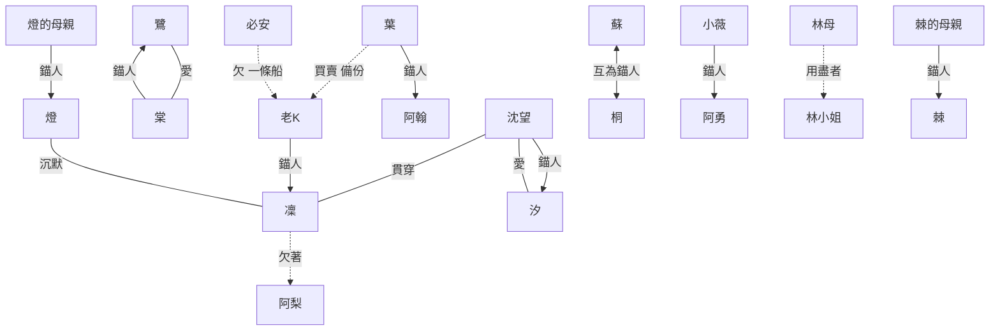

# 角色背景大全

> 來源：2026-10-04 使用者問：「現在有設計每個角色的完整背景了嗎？」並要求「每個角色都要有完整弧線」。
> 回答：[WORLD.md](WORLD.md) 對主要角色寫了「想要、怕、相信、對、錯、結局、最難忘的一場戲」，但**缺生平、彼此的關係、說話方式與傘**，而且次要角色（棠、汐、小薇、林小姐、阿翰、收屍人等）多半只有一行。這份補齊。
> 同日決定：**凜沒有伴侶**（維持現狀）；兩對女性伴侶（鷺／棠、沈望／汐）維持。
> **狀態**：新增的人物、生平與名字是提案，待使用者確認。名字深意見 [NAMES.md](NAMES.md)，新增名字的三語版本在本文件末尾。

## 0. 怎麼讀

每個角色有六件事：**生平**（時間線）、**想要與怕**、**說話方式**（寫腳本時的聲音）、**秘密**、**傘**（見 [UMBRELLA.md](UMBRELLA.md)）、**弧線**（每章做什麼、怎麼結束）。次要角色濃縮成一張表。

**弧線的檢查標準**：每個有名字的人，都要有「想要 → 遇到阻礙 → 做出選擇 → 付出代價 → 留下什麼」，即使只佔幾個場景。

## 1. 關係圖

線的意思：**錨人**＝替對方付帳（被磨掉記憶的人）；**愛**＝彼此牽掛；**欠**＝債與恩。

## 2. 主角團

### 2.1 凜（19 歲，傭兵）

| 項目 | 內容 |
|---|---|
| **生平** | **12 歲前**：住在港區低地的一間小屋，父親**堤**是水閘維修工，母親**蓑**替人縫補雨具與傘。每天放學去巢蛋當舖寫功課，老 K 教她認貨架上的標籤。**七年前（12 歲）**：第二次大洪水，父母與她都死了，只有她被復原：老 K 在自家地下室偷偷架了錨椅，她醒來在當舖，被告知「你睡了三天」，丟了洪水前三週的記憶。**之後**：在當舖長大；15 歲起接案，由鷺帶；右臂因任務受傷換成義體；開始存錢，筆記本最後一頁寫著 480,000（晴岸的一間房） |
| 想要／怕 | 前期替老 K 買下有太陽的房間；怕欠人。詳見 [WORLD.md](WORLD.md) |
| 說話方式 | **短句，不解釋，把感情說成帳**：「那我欠你」「算我的」「多少」。不說謝謝，說「記著」。生氣時句子更短，只剩一個字。**不會說**：「我愛你」「我需要」「幫我」。對老 K 的語氣最粗，因為最安全。罵人用髒話，但**從不罵老 K** |
| 口頭禪 | 「下面本來就是水。」（對任何勸她小心的人） |
| 秘密 | 她不記得洪水前三週，**她從沒問過那三週發生了什麼**，因為怕答案是「老 K 做了什麼」。 |
| **她相信的事（最大的誤會）** | 她相信自己的錨人是老 K 替她向天穹買的**常駐錨人（公司保單）**，「平平的、沒有味道」，所以沒有人替她付感情的帳；老 K 抽的一成手續費，她以為是**保費**。這個誤會到第四章中點（帳本：錨人匿名）才被打破，第五章才知道錨人是誰 |
| 傘 | **從不借傘**。每次出門經過老 K 的傘桶，**目不斜視**。傘對她就是「欠」。直到第八章 |
| 弧線 | 我自己來 → 我問 → 我接受；詳見 [PLOT.md](PLOT.md) |
| 身體記得的事 | 睡著時左手握右手；出門數三步後回頭一次；談價時手指敲桌子；不吃紅蘿蔔；把鞋脫在門外擺得整整齊齊 |
| 感情 | 沒有伴侶。與阿梨是復原夜加摯友；情感主軸是老 K |

### 2.2 老 K（63 歲，巢蛋當舖老闆）

| 項目 | 內容 |
|---|---|
| **名字** | 本姓**柯**，港區人叫「老柯」，叫著叫著成了「老 K」。**柯**字在中文裡還有一層：**爛柯**（王質在山上看人下一局棋，回頭斧柄已經爛了，世上過了數十年），**時間被偷走**的人。K＝KHARON 見 [NAMES.md](NAMES.md) |
| **生平** | **年輕時**：港區渡輪的船夫二十年，沿著港區的水道載人過河，**船錢**是一枚硬幣。**30 多歲**：與妻子**禾**結婚，禾經營巢蛋當舖，他退下船夫，在店裡幫忙。**22 年前（41 歲）第一次大洪水**：他開著渡輪救了很多人（包括必安與他的小隊），**妻子禾沒有救回來**。禾臨死前（或事前）簽過**拒絕復原**，她說：「別用你的記憶換我。」他照做了，從此守著當舖與妻子留下的**傘桶**。**十二年間**：凜的父母是鄰居，常來當舖典當修傘的工具；凜放學後在店裡寫功課。**七年前**：洪水奪走他們；他看著凜的遺體，**打破了對禾的承諾**，用自己做錨人，私設錨椅。**之後**：雇收屍人、賣備份資料給葉、替她挑安全的差事。三年前開始發現自己忘事 |
| 想要／怕 | 凜平安；怕她知道代價而拒絕。詳見 [WORLD.md](WORLD.md) |
| 說話方式 | **港區老人的碎念，句尾拖長，愛用「喔」、「啦」**，把重要的話藏在小事裡：不說「小心」，說「帶傘了嗎」；不說「我擔心」，說「水燒乾了」。講貨架上的東西時才有完整的句子。**不會說**：「我愛你」「對不起」。越到後面，句子越短，開頭常常是「你是……」，然後停下來 |
| 口頭禪 | 「帶傘了嗎？」「那也要帶。」「別修，那是我的鬧鐘。」 |
| 秘密 | ① 他是錨人；② 他把她的備份賣給了葉；③ **他曾答應妻子不為任何人復原，然後為凜食言**。他不知道這算不算背叛禾 |
| 傘 | 當舖門口的傘桶是**禾留下的**，裡面是失主沒有來領的傘，**港區的規矩：借傘不用還，欠著**。他每天問凜帶傘了嗎，是在問「你會回來嗎」（見 [UMBRELLA.md](UMBRELLA.md)） |
| 弧線 | 沉默地付 → 被揭穿 → 說出「是我想付」→ 說「不知道要不要拿回來」→ 忘記她，但每天問傘 → 洪水夜，凜說「帶了」→ 結局各自不同 |
| 對禾的線 | 禾是這個故事裡沒有出場的人：只在標籤、傘桶、一張照片、他偶爾叫錯的名字（他把凜叫成「禾」一次）裡出現。**「替你決定」的另一端**：禾要求他不要決定，他遵守了，代價是失去她 |

### 2.3 鷺（46 歲，資深傭兵）

| 項目 | 內容 |
|---|---|
| **生平** | **20 歲**：港區出身，護航船隊的傭兵，不信任何人，以「最難相處的鷺」出名。**23 年前（23 歲）**：在一次任務中重傷，診所的護理師**棠**救了她，棠每天去看她。**22 年前**：第一次大洪水，鷺在護航時沒能趕回；回來時棠在診所的淹水走廊裡守著病人，她們一起撐了三天。**20 年前**：兩人同居，棠成為她的錨人。**之後 20 年**：鷺越來越敢賭命，因為**棠說她願意**；**棠被磨損**，三年前成為用盡者，進安養病房。鷺累計復原 214 次（港區紀錄）。**三年前起**：鷺帶凜，替她清路；每週日去病房 |
| 想要／怕 | 跟棠多待一天；怕一個人。詳見 [WORLD.md](WORLD.md) |
| 說話方式 | **爽朗、愛開玩笑、帶港區髒話，笑聲很大**；把最重的話用笑話說：「死了還不是照樣喝酒。」叫凜「小鬼」。每次出任務前說「這次最後一次」，然後笑。**不會說**：認真的道歉與感謝（她每週日對棠說的是例外） |
| 口頭禪 | 「這次最後一次。」「死了還不是照樣喝酒。」「你好，我是鷺。」（只對棠） |
| 秘密 | 她早知道**自己每死一次，棠就少一點**，一直做下去。她把自己的錢全部給了病房，沒有存下一毛，所以第四章沒有人付她的最後一次 |
| 傘 | 一把**破傘**，傘骨斷了兩根，是她借給太多人用壞的；她總是撐在凜頭上，自己淋一半（第二章屋頂）。第四章之後，傘在病房的傘架上 |
| 弧線 | 第二章：全港區最好說話的人 → 第二章：死了又活，全場笑 → 第四章：無法復原，「你自己看」 → 之後：由棠與支線「週日」收尾 |

### 2.4 棠（50 歲，用盡者）

| 項目 | 內容 |
|---|---|
| **生平** | 診所的護理師，**甘棠遺愛**：照顧過港區許多人。與鷺同居 20 年，鷺的錨人。三年前被磨到「用盡」，不再記得鷺，**但身體記得**：敲三下桌子，哼一段歌 |
| 說話方式 | 溫和、慢，句尾上揚；對每個人都用護理師的口氣：「今天有吃飯嗎？」「你每個禮拜都來。」 |
| 她哼的歌 | **《借傘謠》**（港區童謠，見 [UMBRELLA.md](UMBRELLA.md)） |
| 弧線 | 第四章：身體記得鷺 → 支線「週日」：聽到那首歌，把凜叫成「你每個禮拜都來」→ 第八章：被收屍人背著撤離，一路哼 |
| 她的選擇 | 她成為鷺的錨人是**自己決定的**，鷺從沒要求。這是整個故事裡少見的「問過、同意」的例子，**反襯凜與老 K** |

### 2.5 燈（16 歲，通訊員）

| 項目 | 內容 |
|---|---|
| **生平** | **父親**是碼頭工，死過幾次、被母親（芸）復原幾次，最後一次沒救回來。**母親芸**因此成為用盡者，住進安養病房，**病床費每月都要付**。**12 歲**：燈接下天穹的「港區少年聲」錄音案，念了一句「歡迎回來」，換得第一個月的病床費；天穹**買斷了那個聲音**，**至今每座電話亭裡還是 12 歲的他**，他的聲音早就變了。**14 歲起**：學通訊，替傭兵當耳機另一頭的人。**認識凜**：鷺介紹。他知道凜累計死了幾次，因為終端的紀錄經過他的線路 |
| 想要／怕 | 母親的病床不被收走；怕開口。詳見 [WORLD.md](WORLD.md) |
| 說話方式 | **嘴碎、愛開玩笑、語速快、會自問自答**：「你猜怎麼著？我也不知道。」提示謎題時喜歡講冷笑話；**一旦要說真話就變短**，「我……算了。」到第六章，他學會**不加「算了」**。**不會說**：「對不起」，他會說「我晚點補給你」 |
| 口頭禪 | 「歡迎回來。」（他不喜歡這句話） |
| 秘密 | 他一直知道錨人**不是匿名的**：他看過紀錄，名字被加密，但他猜得到是誰。他沒說，是因為怕老 K 的錨人一旦說破，凜會拒絕復原然後真的死去 |
| 傘 | **沒有傘**。他住在控制室，很少出門。凜第七章把一把傘遞給他（支線「病床」），他第一次說謝謝 |
| 弧線 | 第四章：說出「每次都是明天」 → 第五章：開始少說話，聲音鎖的提示是**最後一次**他給的玩笑 → 第六章：轉出電話，失去病床 → 第八章：撤離 → 結局 A：亭子裡傳來**長大了的聲音** |

### 2.6 蘇（54 歲，斷錨派領袖）

| 項目 | 內容 |
|---|---|
| **生平** | **年輕時**：港區的廣播員，聲音平淡，以不帶感情報天氣出名。**與丈夫桐**結婚，桐是碼頭吊車司機，工傷死過很多次；兩人**互為錨人**（夫妻常見的做法：誰死了，另一個付）。**20 年的婚姻**後，兩人都成為用盡者。**但蘇還保留著技能**：說話、念稿、判斷。她對「桐」只剩一頂**帽子**，帽沿內側縫著名字 |
| 想要／怕 | 把記憶還給大家；怕錨庫繼續吃人 |
| 說話方式 | **語氣平淡，像在報天氣**：不疑問、不感嘆；愛用名詞堆疊：「今日。港區。降雨。三百一十二人。」生氣時**更慢更輕**。在錄音室念名單時最「像人」 |
| 秘密 | 她知道自己曾有一個丈夫，但**不知道是誰**。她不問，是因為怕答案。她做斷錨派，一半是理念，一半是想知道帽子的主人 |
| 傘 | **黑色折傘**，傘面被風翻過太多次；她在雨天的廣播站外撐傘念稿。第六章傘被風吹翻 |
| 弧線 | 第二章收音機：陌生的名單聲音 → 第四章牆上塗鴉 → 第五章：燈提到「有人在問帳本」 → 第六章：現身 → 支線「帽子」→ 第八章：她的船是第一艘開進洪水的船，接起桐 |

### 2.7 阿梨（27 歲，復原館夜班）

| 項目 | 內容 |
|---|---|
| **生平** | **0 歲**：被放在港區市場一個**梨攤**邊的籃子裡，賣梨的**梨嬸**撿到她，取名阿梨。**梨嬸**養她到 16 歲，梨嬸去世，**沒有人替她付帳**。梨嬸教她煮麵，**湯頭裡放一顆梨**。**16 歲起**：在復原館打工，後來夜班；做「租來的家人」（當一晚被記得的人）。**22 歲**：向阿勇那夥人借錢，想開麵攤，利息一直滾。**無帳者**：沒有人愛她到願意替她付，她自己的死是真的死 |
| 想要／怕 | 開一間麵攤；怕被當成「可以付錢買的」。詳見 [WORLD.md](WORLD.md) |
| 說話方式 | **溫柔、直接、不繞圈**：「我沒有要你付。」「那就欠著。」「你吃了沒？」常用疑問句**把答案留給對方**。對客人用「您」，對凜用「你」，這是她分得清的事 |
| 口頭禪 | 「那就欠著。」「這碗不用欠。」 |
| 秘密 | 她知道自己是無帳者，**所以她比任何人更清楚「被記得」值多少**，才把它當職業 |
| 傘 | **油紙傘**（梨嬸留下的），舊，傘面有一小塊補丁，晴天也帶著，撐著去市場。麵攤開張後，**傘掛在攤子的頂棚上** |
| 弧線 | 見 [SIDEQUESTS.md](SIDEQUESTS.md) 的「麵攤」 |

## 3. 對立方

### 3.1 沈望（74 歲，天穹創辦人）

| 項目 | 內容 |
|---|---|
| **生平** | **約 40 歲前**：水利工程師，設計過港區的水閘與排水，與**汐**同居。**汐**是港務局的**潮汐預報員**，編纂潮汐表、發佈洪水警報。**22 年前（52 歲）第一次大洪水**：汐發出警報，沒人聽；沈望設計的閘門因停電沒能及時關上；**汐留在預報站播報警報，淹死在站裡**。沈望把這件事歸成自己的過失。**21 年前**：她用自己當錨人，復原了汐，成功；發現耗損，**繼續復原**（汐的身體每次復原都更脆弱，大約半年到一年就會再倒，累計三十一次）。**17 年前**：成立天穹，把復原商業化，**理由是讓每個人都有第二次**。**15 年前**：啟動雲蓋計畫。**她對汐的記憶，在二十年間被磨掉**。親手設計了**帳房**：契約一旦成立就必須履行，**任何人不得中止，包括自己**，因為她知道自己有一天會心軟 |
| 想要／怕 | 愛不必記得，只要履行；怕自己心軟。詳見 [WORLD.md](WORLD.md) |
| 說話方式 | **工程師的句子**：條列、精確、沒有形容詞；愛說「我們先確認一件事」。對外是演說的聲音（廣告、標語）：溫柔、緩慢、有重量。**對汐**說的是完全不同的話：筆記本上抄來的指示，念得像給陌生人的說明：「早上先開窗。」 |
| 口頭禪 | 「再來一次，沒關係。」（錄音）；「契約一旦成立，不得中止。」（條文）；「我自己也停不了它。」（第七章） |
| 秘密 | **她知道汐每次復原都在受苦**，她看過汐的身體。她沒有問汐想不想，因為她怕汐說不想 |
| 傘 | **一把白傘**，晴天也撐，在天穹塔的頂樓花園。她對汐說：「你怕曬。」（她不記得這件事是不是真的；筆記本上寫的。）見 [UMBRELLA.md](UMBRELLA.md) |
| 弧線 | 每一章都有她：聲音、看板、署名、電話、見面、廣播、最終頭目。詳見 [PLOT.md](PLOT.md)。**新增兩段**：間章五「早上先開窗」（第七章）與間章六「第一次大洪水」（第九章塔內的回放層），見 §6 |

### 3.2 汐（約 50 歲，生理年齡）

| 項目 | 內容 |
|---|---|
| **生平** | 港務局潮汐預報員，編纂潮汐表二十年。**22 年前**：發出洪水警報，留在預報站，淹死在站裡。**被復原三十一次**：每次復原的殼都比上一次脆弱，**每次死亡都是真的痛**，記憶完整（她是被復原的人，記憶不磨損；磨損的是錨人沈望）。現在住在塔頂花園，沈望每天都來 |
| 想要／怕 | 想知道「她還愛不愛我」；怕**說出她其實累了**，因為沈望會把它當成命令去停掉帳房，然後後悔 |
| 說話方式 | **輕、慢、常常笑，用潮汐比喻**：「退潮了。」「還沒漲上來。」對沈望說話永遠很客氣，像對剛認識的人，因為沈望對她就是這樣 |
| 傘 | **沒有傘**，沈望的白傘是撐在她頭上的 |
| 弧線 | 第七章凜問她「你想繼續嗎」，她說：「**我不知道。我只知道她每天都來。**」→ 第八章帳房洪水協定 → 第九章：她的回答在最終戰裡**成為第一階段的轉折**（見 [BOSSES.md](BOSSES.md)）→ 結局由使用者決定其回答 |

### 3.3 葉（41 歲，天穹風控長）

| 項目 | 內容 |
|---|---|
| **生平** | **哥哥阿翰**（長 8 歲），電台 DJ。葉 **18 歲**起成為阿翰的錨人，**復原十二次**，每次磨掉一些。**阿翰四年前**死於一次無法復原的事故（錨庫容量上限），留下**兩個孩子**：兒子（15 歲）與女兒（10 歲）。葉記不得他的臉，但每天早上在手背寫：「**他叫阿翰。你愛他。**」她進天穹做風控，是因為她相信數字：**11% 的耗損換 89% 的人不必死** |
| 想要／怕 | 讓 89% 的人不必死；怕自己哪一天不再寫那行字 |
| 說話方式 | **客氣、簡潔、像在寫報告**：「我們來看一下。」「從數字上看。」從不用感嘆詞，**唯一的例外**是談到手背上的字：句子會斷 |
| 秘密 | 她看過真實的耗損率，**自己隱瞞了**；她知道自己在說謊，用「如果大家知道就沒人敢簽」說服自己 |
| 傘 | **透明的塑膠傘**（便利商店賣的那種），她每天都帶，因為手背的字不能被雨淋糊。第八章洪水夜，她把傘收起來 |
| 弧線 | 第三章：辦公室裡手背的字 → 第五章：提 480,000 買沉默；凜問「他叫阿翰？」→ 第七章：批准例外（有無阿翰的錄音，是兩個版本）→ 第八章：留在塔裡 → **結局**：新增（見 §5 補充），讓她有完整的結尾 |
| 阿翰的錄音（SQ7） | 那卷錄音是阿翰留給妹妹的：「妹，如果妳聽到這個，表示妳又不記得我了。我叫阿翰。妳愛我。」**手背上的字，最初是他說的** |

### 3.4 阿勇（45 歲，收帳人頭目）

| 項目 | 內容 |
|---|---|
| **生平** | 港區貨運工，妻子早逝。**女兒小薇**八歲那年溺水，他借了天穹的**復原貸款**救她，**當時沒有別的錨人**，只有他自己，**但他是父親，不能磨掉自己的記憶**，所以他讓**小薇成為自己的錨人**（他自己死的時候，由她付）。後來他轉做收帳人，為了還貸款，也為了存**贖回小薇記憶的錢** |
| 他是凜的鏡子 | **為了一個失去記憶的人去做壞事，同時相信自己是在愛她。** |
| 說話方式 | **粗，直接，愛用數字與動作**：「我數到三。」「這筆我記著。」對小薇的語氣完全不同，輕到聽不見 |
| 傘 | 小薇的**兒童雨傘**（黃色），他一直帶在身邊，打開時小孩的圖案朝外 |
| 弧線 | 第二章頭目：被復原時小薇的眼神一次比一次空，**凜可以打斷連結**；之後，副手「利息」接手 |

### 3.5 小薇（12 歲）

| 項目 | 內容 |
|---|---|
| 生平 | 阿勇的女兒，他的錨人。**自願的**：她說：「爸爸死了我才不要不記得你。」（但她其實已經記不得許多事） |
| 說話方式 | 輕、慢、**偶爾空白**：句子說到一半停住，再接上 |
| 弧線 | 第二章：被凜決定打斷連結與否；之後不單獨出現（避免未成年角色）。**不放在任何成人內容附近** |

### 3.6 利息（約 35 歲，阿勇的副手）

| 項目 | 內容 |
|---|---|
| 生平 | 港區出身，**自己也是債務人**：為了母親借了復原貸款，母親沒救回來，債還在。**弟弟**是用盡者，住病房，月費要他付。後來被阿勇收進收帳人，**從來不只收本金** |
| 說話方式 | 笑著說話，**用客氣的詞講最難聽的事**：「幫您算一下。」「小小的利息而已。」 |
| 與燈的對照 | 同樣有一張病床要付；**燈選擇了沉默，利息選擇了暴力**。第六章他做的事不可原諒，但**不寫成惡**，寫成「同一個困境的另一個選擇」（MATURE.md 守則） |
| 弧線 | 第六章接手收帳人，對阿梨做了不可原諒的事（可避免）；之後出現在第八章洪水夜：**他在自己的弟弟的病床邊**，沒有被打倒也沒有被原諒 |

### 3.7 必安／老鬼（約 60 歲，收屍人隊長）

| 項目 | 內容 |
|---|---|
| **生平** | 退休傭兵隊長。**22 年前第一次大洪水**：他的小隊困在水裡，**老 K 的渡輪**載走了他們，**但船只能載這麼多人**，他必須選誰上船。**他選了，有人沒有上來**。從此他**不再說話**。他欠老 K 一條船，**用一輩子還**：七年前起，帶著收屍人在凜每次死亡後十分鐘內把她送到終端 |
| 說話方式 | **不說話**。用動作：放下一杯茶、鋪外套、把門關上。第八章，他第一次出聲 |
| 傘 | **一把大黑傘**，傘柄是木的，他總是**撐在別人頭上**，自己站在雨裡 |
| 弧線 | 第二章起：屋頂的灰衣人 → 第五章：頭目，不傷你，要把你搬走；外套鋪在樓梯上 → 支線「灰無常的工錢」：凜接手付帳；第六、七章：給他一杯茶 → 第八章：他第一次說話（只一句，見腳本）|

### 3.8 其他收屍人（三位）

名字是提案，見 §7。

| 名字 | 年齡 | 生平 | 為什麼做這份工 | 守著哪裡 | 灰道段 |
|---|---|---|---|---|---|
| **石** | 55 | 前碼頭搬運工，力氣大 | 搬運的人，就該把人搬回來 | 港口倉庫的屋頂 | 段 3 |
| **燕** | 48 | 前救護員 | 每年春天都要回來的人；救過太多人，沒能救自己的孩子 | 復原館的吧台 | 段 2 |
| **麥** | 29 | 最年輕，前無帳者；必安撿回來的 | 麥苗越踩越壯，他是被踩出來的 | 病房的夜班 | 段 4 |

### 3.9 棘（40 歲，守衛長）與他的母親

| 項目 | 內容 |
|---|---|
| 生平 | 天穹的守衛長，出身港區。**母親是他的錨人**，被磨損了，在天穹的員工家屬病房。《詩經·凱風》「棘心夭夭，母氏劬勞」：被母親養大的兒子 |
| 說話方式 | **公事公辦，條列式**：「第一，請退後。第二，這裡不開放。」只有對母親說話時才用台語 |
| 弧線 | 第六章頭目：母親坐在旁邊的錨椅上；**他第二次死亡時，自己按掉復原**（見 BOSSES.md）：他選擇不再讓母親付 |

## 4. 次要角色

| 角色 | 年齡 | 位置 | 生平與弧線（各一段） |
|---|---|---|---|
| **林小姐** | 30 | 晴岸業務員 | 母親（林母，62）是晴岸的用盡者，**員工家屬福利**讓她住在那。林小姐每天對母親說：「您好，我是晴岸的林小姐。」（呼應鷺每週日對棠說的話。）第三章：樣品房；第七章：凜問「你呢？」→ 給參觀證與房間鑰匙；B 結局：她辭了業務，成為護理員，問老 K：「今天要帶傘嗎？」說話：**輕聲、有禮、永遠先說「不好意思」** |
| **守門人（JANUS）** | 約 60 | 診所門口 | 用盡者，**習慣讓他繼續做櫃台**：「請問您有預約嗎？」打他時一直道歉。**他的名牌寫著：請洽櫃台**。他的錨人（妻子）已過世。凜打倒他，他說：「謝謝光臨。」 |
| **清理隊隊長（ATROPOS）** | 38 | 天穹清理隊 | 名字**裁**。前無帳者，靠「清理別人的呆帳」爬上來，她相信**帳清乾淨，就不會有人掉進縫裡**。鷺在她手上倒下，她沒有惡意：「這是程序。」說話：**簡短、不帶情緒的程序用語** |
| **榕伯** | 72 | 市集的攤商 | 賣了一輩子的涼茶；記得「最難相處的鷺」：鷺年輕時打翻過他的攤子，**賠了三倍，還付了十年的涼茶錢**。說話：**慢、愛講「從前」** |
| **芷姐** | 36 | 診所護士 | 棠的同事與朋友；保管阿翰的手錶（病人遺物）。說話：**俐落、護理師口氣** |
| **阿翰** | 49（已故） | 葉的哥哥 | 見葉。電台 DJ，聲音是**港區的夜晚**；他的錄音是 SQ7 的核心 |
| **桐** | 55 | 蘇的丈夫 | 碼頭吊車司機，用盡者，住病房。**帽子是他的，蘇的圍巾是她的**；互為錨人，**兩人都不記得對方** |
| **禾** | （已故） | 老 K 的妻子 | 當舖的創辦人。傘桶與「借傘不用還」的規矩是她立的。**簽了拒絕復原**：「別用你的記憶換我。」 |
| **堤與蓑** | （已故） | 凜的父母 | 堤：水閘維修工；蓑：縫補雨具。洪水夜沒有人復原他們。他們出現在凜的記憶與老 K 的標籤裡 |
| **林母、芸（燈的母親）、棘的母親** | — | 病房與家屬病房 | 用盡者，各有一個「不認得兒女、仍做著小動作」的細節（見各支線） |

## 5. 補充：每個人都有完整的弧線

使用者要求每個角色都要有完整弧線。盤點結果，以下是**原本缺的**與補法：

| 角色 | 原本缺什麼 | 補法 |
|---|---|---|
| **葉** | 第七章之後消失 | **第八章**：洪水夜她留在塔裡，看見手背的字被水氣暈開（有錄音：她握著錄音機）；**結局新增**：A 結局走過地圖時，天穹塔的窗邊亮著一盞燈，**一個女人撐著透明傘站在窗前**，傘面上一行字：「他叫阿翰」；B 結局：第一次她寫在手背的字，**最後一行多了一句：「他的孩子在學校。」**；真結局：成為真結局片尾「預設：同意」的簽署人之一（見下） |
| **阿勇** | 第二章之後沒有下文 | **第八章**：洪水夜，他抱著小薇坐在船上，**沒有說話，只是把黃色的傘撐在她頭上**（若凜打斷連結）；若沒打斷連結：他一個人站在水裡，手裡拿著傘 |
| **棘** | 死後沒有下文 | **第八章**：他的母親由收屍人撤離，**棘（若活著）站在塔的樓梯口擋住追兵**，只說一句：「請退後。」 |
| **蘇** | 只有第六章 | 加鋪三次（見 EVENTS.md）；支線「帽子」 |
| **燈** | 第四到六章空白 | 第五章給聲音鎖提示；開始少說話；第六章成為他的轉折 |
| **清理隊隊長裁** | 只有一場戰 | **第五章**：她在復原館喝酒時出現，與阿梨有一段對話（用來給線索）；**第八章**：洪水夜她在清理被水淹的街，**第一次不遵守程序**：把一個無帳者背上船 |
| **鷺** | 死後只有支線 | 加入**間章二**（已有）與第八章的「繩子」：丟繩子給凜的灰衣人之一，手腕上繫著鷺的傘布條（收屍人拿到她的遺物） |
| **沈望** | 戲份不足以撐起最終戰 | 見 §6 |
| **凜** | 沒有伴侶 | **維持現狀**；情感主軸是老 K，朋友是阿梨、燈、鷺 |

## 6. 沈望的新增戲份（讓最後一戰夠重）

使用者希望**多一點沈望的劇情，這樣最終 Boss 的力量才夠大**。最終戰要強，不只是難，是**玩家真的懂她、並且仍要撕裂她**。

| # | 新增 | 位置 | 內容 | 目的 |
|---|---|---|---|---|
| 1 | **遠景伏筆** | 第三章 | 凜在日照區邊緣，從玻璃外看見塔頂花園裡有一位白髮老人撐著白傘，在一個人也沒有的長椅旁澆花；每天都在同一個時間 | 讓玩家在第七章見面時**認出「那個人」** |
| 2 | **錄音的 NG** | 第四章 | 帳本附的標語錄音，有**三十一個版本**，每個版本她的聲音都一樣，但**第三十一個**，最後多了一個字：「……汐。」 | 玩家第一次聽到汐這個字 |
| 3 | **間章五　早上先開窗** | 第七章，見完沈望之後 | **玩家扮演沈望**，度過一個普通的早晨：醒來、看筆記本、開窗、走到花園、對汐自我介紹、替汐澆花、讀筆記本的每一行，**逐條完成**，每一條都對應一個動作與一個**她不記得為什麼要做的理由**。最後：她被**一個陌生的年輕人（凜）**問了一個她二十年沒被問過的問題 | 讓玩家**成為她**，同情她；也讓玩家看見她的**日常履行** |
| 4 | **間章六　第一次大洪水** | 第九章，**塔內回放層**（見 [MAP.md](MAP.md)） | 玩家扮演二十二年前的沈望，在閘門控制室，**閘門因停電無法關閉**，汐在預報站的廣播裡念警報；玩家要做的是**在斷電之前選一件事**：關哪一道閘、保哪一條街，**汐的那一條只能在最後一秒保**。她選擇（或玩家選擇）去**救更多的人**；汐留在預報站。這是整個故事裡最痛的一場「替你決定」 | 讓最終 Boss **不是一個壞人，而是一個做過一次這樣的選擇的人** |
| 5 | **沈望的筆記本逐頁解鎖** | 全作 | 每章她出現時，凜（玩家）可以讀到筆記本的一頁，**到第九章，整本讀完**，最後一頁寫著：「**如果有一天有人問她想不想繼續，請讓她回答。**」（她自己寫的，她完全不記得） | 最終戰撕條款時的重量：**她早就知道答案，只是沒辦法自己問** |
| 6 | **最終戰的第三階段** | 第九章 | 她拿著筆記本，**每一個攻擊都是筆記本上的一行字**；打倒她時，最後一行是「請讓她回答」 | 呼應 BOSSES.md |

間章五與間章六的設計見 [PLOT.md](PLOT.md) 更新的視角間章表。

## 7. 新增名字（提案，三語）

| 角色 | 中文 | 日文 | 英文 | 深意 |
|---|---|---|---|---|
| 禾 | 禾 | 禾（いね） | Rye | 莊稼：他們家的當舖原是糧行？不必解釋。**簡單的名字，簡單的人** |
| 堤、蓑 | 堤、蓑 | 堤（つつみ）、蓑（みの） | Dike、Cape | 凜的父母：防水的人與擋雨的人 |
| 桐 | 桐 | 桐（きり） | Paulownia | 梧桐一葉：**一葉知秋**（與葉呼應），桐樹一落葉，天下皆知秋 |
| 榕伯 | 榕伯 | 榕じい | Old Banyan | 榕樹：港區老人的庇蔭 |
| 芷姐 | 芷姐 | 芷さん | Angelica | 芷是藥草，護理師 |
| 阿翰 | 阿翰 | 翰（かん） | Quill | 翰＝筆、羽毛；DJ 用聲音寫字 |
| 石、燕、麥 | 石、燕、麥 | 石（いし）、燕（つばめ）、麦（むぎ） | Stone、Swallow、Barley | 搬運、回來、踩了更壯 |
| 裁 | 裁 | 裁（さい） | Shears | 裁剪＝阿特洛波斯的剪刀 |
| 柯 | 柯（老 K） | 柯（か） | Ko | 爛柯：時間被偷走（只在中文解釋一次） |

## 8. 待你決定

| # | 問題 | 我的建議 |
|---|---|---|
| 1 | 老 K 有一位已故的妻子**禾**，她立下「借傘不用還」的規矩並**簽了拒絕復原**，這個背景是否同意？ | 同意；它讓「替你決定」有了另一端，也讓傘桶成為全作的核心道具 |
| 2 | 沈望的**間章五（第七章）與間章六（第九章塔內）**，以及筆記本逐頁解鎖，是否合意？ | 合意 |
| 3 | 阿勇為了存小薇的贖回費而收帳（凜的鏡子），是否同意？ | 同意 |
| 4 | 葉的哥哥有兩個孩子，**10 歲的女兒是真結局片尾「預設：同意」的那位女孩**，是否同意？ | 同意；讓片尾不是無名的孩子，而是我們認識的人。**這是最殘酷的版本**，若你覺得過重可以改回無名孩子 |
| 5 | 三位收屍人（石、燕、麥）的設定是否同意？ | 同意 |
