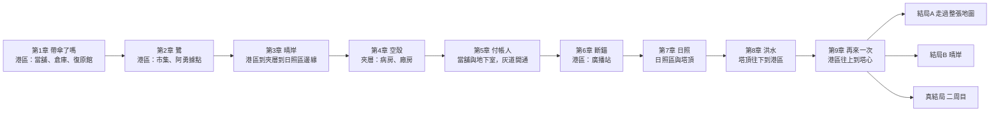
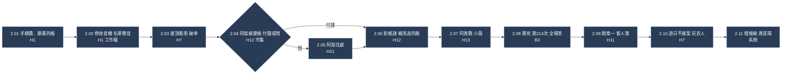
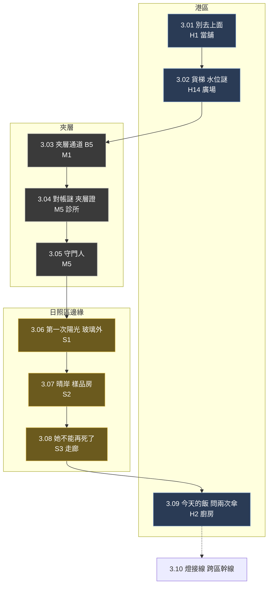
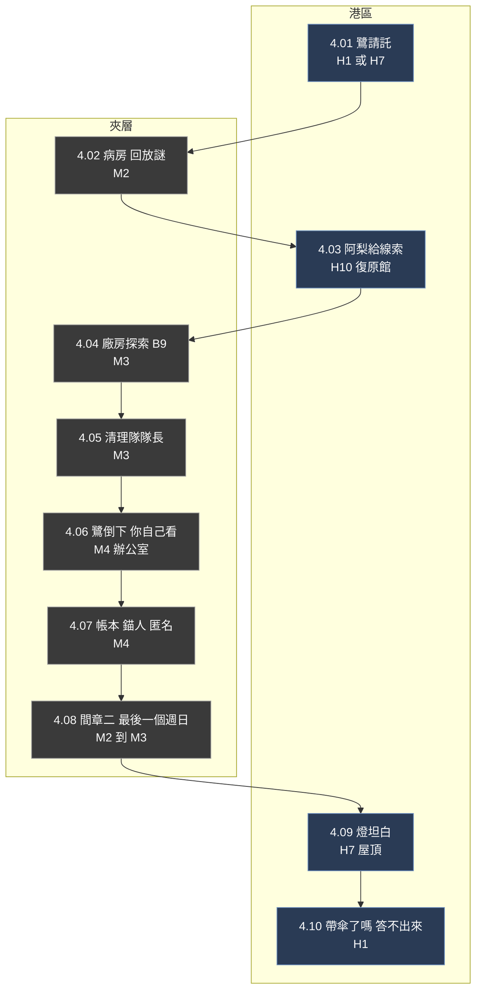
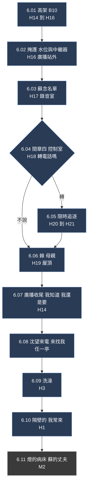
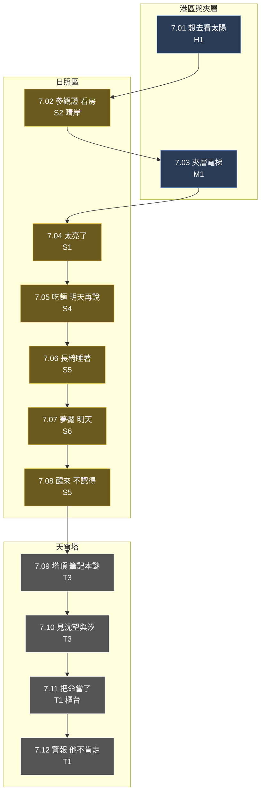
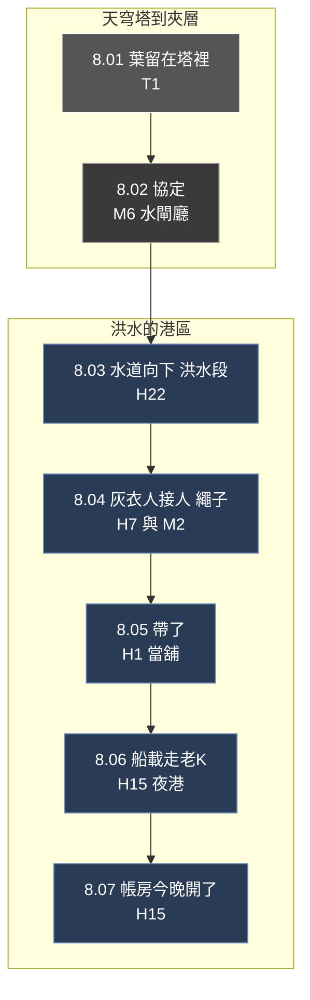
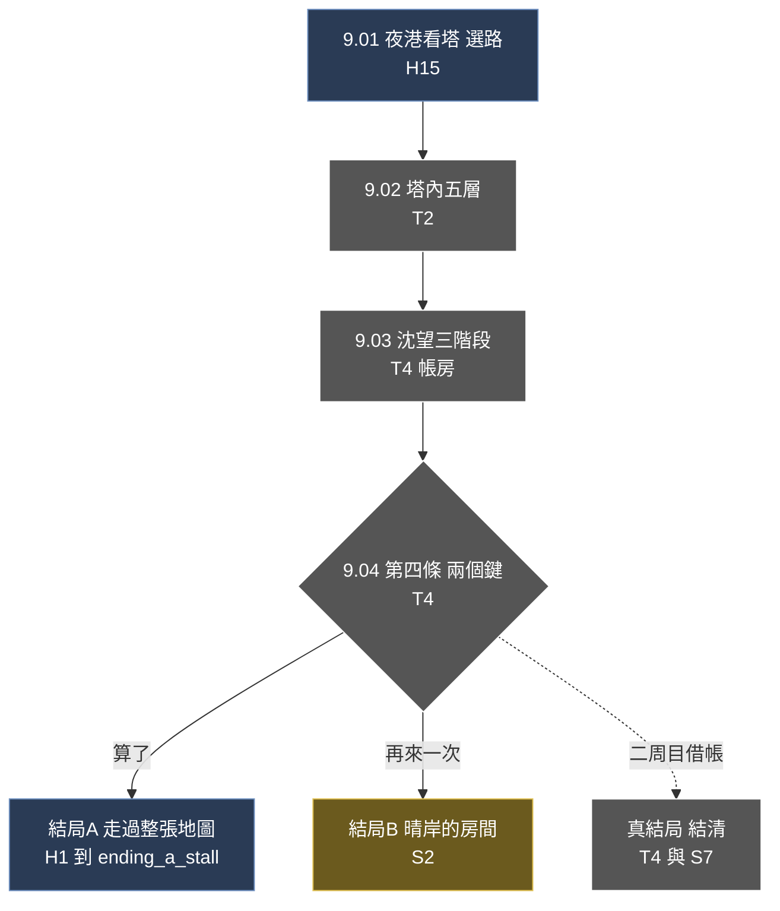

# 事件與地圖綁定：每件事發生在哪裡

> 來源：2026-10-04 使用者要求依大綱把會發生的事情標記出來，並與地圖綁在一起：每個事情發生在哪裡、劇情如何推進，以及支線任務。
> 地圖見 [MAP.md](MAP.md)，長線支線見 [SIDEQUESTS.md](SIDEQUESTS.md)，章節內容見 [OUTLINE.md](OUTLINE.md)、[PLOT.md](PLOT.md)，頭目見 [BOSSES.md](BOSSES.md)。
> 事件編號 `章.序號`（例如 `1.07`），之後直接成為腳本資料的 id。場景代號沿用 MAP.md。
> 同一章內的順序是**提案**，細節在逐章討論腳本時再鎖定；已知需要討論的順序問題標在各章下方。

## 0. 怎麼看

| 欄位 | 說明 |
|---|---|
| 類型 | **主**＝主線必經；**探**＝探索與謎；**戰**＝戰鬥或頭目；**演**＝演出或安靜場景；**間**＝視角間章；**系**＝系統變化（傳送、地圖開通）；**支**＝支線的起點或節點，編號見 [SIDEQUESTS.md](SIDEQUESTS.md) |
| 場景 | MAP.md 的場景代號 |
| 結果 | 這件事做完之後，**地圖與狀態**的改變（旗標、開通、解鎖） |
| 標籤 | 對應 [OUTLINE.md](OUTLINE.md) 的暗線 T1～T9 |

## 1. 章節動線總覽

玩家的移動很有節奏：**第 1～2 章在港區熟悉環；第 3～4 章往上鑽進夾層與日照區；第 5 章回到當舖往下挖；第 6 章回港區；第 7 章往上到塔頂；第 8 章從塔頂一路往下沉；第 9 章再從下往上爬進塔心**。同一條垂直軸走三次，每次意思不同。

### 每章地圖的開通與封閉

| 章 | 新開的路 | 封閉或限制 | 傳送 | 新能力或證件 |
|---|---|---|---|---|
| 1 | 當舖、街道、倉庫、復原館、SC2、SC3 | 市集封路（收帳人） | 無 | 電擊 |
| 2 | 市集、阿勇據點、SC1、SC4 | 夾層以上全封 | **港區環（章末）** | 重擊 |
| 3 | 廣場貨梯 SC5、夾層、診所、SC6、日照區玻璃邊緣 | 日照區只到邊緣 | **跨區幹線（章末）** | 夾層證 |
| 4 | 病房、廠房、SC7 | — | 夾層全部 | 磁吸 |
| 5 | 地下室、**灰道第一段** | — | 同上 | — |
| 6 | 高架 SC10、廣播站 | — | 加 B10 | — |
| 7 | 夾層電梯（全區）、日照區全區、花園電梯 SC11、塔大廳與頂樓 | 警報後港區夜間封鎖 | 加塔線 B11 | 參觀證、塔證 |
| 8 | 塔中央軸與水道 SC12 | 港區被水淹；**傳送全停** | **無** | — |
| 9 | 塔內五層 | 第 8 章的洪水保留 | 只有塔內 | — |

## 2. 第一章　帶傘了嗎

目的：讓玩家愛上這個家，認識復原與阿梨。港區，一個環還沒完全打開。

| ID | 類型 | 事件 | 場景 | 結果與標籤 |
|---|---|---|---|---|
| 1.01 | 演 | 雨夜開場；教學：移動、工作檯改裝；老 K 講貨架上每件東西的來歷 | H1 `pawnshop_front` | 標籤 100%；T1 |
| 1.02 | 演 | 晚飯；漏水桶「別修，那是我的鬧鐘」；船錢罐「留給回不來的人」；地下室門「漏水，別開」 | H2、H1 | T9、T1 |
| 1.03 | 演 | 屋頂：鷺介紹差事；凜算錢，筆記本最後一頁：晴岸 480,000，目前 27,400 | H7 `rooftop` | HUD 出現「巢蛋」 |
| 1.04 | 演 | 出門：「帶傘了嗎？」「下面本來就是水。」 | H1→H5 | 母題起點 |
| 1.05 | 系 | **第一座電話亭**：拿起話筒，「再來一次，沒關係。」 | H6 `anchor_phone_booth` | B1 啟用；T3 |
| 1.06 | 探 | 街道戰鬥教學；收帳人封著市集的路 | H5 | 市集待開 |
| 1.07 | 戰 | 倉庫前廳：看門狗；**凜第一次死亡**，一個笑話 | H8 `dock_warehouse` | 看門狗血量保留；M1 待顯示 |
| 1.08 | 演 | 復原室醒來（赤裸、金屬味）；燈：「歡迎回來」；畫面「再來一次，沒關係。」 | H9 `revival_room` | 復原濾鏡；死亡畫面規則開啟 |
| 1.09 | 探 | 水位謎：三個閘門，第三個要用死來解；世界不重置 | H8 | SC2、SC3；B2；教以死解謎 |
| 1.10 | 戰 | 看門狗戰完 | H8 | 頭目撃破 |
| 1.11 | 演 | 復原夜：復原館，阿梨接待；成年人之間的一夜（基底層／露骨層） | H10 `revival_lounge` | R18 分層；T5 |
| 1.12 | 主 | 天亮的選擇：付錢離開，或留下吃宵夜：「不收錢。」「那我欠你。」「那就欠著。」 | H23 `dawn_noodle_stall` | `knows_ali_address`；SQ1 的初見 |
| 1.13 | 演 | 回家：廚房水燒乾；老 K 離席，回來眼神空；地下室門縫下有光 | H2、H1 | T1；章末 |

> **順序待確認**：1.07 第一次死亡發生在頭目戰前廳，之後才解水位謎（1.09），讓「世界不重置」先由頭目血量保留示範，再由謎強化。PLOT.md 與 PUZZLE.md 的寫法都成立，這裡取前者。

```mermaid
flowchart LR
  E101["1.01 開場雨夜<br/>H1 當舖"] --> E102["1.02 晚飯、船錢罐<br/>H2 廚房"]
  E102 --> E103["1.03 鷺的差事<br/>H7 屋頂"]
  E103 --> E104["1.04 帶傘了嗎<br/>H1 到 H5"]
  E104 --> E105["1.05 第一座電話亭<br/>H6 B1"]
  E105 --> E106["1.06 街道戰鬥教學<br/>H5"]
  E106 --> E107["1.07 看門狗 第一次死亡<br/>H8 倉庫"]
  E107 --> E108["1.08 復原室醒來<br/>H9"]
  E108 --> E109["1.09 水位謎 以死解謎<br/>H8"]
  E109 --> E110["1.10 看門狗戰完<br/>H8"]
  E110 --> E111["1.11 復原夜 阿梨<br/>H10"]
  E111 --> E112{"1.12 天亮的選擇<br/>H23"}
  E112 -->|"留下"| E113["1.13 水燒乾 眼神空<br/>H2"]
  E112 -->|"付錢離開"| E113
  E112 -.->|"留下：旗標"| F1["knows_ali_address"]
  classDef h fill:#2a3b55,stroke:#6c8ebf,color:#fff
  class E101,E102,E103,E104,E105,E106,E107,E108,E109,E110,E111,E112,E113 h
```

## 3. 第二章　鷺

目的：認識「失去」的前置，讓玩家愛上鷺；學「問」；打開港區的環。

| ID | 類型 | 事件 | 場景 | 結果與標籤 |
|---|---|---|---|---|
| 2.01 | 演 | 早晨：老 K 抽一成手續費，帳本鎖著 | H1 | T1 |
| 2.02 | 探 | 修收音機（小謎：頻率）；雜訊裡有一個平淡念名字的聲音 | H1 工作檯 | T8；SQ4 伏筆 |
| 2.03 | 演 | 屋頂：鷺教凜看雨，一把破傘，兩杯茶 | H7 | SQ2 起（週日）；安靜場景 |
| 2.04 | 主 | 市集：收帳人向阿梨要帳；凜選擇付錢（習慣）或「問」 | H12 `neon_market` | 教「問」；SQ1 起 |
| 2.05 | 支 | 阿梨住處：看她練習做麵；「名字還沒想好」 | H21 `ali_flat` | 設定 `knows_ali_address`（第一章沒留下的第二次機會）；SQ1 |
| 2.06 | 探 | 對帳謎：債務簿與收據差一筆；沿路被清過的路（剪斷的電線、昏倒的守衛、沒鎖的門） | H12 | SC1 電線橋；T6；推出阿勇據點 |
| 2.07 | 戰 | 阿勇據點：阿勇戰；小薇是他的錨人；**凜可以打斷連結** | H13 `yong_hideout` | 阿勇不再復原 或 復原 |
| 2.08 | 演 | 鷺死在這一戰，在市集的亭子醒來；燈：「歡迎回來，第 214 次。」所有人笑了 | H13→B3 | B3；SC4 市集封路解除 |
| 2.09 | 間 | **間章一　客人簿**（阿梨）：三位客人，問、聽、記 | H11 `guest_book_room` | 阿梨是無帳者；SQ1 |
| 2.10 | 演 | 章末：屋頂，鷺：「週日我不接案。」對面屋頂一個灰衣人一直看著她 | H7 | T6；SQ2 |
| 2.11 | 系 | 燈：「線接好了。」港區環可傳送 | — | 線路 L1 |

## 4. 第三章　晴岸

目的：第一次往上；看到陽光；看見老 K 的反常。

| ID | 類型 | 事件 | 場景 | 結果與標籤 |
|---|---|---|---|---|
| 3.01 | 演 | 老 K：「別去上面。」 | H1 | T1 |
| 3.02 | 探 | 廣場貨梯：水位謎，第一條跨區的路 | H14 `harbor_plaza` | SC5 |
| 3.03 | 探 | 夾層通道：第一次看見夾層的樣子；電話亭 B5 | M1 `mezzanine` | B5 |
| 3.04 | 探 | 診所：對帳謎（報表、輪班表、病房名冊，三個一組） | M5 `clinic` | 夾層證；真實耗損率 11%；T2；SQ7 伏筆（阿翰的錄音在抽屜裡） |
| 3.05 | 戰 | 守門人：「請問您有預約嗎？」打他時一直在道歉 | M5 | SC6 護理通道（從診所側開）；B6 |
| 3.06 | 演 | 夾層電梯：**第一次看見陽光**（隔著玻璃，只能到邊緣） | S1 `sunlit_district` | B7；日光渲染 |
| 3.07 | 主 | 晴岸：林小姐，樣品房；凜站在窗邊算方向 | S2 `clearwater` | SQ3 起；T9 |
| 3.08 | 主 | 天穹走廊外：老 K 對葉說：「她不能再死了。」葉：「樣本的條件，就是她活著。」凜看見葉的手背有字 | S3 `tianqiong_corridor` | **T1 反轉的第一層**；SQ7 起 |
| 3.09 | 演 | 回家：老 K 留的飯，標籤「今天的」，字跡抖；他問了兩次傘；凜沒說 | H2 | 標籤開始空白 |
| 3.10 | 系 | 燈接線：夾層與跨區幹線 | — | 線路 L2 |

## 5. 第四章　空殼（中點）

目的：第一次「無法復原」；揭露整個設定的代價，不揭露錨人是誰。

| ID | 類型 | 事件 | 場景 | 結果與標籤 |
|---|---|---|---|---|
| 4.01 | 主 | 鷺請凜幫忙偷天穹的帳本（週日） | H1 或 H7 | SQ2 |
| 4.02 | 探 | 病房：棠不記得鷺，身體記得；櫃子靠敲三下與哼歌打開 | M2 `nursing_ward` | B8；回放謎；SQ4、SQ5 伏筆（看見名牌）|
| 4.03 | 主 | 復原館：清理隊的人喝酒說漏嘴，阿梨把線索給凜：帳本在廠房 | H10 | SQ1 |
| 4.04 | 探 | 廠房：場地逐步被擦掉的探索 | M3 `abandoned_factory` | B9；磁吸 |
| 4.05 | 戰 | 清理隊隊長 | M3 | 場地被清空 |
| 4.06 | 主 | **鷺倒下。終端：「復原：無法執行。」沒有「歡迎回來」。遺言：「你自己看。」** | M4 `factory_office` | 鷺永久離隊；SQ2 |
| 4.07 | 主 | 帳本：「受錨者：凜　錨人：匿名　累計 N 次　耗損 91%」 | M4 | 死亡畫面改為「錨人：匿名」；T1、T2；以死解謎開始計耗損 |
| 4.08 | 間 | **間章二　最後一個週日**（鷺）：同一條走廊，替凜清出的路 | M2→M3（SC7） | 鷺的視角 |
| 4.09 | 演 | 燈坦白：「每次都是明天。」 | H7 | T7；SQ5 起（凜問他：「你需要什麼？」）|
| 4.10 | 演 | 回家：老 K：「帶傘了嗎？」凜答不出來；收音機放著鷺的歌 | H1 | 標籤 → 空白增加 |
| 4.11 | 支 | 週日探訪：每章之後的週日可去病房 | M2 | SQ2 |

## 6. 第五章　付帳人

目的：揭露老 K 是錨人；兩個人把話講出來。

| ID | 類型 | 事件 | 場景 | 結果與標籤 |
|---|---|---|---|---|
| 5.01 | 探 | 當舖變調查現場：標籤的空白位置（鎖一：哪些故事被忘了） | H1 | 標籤 → 地圖狀態「調查現場」 |
| 5.02 | 探 | 手續費的帳（鎖二）：一成，總額 52,000，標著「給凜」 | H1 櫃台 | T1 |
| 5.03 | 主 | 阿梨：「你的灰衣人付現金，每個月同一天。」 | H10 | T6；SQ1 |
| 5.04 | 探 | 聲音鎖（鎖三）：「帶傘了嗎？」「下面本來就是水。」 | H4 `basement` 的門 | 地下室打開 |
| 5.05 | 戰 | **老鬼（必安）**：非致命追逐，他要把你搬走；外套鋪在樓梯上，內側繡「必安」 | H4 樓梯 | T6 揭露 |
| 5.06 | 主 | 地下室：錨椅、頭盔、帳、一疊給她的錢、收屍人名單、筆記本（沒有「帶傘了嗎」）、扶手上一枚硬幣 | H4 | **T1 揭露**；T9；T4；SQ6、SQ8 起 |
| 5.07 | 間 | **間章三　洪水那一夜**（老 K，七年前）：揹著凜穿過淹水的街，十分鐘倒數 | H22（另一街區） | 「確認讀取」 |
| 5.08 | 主 | 面對老 K：交易、吵架、贖回：「我不是替你付。是我想付。」「我沒有問你。」「你也沒問過。」 | H4 | 贖回：雙方同意，480,000 |
| 5.09 | 主 | 葉來訪：480,000 買沉默；凜拒絕 | H1 | T3；SQ7 |
| 5.10 | 系 | 地下室深處：**灰道第一段** | H4→灰道 | SC9；灰道段 1 |
| 5.11 | 主 | 章末：電話亭，凜打給燈：「公開帳本。」 | B1 | |

> **順序待確認**：老鬼守在地下室入口（5.05）在聲音鎖之後、進地下室之前；因為他「把外套鋪在樓梯上走開」才讓凜進去。

## 7. 第六章　斷錨

目的：說出真相的代價。阿梨事件在這一章，事件本身不演出。

| ID | 類型 | 事件 | 場景 | 結果與標籤 |
|---|---|---|---|---|
| 6.01 | 探 | 與蘇會合：高架放下 | H14→H16 | SC10；B10 |
| 6.02 | 探 | 掩護：依雲蓋冷卻閥與水位恢復中繼器電力 | H16 `broadcast_outside` | 水位謎 |
| 6.03 | 演 | 蘇在錄音室平淡地念名單 | H17 `recording_booth` | T8；SQ4 |
| 6.04 | 間 | **間章四　控制室**（燈）：阿梨的求救進來，轉給凜或不說 | H18 `control_room` | 設定 `ali_call_relayed` |
| 6.05 | 主 | 若轉：限時雨中追逐，有 `knows_ali_address` 才趕得上 | H20 `rain_chase_alley`→H21 | 事件結果只看後果 |
| 6.06 | 戰 | 守衛長**棘**；母親坐在旁邊的錨椅上 | H19 `broadcast_roof` | 可選打斷連結 |
| 6.07 | 演 | 廣播收尾（若轉了電話，訊號掉過、蘇失望）；人們繼續排隊復原：「我知道。我還是要。」 | H14 | T2 |
| 6.08 | 演 | 沈望來電：「來找我。」 | 任一亭 | T3 |
| 6.09 | 演 | 凜替老 K 洗澡、換衣服 | H3 `pawnshop_bathroom` | 照顧的角色翻轉 |
| 6.10 | 演 | 章末：老 K 摔了一跤：「你是誰家的孩子？」「隔壁的。我常來。」 | H1 | A 結局的台詞埋設 |
| 6.11 | 支 | 燈因此失去母親的病床；蘇請凜幫她找丈夫 | M2、M5 | SQ5、SQ4 |
| 6.12 | 系 | 燈接線：加 B10 | — | |

> **順序待確認**：棘之戰與阿梨事件的先後。目前取「掩護 → 廣播開始 → 間章四（決定）→ 分歧 → 棘之戰 → 收尾」，轉電話的那條線由凜離開再回來，棘在她回來時才出現；沒轉的線凜一直在，棘出現時她就在場。

## 8. 第七章　日照

目的：全作最輕、最亮的一天，然後是最後一個決定的準備。

| ID | 類型 | 事件 | 場景 | 結果與標籤 |
|---|---|---|---|---|
| 7.01 | 演 | 早晨：老 K 想去看太陽 | H1 | |
| 7.02 | 主 | 晴岸：林小姐給**參觀證**；凜與老 K 看房 | S2 | 參觀證；SQ3 |
| 7.03 | 探 | 夾層電梯：日照區全區開放 | M1→S1 | SC8 |
| 7.04 | 演 | 日照區街道：「太亮了。」 | S1 | 日光渲染 |
| 7.05 | 主 | 吃麵：她第一次問他想要什麼，「麵。」；「要不要拿回來？」「明天再說，今天太亮了。」 | S4 `sunlit_noodle_stall` | T1 |
| 7.06 | 演 | 公共花園：長椅，兩人睡著 | S5 `public_garden` | |
| 7.07 | 戰 | 夢魘：**「明天」**（EPIMETHEUS），減速圈 | S6 `nightmare_arena` | |
| 7.08 | 演 | 醒來：老 K 不認得她，交給燈 | S5 | |
| 7.09 | 探 | 花園電梯到塔頂；沈望筆記本謎（每條指示對應一個機關） | T3 `tower_garden` | SC11；T4 |
| 7.10 | 主 | 見沈望與汐：凜問汐「你想繼續嗎」；洪水協定、帳房的契約 | T3 | T3 |
| 7.11 | 主 | 大廳櫃台：**把命當了**（親手按），葉批准例外；錨人同意：未簽署 | T1 `accounting_lobby` | 復原權賣出；死亡畫面改為「讀取存檔」；塔證；B11；SQ7 |
| 7.12 | 演 | 警報：暴風雨提前；燈：「他不肯走。」 | T1→B11 | 港區夜間封鎖 |

## 9. 第八章　洪水

目的：失去之前的最後一夜；她第一次接受。傳送全停。

| ID | 類型 | 事件 | 場景 | 結果與標籤 |
|---|---|---|---|---|
| 8.01 | 演 | 大廳：葉留在塔裡，手背的字被水氣暈開；有或沒有阿翰的錄音，這一場不同 | T1 | SQ7 |
| 8.02 | 戰 | **協定**（THEMIS）：三個部位，放水區塊 | M6 `sluice_hall` | |
| 8.03 | 探 | 塔中央軸與水道向下：水位上升的非戰鬥段 | M6→H22 | SC12；傳送停用 |
| 8.04 | 演 | 灰衣人在屋頂接別人，丟給凜一條繩子；病房的人由收屍人撤離 | H7、M2 | T6；SQ2、SQ4、SQ5、SQ6 的回收 |
| 8.05 | 主 | 當舖：水到膝蓋，標籤漂在水上；老 K 燒水：「帶傘了嗎？」**「帶了。」** | H1 | T1；標籤完整度決定漂浮的標籤數（SQ8）|
| 8.06 | 演 | 夜港：船載走老 K；阿梨在船上（避免）或空位（未避免）；蘇的船第一艘（SQ4）| H15 | T5、T8、T9 |
| 8.07 | 演 | 燈：「帳房今晚開了。」凜看著塔 | H15 | |

## 10. 第九章　再來一次

目的：最後一個謎、最後一個頭目、最後一個決定。

| ID | 類型 | 事件 | 場景 | 結果與標籤 |
|---|---|---|---|---|
| 9.01 | 主 | 夜港：看著塔；選擇路線（灰道或塔外壁），沒有復原 | H15 | 灰道段數決定可用的捷徑 |
| 9.02 | 探 | 塔內五層：水位、錨點、回放、對帳、問；每層一座亭子 | T2 `tower_floors` | B12 |
| 9.03 | 戰 | **沈望（ELPIS）**：三階段，每階段一條血條加一條條款 | T4 `ledger_hall` | |
| 9.04 | 主 | 第四條條款：「雙方同意。錨人：未簽署。」；M8；最後兩個鍵：「再來一次」與「算了」 | T4 | 結局分歧 |
| 9.05 | 演 | **結局 A「隔壁的」**：洪水退後，凜慢慢走過整張地圖，走進麵攤，招牌「欠著」 | H1→H12→…→`ending_a_stall` | 沿路是玩過的地方；SQ1、SQ5 的結果 |
| 9.06 | 演 | **結局 B「帶了」**：晴岸的房間，窗台上的硬幣；阿梨帶麵（或剪影） | S2 | T9；SQ3 |
| 9.07 | 演 | **真結局「結清」**（二周目借帳）：凜坐在沈望的位置；片尾：學校的終端，十歲的女孩，「預設：同意」 | T4、S7 | 伏筆 |

## 11. 各章可回去的舊地點

玩家會一再回頭，這份是「某章你**可以**回哪裡」，有新東西才列。

| 章 | 可回去的地方 | 為什麼回去（新東西） |
|---|---|---|
| 2 | 倉庫 | SC3 開通後的環；新的敵人名單 |
| 3 | 市集、復原館 | 阿梨與支線 SQ1 的新場景 |
| 4 | 診所、日照區邊緣 | 對帳謎的另一層（阿翰的錄音）、林小姐 |
| 5 | 病房、廠房 | 灰道出入口；收屍人名單的人 |
| 6 | 病房、診所 | 蘇的丈夫、燈的母親；SQ4、SQ5 |
| 7 | 全部 | 日照區白天；舊場景在晴天下的樣子 |
| 8 | 當舖、屋頂、病房 | 洪水；撤離與回收 |
| 9 | 全部 | 灰道捷徑；結局的長路 |
