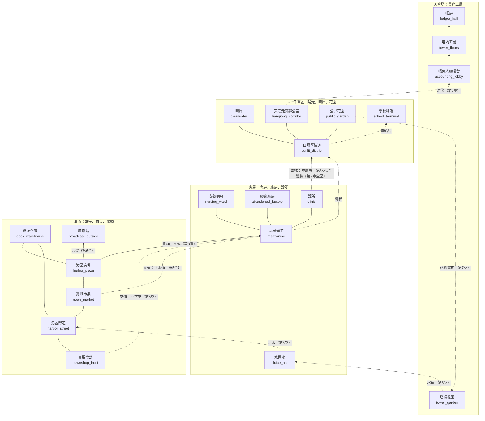
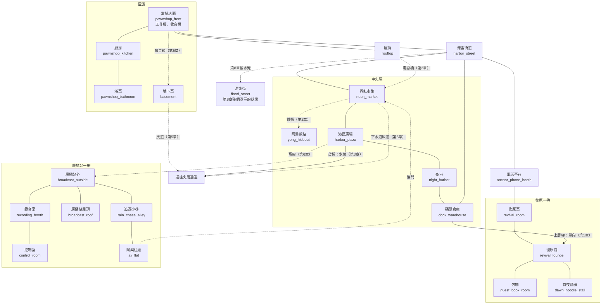
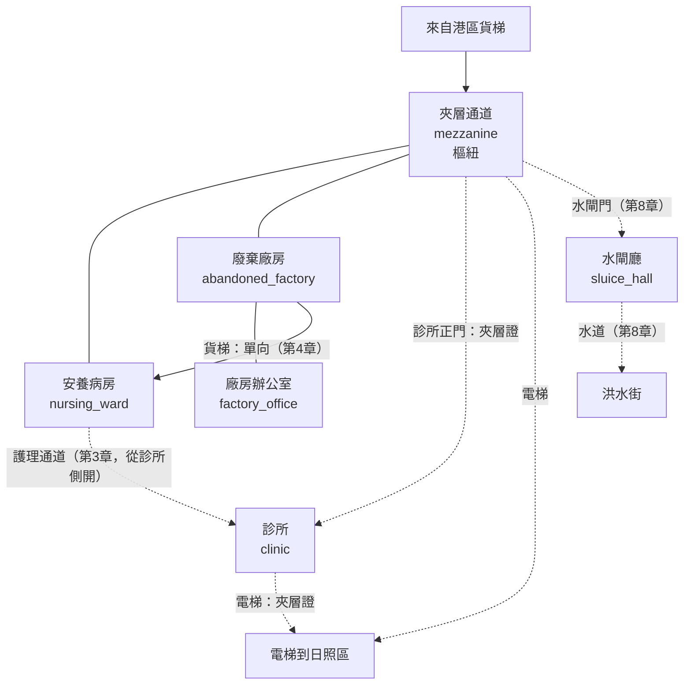
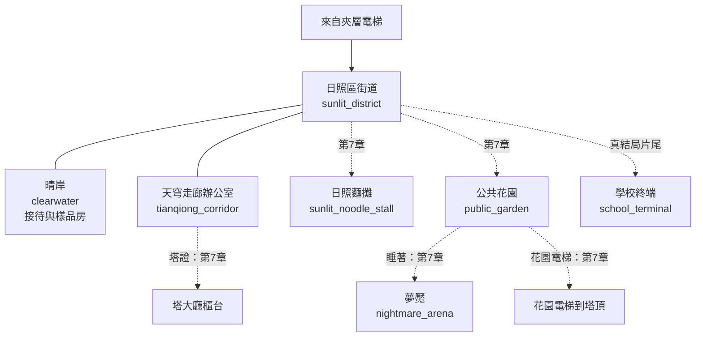
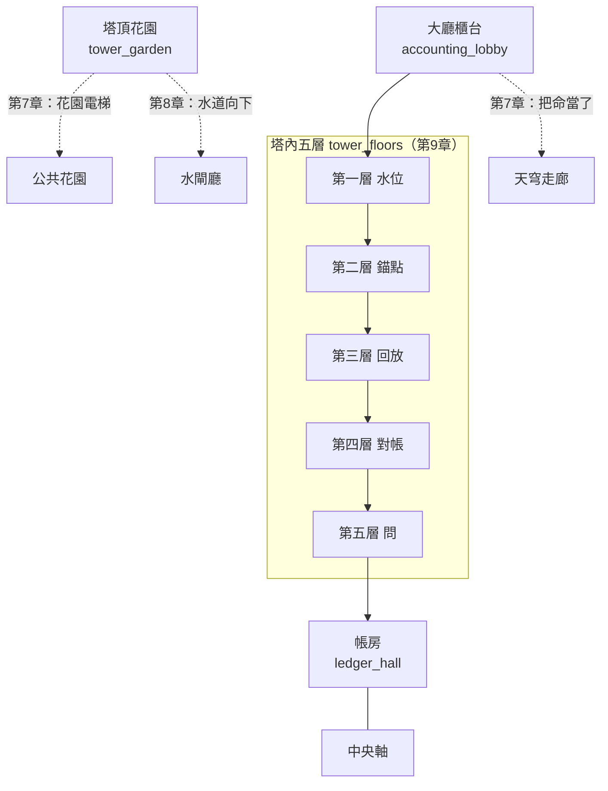
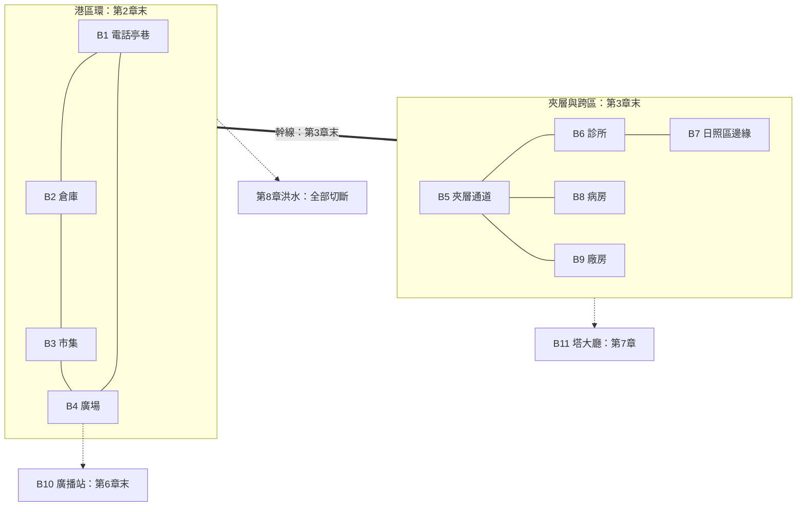

# 地圖設計：緊湊、交錯、重複路過

> 來源：2026-10-04 使用者希望遊戲像《惡靈古堡 1》：**場景會重複出現**，玩家反覆路過許多場景，劇情安排下後期也會回到前期的場景，這時換光影或渲染方式，或把區域錯綜交錯、設置多個傳送點，讓玩家在一個**緊湊且有趣**的遊戲裡冒險、打怪升級、解謎。要同時設計地圖與劇本，把事情標在地圖上。
> 事件與劇情綁定見 [EVENTS.md](EVENTS.md)，長線支線見 [SIDEQUESTS.md](SIDEQUESTS.md)。大綱見 [OUTLINE.md](OUTLINE.md)，解謎動詞見 [PUZZLE.md](PUZZLE.md)。
> 場景代號（如 `pawnshop_front`）沿用 BG-11 的場景包資料夾名，方便美術與關卡對照。**這份是提案**，實作要另外開票。
> 圖用 Mermaid 繪製：實線＝一直通行，虛線＝需要條件或某章之後才開，單向箭頭＝單向捷徑。

## 0. 設計原則

| # | 原則 | 說明 |
|---|---|---|
| 1 | **一座緊湊的城，不是九張地圖** | 全作約 **36 個可玩場景**，分四個區域。每個場景平均被路過 3 次以上，預算花在「換裝」而不是「新增」 |
| 2 | **當舖是大廳** | 像《惡靈古堡》的主廳：每個區域最後都有一條捷徑接回當舖；最安全、最常回來，每章換狀態 |
| 3 | **環與捷徑** | 每個區域至少有一個環（繞一圈回到起點）；單向捷徑「從另一側打開」，第一次走很遠，第二次一條線 |
| 4 | **知識是鑰匙，其次才是道具** | 閘門以水位、義體能力、知識（聲音鎖、回放看到的習慣）為主；通行證只有三張。呼應 Outer Wilds 與 PUZZLE.md 原則 4 |
| 5 | **重訪要有新東西** | 每次回到舊場景都有四項至少一項改變：光影與渲染、空間（新入口或被封）、佔據者與敵人、這裡發生的事 |
| 6 | **傳送要「掙來的」** | 電話亭（錨點）是存檔點，也是傳送網；每座亭子要親自走到才啟用，線路要等燈接好才能互傳（§4）。早期沒有傳送，像《惡靈古堡》逼玩家認識這座城 |
| 7 | **地圖就是劇情的載體** | 每個事件有發生地點，每個地點記得發生過什麼（§6）：老 K 的位置、標籤、水位、麵攤，都是地圖上的狀態 |
| 8 | **洪水改變地圖** | 第八章水位上升，下層被淹、上層新開、傳送網被切斷：一次性改寫整張圖，是全作最大的「換裝」 |

## 1. 世界總圖

沉港市是一座剖面城市：**港區**在最下面（雨、水、市集、當舖），**夾層**在中間（病房、廠房、診所：天穹不想被看見的地方），**日照區**在上面（陽光、晴岸、花園），**天穹塔**貫穿三層，中心是帳房。

### 區域一覽

| 區域 | 氣氛 | 主要敵人（每章敵人名單互不重複，NE-97） | 角色 | 第一次進入 | 場景數 |
|---|---|---|---|---|---|
| **港區** | 夜雨、霓虹、暖黃的家 | 收帳人、保全機甲、無人機 | 老 K、阿梨、鷺、阿勇 | 第 1 章 | 約 17 |
| **夾層** | 管線、冷白燈、鏽 | 天穹清理隊、廠房機具、用盡者的看護機 | 棠、燈的母親、守門人、清理隊 | 第 3 章 | 約 6 |
| **日照區** | 陽光、乾淨、太安靜 | 保全、巡邏機、夢魘（第 7 章） | 林小姐、葉、日照區居民 | 第 3 章（隔著玻璃） | 約 6 |
| **天穹塔** | 白、金屬、帳房的光 | 帳房守衛、條款（第 9 章） | 沈望、汐、葉 | 第 7 章 | 約 4 |

## 2. 四個區域的地圖

### 2.1 港區

當舖是家，也是主廳。最重要的是**中央一個環**：街道、市集、廣場、夜港、倉庫繞成一圈，每條邊在不同章節打開，玩家逐步學會這個環。

| 代號 | 場景 | 用途 | 第一次 | 之後的重訪（見 §6） |
|---|---|---|---|---|
| H1 | `pawnshop_front` 當舖店面 | 據點、工作檯（武器改裝）、收音機 | 1 | 每章，**狀態每章不同** |
| H2 | `pawnshop_kitchen` 廚房 | 晚飯、留的飯、燒水 | 1 | 1、3、6、8、結局 |
| H3 | `pawnshop_bathroom` 浴室 | 洗澡（安靜場景） | 6 | 只有第 6 章 |
| H4 | `basement` 地下室（含 `basement_door`） | 錨椅、帳、筆記本 | 5 | 5、8、9 |
| H5 | `harbor_street` 港區街道 | 樞紐；巡邏與商家 | 1 | 全章，雨量與光隨章變 |
| H6 | `anchor_phone_booth` 電話亭巷 | 第一座亭子，**起點**；接著復原室 | 1 | 全章 |
| H7 | `rooftop` 屋頂 | 差事、看雨、燈的坦白、灰衣人 | 1 | 1、2、4、8 |
| H8 | `dock_warehouse` 碼頭倉庫 | 第一章頭目與水位謎 | 1 | 1、4（路過）、8 |
| H9 | `revival_room` 復原室 | 死後醒來的白房間 | 1 | **每次死亡** |
| H10 | `revival_lounge` 復原館 | 阿梨上班；夜店；酒與陪伴 | 1 | 1、2、3、4、5、6 |
| H11 | `guest_book_room` 包廂 | 間章一 | 2 | 只有間章一 |
| H12 | `neon_market` 霓虹市集 | 對帳謎、麵攤的空地、廣告螢幕 | 2 | 2、3、4、6、結局 A |
| H13 | `yong_hideout` 阿勇據點 | 阿勇與小薇 | 2 | 只有第 2 章（之後被佔：利息） |
| H14 | `harbor_plaza` 港區廣場 | 貨梯、高架、廣播後的人群 | 2 | 3、6 |
| H15 | `night_harbor` 夜港 | 船、碼頭 | 2（路過）| 8、9 |
| H16–H20 | 廣播站一帶 | 第六章 | 6 | 6、間章四 |
| H21 | `ali_flat` 阿梨住處（**新增需求**） | 第二章拜訪、第六章事件的地點（只出現外觀與後果）| 2 | 6、8 |
| H22 | `flood_street` 洪水街 | 洪水段；間章三（七年前，另一街區） | 5（間章三）| 8 |
| H23 | `dawn_noodle_stall` 宵夜麵攤 | 第一章天亮的選擇 | 1 | 只有第 1 章 |

> 阿梨的**麵攤**固定位置在市集 H12 的一塊空地，隨支線逐步長出來（§7、[SIDEQUESTS.md](SIDEQUESTS.md) 麵攤線），`ending_a_stall` 是它最後的樣子。

### 2.2 夾層

天穹不想被看見的一層：用盡者的病房、廢棄的廠房、診所。一個樞紐（夾層通道）連出三條路，**病房、廠房、診所之間另有三條橫向的捷徑**，整層是一個緊密的小迷宮。

| 代號 | 場景 | 用途 | 第一次 | 重訪 |
|---|---|---|---|---|
| M1 | `mezzanine` 夾層通道 | 樞紐、電話亭 B5、灰道出口 | 3 | 3、4、5、7、8 |
| M2 | `nursing_ward` 安養病房 | 棠（鷺的妻子）、燈的母親、蘇的丈夫；鷺每週日來 | 4（也可第 3 章先路過） | 4、間章二、6、8，及支線 |
| M3 | `abandoned_factory` 廢棄廠房 | 清理隊隊長之戰 | 4 | 4、間章二 |
| M4 | `factory_office` 廠房辦公室 | 帳本、鷺倒下的地方 | 4 | 4 |
| M5 | `clinic` 診所（錨庫分站） | 對帳謎、守門人 | 3 | 3、4（路過）、支線 |
| M6 | `sluice_hall` 水閘廳 | 協定頭目；塔通往洪水的路 | 8 | 8 |

### 2.3 日照區

第 3 章只能**隔著玻璃**看：站在夾層電梯的邊緣平台，看見陽光，只有一個小範圍可探索（凜第一次站在光裡）。第 7 章拿到參觀證才進得去全區，這才是「進去」。

| 代號 | 場景 | 用途 | 第一次 | 重訪 |
|---|---|---|---|---|
| S1 | `sunlit_district` 日照區街道 | 第 3 章只有「玻璃邊緣」；第 7 章全區 | 3 | 3、7、B 結局 |
| S2 | `clearwater` 晴岸 | 林小姐、樣品房、B 結局的房間 | 3 | 3、7、B 結局 |
| S3 | `tianqiong_corridor` 天穹走廊辦公室 | 「她不能再死了」；塔的入口之一 | 3 | 3、7 |
| S4 | `sunlit_noodle_stall` 日照麵攤 | 吃麵 | 7 | 只有第 7 章 |
| S5 | `public_garden` 公共花園 | 長椅、花園電梯 | 7 | 7 |
| S6 | `nightmare_arena` 夢魘 | 頭目「明天」（夢，不是實體地點） | 7 | — |
| S7 | `school_terminal` 學校終端 | 真結局片尾 | 真結局 | — |

### 2.4 天穹塔

塔貫穿三層，內部是**垂直的**：外面是辦公室與大廳，裡面是五層謎，中心是帳房。第 3 章只看到外觀，第 7 章進大廳與頂樓花園，**第 8 章從頂樓一路下到洪水**，第 9 章回頭**從下往上爬進帳房**。同一座塔，三次不同方向。

| 代號 | 場景 | 用途 | 第一次 | 重訪 |
|---|---|---|---|---|
| T1 | `accounting_lobby` 大廳櫃台 | 把命當了、葉 | 7 | 7、8、9 |
| T2 | `tower_floors` 塔內五層 | 第 9 章的垂直探索，每層一個動詞 | 9 | — |
| T3 | `tower_garden` 塔頂花園 | 沈望、汐、茉莉；筆記本謎 | 7 | 7、8 |
| T4 | `ledger_hall` 帳房 | 最終戰 | 9 | — |

## 3. 通行規則（閘門）

| 類型 | 例子 | 引入 | 備註 |
|---|---|---|---|
| **水位** | 倉庫閘門（第 1）、貨梯井（第 3）、冷卻閥（第 6）、洪水（第 8 反過來：水位把路淹掉） | 第 1 章 | 水位是**全域狀態**（§7），不是每個謎自己的 |
| **義體能力**（提案，需開票） | **電擊**：供電的閘與電子鎖（第 1 章起）。**重擊**：脆弱的牆與箱（第 2）。**磁吸**：金屬門板與浮物、引雷（第 4 起，第 6、8 章大量用）。**電磁脈衝**（現有）：癱瘓保全閘短時間。**超頻**（現有）：限時機關的寬鬆解法 | 第 1 章起逐章新增 | 沿用現有能力資料，新能力用同一格式 |
| **通行證**（只有三張） | **夾層證**（診所職員證，第 3 章對帳後得）、**參觀證**（林小姐，第 7 章看房）、**塔證**（葉，第 7 章） | 3 / 7 / 7 | 每張都從一個人的手上來，不是撿來的 |
| **知識** | 聲音鎖（第 5 章：「下面本來就是水」）、棠的櫃子（第 4 章：敲三下、哼歌）、沈望筆記本的順序（第 7 章） | 第 4、5、7 章 | 玩家學到的才是鑰匙，不寫進任何道具 |
| **劇情閘** | 收帳人封路（第 1 章，鷺開）、警報（第 7 章末）、洪水（第 8 章） | — | 每個劇情閘都有看得到的原因，不是空氣牆 |
| **單向捷徑** | 倉庫上層梯、廠房貨梯、塔頂水道 | — | 第一次走遠路，從另一側打開後變捷徑 |

**不用的**：鑰匙卡一把開一扇的《惡靈古堡》式鑰匙清單。本作的「鑰匙」是人與知識，這與主題一致（錨人、記憶）。

### 3.1 捷徑清單

| # | 捷徑 | 起迄 | 開啟 | 章 | 縮短的路 |
|---|---|---|---|---|---|
| SC1 | 電線橋 | 當舖屋頂 ↔ 市集屋頂 | 被剪過的電線（灰衣人清過的路之一） | 2 | 當舖到市集由街道繞圈變成一條線 |
| SC2 | 倉庫上層梯 | 碼頭倉庫 → 復原館後巷 | 倉庫內從上層放下（單向） | 1 | 死後從復原室回倉庫的路 |
| SC3 | 夜港閘門 | 夜港 ↔ 倉庫 | 水位 | 1 | 關上港區環 |
| SC4 | 市集封路 | 市集 ↔ 廣場 | 阿勇戰後收帳人撤走 | 2 | 市集到廣場 |
| SC5 | 廣場貨梯 | 港區 → 夾層 | 水位 | 3 | 第一條跨區的路 |
| SC6 | 診所護理通道 | 診所 ↔ 病房 | 從診所側打開 | 3 | 夾層三處互通 |
| SC7 | 廠房貨梯 | 廠房 → 病房後門 | 單向 | 4 | 間章二鷺走的路 |
| SC8 | 夾層電梯 | 夾層 → 日照區 | 夾層證 | 3（只到邊緣）／7 | 跨區 |
| SC9 | **灰道** | 全區（§5） | 第 5 章揭露後 | 5 起，逐段擴 | 取代大部分跨區的走路 |
| SC10 | 高架 | 廣場 → 廣播站 | 蘇的人放下 | 6 | 廣播站 |
| SC11 | 花園電梯 | 公共花園 → 塔頂 | 沈望的邀請 | 7 | 塔 |
| SC12 | 塔中央軸＋水道 | 塔頂 → 水閘廳 → 洪水街 | 洪水協定啟動 | 8 | 從上到下的最長捷徑，第 9 章反向使用 |

## 4. 傳送網：電話亭

電話亭是存檔點，也是傳送網（見 NE-121 與 [../15-combat-feel/DESIGN.md](../15-combat-feel/DESIGN.md)）。

### 4.1 規則

| 規則 | 說明 |
|---|---|
| 親自啟用 | 每座亭子要**走到並拿起話筒**才啟用，沒啟用的亭子不能當傳送目的地。傳送不能跳過一座還沒走過的區域 |
| 線路要接 | 啟用只是存檔。**傳送要等燈把那一段線路接好**（他在通訊裡說「線接好了」）：燈的職責之一，也是他的沉默之外的另一個用處 |
| 早期沒有傳送 | 第 1～2 章只能走路，讓玩家認得這座城；第 2 章末起港區環可互傳 |
| 限制 | 戰鬥中、頭目戰、間章、限時段不能傳送；傳送時有一秒話筒的雜訊演出，**不做黑畫面載入** |
| 第 8 章切斷 | 洪水夜線路被切，傳送停用，只剩存檔點 |
| 第 9 章 | 塔內五層各有一座，**只能在塔內傳送** |
| 代價 | 無。傳送不扣信用點 |

### 4.2 亭子與線路

| 編號 | 位置 | 區域 | 可啟用 | 線路 |
|---|---|---|---|---|
| B1 | `anchor_phone_booth` 電話亭巷（復原室旁） | 港區 | 1 | **起點** |
| B2 | 碼頭倉庫入口 | 港區 | 1 | 港區環（第 2 章末） |
| B3 | 霓虹市集中 | 港區 | 2 | 港區環 |
| B4 | 港區廣場 | 港區 | 2 | 港區環 |
| B5 | 夾層通道 | 夾層 | 3 | 夾層與跨區（第 3 章末） |
| B6 | 診所 | 夾層 | 3 | 夾層與跨區 |
| B7 | 日照區街道（玻璃邊緣） | 日照區 | 3 | 夾層與跨區 |
| B8 | 安養病房門口 | 夾層 | 4 | 夾層與跨區 |
| B9 | 廢棄廠房入口 | 夾層 | 4 | 夾層與跨區 |
| B10 | 廣播站外 | 港區 | 6 | 港區環（第 6 章末） |
| B11 | 大廳櫃台 | 塔 | 7 | 塔線（第 7 章） |
| B12 | 塔內五層（各一座） | 塔 | 9 | 塔內 |

## 5. 灰道：收屍人的路

前四章玩家看到「被清過的路」：剪斷的電線、昏倒但沒死的守衛、沒鎖的門。第 5 章揭露那是老 K 雇的收屍人走的路，**他們每次都在凜死後十分鐘內把她送到終端**，靠的是一張藏在整座城下面的**服務通道網**，叫灰道。

| 項目 | 內容 |
|---|---|
| 揭露 | 第 5 章：老鬼把外套鋪在地下室樓梯上走開；地下室深處有一扇通往灰道的門。一旦打開，凜就**倒著走過前四章的所有伏筆** |
| 地圖意義 | 灰道是**跨區捷徑網**：當舖地下室、市集下水道、夾層通道、病房後門、廣播站、倉庫上層都有出入口。第 5 章開第一段，之後逐段擴 |
| 擴張方式 | **不是靠鑰匙，是靠人**：每位收屍人的名字與理由換一段路（支線「灰無常的工錢」，見 [SIDEQUESTS.md](SIDEQUESTS.md)） |
| 空間 | 窄、低、管線與手寫路標、每隔一段有一張小桌子與一杯茶（收屍人休息的地方）。沒有敵人，是**安靜的跨區走廊**，適合放環境敘事 |
| 敘事 | 灰道的牆上有路標：每個出入口的路標都是同一個人的筆跡，**老 K 的字**，因為路是他規劃的 |
| 與傳送的關係 | 傳送是方便；灰道是「親自走過、更快、有故事」的另一條。第 8 章洪水切斷傳送時，灰道是**最後一條還能走的路** |
| 渲染 | 暗、暖橙的小燈、潮濕。第 8 章水淹過，是**整場洪水最安靜的一段** |

## 6. 重複路過：每個地點每章怎麼換

換法有四種：**光影與渲染**、**空間**、**佔據者與敵人**、**這裡發生的事**。光影用**每章一個環境主題**（沿用既有的環境主題資料，`data/environment/themes/`），場景可有各自的覆寫。

### 6.1 渲染的種類

| 種類 | 用在 | 做法 |
|---|---|---|
| 章節環境主題 | 全作 | 每章一份：雨量、色調、主光、霓虹強度。見 [OUTLINE.md](OUTLINE.md) §5.1 的畫面進程 |
| **記憶濾鏡** | 回放、間章 | 暖黃、顆粒、輕微去飽和、邊緣暈；間章三（洪水夜）再加水的反光 |
| **復原濾鏡** | 每次死後醒來 | 白閃、金屬味的音效、短暫過曝 |
| **日光** | 第 7 章、第 3 章玻璃外 | 直射陽光與泛光；是全作唯一的白天 |
| **洪水水面** | 第 8 章 | 水位線隨進度上升，水面反射霓虹與手電筒 |
| **空殼** | 第 4 章廠房與病房 | 去飽和、冷白、閃爍的日光燈 |
| **帳房白** | 第 9 章 | 近乎無色的白與金屬，條款的字是唯一的顏色 |

### 6.2 當舖與港區街道

| 章 | 當舖（H1） | 港區街道（H5） |
|---|---|---|
| 1 | 暖黃、完整、標籤整齊；漏水桶 | 夜雨、霓虹、積水；收帳人封著市集的路 |
| 2 | 有幾張標籤空白；收音機可修 | 市集封路解除；氣象看板 |
| 3 | 老 K 留的飯；字跡抖；他叫她別去上面 | 雨小；日照區的光從高處漏下來 |
| 4 | 收音機放著鷺的歌；安靜 | 雨大；鷺不在 |
| 5 | **調查現場**：抽屜全開、標籤被翻、貨架空位；地下室門打開 | 葉的車停在門口 |
| 6 | 浴室暖色（H3 第一次開）；老 K 摔了一跤 | 暴雨；廣播的人群 |
| 7 | 空；老 K 不在；沒開燈 | 白天，唯一的晴天，人們抬頭 |
| 8 | **水到膝蓋，標籤漂在水上**；老 K 在桌前燒水 | 洪水街（H22） |
| 9 | 結局 A：洪水退後，標籤泡掉一半 | 結局 A：走過的路，雨沒停 |

### 6.3 其他港區地點

| 地點 | 重訪與換法 |
|---|---|
| **屋頂 H7** | 1 差事（夜）→ 2 看雨（凌晨，破傘）→ 4 燈的坦白（雨大）→ 8 灰衣人在接別人（暴風雨），丟繩子 |
| **市集 H12** | 2 熱鬧、阿梨被要帳、對帳謎 → 3 路過 → 4 阿梨給線索 → 6 廣播後的人群、阿勇的副手佔了阿勇的據點 → 麵攤空地逐章長大 → 結局 A 招牌「欠著」 |
| **復原館 H10** | 1 復原夜（暖色、低燈）→ 2 包廂（間章一）→ 3 老位置、少人 → 4 清理隊說漏嘴 → 5 收屍人收工後來喝酒 → 6 阿梨不在或在（旗標） |
| **碼頭倉庫 H8** | 1 頭目與水位謎 → 4 路過、被清理過 → 8 洪水淹到一半，上層成了船的停靠點 |
| **夜港 H15** | 2 路過 → 8 船、船燈、蘇的船離開 → 9 凜看著塔 |
| **廣場 H14** | 3 貨梯 → 6 廣播後人群：「我知道。我還是要。」 |

### 6.4 夾層、日照區、塔

| 地點 | 重訪與換法 |
|---|---|
| **夾層通道 M1** | 3 首次、冷白燈 → 4 病房與廠房的分岔、閃爍 → 5 灰道出口 → 7 電梯到日照區 → 8 水閘門開了 |
| **病房 M2** | 4 鷺每週日來（灰綠、雨聲）→ 間章二（鷺的視角，同一條走廊）→ 6 支線：蘇的丈夫、燈的母親 → 8 收屍人撤離病患（灰衣人接別人） |
| **廠房 M3** | 4 清理隊，場地逐步被擦空 → 間章二鷺走另一條路 |
| **診所 M5** | 3 對帳謎與守門人 → 支線：阿翰的錄音 |
| **日照區 S1、晴岸 S2** | 3 玻璃外（隔著）→ 7 走進去（白天）→ B 結局窗邊 |
| **塔** | 3 外觀 → 7 大廳與頂樓 → 8 頂樓往下 → 9 **從下往上**爬進帳房 |

## 7. 世界狀態

地圖不是靜態的。以下是全域狀態，存檔時整組存，**缺漏或損毀時退回安全預設值並記錄具體位置**（例如水位預設為該章標準值）。

| 狀態 | 範圍 | 改變 | 影響 |
|---|---|---|---|
| **水位** | 0～4 | 第 1 章起的水位謎；第 8 章洪水強制上升 | 通路、浮力、哪些地方被淹（§3） |
| **雨量** | 1～5 | 隨章節，另與死亡次數輕微連動（調味，不是機制） | 環境主題、聲音 |
| **當舖標籤完整度** | 0～100% | 隨章節自然減少；支線「標籤」可還原一部分 | 當舖畫面、第 8 章漂浮的標籤數 |
| **麵攤進度** | 0～4 | 支線「麵攤」 | 市集空地的外觀；結局的畫面 |
| **灰道段數** | 0～6 | 第 5 章起，支線「灰無常的工錢」 | 可用的捷徑 |
| **電話線路** | 旗標組 | 燈接線（§4） | 可傳送的亭子 |
| **通行證** | 旗標 | 夾層證、參觀證、塔證 | 對應的閘門 |
| **分支旗標** | `knows_ali_address`、`ali_call_relayed` | 見 [PLOT.md](PLOT.md) | 阿梨事件 |
| **以死解謎使用** | 次數 | 第 4 章起計入耗損 | 死亡畫面、燈的提示 |

## 8. 需要新增的場景

BG-11 已有 43 個場景背景，以下是這份地圖**額外需要**的，開票時交給 `pm/Nest-Egg-BG/`：

| 場景 | 用途 | 備註 |
|---|---|---|
| `ali_flat` 阿梨住處 | 第 2 章拜訪、第 6 章事件的外觀、第 8 章 | 不出現事件本身 |
| `grey_path` 灰道 | 第 5 章起的捷徑網 | 三種變體：港區段、夾層段、塔段；窄、暖橙小燈、手寫路標 |
| `mezz_lift` 貨梯井 | 第 3 章水位謎、跨區 | 可與 `mezzanine` 合併為變體 |
| 市集空地（麵攤的位置） | 支線進度的畫面 | 可在 `neon_market` 做 4 種變體，不一定新場景 |

## 9. 待你決定

| # | 問題 | 我的建議 |
|---|---|---|
| 1 | 全作 36 個可玩場景、四區的規模是否合適？ | 合適；比九張獨立地圖省，也比開放世界緊 |
| 2 | 傳送網「親自啟用＋燈接線」的規則是否合意？ | 合意；呼應燈的職責，也讓早期不能亂跳 |
| 3 | 第 8 章切斷傳送、第 9 章只能在塔內傳送，是否合意？ | 合意；洪水的緊張需要它 |
| 4 | 灰道的擴張靠「人」（支線）而不是鑰匙，是否合意？ | 合意；與主題一致 |
| 5 | 義體能力清單（電擊、重擊、磁吸）的順序與數量？ | 先採此表，開票時對照現有能力系統 |
| 6 | 阿梨住處與灰道是否同意新增？ | 同意 |
