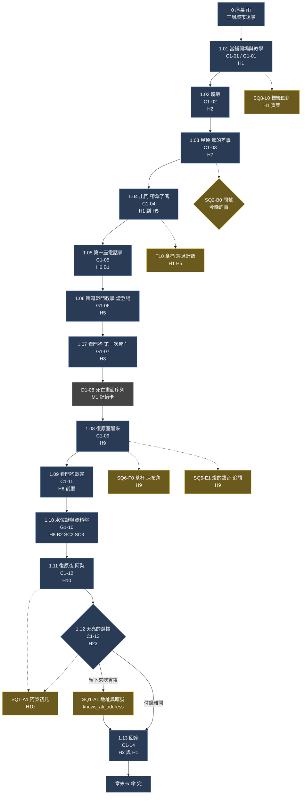
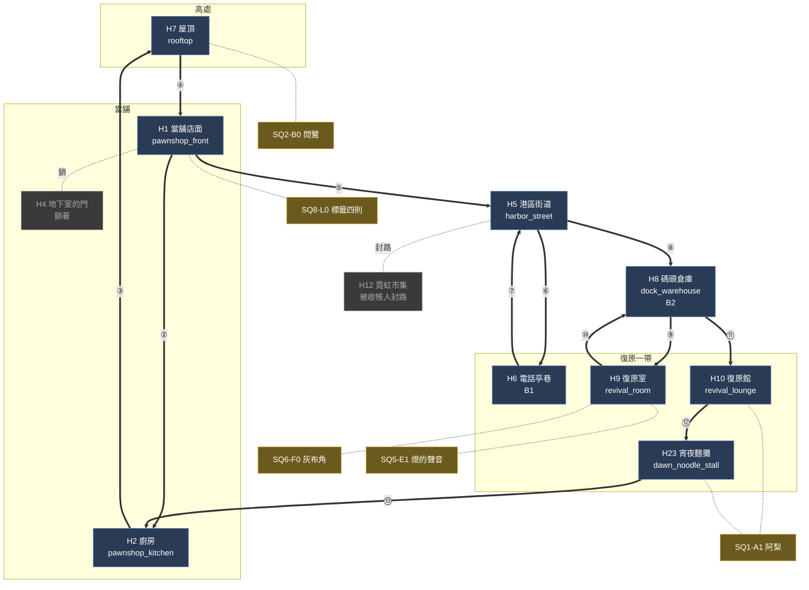

# 第一章「傘」劇本（第二版）

> 來源：2026-10-05 使用者要求：台詞參照《邊緣行者》字幕的**用詞與句型**；腳本要**盡可能清晰**，要有**地圖對應圖**（每個場景發生在地圖哪裡、對應哪條主線與支線）；第一章出現的**主線與支線都要包含**，順序與流程寫清楚；過場、BGM、角色動作、台詞、語氣都盡可能寫清楚。
> 第一版（2026-10-04）改寫為本版：台詞全面改成短句風格；新增地圖對應圖、流程圖、BGM 總表、支線節點與逐場景的分鏡表。
> 對照：事件 1.01～1.13 見 [EVENTS.md](EVENTS.md)，地圖見 [MAP.md](MAP.md)，支線見 [SIDEQUESTS.md](SIDEQUESTS.md)，角色見 [CHARACTERS.md](CHARACTERS.md)，傘見 [UMBRELLA.md](UMBRELLA.md)，成人內容見 [MATURE.md](MATURE.md)。票：ST-1。
> 這份**取代**舊的 `data/story/chapter_01.json` 與 `cutscenes_ch1.json`（舊稿是已作廢的 04-story）。定稿後才轉成資料（ST-2）。

## 0. 怎麼讀這份劇本

### 0.1 編號

| 編號 | 意思 | 例 |
|---|---|---|
| `C1-xx` | **過場／演出**（玩家只看與聽，可跳過） | `C1-03` 屋頂 |
| `G1-xx` | **玩法段**（玩家操作，夾雜通訊與短對話） | `G1-07` 看門狗 |
| `D1-xx` | **系統畫面序列** | `D1-08` 死亡畫面 |
| `1.0x` | **主線事件**（對應 [EVENTS.md](EVENTS.md) 的事件編號） | `1.07` |
| `SQn-Xn` | **支線節點**（對應 [SIDEQUESTS.md](SIDEQUESTS.md)） | `SQ1-A1` |
| `T#` | **暗線**（對應 [OUTLINE.md](OUTLINE.md) 的 T1～T10） | `T10` 傘 |
| `H#`、`M#`、`S#`、`B#` | **地圖代號**（對應 [MAP.md](MAP.md)；`B#` 是電話亭） | `H1` 當舖 |
| `I1-xx` | **可互動物件**（玩家按鍵會說一句） | `I1-03` 懷錶 |
| `BGM-x` | **音樂 cue**（見 §5） | `BGM-3` |

### 0.2 分鏡表的欄位

每個場景都用同一種表。第一欄是**步驟編號**，第二欄是**類型**：

| 類型 | 意思 | 對應現有過場動畫的動作 |
|---|---|---|
| **【鏡】** | 鏡頭、構圖、轉場 | `scene`、`camera`、`letterbox`、`transition`、`fade` |
| **【動】** | 角色動作、站位、表情 | `actor`、`pose`、`move`、`face`、`remove` |
| **【音】** | 音效、環境音、音樂 | `sfx`；音樂見 §5 |
| **【光】** | 光影、特效 | `fx`（shake、flash、lightning、noise、tint、rain、vignette） |
| **【說】** | 台詞 | `say`（style：normal、whisper、shout、noise）、`narrate` |
| **【玩】** | 需要玩家操作 | 玩法系統 |
| **【選】** | 選項（引擎尚缺，見 §14） | （新） |
| **【旗】** | 設定旗標與獎勵 | （新） |

最後一欄**語氣／表演**寫的是**怎麼演**（給配音與動畫）：語速、停頓、視線、手上的動作。

**檢查規則**（現有檢查器）：每個動畫場景 ≤ 16 句台詞、連續台詞 ≤ 3 句、每句 ≤ 56 字。所以每 3 句台詞之間夾一個非台詞步驟（動作、鏡頭或音效）；本稿遵守。

## 1. 台詞風格：參照《邊緣行者》字幕

下面是我讀完使用者提供的字幕（第 1～3、5～10 集，共約 3,000 句）整理的**用詞與句型**。引用的句子只用來說明句型。

### 1.1 它的台詞長什麼樣（數字）

| 項目 | 數據 | 對我們的意義 |
|---|---|---|
| 一句的長度 | **中位數 8 個字，90% 的句子在 16 字以內** | **日常台詞 ≤ 16 字**；超過的只給「簡報、播報、老 K 講貨架」這三種場合 |
| 句尾 | 最常見是「了」「嗎」「…」「吧」「啊」：陳述加一點疑問，常以**省略號**收尾 | 句尾用「了」「嗎」「…」；不加感嘆號 |
| 開頭 | 最常見是「什麼」「我們」「我不」「可惡」「現在」「那個」 | 常用「什麼」「那個」「所以」開頭 |
| 錢 | 「錢」是最高頻的名詞之一 | 港區也一樣：**用數字講感情** |
| 道歉 | 「抱歉」「對不起」出現三十多次，**平靜、不戲劇化** | 凜與燈都會道歉，但不演 |

### 1.2 十個句型（含例子）

| # | 句型 | 《邊緣行者》的例子 | 本作怎麼用 |
|---|---|---|---|
| 1 | **一問一答，答案比問題短** | 「怎麼找他聊」→「當面找他聊」（第 5 集） | 凜：「誰要的。」鷺：「上面。」 |
| 2 | **複述對方的詞** | 「機會　什麼機會」（第 3 集）；「『處理』」（第 1 集） | 阿梨：「一？才一次？」 |
| 3 | **把價錢談成感情** | 「我八　你二」「能六四分嗎」「七三分」（第 2 集） | 凜付錢，阿梨不收；「那我欠你」 |
| 4 | **玩笑當護甲** | 「是三成」→「開玩笑的」（第 2 集） | 鷺：「死了還不是照樣喝酒。」 |
| 5 | **簡報句型**：地點、目標、障礙，一句一件 | 「我來講解工作」「我們要的是……導航數據」（第 3 集） | 鷺交代差事 |
| 6 | **平靜地講殘酷的事** | 「不准在這裡」「那我現在立刻殺了你」（第 3 集） | 燈：「死是工具。」 |
| 7 | **對答裡藏著沒說的** | 「你剛才就一直看著我」（第 2 集） | 老 K 不問她死了幾次，只問「幾次了」 |
| 8 | **半句話收尾** | 「但是……」「其實我最近在考慮……」（第 1 集） | 凜：「…算了。」 |
| 9 | **公司與系統的口吻：正式、長、沒有感情** | 「目前出發前去搭救客戶」（第 1 集） | 天穹氣象台、終端、錄音 |
| 10 | **溫柔的話不加形容詞** | 「我不想你死」（第 10 集） | 全作沒人說「我愛你」 |

### 1.3 用詞

| 類 | 《邊緣行者》 | 本作（港區版） |
|---|---|---|
| 暱稱 | 「小鬼」「小子」 | 鷺叫凜「**小鬼**」；老 K 叫她「**你**」，從不叫名字 |
| 罵人 | 「混蛋」「可惡」「幹」，克制，常常只有一個字 | 凜：「…幹。」（只有死的時候） |
| 同意 | 「明白」「沒問題」「是啊」 | 港區：「行。」「知道了。」 |
| 行話 | 「超夢」「邊緣」「賽博瘋子」 | 「復原」「付帳」「欠著」「再來」「有帳者／無帳者」 |
| 世界的粗糙感 | 洗衣機要儲值、制服在洗衣機裡濕透 | 當舖漏水桶、**吃飯要付四十** |

### 1.4 本作自己的規則

| # | 規則 |
|---|---|
| 1 | **沒有人說「我愛你」「我擔心你」**；愛用動作與小事講：煮水、問傘、切紅蘿蔔 |
| 2 | **老 K 是例外**：他愛講貨架上的東西，句子可以長，語尾有「喔」「啦」；越到後面越短 |
| 3 | **凜短到只有一個詞**；生氣時只剩一個字 |
| 4 | **鷺笑著說最重的話** |
| 5 | **燈嘴碎、自問自答；說真話時突然變短** |
| 6 | **阿梨用問句把答案留給對方**；對客人用「您」，對凜用「你」 |
| 7 | 系統與錄音**不帶情緒**，長句、完整、沒有省略 |
| 8 | 髒話克制：全章只有凜死的那一刻罵一次 |
| 9 | 每個場景至少有一句**不講事情本身**的話（天氣、湯、紅蘿蔔） |

## 2. 第一章總覽

### 2.1 這一章要做到的事

| # | 目標 |
|---|---|
| 1 | 讓玩家**愛上這個家**：當舖、老 K、貨架、漏水桶、晚飯 |
| 2 | 讓玩家**覺得死亡很便宜**：第一次死亡是個笑話，之後才變成第一筆帳 |
| 3 | 埋下全部的暗線：傘桶、船錢罐、地下室、老 K 的空眼神、收屍人的熱茶、標語的聲音、燈的聲音、記憶殘留 |
| 4 | 介紹阿梨：溫柔、直接，不是工具人 |
| 5 | 教玩家：移動、射擊（無限彈藥的小槍）、衝刺、格擋、近戰、電話亭、水位謎、「世界不會因為你死而重置」 |
| 6 | **傘**：凜目不斜視地走過傘桶，每一次 |

**凜相信的事（這一章的盲點）**：她以為自己的錨人是老 K 替她向天穹買的**常駐錨人（公司保單）**，「平平的、沒有味道」，所以沒有人替她付感情的帳；老 K 抽的一成手續費，她以為是**保費**。這個誤會到第四章中點才被打破。

### 2.2 主線事件（按順序）

| 順序 | 主線事件 | 編號 | 場景 | 地圖 | 類型 | 時長 |
|---|---|---|---|---|---|---|
| 0 | 序幕：雨 | — | `rainy_harbor` | 三層城市遠景 | 過場 | 40 秒 |
| 1 | 當舖開場與教學 | 1.01 | `pawnshop_front` | H1 | 過場＋玩法 | 8 分 |
| 2 | 晚飯 | 1.02 | `pawnshop_kitchen` | H2 | 過場 | 3 分 |
| 3 | 屋頂：鷺的差事 | 1.03 | `rooftop` | H7 | 過場 | 4 分 |
| 4 | 出門 | 1.04 | `pawnshop_front` | H1→H5 | 過場 | 1 分 |
| 5 | 第一座電話亭 | 1.05 | `anchor_phone_booth` | H6／B1 | 玩法＋過場 | 1 分 |
| 6 | 街道戰鬥教學與燈 | 1.06 | `harbor_street` | H5 | 玩法 | 6 分 |
| 7 | 倉庫前廳：看門狗與第一次死亡 | 1.07 | `dock_warehouse` | H8 | 玩法＋過場 | 5 分 |
| 8 | 死亡畫面序列 | 1.07（系統） | — | — | 系統 | 12 秒 |
| 9 | 復原室醒來 | 1.08 | `revival_room` | H9 | 過場 | 2 分 |
| 10 | 看門狗戰完 | 1.09 | `dock_warehouse` | H8 | 玩法＋過場 | 1 分 |
| 11 | 水位謎與資料盤：世界不會因為你死而重置 | 1.10 | `dock_warehouse` | H8／B2／SC2、SC3 | 玩法 | 8 分 |
| 12 | 復原夜：復原館 | 1.11 | `revival_lounge` | H10 | 過場 | 6 分 |
| 13 | 天亮：宵夜的選擇 | 1.12 | `dawn_noodle_stall` | H23 | 過場＋選擇 | 3 分 |
| 14 | 回家 | 1.13 | `pawnshop_kitchen`、`pawnshop_front` | H2、H1 | 過場 | 3 分 |
| 15 | 章末卡 | — | — | — | 系統 | 10 秒 |

### 2.3 第一章的支線與可選內容

第一章有**五條支線在這裡開始或埋種子**。（支線的完整設計見 [SIDEQUESTS.md](SIDEQUESTS.md)；這裡只列第一章的節點。）**經驗值與信用點**依 SIDEQUESTS.md §0.1 的大小分級（小／中／大），成長系統建立後生效。

| 節點 | 所屬支線 | 在哪 | 怎麼觸發 | 內容 | 大小 | 旗標 |
|---|---|---|---|---|---|---|
| **SQ8-L0** | 標籤 | `pawnshop_front` H1 | 對貨架上的四件舊貨按互動 | 聽老 K 講四張標籤的故事（懷錶、吉他、雨衣、船錢罐）；這四張是**完整的**，第五章後它們開始空白 | 小（聽完四張才給一次） | `labels_heard` 0～4 |
| **SQ2-B0** | 週日（鷺／棠） | `rooftop` H7 | 屋頂與鷺的對話中選擇【問她今晚的事】 | 鷺：「看一個人。」不說是誰；**第一次的「問」**（輕量版） | 小 | `asked_egret_sunday` |
| **SQ5-E1** | 病床（燈） | `revival_room` H9 | 對燈說「你的聲音跟終端很像」，並**追問第二次** | 燈第二次回答時停了很久：「…大概吧。」 | 小 | `noticed_lamp_voice` 0～2 |
| **SQ6-F0** | 灰無常的工錢（收屍人） | `revival_room` H9 | 對復原室桌上的**茶杯**按互動 | 杯底壓著一角**灰色的布**，收進道具欄（「灰布角」） | 小 | `has_grey_cloth` |
| **SQ1-A1** | 麵攤（阿梨） | `revival_lounge` H10、`dawn_noodle_stall` H23 | 復原夜遇見阿梨；天亮選擇【留下來吃宵夜】 | 阿梨初見；「那就欠著」；說出被收帳人盯上，**給地址與暗號** | 中 | `knows_ali_address` |
| （傘） | **T10 傘** | H1、H5 | 每次經過傘桶 | 凜目不斜視；不是支線，記錄次數 | — | `passed_umbrella_count` |

另有**環境敘事**（不是支線、沒有獎勵，是讓世界有東西可看）：

| 位置 | 內容 |
|---|---|
| H1 壞掉的收音機 | 只有雜訊，調不到台（第二章可以修；SQ4 伏筆） |
| H1 工作檯 | 武器改裝教學 |
| H5 看板 | 「今夜降雨量偏多，復原申請量高峰。」（T2） |
| H5 傳單 | 回音派：「復原出來的不是人，是人的回音。」凜接過，看一眼，扔進水溝 |
| H8 倉庫牆上的水位刻度 | 教「牆上的數字就是水位」 |
| H10 復原館牆上的價目表 | 「復原餐 120」「酒 80」「陪伴　另議」 |

### 2.4 流程圖：順序、分支與支線

藍色＝主線；琥珀色＝支線節點（虛線）；灰色＝系統畫面。

### 2.5 地圖對應圖

下圖是第一章玩家在地圖上**實際走的路**。粗線的圓圈數字是**走的順序**（對照下方的路線表）；琥珀色節點是**支線**，細虛線連到發生的場景；灰色是第一章打不開的地方。第一章**只在港區**，夾層與日照區還打不開。

**路線表**（①是開場，玩家從 H1 開始）：

| 順序 | 從 → 到 | 主線事件 | 玩家在做什麼 | 路是怎麼通的 |
|---|---|---|---|---|
| ① | H1（原地） | 1.01 | 開場、教學、聽貨架標籤（SQ8-L0） | — |
| ② | H1 → H2 | 1.02 | 晚飯 | 店內通道 |
| ③ | H2 → H7 | 1.03 | 上屋頂，與鷺對話（SQ2-B0） | 店內樓梯 |
| ④ | H7 → H1 | 1.04 | 下樓，出門，經過傘桶 | 店內樓梯 |
| ⑤ | H1 → H5 | 1.04 | 走出當舖 | 前門 |
| ⑥ | H5 → H6 | 1.05 | 啟用電話亭 B1 | 街角 |
| ⑦ | H6 → H5 | 1.06 | 街道戰鬥教學 | 街角 |
| ⑧ | H5 → H8 | 1.07 | 倉庫前廳，看門狗，**第一次死亡** | 碼頭路 |
| ⑨ | H8 → H9 | 1.08 | 死後在 B1（H6）醒來，進復原室（SQ6-F0、SQ5-E1） | 復原（傳送到最近的亭子） |
| ⑩ | H9 → H8 | 1.09、1.10 | 走回倉庫：打倒看門狗、水位謎、資料盤 | 同 ⑧ |
| ⑪ | H8 → H10 | 1.11 | 復原夜（SQ1-A1 初見） | **SC2：倉庫上層梯（單向）**，1.09 開通 |
| ⑫ | H10 → H23 | 1.12 | 天亮宵夜的選擇（SQ1-A1） | 復原館門口 |
| ⑬ | H23 → H2 | 1.13 | 回家（經 H5、H1） | 走回當舖 |

### 2.6 場景—地圖—主線／支線 對照表

| 場景 | 地圖 | 場景資料夾 | 主線 | 支線／暗線 | 電話亭 | 通行 |
|---|---|---|---|---|---|---|
| 序幕 | 三層城市遠景 | `rainy_harbor` | — | T2（水位數字） | — | — |
| C1-01、G1-01 | H1 | `pawnshop_front` | 1.01 | **SQ8-L0**、T1、T9、T10 | — | 開放 |
| C1-02 | H2 | `pawnshop_kitchen` | 1.02 | T1（抽屜）、T10 | — | 開放 |
| C1-03 | H7 | `rooftop` | 1.03 | **SQ2-B0**、T3（遠處的塔） | — | 開放 |
| C1-04 | H1→H5 | `pawnshop_front` | 1.04 | T10（傘桶） | — | 開放 |
| C1-05 | H6 | `anchor_phone_booth` | 1.05 | T3（沈望的聲音） | **B1 啟用** | 開放 |
| G1-06 | H5 | `harbor_street` | 1.06 | T2（看板）、燈登場 | — | 市集封路 |
| G1-07、D1-08 | H8 | `dock_warehouse` | 1.07 | T3（標語） | B2 入口 | 開放 |
| C1-09 | H9 | `revival_room` | 1.08 | **SQ6-F0**、**SQ5-E1**、T6、T7 | — | 開放 |
| C1-11 | H8 | `dock_warehouse` | 1.09 | 看門狗；隔牆打開 | — | 開放 |
| G1-10 | H8 | `dock_warehouse` | 1.10 | 以死解謎；資料盤（接第二章） | **B2 啟用**、SC2、SC3 開通 | 隔牆打開後 |
| C1-12 | H10 | `revival_lounge` | 1.11 | **SQ1-A1**（初見） | — | 經 SC2 抵達 |
| C1-13 | H23 | `dawn_noodle_stall` | 1.12 | **SQ1-A1**（旗標） | — | 開放 |
| C1-14 | H2、H1 | `pawnshop_kitchen`、`pawnshop_front` | 1.13 | T1（空眼神）、T10、地下室的光 | — | 開放 |

### 2.7 本章開始時的地圖狀態

| 項目 | 狀態 |
|---|---|
| 開放的場景 | H1、H2、H7、H5、H6、H9、H8、H10、H23 |
| 封閉的路 | 市集（H12）：收帳人封路；夜港（H15）：水位閘門沒開（SC3 在 1.09 開通）；地下室（H4）：鎖著；夾層以上全部封閉 |
| 電話亭 | 第一座 B1 在 1.05 啟用；B2 在 1.10 啟用；**沒有傳送**（第 2 章末才接線） |
| 傳送 | 無 |

### 2.8 旗標與存檔

| 旗標 | 設定時機 | 預設（缺漏或損毀時） |
|---|---|---|
| `knows_ali_address` | 1.12 選【留下來吃宵夜】，或第二章主動拜訪 | **真** |
| `passed_umbrella_count` | 每次經過傘桶 +1 | 0 |
| `first_death_seen` | 1.07 | 假 |
| `ledger_disk_obtained` | 1.10 | 假 |
| `watchdog_defeated` | 1.09 | 假 |
| `labels_heard` | SQ8-L0，0～4 | 0 |
| `asked_egret_sunday` | SQ2-B0 | 假 |
| `noticed_lamp_voice` | SQ5-E1，0～2 | 0 |
| `has_grey_cloth` | SQ6-F0 | 假 |

---

## 3. 角色在本章的聲音

寫台詞與配音時查這張表。

| 角色 | 語速與音色 | 語氣 | 在本章會說的 | 不會說的 |
|---|---|---|---|---|
| **凜** | 慢、低、乾 | 平，不解釋；生氣更短 | 「多少。」「記著。」「…幹。」 | 「謝謝」「我需要」「幫我」 |
| **老 K** | 碎念、尾音拖長 | 溫、不抬頭 | 「喔。」「啦。」「帶傘了嗎？」「今天的。」 | 「小心」「擔心」「對不起」 |
| **鷺** | 快、笑聲大 | 爽朗，把重話當笑話 | 「小鬼。」「死了還不是照樣喝酒。」 | 認真的道歉與感謝 |
| **燈** | 快、嘴碎、少年的聲音 | 自問自答，說真話時變短 | 「喂喂，一二三。」「你猜怎麼著？」 | 「對不起」（他說「我晚點補給你」） |
| **阿梨** | 輕、穩、不趕 | 問句，把答案留給對方 | 「吃了沒？」「那就欠著。」 | 命令句 |
| **錄音（沈望）** | 緩、溫柔、完整 | 像對孩子說話，無省略 | 「再來一次，沒關係。」 | 任何情緒詞 |
| **氣象台／終端** | 合成聲，平 | 公文 | 水位、降雨量、復原狀態 | 感嘆 |

---

## 4. 傘的演出（本章總表）

| 位置 | 傘 |
|---|---|
| 序幕 | 沒有傘；只有雨 |
| C1-01 | **傘桶**第一次介紹；標籤「傘」，禾念成 kasa |
| C1-04 | 「帶傘了嗎？」「下面本來就是水。」凜走過傘桶 |
| C1-02、C1-04 | 老 K 哼《借傘謠》（只有旋律） |
| C1-12 | 復原館吧台後面，阿梨的油紙傘靠著牆（畫面角落，不解釋） |
| C1-13 | 阿梨的麵攤頂棚下掛著一把油紙傘（同一把） |
| C1-14 | 最後一個畫面：傘桶，滴水 |

---

## 5. BGM 與音效總表

**音樂系統的規則**（[../16-audio/DESIGN.md](../16-audio/DESIGN.md)）：音樂有 `calm`（平靜）、`safe`（安全區）、`combat`（戰鬥）、`boss`（頭目）四種狀態，另有死亡與通關的短 sting；**過場動畫播放時 BGM 壓低**；對話與暫停選單不中斷音樂。環境音（雨、水滴等）掛在 Ambience 匯流排，不算 BGM。

**這一章的音樂紀律**：**音樂很少**。雨聲與漏水桶的水滴是這一章真正的背景音；音樂只在需要它的地方出現。第一段旋律要到 1.09 才出現。

### 5.1 音樂 cue

「可暫代」是現有 `data/audio/music.json` 裡能先頂用的曲目（NE-161 配置時可直接用）；「新曲需求」是目前沒有的、需要新找或新做的曲子，寫出情緒、樂器與速度，交給音訊管線挑素材。

| cue | 場景 | 狀態 | 可暫代 | 新曲需求 |
|---|---|---|---|---|
| **BGM-0 無** | 序幕、晚飯 C1-02、死亡序列 | 無音樂 | — | 序幕只有雨、水位刻度的敲擊聲；晚飯只有碗筷與漏水 |
| **BGM-1 當舖** | C1-01、C1-14 | safe | `safe_pawnshop` | 暖、低音量、慢（約 60～66 BPM，**與漏水桶的滴水同步**）；老式鋼琴或電子琴；沒有鼓；可循環 90 秒以上 |
| **BGM-2 屋頂** | C1-03 | calm | `calm_rooftop` | 疏離、緩；弦樂鋪底；**鷺笑的時候音樂不變**（對比） |
| **BGM-3 電話亭** | C1-05 | safe | `safe_booth` | 話筒雜訊為主；錄音說話時音樂淡出到無 |
| **BGM-4 街道** | G1-06 平靜／戰鬥 | calm＋combat | `calm_market`、`combat_alleys` | 戰鬥是低頻脈衝，不是旋律；清完敵人後 3 秒退回平靜 |
| **BGM-5 倉庫** | G1-07 前、G1-10 | calm | `calm_freight` | 空曠、金屬、水的回聲 |
| **BGM-6 看門狗** | G1-07 | boss | `boss_warden`（暫代） | 專屬：工業打擊樂＋低音鋸齒；血量一半進入第二段（速度加快、加一層）；**第一次死亡時音樂在命中瞬間切斷** |
| **BGM-7 死亡** | D1-08 | 無（靜音） | `death_sting` **不用**（第一次） | 第一次死亡用靜音＋錄音；**第二次起**才用 `death_sting` 的簡化版 |
| **BGM-8 復原室** | C1-09 | 過場 | — | 新曲：冷、金屬、單音的嗡鳴（約 40 Hz）加呼吸聲；結尾 5 秒，鋼琴 pp 彈出**《借傘謠》的前五個音**（見 §5.3），之後靜音 |
| **BGM-9 第一段旋律** | G1-10 解開時 | stinger | — | 新曲：只有《借傘謠》前五個音的鋼琴 stinger，約 4 秒，接 `calm_freight` |
| **BGM-10 復原館** | C1-12 | safe | — | 新曲：低音量的港區爵士，慢（約 70 BPM），電鋼琴＋刷鼓＋低音提琴，酒杯與雨聲；人聲只有嗡嗡的背景 |
| **BGM-11 宵夜** | C1-13 | 過場 | — | 新曲：同一段旋律，**低八度的獨奏鋼琴**，加蒸氣聲；**選擇出現時音樂停** |
| **BGM-12 回家** | C1-14 | 無／過場 | — | **沒有配樂**：只有雨、水滴、老 K 哼歌（這次有一點走音） |
| **BGM-13 章末** | 章末卡 | stinger | — | 新曲：傘滴水的聲音，加《借傘謠》前五個音，**最後一個音沒有彈完** |

### 5.2 環境音（Ambience）

| 場景 | 環境音 | 現有音效 id |
|---|---|---|
| 序幕、H5 街道 | 雨、遠處汽笛、城市夜 | `amb_rain`、`amb_city_night` |
| H1 當舖 | 屋頂的雨（透過天花板）、**漏水桶的水滴（固定節拍）**、壞收音機的雜訊 | `amb_rain_light`、`amb_drip` |
| H2 廚房 | 爐火、碗筷、水滴 | `amb_drip` |
| H7 屋頂 | 雨、風 | `amb_rain`、`amb_wind` |
| H6 電話亭 | 雨、話筒雜訊 | `amb_rain`、`phone_pickup`、`phone_voice`、`phone_hangup` |
| H8 倉庫 | 雨、發電機、水聲 | `amb_rain_light`、`amb_generator` |
| H9 復原室 | 機械、通風 | `amb_machine_room`、`amb_ventilation` |
| H10 復原館 | 低音量人聲、玻璃杯、雨 | `amb_city_night`（壓低） |
| H23 宵夜 | 蒸氣、碗筷、雨漸小 | `amb_rain_light` |

### 5.3 《借傘謠》的前五個音

整部作品的**主題旋律**是《借傘謠》（歌詞見 [UMBRELLA.md](UMBRELLA.md) §2）的前五個音：大調五聲音階，**上行三個音，跳進，再回落**（例：Do、Re、Mi、Sol、Mi）。第一章只出現**旋律**，沒有歌詞：

- 老 K 哼（C1-02、C1-04、C1-14），**每次越來越不準**；
- 復原室結尾的鋼琴（BGM-8）；
- 水位謎解開的 stinger（BGM-9）；
- 宵夜的獨奏鋼琴（BGM-11）；
- 章末卡（BGM-13，最後一個音沒彈完）。

這個旋律在之後各章換樂器與配器出現（鷺的相合傘、棠的哼唱、第八章全港區的合唱）。

---

## 6. 序幕：雨（C1-00）

| | |
|---|---|
| 地點 | 三層城市遠景 `rainy_harbor` |
| 主線／支線 | 序幕（不屬任何事件）；T2（水位） |
| 前置 | 新遊戲 |
| 類型 | 過場（無對白） |
| 時長 | 約 40 秒 |
| 構圖 | 由下往上的緩慢升降鏡頭，上方的雲層之上有一圈金色的光 |
| 光影 | 暗冷藍；遠處霓虹倒影；最上層沒有雨 |
| BGM | **BGM-0 無**（只有環境音） |
| 角色 | 無 |

| # | 類型 | 內容 | 語氣／表演 |
|---|---|---|---|
| 1 | 【鏡】 | 黑畫面，`fade` 進 | 兩秒 |
| 2 | 【音】 | `amb_rain` 漸入；沒有音樂 | |
| 3 | 【鏡】 | 淡入：由下到上蓋成三層的城市；最下面是泡水的港區，霓虹倒映在積水；中間是冷白色的夾層；最上面雲層之上，一圈金色的光，**沒有雨** | 鏡頭由下往上，約 12 秒 |
| 4 | 【說】 | 氣象台（`narrate`）：「天穹氣象台提醒您。今晚降雨持續。港區水位三點二公尺，持續上升。」 | 合成女聲，平，沒有起伏 |
| 5 | 【鏡】 | 牆上的水位刻度，數字 `3.2`；雨滴一直敲 | **教玩家：牆上的數字是水位** |
| 6 | 【音】 | 水滴敲在鐵皮上，第一次聽到「滴、滴」 | |
| 7 | 【鏡】 | 鏡頭下移穿過雨，停在一間店的屋頂：屋頂漏水，滴進一個桶。**一滴、兩滴** | |
| 8 | 【光】 | `lightning` 一次 | |
| 9 | 【鏡】 | 章節卡：「**傘**」，下方「かさ／Kasa」（依語言只顯示一種）；畫面是一把收著的黑傘靠在傘桶裡，滴水 | `title` |

---

## 7. 當舖開場與教學（C1-01、G1-01）

| | |
|---|---|
| 地點 | **H1 當舖店面** `pawnshop_front` |
| 主線事件 | **1.01** |
| 支線節點 | **SQ8-L0**（標籤四則）；暗線 T1、T9、T10 |
| 前置 | 序幕結束 |
| 類型 | 過場（C1-01，約 1 分）＋玩法（G1-01，約 7 分）＋可互動物件 |
| 時長 | 約 8 分鐘 |
| 構圖 | 側視，貨架到天花板；櫃台在左，工作檯在右，傘桶在門邊；漏水桶在畫面中間偏右 |
| 光影 | 暖黃桌燈；窗外藍冷的霓虹；雨滴的反光 |
| BGM | **BGM-1 當舖**（過場期間壓低） |
| 角色 | **老 K**（櫃台後，站，算帳）、**凜**（工作檯前，蹲，擦槍） |

### 7.1 過場 C1-01（12 句）

| # | 類型 | 內容 | 語氣／表演 |
|---|---|---|---|
| 1 | 【鏡】 | `scene` 當舖，鏡頭從漏水桶慢慢移到老 K，再到凜 | 水滴聲每 1 秒一次 |
| 2 | 【動】 | 老 K 站在櫃台後撥算盤；凜蹲著擦槍 | 老 K 不抬頭；凜不抬頭 |
| 3 | 【說】 | **老 K**：「水位又上來了啦。」 | 碎念，尾音拖長 |
| 4 | 【說】 | **凜**：「三點二。」 | 平，不抬頭 |
| 5 | 【說】 | **老 K**：「你怎麼知道？」 | 好奇，真的在問 |
| 6 | 【動】 | 凜抬頭，指了指牆上的刻度 | 沒有表情 |
| 7 | 【說】 | **凜**：「牆上寫的。」 | |
| 8 | 【說】 | **老 K**：「啊。對。牆上有寫。」 | 笑；**像第一次知道**（伏筆：他在忘事） |
| 9 | 【說】 | **老 K**：「鷺等一下來，說有差事。」 | 繼續撥算盤 |
| 10 | 【說】 | **凜**：「上面指定的？」 | 停下擦槍 |
| 11 | 【動】 | 老 K 的視線**避開一秒**，伸手調桌燈 | 這一秒是第一個「可疑」 |
| 12 | 【說】 | **老 K**：「上面指定的。我看過了，倉庫而已。」 | 太快，太輕 |
| 13 | 【說】 | **凜**：「一成照抽。」 | 平 |
| 14 | 【說】 | **老 K**：「照抽。保費嘛。你自己簽的。」 | 笑，**「保費」這兩個字是整部作品最大的誤會** |
| 15 | 【說】 | **凜**：「嗯。」 | 把槍收進槍套 |
| 16 | 【說】 | **老 K**：「去後面試試手感。那把子彈用不完。」 | 指店後空地 |

### 7.2 玩法 G1-01：教學

| # | 類型 | 內容 |
|---|---|---|
| 1 | 【玩】 | **移動、跳躍**：走到店後空地 |
| 2 | 【玩】 | **射擊**：小槍（手槍）對靶，**子彈用不完**；提示框：「這把槍的子彈用不完。」 |
| 3 | 【玩】 | **換彈**：彈匣 12 發 |
| 4 | 【玩】 | **衝刺**：衝刺中無敵；提示框：「衝刺的瞬間，子彈打不到你。」 |
| 5 | 【玩】 | **工作檯**：武器改裝介面（老 K 的旁白：「改槍的話，跟我說一聲。」） |

### 7.3 可互動物件（SQ8-L0）

玩家對物件按鍵，**老 K 說一句**。這是玩家認識這個家的方式。**四張標籤（懷錶、吉他、雨衣、船錢罐）聽完一次，`labels_heard` +1**；聽完四張給一次小節點獎勵。

| 編號 | 物件 | 標籤上的字 | 老 K 的話（語氣：不抬頭，像講老朋友） | 伏筆 |
|---|---|---|---|---|
| I1-01 | **漏水桶** | （無） | 「別修。那是我的鬧鐘。」 | ★ T11；每滴一秒 |
| I1-02 | **壞掉的懷錶** | 「送貨員的。他說遲到二十分鐘會被罵。押三年，沒來贖。我沒賣。」 | 「他每次都說明天來。」 | 「明天」（第七章 EPIMETHEUS） |
| I1-03 | **沒有弦的吉他** | 「押的人說，彈的人不在了。」 | 「彈的人以前很大聲。」 | 鷺（SQ2、SQ8） |
| I1-04 | **舊雨衣** | 「碼頭的。這件救過一個人。」 | 「雨衣比傘可靠啦。你不信？」 | 傘 |
| I1-05 | **船錢罐** | 「**船錢**」 | 「留給回不來的人。」 | ★ T9、T10，三語 |
| I1-06 | **壞掉的收音機** | （無） | （只有雜訊，凜：「…沒台。」） | SQ4 伏筆 |
| I1-07 | **地下室的門** | 「漏水，別開。」 | 「別開。滿地都是水。」 | T1；**白天門縫下沒有光** |
| I1-08 | **工作檯** | — | 「改槍的話，跟我說一聲。」 | 教學 |
| I1-09 | **傘桶** | 「**傘**」 | 見 §7.4 | ★ T1、T10 |

### 7.4 傘桶（第一次）

| # | 類型 | 內容 | 語氣／表演 |
|---|---|---|---|
| 1 | 【鏡】 | 鏡頭給傘桶：十幾把舊傘，傘尖在滴水 | 特寫，三秒 |
| 2 | 【說】 | （標籤）「傘」 | 日文並排「かさ」，英文並排「Kasa」（只顯示一種） |
| 3 | 【說】 | **老 K**：「禾都念成 kasa。老港話啦。」 | ★ T1。他**看著傘桶，不是看凜** |
| 4 | 【說】 | **老 K**：「借傘不用還。欠著就好。」 | 輕 |
| 5 | 【動】 | 凜把視線移開，不說話 | **她第一次躲開傘桶的視線** |

**傘桶規則**：之後每次經過傘桶，**凜都不看它**（鏡頭用肩線，不給正面）。玩家可以對傘桶按互動，但凜永遠不拿，說：「不用。」（每次句子相同，越來越短：「不用。」「不用。」「…不用。」）。**每次經過 `passed_umbrella_count` +1。**

---

## 8. 晚飯（C1-02）

| | |
|---|---|
| 地點 | **H2 廚房** `pawnshop_kitchen` |
| 主線事件 | **1.02** |
| 支線節點 | —；暗線 T1（抽屜裡的一疊錢）、T10（哼歌） |
| 前置 | G1-01 結束，玩家走進廚房 |
| 類型 | 過場 |
| 時長 | 約 3 分鐘 |
| 構圖 | 窄廚房；桌子在中間，兩副碗筷；牆上一張發黃的照片（只看得到一個女人的背影，禾）；老 K 左，凜右 |
| 光影 | 暖黃，窗外藍；爐火的橘光 |
| BGM | **BGM-0 無**（只有碗筷、雨、漏水、老 K 哼歌） |
| 角色 | **老 K**（切菜／上菜）、**凜**（在門口脫鞋，擺整齊；坐下吃飯） |

| # | 類型 | 內容 | 語氣／表演 |
|---|---|---|---|
| 1 | 【鏡】 | 廚房，凜在門口**把鞋脫在門外，擺得整整齊齊** | 慢，像被檢查 |
| 2 | 【音】 | 爐火、湯滾、水滴 | 沒有音樂 |
| 3 | 【說】 | **老 K**：「今天的。」 | 端湯上來；「今天的」＝他每天的口頭禪 |
| 4 | 【動】 | 凜把四枚硬幣拍在桌上，像在還債 | 沒有看他 |
| 5 | 【說】 | **凜**：「四十。」 | |
| 6 | 【說】 | **老 K**：「收到。」 | 把錢掃進抽屜 |
| 7 | 【鏡】 | **抽屜裡已經有一疊錢**（只給遠景，不特寫） | T1：第五章的 52,000 |
| 8 | 【動】 | 凜用筷子把紅蘿蔔一根一根挑出來 | |
| 9 | 【說】 | **老 K**：「我切很細了啊。」 | 笑 |
| 10 | 【說】 | **凜**：「還是看得到。」 | |
| 11 | 【說】 | **老 K**：「看得到才叫紅蘿蔔啊。」 | |
| 12 | 【音】 | 老 K 哼《借傘謠》的旋律（一小段，無歌詞） | **凜沒有注意** |
| 13 | 【鏡】 | 凜吃飯：左手扶碗，**右手的義體握著左手腕** | M1 的視覺伏筆，**不點破** |
| 14 | 【說】 | **老 K**：「幾次了？」 | 假裝隨口，不看她 |
| 15 | 【說】 | **凜**：「九。」 | |
| 16 | 【說】 | **老 K**：「九啊。」 | 筷子停了一下 |
| 17 | 【說】 | **凜**：「別人兩三倍。我還好。」 | 乾笑 |
| 18 | 【說】 | **老 K**：「喔。」 | **低頭喝湯，把話吞下去** |

（共 11 句台詞，符合檢查器；中間夾動作與音效。）

---

## 9. 屋頂：鷺的差事（C1-03）

| | |
|---|---|
| 地點 | **H7 屋頂** `rooftop` |
| 主線事件 | **1.03** |
| 支線節點 | **SQ2-B0**（問鷺今晚的事）；暗線 T3（遠處的塔）、SQ8（吉他的主人是鷺） |
| 前置 | C1-02 結束 |
| 類型 | 過場（含一個選項） |
| 時長 | 約 4 分鐘 |
| 構圖 | 水塔、天線、晾衣繩；遠處一座塔，塔頂有光；鷺坐在水塔邊 |
| 光影 | 雨夜；遠處塔頂一圈金色的光 |
| BGM | **BGM-2 屋頂**（`calm_rooftop`，過場壓低） |
| 角色 | **鷺**（坐在水塔邊，抽菸，大笑）、**凜**（走上屋頂） |

| # | 類型 | 內容 | 語氣／表演 |
|---|---|---|---|
| 1 | 【鏡】 | 遠景：塔，頂端有光；再拉近到屋頂 | |
| 2 | 【動】 | 鷺坐在水塔邊，抽菸；凜走上屋頂 | 鷺背對，不用回頭就知道是她 |
| 3 | 【說】 | **鷺**：「小鬼。遲到三分鐘。」 | 大笑，**扔給她一瓶熱茶** |
| 4 | 【說】 | **凜**：「老 K 在吃飯。」 | 接茶 |
| 5 | 【說】 | **鷺**：「那老頭永遠在吃飯。聽好，差事很簡單。」 | 比劃 |
| 6 | 【動】 | 鷺伸出三根手指，一根一根收起 | 簡報的節奏 |
| 7 | 【說】 | **鷺**：「地點，碼頭倉庫。目標，保險箱裡一片資料盤。」 | 簡報句型 |
| 8 | 【說】 | **鷺**：「有隻看門狗守著。兩條腿，一條尾巴，脾氣不好。」 | 笑 |
| 9 | 【說】 | **凜**：「誰要的。」 | |
| 10 | 【說】 | **鷺**：「上面。我不問，你也別問。」 | |
| 11 | 【說】 | **凜**：「你呢。」 | |
| 12 | 【說】 | **鷺**：「我今晚有事。」 | **笑容少了一點，只有一瞬** |
| 13 | 【選】 | **選項**：【問她今晚的事】／【不問】 | `asked_egret_sunday` |

**分支 A：【問她今晚的事】**（SQ2-B0）

| # | 類型 | 內容 | 語氣／表演 |
|---|---|---|---|
| A1 | 【說】 | **凜**：「什麼事。」 | **凜第一次問別人** |
| A2 | 【說】 | **鷺**：「…看一個人。」 | 愣一下；**笑沒了，只有一個詞** |
| A3 | 【說】 | **凜**：「誰。」 | |
| A4 | 【說】 | **鷺**：「下次講。喝茶。」 | 把話題推開 |
| A5 | 【旗】 | `asked_egret_sunday` = 真；SQ2-B0（小節點） | |

**分支 B：【不問】**：鷺：「沒事沒事。」（笑）

（兩個分支回到主線）

| # | 類型 | 內容 | 語氣／表演 |
|---|---|---|---|
| 14 | 【說】 | **鷺**：「你一個人去。不要一個人死，浪費。」 | ★ T8。笑，大聲 |
| 15 | 【動】 | 凜看她一眼 | |
| 16 | 【說】 | **鷺**：「開玩笑啦。死了還不是照樣喝酒。」 | 拍她肩膀 |
| 17 | 【動】 | 凜掏出舊筆記本（她的帳），翻到最後一頁 | 鷺**無意中瞥到** |
| 18 | 【鏡】 | 筆記本特寫：**「晴岸　480,000　已存 27,400」** | |
| 19 | 【說】 | **鷺**：「欸，晴岸？你要買房？」 | |
| 20 | 【說】 | **凜**：「還早。」 | 立刻合上 |
| 21 | 【說】 | **鷺**：「給誰？」 | |
| 22 | 【說】 | **凜**：「…一個人。」 | |
| 23 | 【說】 | **鷺**：「喔——老頭子的喔？」 | 拖長音，笑 |
| 24 | 【說】 | **凜**：「別說。」 | |
| 25 | 【說】 | **鷺**：「好好好。嘴巴縫起來。」 | 做縫嘴的動作，**但眼神軟下來** |
| 26 | 【鏡】 | 鷺指向遠處的塔 | |
| 27 | 【說】 | **鷺**：「看到那座塔沒有？上面有太陽。真的太陽。」 | |
| 28 | 【說】 | **凜**：「聽說。」 | |
| 29 | 【說】 | **鷺**：「你要帶他去喔。」 | **她自己沒說想帶誰去** |
| 30 | 【旗】 | HUD 出現「巢蛋 27,400 / 480,000」；教學提示：信用點可以改裝武器，也存進巢蛋 | |

（台詞數超過 16 句，**拆成兩個過場**：C1-03a（步驟 1～13＋分支）與 C1-03b（步驟 14～30）。）

---

## 10. 出門（C1-04）

| | |
|---|---|
| 地點 | **H1 當舖店面**→**H5 港區街道** |
| 主線事件 | **1.04** |
| 支線／暗線 | **T10 傘桶**（`passed_umbrella_count` +1） |
| 前置 | C1-03b 結束，玩家回到店內 |
| 類型 | 過場 |
| 時長 | 約 1 分鐘 |
| 構圖 | 當舖門口，傘桶在畫面右下，老 K 在櫃台後，門半開；鏡頭跟著凜走出門 |
| 光影 | 暖黃（店內）切到冷藍（街） |
| BGM | **BGM-1 當舖**漸出 |
| 角色 | **老 K**、**凜** |

| # | 類型 | 內容 | 語氣／表演 |
|---|---|---|---|
| 1 | 【動】 | 凜走向門口，**經過傘桶，肩線，不看** | |
| 2 | 【說】 | **老 K**：「帶傘了嗎？」 | ★ T2。**沒有抬頭**，像說了幾千次的口頭禪 |
| 3 | 【說】 | **凜**：「下面本來就是水。」 | ★ T2。**邊說邊走過傘桶** |
| 4 | 【說】 | **老 K**：「喔。」 | 低頭翻帳本；**手停了一下** |
| 5 | 【鏡】 | 鏡頭跟著凜走出門，雨聲變大；最後一個畫面是**傘桶**，傘滴水 | |
| 6 | 【音】 | 廚房傳來老 K 哼《借傘謠》（只有旋律） | 越來越遠 |
| 7 | 【旗】 | `passed_umbrella_count` +1 | |

---

## 11. 第一座電話亭（C1-05）

| | |
|---|---|
| 地點 | **H6 電話亭巷** `anchor_phone_booth`（**B1**） |
| 主線事件 | **1.05** |
| 支線／暗線 | T3（沈望的聲音第一次出現） |
| 前置 | 走出當舖，來到街角 |
| 類型 | 玩法＋過場 |
| 時長 | 約 1 分鐘 |
| 構圖 | 港區街角，發光的老式電話亭，玻璃有雨痕，青色的光；旁邊一扇小鐵門（復原室） |
| 光影 | 青色亭燈，冷藍的雨 |
| BGM | **BGM-3 電話亭**（錄音說話時淡出到無） |
| 角色 | **凜** |

| # | 類型 | 內容 | 語氣／表演 |
|---|---|---|---|
| 1 | 【玩】 | 走近電話亭，提示：「撥號備份」（按鍵）；第一次有教學提示：「備份就是存檔。死後會在最近的亭子醒來。」 | |
| 2 | 【音】 | `phone_pickup`（拿起話筒），`phone_dial` | |
| 3 | 【說】 | **錄音**：「歡迎使用天穹備份服務。」 | 女聲，**溫柔，緩慢，像在對孩子說話**，完整句，沒有省略 |
| 4 | 【說】 | **錄音**：「備份完成。」 | |
| 5 | 【說】 | **錄音**：「再來一次，沒關係。」 | ★ T6。**沈望本人的聲音**，玩家第一次聽到；音樂淡出 |
| 6 | 【動】 | 凜掛上話筒 | `phone_hangup` |
| 7 | 【光】 | 亭子的燈**閃一下**，像傘收起來 | |
| 8 | 【旗】 | **B1 啟用** | 見 NE-121 的電話亭互動 |

---

## 12. 街道：戰鬥教學與燈（G1-06）

| | |
|---|---|
| 地點 | **H5 港區街道** `harbor_street` |
| 主線事件 | **1.06** |
| 支線／暗線 | T2（看板）；**燈登場**；環境敘事（回音派傳單） |
| 前置 | B1 啟用 |
| 類型 | 玩法（含通訊） |
| 時長 | 約 6 分鐘 |
| 地圖 | H5；市集（H12）被收帳人封路，只能走向碼頭（H8） |
| 光影 | 霓虹招牌，積水反光；雨 |
| BGM | **BGM-4 街道**：平靜 `calm_market`，戰鬥 `combat_alleys`（清完敵人後 3 秒退回平靜） |
| 角色 | **燈**（通訊聲音）、**凜**（玩家）、清掃兵 ×3（遠程）、回音派傳單員（NPC） |

### 12.1 通訊登場（`radio`）

| # | 類型 | 內容 | 語氣／表演 |
|---|---|---|---|
| 1 | 【說】 | **燈**：「喂喂，一、二、三。聽得到嗎？」 | 少年的聲音，**愛講話**，語速快 |
| 2 | 【說】 | **凜**：「聽得到。」 | |
| 3 | 【說】 | **燈**：「你耳機又有雜音。我說過那顆喇叭該換了。」 | |
| 4 | 【說】 | **凜**：「你想換你付。」 | |
| 5 | 【說】 | **燈**：「哈。我今天先幫你看路。市集被收帳人封了，走碼頭那邊。」 | **地圖提示：開啟地圖** |

### 12.2 環境敘事（非支線）

| 位置 | 內容 | 語氣 |
|---|---|---|
| 看板 | 「今夜降雨量偏多，復原申請量高峰。」 | 合成聲，正式，T2 |
| 回音派傳單員 | 「復原出來的不是人，是人的回音。」遞給凜一張傳單 | 輕，不是推銷，像在傳話 |
| 凜 | 接過看一眼，扔進水溝：「再來。」（港區道別，意思是「我走了」） | 平 |

### 12.3 戰鬥教學（用現有系統）

| # | 類型 | 內容 | 燈的提示 |
|---|---|---|---|
| 1 | 【玩】 | **射擊與掩護**：清掃兵（遠程）的子彈 | （不講，玩家自己會） |
| 2 | 【玩】 | **衝刺**（無敵） | 「按衝刺，閃過去。衝刺的瞬間子彈打不到你。」 |
| 3 | 【玩】 | **格擋**（能量護盾） | 「右手那顆護盾，舉起來擋。剛按下的瞬間擋，叫完美格擋，子彈會飛回去。」 |
| 4 | 【玩】 | **近戰** | 「貼身的時候用刀，省子彈。」（雖然她的子彈用不完）「習慣一下。早晚會換槍。」 |

### 12.4 戰鬥中的通訊

| 時機 | 講者 | 台詞 | 語氣 |
|---|---|---|---|
| 第一次被打中 | 燈 | 「痛嗎？痛就對了。你的身體還在。」 | 半開玩笑 |
| 第一次完美格擋 | 燈 | 「哇。漂亮。…我沒有誇你。」 | 嘴硬 |
| 全部清完 | 燈 | 「好。倉庫在碼頭盡頭，我在你耳邊。」 | 輕 |

---

## 13. 倉庫前廳：看門狗與第一次死亡（G1-07）

| | |
|---|---|
| 地點 | **H8 碼頭倉庫（前廳）** `dock_warehouse`；電話亭 **B2** 在入口 |
| 主線事件 | **1.07** |
| 支線／暗線 | T3（死亡時再聽到標語）、T1（凜說「還好我有保單」） |
| 前置 | G1-06 清完敵人，玩家走到倉庫 |
| 類型 | 玩法＋過場（頭目戰） |
| 時長 | 約 5 分鐘 |
| 構圖 | 貨櫃堆疊，積水到腳踝，吊車在雨中搖晃，遠處水閘的閘門 |
| 光影 | 冷藍；探照燈 |
| BGM | 進場 `calm_freight` → 頭目登場 **BGM-6 看門狗**（暫代 `boss_warden`） |
| 角色 | **凜**、**看門狗**（兩腿一尾的保全機甲，兩個部位，橙色發光處才打得到）、**燈**（通訊） |

### 13.1 頭目登場卡

玩家進入前廳：登場卡「**看門狗**」（第一章只顯示中文名；英文代號 CERBERUS 擊敗後在圖鑑解鎖）。

### 13.2 玩法

| 項目 | 內容 |
|---|---|
| 類型 | 大型機甲，兩個部位；橙色發光的部位才打得到；招式：衝撞、甩尾、跳壓、飛彈（輕） |
| **設計目標** | **第一次幾乎一定會死**：高傷害招式，教學不教完全 |
| 近戰機會 | 跳壓落地的硬直、背部電源（近戰傷害加倍） |
| 它的血量 | **在你死後保留**（下一次來，第一個部位已經冒著煙） |

### 13.3 死前的戲（戰鬥中即時觸發）

觸發：凜的血量**第一次降到 25% 以下**時：

| # | 類型 | 內容 | 語氣／表演 |
|---|---|---|---|
| 1 | 【說】 | **凜**：「還好我有保單。」 | 戰鬥即時對話，乾，自言自語 |
| 2 | 【動】 | **（下一個攻擊命中）** | **她說完這句話的下一秒被打中** |
| 3 | 【光】 | `flash`＋`noise`；畫面變白；雨聲**突然消失**；沒有音樂（BGM-6 在命中瞬間切斷） | |
| 4 | 【說】 | **燈**（通訊，靜了一秒）：「…你說完才被打。」 | 愣住，然後憋笑 |
| 5 | 【說】 | **燈**：「我必須承認這很好笑。」 | 輕 |
| 6 | 【旗】 | `first_death_seen` = 真 | |

---

## 14. 死亡畫面序列（D1-08）

| | |
|---|---|
| 類型 | 系統畫面序列（可略過的是第二次起） |
| 時長 | 約 12 秒（第一次完整版） |
| BGM | **BGM-7**：第一次全靜音；之後的死亡用簡化版 |
| 主線／支線 | 1.07；T3、T7（燈的聲音）、**M1（第一段記憶）** |

| 秒 | 畫面與聲音 | 語氣 |
|---|---|---|
| 0 | **全白，無聲** | |
| 2 | 黑底，只有雨聲（比之前小）。畫面中間一行字：**「再來一次，沒關係。」**（錄音，沈望的聲音，與電話亭同一個聲音） | ★ T6，緩、溫柔 |
| 5 | 另一個聲音（燈，少年，**略有雜訊**）：**「歡迎回來。」** | ★ T9，**呼吸停頓之後**才說 |
| 7 | 狀態列：`復原完成　今日第 1 次　錨人狀態：良好　復原費 −（5%）` | 公文；**復原費實際金額＝身上信用點的 5%** |
| 9 | 一張細小的**記憶卡**，像讀取殘留：**M1**「（錨人的記憶）她睡著的時候，左手會握著右手。我在門口站了很久。」（匿名視角，細小、不點破） | |
| 12 | 切到復原室 | |

規則：
- **這是第一次死亡才有的完整版**；M1 之後，記憶卡只在節點後的第一次死亡出現（PLOT.md）。
- 沈望的錄音與燈的「歡迎回來」之間隔著一個**呼吸**。
- **第二次起**：只剩 0～7 秒的簡化序列；第三次起可略過（燈：「…你知道的。」）。

---

## 15. 復原室醒來（C1-09）

| | |
|---|---|
| 地點 | **H9 復原室** `revival_room` |
| 主線事件 | **1.08** |
| 支線節點 | **SQ6-F0**（茶杯與灰布角）、**SQ5-E1**（燈的聲音）；暗線 T6（收屍人）、T7（燈） |
| 前置 | D1-08 結束 |
| 類型 | 過場＋兩個可選互動 |
| 時長 | 約 2 分鐘 |
| 構圖 | 全白小房間，一張金屬台，一盞冷燈；**第一視角**：從天花板往下看她，她喘氣、坐起 |
| 光影 | 冷白，輕微過曝（復原濾鏡）；漸退 |
| BGM | **BGM-8 復原室**：冷、金屬的嗡鳴；**結尾 5 秒鋼琴 pp 彈出《借傘謠》前五個音**，然後靜音 |
| 角色 | **凜**（赤裸，蓋著薄毯：基底層不露骨，R18 關閉時完全不裸露）、**燈**（通訊） |

| # | 類型 | 內容 | 語氣／表演 |
|---|---|---|---|
| 1 | 【鏡】 | 白畫面淡入；第一視角：天花板的冷燈；凜喘氣 | 復原濾鏡：白閃，漸退 |
| 2 | 【說】 | **凜**：「…幹。」 | **全章唯一一次罵髒話**；吐出一口氣，**嘴裡有金屬味**，皺眉 |
| 3 | 【動】 | 她看著自己的手：義體右臂正常；**左手握著右手腕** | |
| 4 | 【說】 | **燈**（通訊）：「歡迎回來。」 | **與終端的聲音幾乎一樣** |
| 5 | 【說】 | **凜**：「你的聲音跟終端很像。」 | ★ 伏筆；平 |
| 6 | 【說】 | **燈**：「…港區少年的聲音，長得都差不多吧。」 | **停了半拍，笑得有點硬** |
| 7 | 【選】 | **選項**：【追問】／【算了】 | `noticed_lamp_voice`（SQ5-E1） |

**【追問】**（第一次）：

| # | 類型 | 內容 | 語氣 |
|---|---|---|---|
| A1 | 【說】 | **凜**：「騙人。」 | 平 |
| A2 | 【說】 | **燈**：「…你要不要先喝茶？」 | 轉移話題，**他停頓了一秒** |

（`noticed_lamp_voice` = 1。可以再選一次【追問】。）

**【追問】**（第二次）：

| # | 類型 | 內容 | 語氣 |
|---|---|---|---|
| B1 | 【說】 | **凜**：「你在躲。」 | |
| B2 | 【說】 | **燈**：「…大概吧。」 | **停了很久，聲音變短**（他不再開玩笑）。`noticed_lamp_voice` = 2；SQ5-E1（小節點） |

**【算了】**：直接進入下一段。

| # | 類型 | 內容 | 語氣／表演 |
|---|---|---|---|
| 8 | 【動】 | 凜看見台邊小桌上有一杯**熱茶，冒著煙**，沒人 | |
| 9 | 【說】 | **凜**：「誰放的。」 | |
| 10 | 【說】 | **燈**：「診所的人吧。每次都有。」 | **他知道是誰放的**，沒說 |
| 11 | 【玩】 | 玩家可對**茶杯**按互動（SQ6-F0）：杯底壓著一角**灰色的布**，收進道具欄「灰布角」 | 凜：「…抹布？」；**不點破** |
| 12 | 【動】 | 凜喝了那杯茶 | |
| 13 | 【旗】 | `has_grey_cloth`（SQ6-F0，小節點）；復原費：身上信用點 −5%（HUD 顯示）；**每次復原都有茶，從今以後** | |
| 14 | 【音】 | BGM-8 結尾：鋼琴 pp 五個音，然後靜音 | |

---

## 16. 看門狗戰完（C1-11）

| | |
|---|---|
| 地點 | **H8 碼頭倉庫（前廳）** `dock_warehouse` |
| 主線事件 | **1.09** |
| 支線／暗線 | T1（天穹拿走了什麼）；開啟隔牆（`watchdog_gate`） |
| 前置 | 打倒看門狗（頭目戰第二次；它的血量在你死後保留） |
| 類型 | 玩法＋過場 |
| 時長 | 約 1 分鐘 |
| BGM | **BGM-6** 在擊敗瞬間切斷；之後只有雨與水滴 |
| 角色 | **凜**、**燈**（通訊） |

| # | 類型 | 內容 | 語氣／表演 |
|---|---|---|---|
| 1 | 【光】 | 看門狗倒地：**機械的嘆氣**（不是爆炸，是洩氣），尾巴最後抖一下 | 音樂切斷，雨聲回來 |
| 2 | 【說】 | **燈**：「只有一頭。」 | 通訊，輕 |
| 3 | 【說】 | **凜**：「什麼只有一頭。」 | |
| 4 | 【說】 | **燈**：「看門狗。別的紀錄裡，它有三個頭。」 | **伏筆**：天穹拿走了其他兩個 |
| 5 | 【音】 | 隔牆升起（閘門聲）；前廳右側的路打開 | |
| 6 | 【旗】 | `watchdog_defeated` = 真；信用點、圖鑑「看門狗」解鎖；隔牆打開 | |

**圖鑑**：「看門狗（CERBERUS）：冥界的三頭看門犬。**這一隻只有一頭。**其他兩個頭，上面已經拿走了。」

---

## 17. 水位謎與資料盤：世界不會因為你死而重置（G1-10）

| | |
|---|---|
| 地點 | **H8 碼頭倉庫（閘門廳）** `dock_warehouse`；**B2 在閘門廳入口** |
| 主線事件 | **1.10** |
| 支線／暗線 | 以死解謎（教學）；T2（水位）；開通 SC2、SC3；**B2 啟用** |
| 前置 | 看門狗倒下、隔牆打開（1.09）；從前廳走進閘門廳 |
| 類型 | 玩法（含通訊） |
| 時長 | 約 8 分鐘 |
| 構圖 | 倉庫內側，一連三座閘門；牆上刻著水位；積水在腳踝與膝蓋之間；吊車、浮筒、貨櫃；看門狗在遠處巡邏（**第一個部位已經冒著煙**） |
| 光影 | 冷藍；探照燈；水面反光 |
| BGM | **BGM-5 倉庫**（`calm_freight`）；解開時 **BGM-9 第一段旋律** stinger |
| 角色 | **凜**、**燈**（通訊，提示） |

### 16.1 謎的起承轉合

| 階段 | 內容 | 燈的提示 |
|---|---|---|
| 起 | 一個閘門與一個浮筒：打開閘門，水位升，箱子浮起來 | 「牆上的數字是水位。數字會告訴你東西會不會浮。」 |
| 承 | 兩個閘門，順序不同結果不同 | 「先開哪個，水往哪邊流？」 |
| 轉 | 第三個閘門在水底，**只有你站在開關上它才開，水會淹過你** | 「…你要站上去。對。你會死。」 |
| 合 | 你死了，**閘門保持開啟**；復原後走進已經漲滿的房間，箱子浮到對岸，打開貨櫃 | 「看，閘門還開著。」 |

### 16.2 關鍵對話（在「轉」的時候觸發）

| # | 類型 | 內容 | 語氣／表演 |
|---|---|---|---|
| 1 | 【說】 | **凜**：「站上去，水淹過頭，我就死了。」 | 看著水 |
| 2 | 【說】 | **燈**：「對。」 | |
| 3 | 【說】 | **凜**：「你要我淹死。」 | |
| 4 | 【動】 | （停頓） | |
| 5 | 【說】 | **燈**：「我要你死一次。差別很大。」 | 笑，**自問自答的節奏** |
| 6 | 【說】 | **凜**：「…閘門會一直開著？」 | |
| 7 | 【說】 | **燈**：「世界不會因為你死了就重來。你死了，水還是水。」 | **全作最重要的規則，一句講完** |
| 8 | 【說】 | **凜**：「所以死是工具。」 | |
| 9 | 【說】 | **燈**：「你學得真快。」 | **最後一個字略沉**（伏筆：他知道這不是工具） |

玩家按照提示死一次（或讓水淹過）；**第二次死亡不演完整版，只剩簡化序列**（D1-08 的 0～7 秒）。

### 16.3 解開之後

| # | 類型 | 內容 | 語氣／表演 |
|---|---|---|---|
| 10 | 【說】 | **凜**：「這很方便。」 | 看著積水，**笑了一下**：這是第一章唯一一次她覺得這件事好笑 |
| 11 | 【說】 | **燈**：「…對。很方便。」 | **燈沒有笑** |
| 12 | 【音】 | **BGM-9**：鋼琴 stinger，《借傘謠》前五個音 | 約 4 秒，接 `calm_freight` |
| 13 | 【旗】 | **B2 啟用**；SC2（倉庫上層梯，單向）與 SC3（夜港閘門）開通；帳本記一筆（還沒有耗損）；經驗值（成長系統後） | |

### 17.4 保險箱與資料盤

「合」之後，走進已經漲滿的房間，貨櫃浮到對岸，打開保險箱：

| # | 類型 | 內容 | 語氣／表演 |
|---|---|---|---|
| 14 | 【動】 | 凜打開保險箱，取出資料盤 | 資料盤上貼著收帳人的徽章 |
| 15 | 【說】 | **燈**：「那是收帳人的帳。上面為什麼要這個？」 | |
| 16 | 【說】 | **凜**：「不知道。」 | 收進口袋 |
| 17 | 【說】 | **燈**：「你不好奇？」 | |
| 18 | 【說】 | **凜**：「錢到了就行。」 | |
| 19 | 【旗】 | `ledger_disk_obtained` = 真；信用點、改裝券；巢蛋進度增加 | |
| 20 | 【鏡】 | 往右的上層走道亮起，通往復原館的上層梯（單向） | SC2 開通 |

---

## 18. 復原夜：復原館（C1-12）

| | |
|---|---|
| 地點 | **H10 復原館** `revival_lounge` |
| 主線事件 | **1.11** |
| 支線節點 | **SQ1-A1**（阿梨初見）；暗線 T5（阿梨）、梨嬸的伏筆（梨子湯）；成人內容分層 |
| 前置 | 看門狗戰完，經 SC2（上層梯）走到復原館後巷 |
| 類型 | 過場（含基底層與露骨層） |
| 時長 | 約 6 分鐘 |
| 港區的習慣 | 復原的夜晚，人會去復原館吃東西、喝酒、找人說話、找人碰。這是港區對死亡的**消化方式** |
| 構圖 | 復原室旁的夜間店，低燈；吧台，包廂的簾子；吧台後面的阿梨；**角落靠著一把油紙傘** |
| 光影 | 低燈，紫粉與暖黃；雨的反光 |
| BGM | **BGM-10 復原館** |
| 角色 | **阿梨**（吧台後，擦杯子）、**凜**（走進來，坐下） |

### 18.1 基底層（所有版本，R18 開關不影響）

| # | 類型 | 內容 | 語氣／表演 |
|---|---|---|---|
| 1 | 【鏡】 | 牆上的價目表：「復原餐 120」「酒 80」「陪伴　另議」 | 環境敘事 |
| 2 | 【說】 | **阿梨**：「今天第幾次？」 | 看著凜走進來。**輕，穩，不趕** |
| 3 | 【說】 | **凜**：「一。」 | 坐下 |
| 4 | 【說】 | **阿梨**：「一？才一次？」 | 笑；**複述對方的詞**（句型 2） |
| 5 | 【說】 | **阿梨**：「那你運氣好。吃什麼？復原餐，還是酒？」 | 遞菜單 |
| 6 | 【說】 | **凜**：「都要。」 | |
| 7 | 【動】 | 阿梨把一碗熱湯、一點肉、麵包推過去 | |
| 8 | 【說】 | **阿梨**：「您貴姓？」 | **對客人用「您」，職業習慣** |
| 9 | 【說】 | **凜**：「凜。」 | |
| 10 | 【說】 | **阿梨**：「阿梨。梨子的梨。別分梨吃，會分開。」 | ★ T4。三語創譯 |
| 11 | 【說】 | **凜**：「…好。」 | **第一次笑出來** |
| 12 | 【動】 | 凜喝湯 | |
| 13 | 【說】 | **凜**：「這湯怎麼是甜的？」 | |
| 14 | 【說】 | **阿梨**：「放了一顆梨。」 | **梨嬸的做法**（伏筆） |
| 15 | 【動】 | 阿梨看了她一眼，把杯子放下 | **停了一下** |
| 16 | 【說】 | **阿梨**：「我下班了。」 | **她自己決定的**，語氣直接 |
| 17 | 【說】 | **阿梨**：「這個不是工作。」 | |
| 18 | 【說】 | **凜**：「多少。」 | 把一疊信用點放在吧台上 |
| 19 | 【動】 | 阿梨看著錢，**沒有收**；停了一下 | |
| 20 | 【說】 | **阿梨**：「放著吧。」 | |
| 21 | 【鏡】 | **暗轉**；窗外的雨 | |

（共 15 句台詞；因為有暗轉，拆成 C1-12a（步驟 1～14）與 C1-12b（步驟 15～21）。）

### 18.2 露骨層（只在 R18 模式開啟時）

- 內容**不在這份寫**，由 R18 的場景資料另檔處理，遵守 [MATURE.md](MATURE.md)：成年人之間、雙方自願、**阿梨主動決定**、不給玩家獎勵、不是色情本身，而是**這個世界處理死亡的方式**。
- 這一場的**情感重點**（兩個版本都要有）：凜在最後問：「你怎麼不問我今天怎麼死的？」阿梨：「你想講的話就會講。」凜沒有說。（**阿梨的特質：不問，讓她自己說**）
- **R18 關閉時**：同一個夜晚，兩個人在吧台聊到天亮，不進包廂。凜問阿梨為什麼做這份工，阿梨說：「因為有人要被記得。」

### 18.3 旗標

SQ1-A1（初見）完成；阿梨初見（小節點）。

---

## 19. 天亮：宵夜的選擇（C1-13）

| | |
|---|---|
| 地點 | **H23 宵夜麵攤** `dawn_noodle_stall`（復原館門口） |
| 主線事件 | **1.12** |
| 支線節點 | **SQ1-A1**（地址與暗號，旗標 `knows_ali_address`） |
| 前置 | C1-12 結束，天亮 |
| 類型 | 過場＋選擇 |
| 時長 | 約 3 分鐘 |
| 構圖 | 凌晨灰藍的光，小麵攤，蒸氣，雨小了一點；**麵攤頂棚下掛著一把油紙傘** |
| 光影 | 灰藍，蒸氣暖白 |
| BGM | **BGM-11 宵夜**：低八度的獨奏鋼琴；**選擇出現時音樂停** |
| 角色 | **阿梨**（端麵）、**凜** |

| # | 類型 | 內容 | 語氣／表演 |
|---|---|---|---|
| 1 | 【鏡】 | 凌晨灰藍的光，麵攤蒸氣；阿梨端出最後一碗麵 | |
| 2 | 【選】 | **選項**：【付錢離開】／【留下來吃一碗宵夜】 | **BGM 停** |

### 19.1 分支 A：留下來吃宵夜（`knows_ali_address` = 真）

| # | 類型 | 內容 | 語氣／表演 |
|---|---|---|---|
| A1 | 【說】 | **阿梨**：「吃。」 | 把最後一碗麵推過去 |
| A2 | 【說】 | **凜**：「多少。」 | 摸錢 |
| A3 | 【說】 | **阿梨**：「不收錢。」 | **她把凜昨晚放在吧台的那疊錢，原封不動推回來** |
| A4 | 【說】 | **凜**：「那我欠你。」 | ★ T5（三語） |
| A5 | 【說】 | **阿梨**：「那就欠著。」 | ★ T5。**她笑了，這是她的口頭禪** |
| A6 | 【動】 | 凜沒有再說話，吃完那碗麵 | |
| A7 | 【說】 | **阿梨**：「我最近被收帳人盯上了。」 | 輕，**不是求救，只是陳述** |
| A8 | 【說】 | **凜**：「欠多少。」 | |
| A9 | 【說】 | **阿梨**：「錢不是問題。是他們一直在加。」 | |
| A10 | 【說】 | **凜**：「你住哪。」 | |
| A11 | 【說】 | **阿梨**：「市集後面，三樓。敲三下，再敲兩下，是我。」 | **暗號與地址（旗標）** |
| A12 | 【說】 | **凜**：「我不去。」 | |
| A13 | 【說】 | **阿梨**：「沒要你去。我只是告訴你。」 | **只是告訴，不是要求** |
| A14 | 【旗】 | `knows_ali_address` = 真；**SQ1-A1（中節點）** | |

### 19.2 分支 B：付錢離開（`knows_ali_address` = 假）

| # | 類型 | 內容 | 語氣／表演 |
|---|---|---|---|
| B1 | 【說】 | **凜**：「多少。」 | 站起來 |
| B2 | 【說】 | **阿梨**：「您昨晚付過了。」 | **她還是用「您」** |
| B3 | 【說】 | **凜**：「這是宵夜。」 | 把錢放下 |
| B4 | 【動】 | 阿梨看著錢，沒收；**沒說「那就欠著」** | |
| B5 | 【說】 | **阿梨**：「再來。」 | 港區的道別 |
| B6 | 【說】 | **凜**：「再來。」 | 離開 |
| B7 | 【旗】 | `knows_ali_address` = 假（第二章是**第二次機會**，見 EVENTS.md 2.05） | |

**預設值為「真」**：存檔缺漏或損毀時取「寧可不發生」（PLOT.md）。

---

## 20. 回家（C1-14）

| | |
|---|---|
| 地點 | **H2 廚房**、**H1 當舖店面** |
| 主線事件 | **1.13** |
| 支線／暗線 | T1（空眼神、地下室的光）、T10（傘桶） |
| 前置 | C1-13 結束，天亮 |
| 類型 | 過場 |
| 時長 | 約 3 分鐘 |
| 構圖 | 清晨，雨聲；凜在門口脫鞋，擺整齊；廚房有煙 |
| 光影 | 灰藍的清晨光，廚房的暖黃 |
| BGM | **BGM-12 回家**：沒有配樂，只有雨、水滴、老 K 哼歌（走音） |
| 角色 | **老 K**（爐子前）、**凜** |

| # | 類型 | 內容 | 語氣／表演 |
|---|---|---|---|
| 1 | 【動】 | 凜在門口**把鞋脫在門外，擺整齊**，經過傘桶：不看 | `passed_umbrella_count` +1 |
| 2 | 【鏡】 | 廚房裡有煙：**水燒乾了**，壺底是黑的；老 K 站在爐子前，背對她，一動不動 | |
| 3 | 【說】 | **凜**：「老 K。」 | 快步關火 |
| 4 | 【說】 | **老 K**：「啊。」 | **像醒過來**，轉頭看她 |
| 5 | 【說】 | **老 K**：「水燒乾了喔。」 | |
| 6 | 【說】 | **凜**：「是。」 | |
| 7 | 【說】 | **老 K**：「老了。」 | 笑，**那個笑太久** |
| 8 | 【說】 | **老 K**：「我去裝個水。」 | 拿起壺，往後面走 |
| 9 | 【鏡】 | 老 K 走向店後方，**經過那扇地下室的門**；鏡頭給凜的視角：他的背影在門口**停了一下** | |
| 10 | 【音】 | **鑰匙的聲音**；門縫下**有光，一秒**，然後暗掉 | |
| 11 | 【動】 | 老 K 走回來，端著壺 | |
| 12 | 【鏡】 | 老 K 看著凜：眼神是空的，**三秒的特寫**，沒有聲音，只有雨與漏水桶 | |
| 13 | 【說】 | **老 K**：「…你什麼時候回來的？」 | |
| 14 | 【說】 | **凜**：「剛剛。」 | |
| 15 | 【說】 | **老 K**：「喔。水燒好了。」 | **他完全不記得自己剛剛去了哪裡** |
| 16 | 【動】 | 凜看著他，**什麼都沒說** | |
| 17 | 【鏡】 | 鏡頭轉向地下室的門（門縫下沒有光）；最後的畫面：**傘桶**，傘滴著水 | `passed_umbrella_count` 的最後一次 |

（17 個步驟，台詞 9 句；一個過場。）

### 20.1 章末卡（C1-99）

| | |
|---|---|
| 內容 | 「**傘　完**」；下一章：「**鷺**」 |
| BGM | **BGM-13 章末**：傘滴水的聲音，加《借傘謠》前五個音，**最後一個音沒彈完** |
| 時長 | 約 10 秒 |

---

## 21. 暗線與伏筆（本章埋的）

| 條目 | 在哪裡 | 回收 |
|---|---|---|
| 傘桶與「借傘不用還」 | C1-01、C1-04、C1-14 | 第八章 |
| 凜相信自己是「公司保單」 | C1-01、C1-02、G1-07 | 第四章 |
| 一成「保費」 | C1-01 | 第五章（52,000，標著「給凜」） |
| 抽屜裡的一疊錢 | C1-02 | 第五章 |
| 船錢罐 | C1-01 | 第五章、B 結局 |
| 地下室的門與光 | C1-01、C1-14 | 第五章 |
| 老 K 的空眼神 | C1-14 | 全作 |
| 熱茶與灰布角 | C1-09 | 第五章（收屍人）、第七章（凜給必安一杯茶） |
| 標語是同一個人的聲音 | C1-05、D1-08 | 第四章、第九章 |
| 燈的聲音像終端 | C1-09 | 第四章（燈 12 歲錄的） |
| 牆上寫的：水位 | 序幕、C1-01 | 第八章 |
| 看門狗只有一頭 | C1-11 | 第三章（天穹拿走了什麼） |
| 鷺的「這次最後一次」與「看一個人」 | C1-03 | 第二章、第四章 |
| 沈望的聲音 | C1-05、D1-08 | 第三章遠景、第七章見面 |
| 阿梨的梨嬸與油紙傘 | C1-12、C1-13 | 第二章間章一 |
| 吉他、懷錶（標籤） | C1-01 | 第五章起的標籤支線 |

## 22. 玩法節點與獎勵

| 節點 | 內容 | 獎勵 |
|---|---|---|
| 教學 | 移動、射擊、衝刺、格擋、近戰 | — |
| 電話亭 B1 | 啟用 | 存檔點 |
| 街道戰鬥 | 清掃兵 | 信用點、經驗值（成長系統建立後） |
| 看門狗戰（含第一次死亡） | 頭目 | 信用點 100、圖鑑「看門狗」 |
| 水位謎 | 以死解謎 | 經驗值（建立後）、SC2、SC3、B2 |
| 資料盤 | 取得 | 之後第二章的對帳謎用 |
| 支線小節點 ×5 | SQ8-L0、SQ2-B0、SQ5-E1、SQ6-F0、SQ1-A1 | 經驗值與信用點（成長系統後；小／中） |

## 23. 三語對照（★ 關鍵句）

三種語言**各自重寫雙關與標誌性台詞，不逐字翻**（[NAMES.md](NAMES.md) 原則 6）。日文與英文是我的提案，**需要母語者確認**。

| ★ | 中文 | 日文 | 英文 |
|---|---|---|---|
| T1 標籤「傘」 | 「禾都念成 kasa。老港話啦。」 | 「禾（いね）はね、『かさ』って呼んでたんだ。港の古い言葉だよ。」 | 「Rye always called it *kasa*. Old harbor word.」 |
| T2 出門 | 「帶傘了嗎？」「下面本來就是水。」 | 「傘、持った？」「下はもともと水だよ。」 | 「Got your kasa?」「It's water down there anyway.」 |
| T3 港區道別 | 「再來。」 | 「またね。」 | 「Again.」（「再來一次」的縮寫） |
| T4 阿梨的名字 | 「阿梨。梨子的梨。別分梨吃，會分開。」 | 「梨って書いて、なし。縁起悪いって言われるけどね、『無し』に通じるから。」 | 「Pear. Like the fruit. Like 'a pair'—somebody's other half, for the night.」 |
| T5 欠著 | 「那我欠你。」「那就欠著。」 | 「じゃあ、借りだね。」「ツケにしとく。」 | 「Then I owe you.」「Put it on the tab.」 |
| T6 標語 | 「再來一次，沒關係。」 | 「もう一度、大丈夫。」 | 「Once more. It's all right.」 |
| T8 鷺 | 「不要一個人死，浪費。」「死了還不是照樣喝酒。」 | 「一人で死ぬなよ、もったいない。」「死んだって、どうせ酒は飲めるさ。」 | 「Don't die alone. Waste of a good death.」「You can still drink after.」 |
| T9 歡迎回來 | 「歡迎回來。」 | 「おかえり。」 | 「Welcome back.」 |
| T10 船錢 | 「船錢」「留給回不來的人。」 | 「渡し賃」「戻れない人のために。」 | 「The Fare」「For the ones who don't come back.」 |
| T11 鬧鐘 | 「別修。那是我的鬧鐘。」 | 「直すなよ。あれは俺の目覚ましだ。」 | 「Don't fix it. That's my alarm clock.」 |
| 伏筆 | 「你的聲音跟終端很像。」 | 「ターミナルの声、お前に似てるな。」 | 「You sound like the terminal.」 |
| 保單 | 「還好我有保單。」 | 「保険に入っててよかった。」 | 「Good thing I'm insured.」 |
| 簡報 | 「地點，碼頭倉庫。目標，保險箱裡一片資料盤。」 | 「場所は埠頭の倉庫。狙いは金庫の中のディスク一枚。」 | 「Dock warehouse. Target: one disk in a safe.」 |
| 玩笑 | 「看到那座塔沒有？上面有太陽。真的太陽。」 | 「あの塔、見える？上には太陽がある。本物の。」 | 「See that tower? There's sun up there. Real sun.」 |

> 英文版第一次出現 *kasa* 時，標籤並排寫 `Kasa (傘)`，老 K 說：「Rye always called it kasa. Old harbor word.」讓英文玩家把它當成**這個世界自己的字**（UMBRELLA.md §1）。

## 24. 資料轉換備註（給 ST-2）

| 項目 | 做法 |
|---|---|
| 檔名 | 每個 `C1-xx` 一個過場場景，id 例 `ch1_c01_shop`；通訊用 `radio` 模式；超過 16 句的拆成 `a`、`b` |
| 講者表 | `rin`、`old_k`、`egret`、`lamp`、`ali`、`recording`、`terminal`、`weather`；`recording` 的名字顯示為空，不寫「沈望」 |
| 三語欄位 | 每句 `zh`、`ja`、`en`；★ 句加 `transcreate: true` |
| 旗標 | `knows_ali_address`（預設真）等，缺漏退回預設並記錄具體位置 |
| 引擎缺口 | 見 §25 |

## 25. 引擎缺口（需要的新功能）

| # | 缺的 | 用在 | 票 |
|---|---|---|---|
| 1 | **對話選項與旗標**（目前過場動畫沒有分支） | C1-03、C1-09、C1-13 | ST-3 |
| 2 | **可互動物件的短台詞**（站在物件前按鍵，說一句） | 當舖的標籤、傘桶、茶杯 | ST-3 |
| 3 | **死亡畫面的序列**（標語 → 歡迎回來 → 狀態列 → 記憶卡） | D1-08 | ST-3 |
| 4 | **道具欄的故事道具**（灰布角） | SQ6-F0 | ST-3 |
| 5 | 傘桶的收藏介面 | 之後的支線 | 之後再開 |
| 6 | 三語欄位與 `transcreate` 標記 | 全部台詞 | ST-2 |

## 26. 待你決定

| # | 問題 | 我的建議 |
|---|---|---|
| 1 | 台詞風格（短句、中位數 8 字、複述對方的詞）是否符合你要的《邊緣行者》感？ | 若覺得太冷，可以把鷺與燈的台詞放長一點（他們是全作最愛講話的人） |
| 2 | 凜以為自己是**常駐錨人（公司保單）**，老 K 的一成是她以為的「保費」，是否同意？ | 同意 |
| 3 | 第一次死亡在倉庫**前廳**的頭目戰，之後才解水位謎，是否同意？ | 同意 |
| 4 | 【問她今晚的事】這個鷺的選項，以及燈的【追問】兩次，是否同意作為第一章的「問」？ | 同意；都是低風險、小節點 |
| 5 | 復原室的熱茶與灰布角（收屍人的伏筆）每次復原都出現，是否同意？ | 同意；第七章凜回遞一杯茶 |
| 6 | 資料盤是收帳人的帳，用在第二章的對帳謎，是否同意？ | 同意 |
| 7 | 看門狗是「教學不教完全」的高難度（第一次幾乎必死），是否同意？ | 同意；要與負責戰鬥的 Session 對齊 |
| 8 | BGM 的新曲需求（復原室、復原館、宵夜、章末與《借傘謠》前五個音）是否交給音訊管線處理？ | 是；先用現有曲目暫代 |
