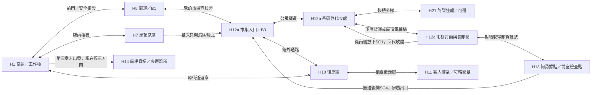

# 第二章「鷺」完整劇本

ST-18，2026-10-10；輸入基準 `552b51c1db3554b1a63e09ef9c8879ab869ec24b`。本稿交付原創繁體中文文稿、演出與狀態契約；尚未生成故事／關卡資料，未宣稱遊戲、三語、聲音、動畫或發行驗收通過。逐條審查見 [CH02_SCRIPT_REVIEW.md](CH02_SCRIPT_REVIEW.md)。最新 [全章因果](../20-campaign-experience/CAMPAIGN_NARRATIVE.md) 與 [審查門檻](../20-campaign-experience/SCRIPT_REVIEW_GATE.md) 優先於舊分鏡的固定過場比例。

## 1. 因果與本章裁定

前夜凜從碼頭帶回收帳人的資料盤，在復原館外交接櫃放盤、取得驗收回執，完成宵夜選擇後回家。次晨鷺核對回執，老 K 結算抽成；盤上的一筆「市場修繕代收」沒有對應收據，凜去市集找收據。阿梨正在同一個代收點被催帳，查委託與她的債交疊，但幫她付款、拜訪住處、處理私人帳都可拒絕。凜查出多收利息並找到阿勇，完成戰鬥後拿到原始帳冊及診所報表索引。屋頂收束時她決定次日去夾層診所查真正收費依據，第三章由此開始。

本章讓凜第一次看見別人的復原：鷺的第214次被當成笑話，小薇承擔阿勇那一次的損耗。玩家看懂「有人付出」，凜仍把自己的一成手續費當作公司保單的費用；此誤信不能由旁白／任務當成客觀真相。第四章才證明她有人替付，第五章才指名老 K。

| 裁定 | 本稿的行為／禁止事項 |
|---|---|
| 交盤與閱覽 | 第一章交盤戲由 ST-9 實作。本稿 S00 提供完整跨章介面對白，不能在兩章重播兩次；第二章只有回執、帳目摘要及閱覽授權，凜不能再藏／交／典當原盤 |
| 結算 | S01 的800報酬、80抽成、720可花信用點是本稿選定的交易額；若第一章已按同一交易結算，S01只讀回執不再發錢。480,000是房價；不憑文稿送27,400或改存款帳 |
| 凜的死亡 | 本章臺詞讀本輪實際死亡數。磨損主要由錨人承擔，不寫凜每復原必然失憶；普通死亡仍沿用現有5%扣款及上限，首次建檔免費，沒有新增10%死亡費 |
| 阿勇斷連 | 舊 BOSSES「打斷就永久死亡」與第八章「斷連後抱小薇上船」衝突。採用**致命結果發生前**永久解除這段父女連結、隨後非致命制伏；阿勇活著，不能再用小薇復原。保留路真正死／復原一次後，僅暫停本戰讀取與動力，保留連結資格但不自動重接。兩路阿勇仍活著，不能在已死亡後剪線卻讓他無因復活 |
| 有代價的選擇 | 斷連不是免費秒殺：需避開阿勇守終端的攻擊並操作隔離箱，再完成制伏。保留路多一輪且小薇失去一段記憶。兩路主線獎勵相同；不以傷害兒童作優勢或成就 |
| 制伏的物理原因 | 阿勇的棍柄鎖扣與外骨骼由帳房主機供電，接通時棍柄卸不下，胸前儲能匣受裝甲保護。隔離箱切掉復原讀取也會切開這套共用動力，凜才有機會擊破棍柄鎖扣、取下儲能匣並固定他。保留路只能從裝甲受擊後短暫露出的匣窗阻止攻勢，第一殼過載致死；第二殼復原瑕疵讓匣蓋無法閉合，鷺斷動力後才可安全卸匣。不是同一個可輕易制伏的敵人被凜故意多殺一次 |
| 永久解除與暫停 | 主隔離箱的安全撤銷鍵永久撤掉這段父女連結；維修暫停閂在被主機帶電護板擋住的側箱內，第一次復原衝擊才使側箱外蓋脫落。保留路此時可暫停，不代表撤銷資格。兩路後章都不再讀小薇；保留路是否重接必須另有父女知情決定，本輪正式主線直到第八章維持暫停，不用跨章時間跳躍代作同意 |
| 玩家可知與後章後果 | 選項只說當下可查的永久解除、帶電卸匣危險、死亡可能讀取錨人的風險；不預告復原次數、哪段記憶或第二殼缺陷。保留路實際發生的一次損耗永久保留：小薇知道父親身份，但不認得黃傘的共同往事，與父親重新商量距離。第八章兩人皆在船上；舊「未切斷便持續磨損、阿勇獨自拿傘」不得沿用，詳見第5節後章契約 |
| 214次 | 鷺登場是213次，本章事件完成才214；不加到凜的死亡數／費用。鷺知道自己代價，仍用笑話帶過；不在此說棠姓名、用盡或第四章必死 |
| 無帳者與客人簿 | 阿梨27歲，三位客人皆成年；間章只問、聽、記、端湯，無性或戰鬥內容。小薇僅在據點與家屬安全出口，不進復原館、間章或相關成人內容 |
| 沈望與汐 | 市集演說可公開沈望為天穹創辦人；不揭汐、不畫墓、不說她已死。汐現在仍活著，第三章只見白傘遠景 |
| 地址與保守遷移 | 第一章留下才已知；付款／欠條離開保持未知。本章主動敲門並完成地址交代才補得。舊檔缺值不假稱知情：另記安全救援回退政策，未來第六章不可因損毀製造不利後果 |

## 2. 一頁區域連線與節奏

H代號是設計地點，不是真實LevelData座標。ST-19以實際地形產生路徑及腳底格座標，任務UI讀正式來源；不得直接把本圖代號或估計位置當已驗證關卡。

| 區域／首次估計 | 功能、張力、遭遇 | 路線、觀察、捷徑與可選獎勵 |
|---|---|---|
| H1／H7，6–8分 | 次晨結算→修收音機可選→茶雨；低谷，有生活動作 | 屋頂以市場雨量屏為地標；樓梯實接；工作檯可回訪，無戰鬥 |
| H12a，3–4分 | 市場入口兩種身份的2場開放短戰，可從攤道繞過；追帳社交衝突 | 查核證只放行公眾攤道；B3雨棚安全；上層箱可看見，從後段SC1拿20信用點 |
| H12b，5–7分 | 收據、榕伯、公告屏、租攤視窗；調查小弧線 | 三條證據路線任意順序；茶攤是回看帳的安全桌；阿梨住處外梯不需已知地址 |
| H21可選，4–5分 | 洗碗／試湯／主動問地址；安靜、零戰鬥 | 兩端接後樓外梯；無私人房間搜尋門檻；櫥櫃內工具僅在主人同意後取 |
| H12c，4–5分 | 探索→2場戰／1場護送紙箱出水短情境→對帳完成；中峰 | 下層貨道與雨棚上路成環；電線橋已有剪線痕跡；秘密乾燥盒給20信用點，不鎖主線 |
| H13，7–9分 | 前室短調查→阿勇近身對決→鷺倒下；最高峰 | 前室檢查點隔著關閉防火門；小薇高處安全隔間；後臺帳櫃由制伏開，不靠支線鑰匙 |
| B3／H10，3–4分 | 鷺醒來、帳目驗收、阿梨決定可選；回落 | SC4回入口免重走；B3與委託公用終端用途分清 |
| H11間章可選，10–12分 | 阿梨三客，問／聽／記，不戰鬥；長谷 | 每客可獨立儲存；略過出口回凜的H10，不提前傳送屋頂 |
| H7收束，3–4分 | 週日、灰衣人、第三章目標；低谷帶疑問 | 港區環用交通接線說明；不開灰道、不提前開夾層 |

主路34–41分；含全部住處／收音機／週日追問及客人簿約49–60分。這是分段製作估計，非實測。約8–11分為首次交談／電影／強制資訊確認，查帳操作與客人簿閱讀另計，不把NPC模態閱讀藏成純探索。戰鬥約9–12分、調查與平臺約12–15分，其餘為移動與生活互動；不為湊比例塞重複怪。低谷安全區允許超過60秒不戰鬥。

新增動詞限三組：證據對帳（安全單據→三份比對→帳櫃原本）、隔離連結（前室圖示→戰中選擇）、問聽記（追帳→住處／客人簿）。既有格擋／衝刺／重擊使用既有成長；重擊可在S03工作檯試用並列為本章可選解鎖，不拿新能力鎖住處或帳櫃。

## 3. 共用演出政策與逐場索引

角色面向與地面由舞臺表指定；用成人H為世界尺寸，桌面0.43H、椅座0.27H、杯0.06H、門1.25H、通道淨高≥1.25H。新動畫只是需求，不聲稱現有骨架已會。靠近NPC可退回；只有確認交談／電影入口才進21:9。公文、單據、廣播、一般氣泡不加遮幅。戰鬥維持完整視野。

每場開始先存安全快照，不寫完成；播放完／玩家明確略過非選擇資訊才提交結果。略過停在未作選擇，不能自動付錢、斷連、接受拜訪。可退回的交談／調查中止保留已取得證據，不寫整場完成。已完成回訪只用本稿短反應。涉及物品／錢／世界的結果與完成標記同一個結算記錄，只生效一次。

| 場號／事件 | 起因與資訊增量 | 玩家參與／固定演出+首次閱讀估計 | 鎖操作／再次失敗成本 |
|---|---|---|---|
| S00／第一章交盤介面 | 從倉庫到復原館有委託目的 | 放盤、取回執／5+20秒 | 僅櫃子確認動畫；完成不重播 |
| S01／2.01 | 回家後付款，發現待核對市集列 | 核對800−80／6+45秒 | 主動交談；中斷不結算 |
| S02／2.02、SQ4-D1 | 壞收音機可修，陌生人念名單 | 接線、調頻、儲存片段／4+25秒，操作2–3分 | 可離開；錯頻立即再調 |
| S03／2.03 | 鷺安排查帳，破傘照顧可見 | 坐點、喝茶、拿查核證／12+70秒 | 簡報需完成才能進市場；略後同證 |
| S04／SQ2-B1 | 玩家追問週日，認識鷺私人界線 | 問／不問／4+30秒 | 可選；中斷再問，無主線門檻 |
| S05／2.04入口 | 昨晚封路今天只開公眾攤道 | 出示證、選路／3+15秒 | 不鎖戰鬥，提示可略 |
| S06／2.04、SQ1-A2 | 追帳，凜付款或先問阿梨 | 選擇付款／問、取得代收收據／7+65秒 | 安全交談；付款需再次確認 |
| S07／2.05、SQ1-A3 | 補救地址，不靠上章旗標找門 | 主動敲門、洗碗、試湯、問／10+70秒 | 可選，不鎖私人住處出口 |
| S08／2.06三證據 | 調查主線委託與阿梨那筆分開 | 三條路取得合約、收據、代收簿／每物2+10秒 | 可退出對帳，錯誤無處罰 |
| S09／2.06路痕 | 未知者先清路，不能假說已知身份 | 開捷徑、檢視守衛呼吸／0+20秒 | 不鎖操作，不須調查全痕跡 |
| S10／2.06結論 | 玩家證明重複利息，找到據點 | 比對與確認兩個結論／3+30秒 | 缺證據提示，不能靠猜刷錢 |
| S11／2.07前室 | 收帳爭議為何變戰鬥，認識小薇 | 調查隔離箱，確認進場／8+55秒 | 登場可略，失敗只短版 |
| S12／2.07戰鬥 | 斷連或保留的一次代價 | 真實戰鬥／選擇閱讀≤60秒 | 選擇安全暫停、確認後恢復 |
| S13／2.07結果 | 帳櫃、阿勇兩路後果、鷺劇情倒下 | 制伏、取帳、協助搬送／15+40秒 | 兩段電影皆可略，未完成讀回開頭 |
| S14／2.08 | 鷺第214次，笑聲與小薇反差 | 從SC4走到B3、接她起身／12+35秒 | 亭子短電影；凜不被扣費 |
| S15／主線帳目驗收 | 完成委託，索引指第三章 | 上傳三證據、儲存索引／5+35秒 | 一次結算；不重交盤 |
| S16／SQ1-A4 | 阿梨自己的錯帳交她決定 | 交私人副本、保留／申請更正／4+50秒 | 可選，拒絕也有主線完成 |
| S17／2.09入口 | 客人簿視角有真實地點與原因 | 選擇玩／略過；交班／6+30秒 | 可略，不發操作節點獎勵 |
| S18–20／客人簿三客 | 成年人需求各不同，教問聽記 | 每客問、筆記、回答／每客4+60秒 | 可返回，錯誤回應可修，無死亡 |
| S21／間章收束 | 瞭解阿梨的湯與無帳者處境 | 收本、回凜／5+25秒 | 退出／略後同凜位置，不補獎 |
| S22／2.10–11章末 | 鷺界線、灰衣人與診所下一步 | 上屋頂、確認次日出發／14+65秒 | 一次電影可略；L1完成才開 |

## 4. 逐場完整稿

每個表的「說」是玩家可見原創臺詞；其他文字為演出說明。一般交談每次至多三句連續臺詞後安排動作／操作，長段可拆小節但不新增完成旗標。所有手把確認／返回提示從當前輸入對映取得，不寫死按鍵。

### S00　把盤送到交接櫃（跨章介面，第一章播放一次）

H10館外後巷。凜有盤，燈在通訊，鷺僅遠端。倉庫上層出口落在後巷平臺，欄杆與下到櫃前的樓梯相接；鏡頭跟凜，不突然傳到館內。櫃高0.9H、開口0.55H，盤寬0.12H；青燈不打亮人臉過曝。純雨聲、櫃鎖及紙捲聲。

| 拍 | 臺詞／動作／玩家行動 |
|---|---|
| 1 | 燈說：「前面那個藍燈櫃是委託交接櫃，把盤放進去就有回執。」凜仍可沿後巷走，HUD顯示「把資料盤放入交接櫃。」 |
| 2 | 玩家確認放盤；凜一手撐櫃沿，另一手將盤插入，不從身上再次複製一片。終端說：「資料已驗收。報酬將於下一個結算時段發放。」 |
| 3 | 燈說：「回執出來了，鷺姐明早會替你對錢。」玩家取回執；凜說：「盤交了，錢我明天再核。」 |
| 4 | 鷺說：「盤裡有一筆市場代收帳沒附件，明早上屋頂再談。」凜說：「明早先談錢，附件排後面。」她把回執夾進筆記本，手上不再有盤。 |
| 結果 | 實體盤交付、回執取得、閱覽授權與待結算交易儲存；回家仍由宵夜事件完成放行，地址非門檻。 |

若ST-9已播放同一場，本稿不再生成S00；若只存在舊「取得盤後回家」存檔，第二章入口提供「回交接櫃補驗收」可行目標，不憑空設盤已交。遺失物品紀錄而保險箱取得紀錄存在，由委託終端核對一次恢復交付流程，記錄具體欄位，不發第二份報酬。

### S01　次晨結算

H1櫃臺，老 K、凜，鷺通訊。凜在0.30W，老 K在0.70W，桌腳落同一地面帶；帳本在老 K手邊，只見鎖扣與本次結算頁，不拍第五章「給凜」。雨滴、算盤／終端按鍵；當舖低音量暖曲。凜起床後仍穿自己裝備，錢與盤不能因鏡頭切換變動。

| 拍 | 臺詞／動作／玩家行動 |
|---|---|
| 1 | 老 K把乾毛巾推到櫃臺：「頭髮先擦乾，昨晚那個鍋我換過了喔。」凜說：「鍋不用算進我的帳，我只叫你加水。」 |
| 2 | 鷺通訊說：「交接櫃驗收過了，八百信用點，沒有少。」老 K把回執壓平：「照原來的一成，我收八十，你拿七百二十。」 |
| 3 | 玩家比對報酬／抽成／淨額三欄，再確認結算。凜說：「一成照舊，這筆保費我記著。」老 K只回：「你先把今天的帳算好，別連早餐也省了。」他不確認公司保單真相。 |
| 4 | 老 K合上另一本鎖帳。凜說：「你那本帳不能借我看？」老 K說：「每個人的東西都記在裡面，不能整本借走啦。」他把早餐放在帳本前，拒絕是具體保密理由。 |
| 5 | 鷺說：「資料盤有一筆市場修繕代收，找不到付款附件。委託要我們核對，不是再偷一片盤。」凜說：「我拿回執去找收據，盤已經不在我這裡。」 |
| 6 | 老 K說：「上面指定查這筆，別替他們多接別人的帳。」凜說：「我核完才回來，飯留著。」 |
| 選擇反應 | 上章留下：老 K說「昨晚吃過麵，今天也要吃喔。」凜說「兩頓我分得清楚。」上章付錢／欠條走：老 K說「把欠條和回執分開放，別把人家的晚飯當委託。」凜說「我只是不想混在一起。」不知道她昨晚細節時不用這版，改「回執不要沾到湯，字會掉喔。」 |
| 結果 | 同一交易結算720一次；目標「上屋頂向鷺拿查核證。」待核對摘要留在筆記。主線查帳的250另筆在S15完成時才得。 |

已結算回訪：老 K「錢已經對過了，茶在樓上，別讓她等喔。」錢不足／零錢不影響此收入；早餐不新加付費門檻。

### S02　收音機裡的人（SQ4本章節點）

玩家可看到工作檯壞收音機，老 K在旁。收音機寬0.22H，殼與旋鈕分件在桌面，手不得穿過外殼；鏡頭不加遮幅，三個接點可用方向鍵／手把焦點選，不靠精準滑鼠。錯接只出雜訊，可立即改；不扣錢、不危險。

| 拍 | 臺詞／動作／玩家行動 |
|---|---|
| 1 | 凜說：「這臺還有電，喇叭為什麼沒聲音？」老 K說：「上次摔到接線鬆了，零件盒有同一款接頭。你要修就拿，別拿槍託敲喔。」 |
| 2 | 玩家把電源接到電源、天線接到天線、喇叭接到音源；每接點標用途完整說明。燈說：「先讓指標進兩條刻線中間，再轉到聲音最清楚的地方。」 |
| 3 | 低頻雜訊→潮汐臺；氣象臺說：「港區午後降雨持續，市場低窪通道請改走上層雨棚。」玩家可繼續轉旋鈕。 |
| 4 | 陌生廣播女聲說：「今晚先念三個還在等回覆的名字。陳海生、周美蘭、林兆安，你們的家人來過。」只顯示「陌生廣播」，無蘇身份標籤。 |
| 5 | 女聲說：「如果名字念錯了，請告訴我。我會重新念，名字不該只剩一個編號。」停頓後是「我還留著一頂帽子。如果有人認得帽沿的補線，請到港區電臺留言。」 |
| 6 | 凜說：「她連帽子也放進尋人名單。」老 K說：「名字不記得，東西還在，也是個開頭啦。」 |
| 7 | 玩家選「儲存這段廣播」／「先關掉收音機」。儲存後凜寫「陌生廣播／帽沿補線／港區電臺」；修好與聽清後給小節點獎勵，儲存片段是線索結果，無額外第二份獎勵。 |
| 結果 | `ch2_radio_repaired`、`sq4_broadcast_heard`同場完成；聽到才公開支線「記下廣播裡的尋人線索。」未儲存可在修好的收音機重聽，首次完成領20信用點與小節點XP尺度。 |

不修可出門，主線指屋頂；略過聲音資訊不等於操作完成。章末後仍可回修，不提前發黑折傘／斷錨派改裝。

### S03　茶還熱，傘已經破了

H7，凜與鷺。必經簡報是玩家主動交談；屋頂樓梯旁有「鷺在茶座等你。」兩人可站著或由玩家選坐點後坐，凜不被強拉上板凳。椅座0.27H、茶箱桌0.43H；鷺破傘兩根骨折，握點與半邊濕肩可見。屋頂暖茶燈、青雨量屏、遠塔冷色；雨聲與鷺哼五音《借傘謠》，不以白閃表現茶氣。

| 拍 | 臺詞／動作／玩家行動 |
|---|---|
| 1 | 鷺把杯子挪離滴水點：「小鬼，坐裡面，那塊板凳今天還沒有泡水。」凜說：「你每次都說今天，這木頭已經腫了。」 |
| 2 | 玩家拿杯／坐定；鷺將傘偏向凜，自己左肩淋雨。凜說：「傘骨斷了，你那邊在漏。」鷺說：「我這件外套本來就濕，兩邊一起濕才不會歪。」她笑得比笑話大聲。 |
| 3 | 凜把杯放穩：「我記著這杯茶，傘不用算。」鷺說：「你還要替雨開一個帳啊？先喝，茶不會等你算完。」凜沒有取得／握持傘。 |
| 4 | 鷺抽出查核證：「市場查核證只讓你進公眾攤道，後面的帳房還是阿勇管。阿勇是這一帶收帳人的頭。」 |
| 5 | 鷺說：「昨晚盤裡那筆代收款有批號，收據卻不在。去代收處找當天的租攤合約和收款存根。」凜說：「我先看原本，再聽他們怎麼算。」 |
| 6 | 鷺說：「天穹要找誰多收了錢，我只要他們別拿攤商的錢墊掉。你看見不對的地方就寫，不用替誰挑好看的。」她把證推到凜手邊。 |
| 7 | 玩家確認收證；凜說：「查完這筆就能結案？」鷺說：「附件對得上才算，光把收帳的人打趴不會長出收據。」 |
| 8 | 鷺轉頭看雨：「你看雨別只看腳下。屋頂先響、雨棚再響，你就知道市場哪條路積水了。」凜說：「所以你喝茶也在看路。」鷺說：「至少我這杯不用你付保費。」 |
| 結果 | 簡報完成、查核證和摘要；市場入口可進。下個主線目標「到市集代收處核對帳目。」額外追問不鎖證與出口。 |

重擊可選演練短支節：鷺指樓梯旁固定木靶「把重擊接在收招後，你要的是空檔，不是揮得久。」玩家試既有能力即可離開；不寫「已學」除非成長服務真正完成解鎖，不發第二把武器。

### S04　你週日到底去哪裡（SQ2）

S03後玩家選「問鷺週日的安排」；同舞臺、仍可退回。第一章問過者先說「你昨晚說要看一個人，週日也去？」未問者說「你行事曆每個週日都是空的，你不接案？」讀旗標決定開頭。

| 拍 | 臺詞／動作／玩家行動 |
|---|---|
| 1 | 鷺說：「週日不是空的，我留給別人了。」凜說：「有人找你收帳？」鷺收住笑、補一次茶。 |
| 2 | 鷺說：「有個人以前連我發脾氣都會替我端水。我去坐一下，讓她嫌我吵。」凜說：「那我不排週日，免得你又趕時間。」 |
| 3 | 鷺說：「這句我記下了，哪天有活別又只看價錢。」凜說：「我先把今天做完，週日你自己留著。」 |
| 結果 | `sq2_sunday_heard`只在答完後真；20信用點，小節點XP，已問過第一章者也只領本章新資訊一次。不能公開病房、棠或葬禮地標；未問章末仍聽「週日不接案」，不補此可選獎勵。 |

### S05　市場重新開了一半

H5→H12a。凜、入口巡帳員，燈通訊。鐵柵與地面導線開口對齊，公眾入口與貨道封門分清；戰鬥區無21:9接近預告。兩場短遭遇用本章攤位押運手（短棍突進）、票據投手（紙頁扇形）新身份，非把前章保全換色；每場同屏≤3，可繞公眾攤道，普通NPC不能攻擊。

巡帳員看證說：「查核的人走雨棚下，貨道沒有放行。」凜說：「我去代收處，你把入口留著。」他讓開。燈說：「昨天封路，今天只開了攤道。別跟著貨車鑽進柵門。」

若玩家先到貨道，提示「貨道仍由收帳人管制，先到代收處核對卸貨批號。」查核證缺失提示「鷺在當舖屋頂等你，拿查核證後再來。」證不是消耗品，不重複索費。B3提示「這座電話亭可登記復原位置，港區交通線尚未接通。」未登記不聲稱已啟用，凜普通死亡仍回既有登記亭。

### S06　先問她需要什麼（追帳兩路）

H12b代收處，凜、阿梨、利息（約35歲副手）、鷺稍後抵達。阿梨抱租攤圖，油紙傘放在自己腳邊，原本仍在她手裡。利息站0.70W，阿梨0.50W、凜0.30W，收款臺阻隔而非人堵門；只有確認交談後安全鎖操作。人群後退到通行線外，不用黑邊蓋戰鬥。

| 拍 | 臺詞／動作／玩家行動 |
|---|---|
| 1 | 利息說：「今天四十信用點代收款，加上前帳的利息，我才能替您收租攤申請。」阿梨說：「申請上沒有這一項，你先把已收的兩筆列出來。」 |
| 2 | 凜進入可退回交談入口：「昨晚收的那筆也算利息？」利息說：「我是阿勇的副手，大家叫我利息。帳在他那裡，我這裡只負責收。」名稱同場說明。 |
| 3 | 阿梨說：「我來找攤位，不是來續借。你把我的申請壓著，我就得一直回來。」凜伸向口袋，阿梨看她的手：「你先問我，好嗎？」 |
| 選擇A | 「先付四十取得收據。」確認框說明「代墊40信用點，只解除今天的催收；不結清阿梨的債。」凜說：「這四十我先墊，你開收據。」阿梨說：「我會把這筆記給你，但攤位的事還沒解決。」利息開具蓋章收據，申請仍退回阿梨。 |
| 選擇B | 「先問阿梨需要什麼。」凜把手離開口袋：「你現在需要什麼？」阿梨說：「一塊能煮麵的攤位，還有一張租攤許可。我缺的是這兩樣，不是你口袋裡的錢。」凜說：「把已付的收據給我，我先查他為什麼收兩次。」 |
| B續 | 利息說：「查帳可以，今天還欠四十。」鷺出示查核授權：「這筆有爭議，委託查完前不能往上加。你不簽，我把拒絕查核也寫進去。」利息說：「您拿存根看，原本不能帶走。」他印副本，兩路均有收據。 |
| 缺錢 | A確認前餘額<40：「信用點不夠，先問阿梨並核對收據。」返回A/B選擇，不自動賣裝備／轉欠債；B始終可選。 |
| 4 | 阿梨說：「復原館夜班下班了，我在市場找位置，後樓三樓的小廚房還有湯。」未留宵夜者補一句「昨晚你先走，我沒來得及給你留一碗。」已留下者改「昨晚那碗不是租攤試吃，這次才算。」 |
| 5 | 凜說：「我先對附件，有空再去吃。」阿梨說：「後樓外梯能找到我，想進來就敲門，不用替我跟別人借鑰匙。」地圖只顯示「後樓有人邀你試湯」，此刻不設已知私人地址／暗號。 |
| 結果 | 兩路`ch2_market_contact_done`；代收收據證據儲存，40僅A交易扣一次。B另得`ch2_ali_need_asked`、SQ1-A2小節點20信用點及XP；A可稍後主動問同句補A2，不補返款，獎勵僅一次。主線去三證據，住處為可選目的地。 |

回訪利息「附件帶去帳房，別拿我的存根當免付證。」阿梨只對付款路說「你墊的四十我記著，你想先聽攤位的事嗎？」選聽會完整再播B的需求問答、不再出現索款。玩家拒絕是「我先把委託查完。」她回「我留著申請，等你回來再談。」

### S07　洗一隻碗，別替我把攤子買了（SQ1-A3／地址補救）

H21。後樓外梯從代收處能看到有補丁油紙傘的門口，公用郵箱標「三樓小廚房」，無姓名線索也能探索找到。靠近門不自動給地址；敲門由阿梨回應。屋內淺暖黃、一張桌、一口湯鍋、洗碗池；不拍床／成人內容。凜不擅入櫃子。

| 拍 | 臺詞／動作／玩家行動 |
|---|---|
| 1 | 玩家敲門；阿梨從廚房來：「你找到了，門口那把補過的傘就是我的。先把鞋底的水擦一下，好嗎？」凜把溼鞋底蹭在門墊，仍可返回。 |
| 2 | 未知地址者：凜說「你說後樓，我差點走進貨梯。」阿梨說「我是市場後樓三樓，走外梯，敲兩下再敲一下，我就知道是你。」已知者：阿梨說「還記得兩下再一下，你沒把暗號算成一筆帳吧？」凜說「我記在人名那頁，沒有標價。」 |
| 3 | 阿梨放一疊碗：「你想喝湯的話，先替我洗這三隻，好嗎？我剛試的都用完了。」玩家可選「洗碗試湯」／「只記地址，先走」。只記地址仍`knows_ali_address`，不發A3操作獎勵，阿梨說「下次再來，門口會留一盞燈。」 |
| 4 | 玩家按序沖、擦、放入架；操作提示「把洗好的碗放到乾燥架上。」錯放阿梨說「那邊還滴水，換到左邊就好。」不用反覆失敗動畫。她忙煮湯，凜可選鍋邊3個試湯量，無分數。 |
| 5 | 凜說：「這鍋放的梨比昨晚多。」阿梨說：「我在試能煮一整晚的湯，梨嬸以前就是這樣教我的。她在梨攤邊撿到我，所以我叫阿梨。」 |
| 6 | 凜說：「攤子準備叫什麼？」阿梨看空白招牌紙：「名字還沒想好，我先想每天要給人吃什麼。」凜說：「我可以把攤租先付了。」 |
| 7 | 阿梨把許可申請推回自己面前：「你先替我把錯的帳找出來。要不要租，我會自己簽，不用你替我答應。」凜收回錢：「那你簽，我記要用的東西。」 |
| 結果 | 地址／暗號在拍2答完單獨儲存，並解鎖H21近路記錄。洗碗+試湯+需求回應完成A3，40信用點、中節點XP、熱湯當場回復（不生成可賣無限湯）。兩路都能回主線，不發傘／攤架完成。 |

復訪阿梨「碗放左邊就好，今天我先試湯，不收新的攤租。」未完成洗碗可以續；首完成領一次。地址損毀時保留實際H21探索紀錄並由門口短對話重講，不憑推論讓凜說已聽過。

### S08　三張紙，三條路

必要對帳證據全部是市集公眾帳：A租攤合約（H12b租攤視窗）、B已付收據（S06代收副本）、C當日代收簿（H12c裝卸間）。阿梨私人帳的詳細條目D要S13帳櫃後才能取，本場不替她結清。

| 路線／演出 | 完整臺詞、可讀檔案與玩家操作 |
|---|---|
| A合約，租攤視窗 | 視窗員說「攤位押金本金二百，本期利息二十。申請沒有核準前，不收續租款。」凜說「這行要留副本，代收處給我的金額不一樣。」玩家取副本；視窗員戳「暫未核准」，不提前把許可靠查帳發給阿梨。 |
| B收據，代收處 | 頁面「市場修繕代收／批號M17／本金200／本期利息20／已付120／本期應付100」。付款路增「今日代墊40，待查核抵扣」，問路無此項；兩路基礎算式相同。玩家可檢視蓋章日期，聽到紙蓋章的脆聲。 |
| C代收簿，裝卸間 | 「批號M17／收款120／其中本金100、利息20／轉送北棟二樓／待收欄120」。正確應待收100，多20；不是用「120−100」當阿梨全部債務結論。凜說「本金已還一百，這期利息也付過了，他又塞了二十進去。」 |
| 可選榕伯 | 榕伯在涼茶攤：「我賣涼茶賣到這把年紀，鷺年輕時把我攤子打翻，賠了三倍，還先付十年的茶錢。」凜說「她現在連茶都拿來借人情。」榕伯說「她以前最難相處，現在最好說話。以前她總說下回再賠，後來不敢拖了。」只說自己的經驗，不知棠或凜錨人。 |
| 公告屏，非強制電影 | 臺標「天穹週年演說／創辦人沈望」。沈望影像說「我們先確認一件事：每一份申請，都代表有人還想回家。天穹會繼續讓第二次成為可能。」氣象旁欄「今晚降雨偏多，復原申請量預計增加。」凜可走、重聽、關字幕，不觸發21:9；播音不能說雨由耗損造成。 |
| 小販傳聞 | 小販說「人家說付帳人遲早來收，你最好別只看今天的價。」凜說「你見過他收什麼？」小販說「我也是聽的，沒見過。」明確都市傳聞，日誌記「未經證實」，不當結論。 |

拿到證據即儲存，不須聽完無關榕伯故事才取。合約／收據／代收簿完成一次提供，無戰鬥可及；C有下層兩場小遭遇但可從上層解鎖電線橋繞過。每個必要物件缺圖用文字副本，缺音靜音+具體記錄，證據真相不能缺。

### S09　路已經被人清過

H12c，凜、燈。通訊可移動；無新增完成門檻。上層橋邊電線兩端已剪、絕緣露出但不通電；下層守衛倚牆昏迷，胸口有呼吸，不拍屍體；北棟門鎖完整但開著。灰衣人遠景與三痕跡不是身份解鎖。

凜氣泡：「這條電線被人剪斷了。」燈回：「電已經斷了，可以從橋上過去。」兩句≤30字同屏≤2。20秒操作後下一處凜氣泡：「守衛還有呼吸，誰先來過？」燈說：「我只看見門沒鎖，查不到人。」玩家按開SC1橋梯，金屬拉桿與地面落腳可見。調查守衛動作是凜蹲下檢視呼吸，腳仍貼地，不能因蹲姿把角色移進牆。

到門前小販遠聲「有人說灰無常來了，我可沒敢上去看。」燈僅說「先看門內，別替影子取名字。」玩家不用看三點也能過門，不發必安圖鑑／老 K僱主事實。

### S10　把重複的利息指出來

H12c乾燥作業桌，凜、鷺通訊。介面三證據同頁可翻，選證據可返回來源／地圖；首次看到全部數字後使用「比較已付利息」動作，不給盲猜多選題。玩家親手選合約20、收據已付20、代收簿待收120，系統顯示本金剩100，重複20；再選C的北棟二樓批號。

| 拍 | 臺詞／動作／玩家行動 |
|---|---|
| 1 | 鷺說「拿本金的欄對本金，別拿還款總額整筆減掉。裡面有已付利息。」凜翻頁，手指敲桌：「本金還剩一百，二十的利息已經付過。」 |
| 2 | 玩家確認重複欄；凜說「代收簿還寫一百二十，他把已付的二十再收一次。」燈說「三張都有同一批號，北棟二樓就是送帳的地方。」 |
| 3 | 鷺說「把這三張留著，我們去找原本。你只查出了這一期，別替所有欠帳的人說已經清了。」凜說「我拿證據去，不拿你的猜測去。」 |
| 缺證據 | 僅A/B：「還缺代收簿，去雨棚後面的裝卸間核對待收欄。」僅B/C：「還缺租攤合約，去租攤視窗確認這期利息。」未有B：「先找代收處要已付收據，不能只用對方的帳證明對方。」 |
| 錯比對 | 把120總還款當本金：提示「收據的120包含100本金與20利息，請分別比較。」無扣款、無重新整理敵人、無失敗語羞辱。 |
| 結果 | `ch2_market_reconciled`；地圖公開北棟二樓據點，貨門讀已確認卸貨批號放行。未找到D私帳不會卡此結論。 |

### S11　他叫她把傘放下

H13前室→二樓帳房，凜、鷺、阿勇、小薇。阿勇的身份在S03已經說明；小薇首次只說女兒與錨人，不展童年死亡經歷。前室有安全存檔與主隔離箱圖：「安全撤銷會永久解除這段復原連結，同時斷開動力；不會傷害座位上的人。」圖上另標「維修暫停閂：側箱內」，側箱現在被主機帶電護板封住、手無法伸入；只展示受阻事實，不預告稍後如何露出。主箱0.4H在可達牆0.5H高；小薇處在後方高臺安全隔間，玻璃與裝置將成人戰場分開，無武器／爆炸可穿過。她的座椅腳踏按兒童腳長支援，傢俱不隨其身高亂縮。

| 拍 | 臺詞／動作／玩家行動 |
|---|---|
| 1 | 玩家確認進帳房，阿勇把帳冊壓在鐵棍下：「你們拿幾張副本，就要我把人借出去的錢當沒借？」凜鋪三張紙：「我沒有刪本金，這二十已經付了。」 |
| 2 | 鷺說：「把原帳拿出來，先核批號。你不認那個章，也不能叫人再付一次。」阿勇說：「上面一天一張收費表，我只能照今天的收。你要說我錯，把今天那張也拿來。」 |
| 3 | 凜說「那就讓我們看。」阿勇把通往帳櫃的門拉住：「這裡沒有給你們的鑰匙，拿帳先過我。」他抄棍，鷺把凜讓到正面、自己走側邊護門。動機是保住權力與錢，不口說願查卻忽然無因開戰。 |
| 4 | 小薇在安全臺說「爸爸，傘要放在哪裡？」阿勇忽然放輕：「小薇，放在腳邊，不要離開椅子。」黃色兒童傘合攏靠她腳踏，圖案朝外。 |
| 5 | 凜說「你把你女兒帶到帳房幹什麼？」阿勇說「小薇是我的錨人，連著終端我才能回來。她要我回來。」小薇說「我不想爸爸再不見了。」不將年幼同意當無爭議合法性旁白。 |
| 6 | 阿勇扣緊棍柄，外骨骼電纜繃直。燈說「他的裝甲和復原共用電源，主箱撤銷能一起切掉。斷電後才能卸下棍子和儲能匣。」玩家先在前室看見同款斷電鎖扣鬆開，說明與實物吻合。 |
| 7 | 鷺低聲說「主機在她那層下面，別朝她那邊開槍。」燈說「主箱會永久解除這段連結，側箱只能暫停，但現在被護板擋住。」字幕與同義HUD「主箱永久解除父女連結；小薇不是攻擊目標。」 |
| 結果 | 戰鬥登場已看，只記重播短版與戰鬥前快照；不寫阿勇制伏、不發帳冊、不設斷連選擇。復原連結初始保留。 |

### S12　復原與利息：阿勇戰完整兩路

無遮幅、兩條可繞鐵棍的高低路但無危險臺通向小薇。第一階段近身鐵棍、慢紙頁，第二階段僅保留路出現。利息每受擊疊1最多5、每層下一擊+10%，踩亮「結帳」墊／6秒未受擊消退；用圖形層數與腳墊白框兼用，無新貨幣。「結帳」是阿勇執法裝備給凜貼的加壓標記，不能暗示玩家欠真債。

| 玩法拍 | 演出／提示／結果 |
|---|---|
| 開戰 | 鷺護住側門擋兩名押運手，不替玩家持續削阿勇HP。她說「你盯他棍子，我守側門。」鐵棍重擊0.8秒蓄力可躲可擋，撲空給反擊；慢扇形紙頁可跳縫；最多兩小弟同屏、第二階段不再增援。 |
| 首次利息 | HUD「利息標記會加重下一次受擊，踩亮著的地墊可清除。」燈bark「踩亮墊能清掉標記。」最多每場兩句bark，另一句鷺「他還會再補一棍。」每句≤16字。 |
| 25%血閾值 | 阿勇退到終端前護住機器，凜看見小薇握椅背。戰鬥暫停進入**選擇說明**，沒有危險／計時逼選。選「永久解除父女連結，再制伏」或「保留連結資格，繼續迎戰」；都可「先返回說明」，略過不會預設。 |
| 說明全文 | 同頁四段可捲動：「永久解除會切掉動力與讀取。阿勇將失去靠小薇復原的資格，小薇不再承擔這段連結的損耗。」「斷電後擊破棍柄鎖扣，再卸下儲能匣，可以制伏他。你仍要避開他的反擊。」「保留資格就繼續迎戰。儲能匣仍帶電，攻擊它可能使阿勇過載死亡；復原會讓小薇失去記憶。」「側箱的暫停閂現在被護板擋住，無法使用。繼續打有風險，不能保證兩人都不付出代價。」選擇窗由玩家閱讀／確認／返回，不設三秒倒數；不能靠誤射終端選結果。此時只知道設備與讀取風險，不知道復原會發生幾次、失去哪一段、下一具身體的狀況。 |
| 斷連路 | 玩家親手去主隔離箱確認永久撤銷，阿勇仍會追擊，進箱操作1.5秒可受擊取消且未完成不寫。成功主機由白連線轉灰斷線，提示「父女連結已永久解除，小薇未被讀取。」剩餘HP改顯示「制伏進度」明確非致命。鎖扣橙色破損提示，玩家打斷棍柄鎖扣，阿勇棄棍用外骨骼短拳，抓住撲空再以互動拔出已斷電儲能匣，裝甲停止，鷺用側門固定帶綁住他；不是普通斬擊穿胸後改口存活。**無死亡／復原／棺材**。 |
| 保留路第一次倒下 | 玩家持續開啟阿勇儲能匣視窗，匣仍帶電不可拔，最後一次受擊引發第一殼過載，阿勇真正死亡。鷺護住護欄，倒地／讀取過渡可略；終端亮，小薇說「爸爸，你說回來就吃飯。」阿勇起身說「我回來了，妳看著我。」小薇看黃色傘說「這把傘是誰的？」她忘的是明確片段，不是演出抽象透明人體。 |
| 第二階段 | 阿勇復原殼一隻手顫／衣袖未穿妥，匣蓋反覆卡住不能閉合，不裸體；動作較慢、單擊更重，延後一拍補棍，硬直長。**此時**凜才看見匣蓋缺陷及復原衝擊震落的側箱外蓋。鷺走側門按下維修暫停閂，確實停止讀取及動力；這是設備安全暫停，不撤銷連結資格。燈說「他的匣蓋閉不上，現在斷了電，可以卸下來。」HP才改「制伏進度」；玩家仍需打破棍柄鎖扣、逼出撲空，完成拔匣制伏。第二階段快照在暫停完成後，普通戰敗可重試，不讓小薇再次被讀。 |
| 第二輪結束 | 玩家打贏以卸匣／繳棍／固定帶收尾，阿勇活著。終端標「維修暫停／資格保留／恢復須本人與錨人確認」，燈說「讀取停了，資格還在，機器不會自己重接。」救護員鎖住暫停閂並保管維修鑰匙，阿勇不能抬手重啟。不是阿勇突然善良自願，控制箱被凜／鷺確實關閉。 |
| 劇情鷺倒下位置 | 僅玩家成功制伏後觸發S13，不把鷺倒下掛普通HP。她回頭推開砸向家屬通路的押運手，背後殘留裝卸機反衝鐵件擊中胸背，跌到成人戰區地板；玩家戰鬥已結束。兩路來源同一臺被押運手過載的裝卸機，無憑空必中敵彈。 |

第一次在本戰真死亡的凜：敗北卡「隔離箱能阻止小薇的讀取，亮墊能清除利息標記。看見鐵棍蓄力再閃避。」依現有配置預設第一次顯示，後續手動查；不長播S11。第2／3／10次普通死亡只短恢復，讀真實登記點、HP、5%現有結算與上限，不能把本戰一次小薇耗損重複疊加。見第7節階段儲存。

斷連選擇與箱操作結果分開：選擇cut但未成功操作被殺，讀前室重新操作；一旦主箱成功撤銷，永久解除與世界斷線保持，後續失敗重試仍走制伏，不改成保留。保留首次死亡+復原作為已完成階段儲存，小薇一次讀取消耗保持，凜失敗重試從第二階段，不把歷史倒回當恢復記憶。

### S13　帳櫃開了，她卻沒有站起來

H13，先阿勇結果，再鷺倒下，兩段可略電影各有自己的結尾事務。帳櫃內無原資料盤，僅原本帳及診所報表索引。鷺倒下無音樂，只有雨打通風窗；凜蹲於有支撐地面檢視，武器安全收掛，不能穿胸站位。

| 拍 | 臺詞／動作／玩家行動 |
|---|---|
| 1斷連 | 阿勇被固定在椅邊：「你永久拆了我和她的連結，還要我認你算的帳？」凜說「你活著就能對，別拿她再付。」小薇問「爸爸，我們回家嗎？」阿勇看她：「傘拿著，門外等我的人會送妳。」小薇由非戰鬥成年市場救護員護送至家屬出口，黃傘歸她，沒有立刻送凜裝備。 |
| 1保留 | 阿勇手顫說「她連自己的傘都不記得，你們滿意了？」凜說「是你把她接進來的，原帳也不能靠她付。」救護員說「連結暫停了，恢復得先讓你們知道代價，再由你們決定。今天不會再讀她。」小薇看父親說「爸爸，這把傘先讓你拿。我想自己走出去。」阿勇伸手又收回，接傘說「好，我走在妳後面。」小薇仍認得父親，忘的是黃傘共同往事；兩人分開走出，不把一次損耗寫成完全失智。 |
| 2 | 玩家到帳櫃取公眾原帳、阿梨私人頁副本與「診所報表索引：港區代收批號M17→夾層診所月報17」。不搜私人床鋪。原帳文字「待收100；代收簿附加20；收費基準另見夾層診所月報17」，提供第二章結論與第三章查原表理由。 |
| 3 | 凜說「原本寫一百，代收那二十沒有根據。」燈說「月報十七在夾層診所，這裡只有索引，沒有原始報表。」阿勇說「上面每天改，我拿得到的也是抄本。你想問原來怎麼算，就上去問。」他的條件解釋來自看到索引，無全知耗損揭露。 |
| 4 | 鷺去家屬出口，被過載反衝擊中，倒地；凜喊「鷺姐，先別起來，我看傷在哪裡。」鷺沒有說自己最後一次／必死，喘著說「這下茶又要重泡了。」 |
| 5 | 凜檢視但不觸發凜死亡UI；鷺失去回應。燈說「她的復原點在市集亭子，先把門口清出來，有人來接。」玩家親手撐開家屬出口門，用布遮雨但不裸露，灰衣搬運者從成人戰區安全入口抬擔架。 |
| 6 | 無名字的灰衣人檢查擔架綁帶、掛上鷺裝備袋，另一人拿破傘；鏡頭停在擔架輪子過門檻，不特寫僱主標記。凜說「她的傘也帶上，兩根骨都斷了。」灰衣人點頭不說話。 |
| 結果 | S12繳棍固定完成時已提交制伏與120報酬；本場不重給。帳櫃互動另提交證據，鷺搬送結尾再提交待復原事件與SC4家屬路開至B3。HUD「到市集電話亭等鷺。」不計凜死亡，不扣她錢。 |

玩家略電影同樣送出鷺及裝備，起點在SC4可走出口，不強制傳凜到亭子。退出搬送途中重來S13搬送短段；帳已拿到保留不再給，一次事件標識讓擔架不生成兩副。

### S14　第214次的笑聲

B3市集亭，凜、鷺、榕伯與兩成年圍觀者；小薇已從家屬專道離開，不在笑場／館內。亭子起身地面無水危險；鷺先從座位借扶手坐起、腳著地再站，不從空中降。她拿回自己的裝備袋和破傘；復原殼衣物由亭內衣櫃供普通外套，鏡頭不裸體。

| 拍 | 臺詞／動作／玩家行動 |
|---|---|
| 1 | 亭機亮起，錄音少年聲「歡迎回來。」燈現場通訊補「鷺姐，這次是第二百一十四次了。」不假說即時燈聲等於錄音。 |
| 2 | 鷺推門、扶框：「你們連我遲到幾次都不算，這個倒記得清楚。」榕伯說「喝茶賒帳我也記著，別裝沒聽見。」成年圍觀者笑，凜也笑了一下。 |
| 3 | 玩家把傘遞到鷺手邊，她接而非凜裝備；凜說「兩根傘骨還沒長回來，復原只管你自己？」鷺說「傘要是也收費，我早就用手接雨了。」她大笑，肩頭留被水溼過的新外套。 |
| 4 | 凜笑收住：「你不會怕醒不過來？」鷺看杯口，輕一拍：「我先把今天過完，不然明天的茶誰喝？」她沒有給明確永不失敗保証。 |
| 5 | 燈說「門口清了，帳目可以上傳了。查完再回屋頂，別漏掉委託結算。」凜拿筆記，視線短停家屬出口已關的門，無全知小薇旁白。 |
| 結果 | 鷺復原事件完成，213→214一次；`ch2_egret_returned`，短片一次看過；B3若凜未登記仍不自動更新她復原點。對同事件重讀不再加214→215。 |

回訪鷺「我人回來了，傘沒修，這次紀錄別多算。」別人普通敵人復原早於此時的觀看不說「首次世界復原」，本章定義是第一次近距離跟隨一個朋友完整返回；阿勇保留路已先看到敵人復原，S14不稱全世界第一次。

### S15　查帳結案，索引仍不是答案

H10館外公用委託終端，凜、鷺遠端、葉遠端抽查。葉首次身份由終端顯示「天穹風控長／葉」，無手背字特寫提前第三章。終端桌面和插槽不是原盤交接櫃，凜上傳掃描副本。

| 拍 | 臺詞／動作／玩家行動 |
|---|---|
| 1 | 玩家勾上三証據與原本差額20；葉遠端說「我是天穹的葉，負責這次帳務抽查。你提出的同批號副本已核對，這一期附加的二十不成立。」 |
| 2 | 凜說「另一張診所月報決定他收多少，我要看原來的。」葉說「索引可以給你。夾層診所儲存原始月報，現場申請閱覽，這裡不能替它答。」不贈無條件通行證，不聲稱葉已同意盜取。 |
| 3 | 鷺說「我們對的是市場代收，阿梨自己的舊債由她簽。這筆先結，別混成一本。」凜說「私人那頁我留副本，不幫她銷掉。」 |
| 4 | 終端發委託結案250信用點，顯示「市場查核報酬250／第一次結算」。玩家儲存索引，頁面解釋「夾層是港區與日照區之間的工作層，診所從廣場貨梯過去。」 |
| 結果 | `ch2_audit_submitted`、主線結案交易250一次；索引永久劇情物不能賣／當；HUD轉「回當舖屋頂與鷺碰面。」S16／間章仍可選。 |

付款路主線數字：同一期已付120+代墊40，正確待付60；問路待付100。終端不退款40，私人委託／阿梨決策才能處理抵扣，不能結案淨賺一筆取消之前選擇成本。

### S16　這頁帳由你決定（SQ1-A4）

H10館外休息桌，阿梨在下班前，凜。私人頁D在S13取得，未幫她問／未去住處也可主動交；她不是主線結案簽字人。桌上只一冊一杯，阿梨油紙傘仍她持有。

D全文：「阿梨／開攤借款本金600／已還本金400／本期利息60，已付60／本金剩200／錯加本期利息60／錯記待付260。今日市場代墊40另列，尚未併入私人帳。」本稿已替讀者算清，不混S08公共M17的20；玩家選已付60對錯加60可得到證明，不抹掉合法200。D僅本期錯誤，不宣稱五年貸款一直同一利率。

| 拍 | 臺詞／動作／玩家行動 |
|---|---|
| 1 | 凜把副本轉到她面前：「妳這一頁也把付過的利息加了一次，六十，不是市場那筆二十。」阿梨對收據：「本金兩百我認，這六十我不認。」 |
| 2 | 玩家指出D的已付60、重複60；阿梨說「你沒替我刪掉，這樣我能自己去說。你想陪我申請更正，還是先把紙留給我？」 |
| 選更正 | 凜說「我陪妳，簽名妳自己寫。」阿梨拿筆簽申請，終端收到爭議回執：「附加60已暫停，待核對；本金200保留。」只獲得申請回執，不編一幕瞬間債務全消。 |
| 選留存 | 凜說「我把證據給妳，何時交由妳決定。」阿梨把紙夾進許可申請：「我今天先留著，租攤那邊還等我補資料。」不自動提交，不抹去選擇。 |
| 未問需求者 | 阿梨說「你現在想問攤位的事嗎？」若選擇問，完整補S06-B需求回應，領取A2一次；拒絕沒有A2，不影響本節點。 |
| A付錢者 | 阿梨再說「妳墊的四十不能拿來抵我沒同意的舊帳，我先把收據夾在旁邊。」凜說「妳決定怎麼用，我不再替你塞進去。」將`ali_advance_40`保留為獨立記錄；不現場退款，不為免損強制選擇更正。 |
| 結果 | `sq1_ledger_delivered`與`ali_ledger_action=correct/hold`在選後儲存；40信用點、中節點XP一次，同額兩選。未交D可往屋頂，錯過節點不補款，阿梨未來自己處理，第四章架攤可繼續。 |

回訪correct：「我收到暫停催收的回執，攤位許可還要我補，這不是你欠的。」hold：「那頁還在我這裡，我會挑自己能去的那天。」兩路都不說債全部清空。

### S17　客人簿：換到阿梨的那一邊

S15後凜在H10看到阿梨準備夜班客人簿，可選「看她今天的工作（進入阿梨視角）」／「先回屋頂」。無小薇在此，無成人演出。阿梨說「我有三位客人，晚一點才收店。你先回去，湯我會留。」凜說「別替我把夜班也記成欠，我下次再來。」

鏡頭由凜離開門口→阿梨拿簿進H11；卡「今晚稍後／阿梨」。這不是凜會看到的記憶讀取，也不是預演未來傷害。間章時間與凜返屋頂晚些時並列，完成返回H10凜的入口快照，不給凜阿梨每個客人的私人身份知識。玩家知識與凜知識分開。

阿梨在H11開本：「我可以聽您說，也可以照您留下的細節陪您說話。您想我今晚怎麼稱呼您？」三客預約有明確邊界，不讓演員無提示扮死者。操作只有移動、問、聽、記、回答、端湯；角色控制無槍／盾／危險區，跌離椅側回該客桌邊，是工作糾正／回放，不計復原。

### S18　第一位客人：不用叫我爸爸

客人「鄭先生」，58歲成年，想要已故成年女兒陪他說話；不演女兒死亡、不以阿梨改變關係的身份作獎勵。H11窗桌，阿梨0.30W，鄭0.70W，空椅僅一張；茶桌0.43H椅0.27H，窗雨聲。

| 拍 | 臺詞／動作／玩家行動 |
|---|---|
| 1 | 鄭先生把一張餐廳小票放桌上：「我想有人問我今天吃了什麼，她以前會問。我女兒二十六歲那年沒有回來。」阿梨不立刻叫父親。 |
| 2選問 | 玩家選「您想讓我怎麼稱呼您？」阿梨完整複述。鄭說「叫鄭先生就好，今晚不用叫爸爸，那樣我會一直等她。」玩家記「稱呼鄭先生」。 |
| 3選聽 | 玩家選「聽他說晚飯」；鄭說「我今天吃了魚，沒吃完。她總把魚刺挑到左邊的小盤，怕我嫌麻煩。」阿梨把小盤放到左邊，動作接事實。 |
| 4選記 | 客人簿三欄「稱呼／今天吃的／放盤位置」；正確條目鄭先生／魚／左邊。介面可重聽已說資訊，不用記憶小遊戲倒數。 |
| 5回應 | 阿梨說「鄭先生，您今天的魚沒有吃完，要不要把刺先放在左邊的小盤？」鄭說「我想說沒吃完，她大概會笑我。妳不用學她笑，聽我說完就好。」 |
| 錯回應 | 選喊爸爸：鄭說「我剛才想先叫鄭先生，我還沒準備好。」選錯誤食物：他說「我今天吃的是魚，我可以再說一次。」提示回筆記核對，不減任何關係／錢。 |
| 結果 | 使用者確認儲存三條並回應，`guest_zheng_done`；20信用點、小節點XP記為凜章節可選完成獎勵帳，不冒稱鄭付錢給凜。阿梨的夜班工資獨立，不供凜偷偷拿。 |

### S19　第二位客人：今天不用提醒我

「陳女士」，44歲成年，復原後想有人陪她像過去與成年妻子說話；妻子尚活但夫妻分開工作／居住，不能把每客都寫成故人。她保留記憶，並非自身復原導致必然失憶。

| 拍 | 臺詞／動作／玩家行動 |
|---|---|
| 1 | 陳女士拆腕上覆原登記紙帶：「我妻子今天在另一個港口，回不來。我想有人坐這張椅子，不用裝作她真的在這裡。」阿梨說「我坐這邊，您要我先聊什麼？」 |
| 2問 | 玩家問「您今晚想談今天，還是隻想安靜一點？」陳說「別問我怎麼死的。我記得每一秒，只想吃一口熱的。」 |
| 3聽 | 陳說「她替我收外套時，都會把帽子翻出來，不讓水流進領子。今晚能替我翻嗎？」玩家確認「替她翻雨帽」才操作衣物，阿梨將衣領護好、不觸碰私人部位。 |
| 4記 | 筆記「不問死法／要熱湯／翻出雨帽」。玩家讀湯選單，選「先問可吃什麼」。阿梨問「您有不能吃的東西嗎？」陳說「不要蔥，梨湯就好。」追加食物忌諱，一屏四欄可滾動。 |
| 5回應 | 阿梨端碗：「這碗梨湯沒有蔥。您的雨帽已經翻出來，外套掛著晾就好。」陳說「我還能聞到湯，今天先不談別的。」阿梨等她喝，不主動把手握上去。 |
| 錯回應 | 若問死法：陳說「這件事我今晚不想說，請換個話題。」若加蔥：她說「我不能吃蔥，您能換一碗嗎？」阿梨照改，無扣款、無用真死亡模擬懲罰。 |
| 結果 | 儲存四項並端合適湯，`guest_chen_done`；20信用點／小節點XP一次。 |

### S20　第三位客人：讓我先把話講完

「洪先生」，35歲成年，想向離開的成年朋友道歉；沒有要求原諒就不能由玩家替朋友簽原諒。阿梨近門桌，洪自己把椅拉開再坐，姿態有支撐；水壺不懸空。

| 拍 | 臺詞／動作／玩家行動 |
|---|---|
| 1 | 洪先生拿著沒寄的信：「我以前每次都替他回話，後來他不跟我出海了。你能先當作還願意聽的人嗎？」阿梨說「我可以聽，但我不能替他答應您。」 |
| 2問 | 玩家問「您希望我回答，還是先讓您說完？」洪說「先讓我說完。不要說沒關係，他沒有這麼說過。」 |
| 3聽 | 洪說「我那天替他簽了下一趟的名，覺得船位難得，留給他就是幫他。沒問他為什麼不想去。」阿梨不插嘴，洪把信攤開：「我現在想把名字圈掉，信還是得寄。」 |
| 4記 | 筆記「先聽完／不代原諒／未問就簽船位」。玩家確認記錄後選回應「我聽見了，您可以把沒問過他的事寫進信裡。」阿梨按完整句說，給他筆、不替寫。 |
| 5 | 洪寫一句「我沒有先問你」，停筆：「我自己寄，不能叫妳替我。」阿梨說「信封給您，寄到哪裡也請您自己決定。」 |
| 錯回應 | 若選「我替他原諒您」：阿梨拒絕代說「我不能替他原諒您，我可以再聽您說一遍。」洪說「對，他沒有說過沒關係。」回筆記選另一回應，不獎勵欺騙。 |
| 結果 | 記錄與回應完成`guest_hong_done`，20信用點／小節點XP一次；信歸客人，不成為凜拿去勒索／主線鑰匙。 |

### S21　湯裡為什麼有梨

三客桌已收，H11阿梨獨自。可操作收杯、把本放回櫃，不鎖退出。雨聲、碗入水、鍋蓋；不播放總結人生大道理。

阿梨看紙頁低聲：「鄭先生不想聽爸爸，陳女士不要蔥，洪先生不想別人替他說沒關係。今天三頁都寫清楚了。」玩家把一顆梨放入鍋，她說「梨嬸教我，湯裡放一顆梨，煮到最後也不容易澀。她在梨攤邊把我抱回去，我能留下的做法就這幾樣。」

阿梨將工作胸牌放桌：「我沒有錨人，真倒下就沒有下一次。有人能把今天說完，我就先讓他說完。」這是她自我知識，只玩家聽見，凜此刻不在，不新增她聽到此句旗標。鏡頭退出H11，卡「回到凜／市集查帳結束後」；回原H10快照，HUD「回當舖屋頂與鷺碰面。」

完成三客且收本有`guest_book_completed`、SQ1-A5中節點40信用點／XP；與3×20合計100。中途略過回凜、只保留已做客節點獎勵，不補全三客／A5；主線不讀此完成。可在章末前重進繼續剩餘客。整章結束後回訪提供新夜班短反應，不把三客每次都當今晚重演；章節收藏可回放，不發獎。

### S22　星期日留給誰，明天去哪裡

H7章末，凜、鷺、燈通訊；對面屋頂灰衣人遠景。前置S14、S15完成；S16、間章不用完成。凜走原街道樓梯回來，鏡頭可跟；坐定／確認收束才進入電影21:9。茶杯仍兩只，破傘是同一把；凜筆記夾的是索引與收據，沒有原盤。屋頂無戰鬥危險。

| 拍 | 臺詞／動作／玩家行動 |
|---|---|
| 1 | 鷺倒新茶：「這杯先喝，別等我死了才幫我收。」凜說「今天你把人家帳房撞壞了，茶錢恐怕不夠賠。」鷺笑：「帳對出來了，他的椅子倒下去也值。」 |
| 2 | 凜取索引：「代收那筆對完了，可是診所月報還在上面。明天我從廣場貨梯過去，看原來的。」鷺說「去查表可以，不用每張都有簽名就信它。晴岸也在那邊，想看就看，不先替老頭子買。」晴岸同場補「就是你那本目錄的日照區住宅」。 |
| 3 | 玩家確認「明天去夾層診所核對原表」；凜說「我先看表，房子還差得遠。」鷺把她索引上濺的水擦掉：「明天別算我，週日我不接案。」 |
| 4已追問 | 凜說「那個人還在等你嫌吵，我沒排你的活。」鷺說「妳終於沒替我把空白填滿，今天算妳贏一次。」未追問：凜說「你不是每次都說最後一次，怎麼還留週日？」鷺說「有個人要見，工作不能佔那天。」不補棠／支線獎勵。 |
| 5 | 灰衣人對面屋頂撐大黑傘站在雨裡，看向此屋頂；衣服與S09剪影一致，名字不顯示。凜說「對面那個人一直看這邊，他今天是不是先我們進市場？」鷺轉頭，人已退入門框：「看見了不代表知道，我們明天再看。」不說她知道老 K僱主。 |
| 6 | 燈說「港區的交通線接好了，當舖街口、市集和復原館可以互相通行。上層那條還沒接，明天得從廣場走。」鏡頭看B1/B3終端交通指示連亮；不是只有復原裝置憑空變瞬移。 |
| 7 | 凜說「我先回去，老 K留了飯。」鷺把破傘收攏，沒有給凜：「喝完再走，這次我真不追妳。」凜喝掉最後一口，站起腳底不離地。 |
| 結果 | 完成`ch2_complete`、`harbor_line_l1_ready`、第三章待辦目標。章末卡「第二章 鷺 完／下一章 晴岸／去廣場貨梯找夾層診所。」獨立第二章包在卡後存檔與主選單收尾，不能落入舊level_03。 |

港區環L1是有實體候車站／交通終端的快速通行，不改復原機制；未探索的站點只顯示已接線，親自到訪才作為目的地，避免傳到未驗證落點。ST-19若尚無可用交通服務，保留「步行路線已接通」版：燈說「港區的通路都接上了，市場後門能回當舖街口。上層那條還沒通，明天得從廣場走。」不畫無法用的傳送按鈕；NE-234包驗收要求明確採用哪版，不能用規劃線冒稱傳送已實作。

## 5. 正式任務、支線、物品與獎勵契約

以下為ST-19寫回章節故事source的唯一真相清單；所有`location`等真實地圖座標屆時才產生、驗達。UI不寫任何完成值，未生成本表不是正式quests。

| 主線任務／背景 | 步驟與可查目標 | 完成／獎勵／阻塞說明 |
|---|---|---|
| 核對昨晚的委託報酬。盤已驗收，報酬尚待核對。 | H1核對→H7拿證 | S01結算後720；缺交盤「先到復原館外交接櫃補驗收。」；已結算徑指屋頂 |
| 查清市集重複的利息。代收帳沒有付款附件，需要原始證據。 | 接觸代收處→合約／收據／代收簿任意順序→確認重複20與批號 | S10完成；無額外每張紙小額刷獎；缺證據提示用S10原文 |
| 到北棟二樓核對原帳。收據指向阿勇管的帳房。 | H13前室→戰鬥制伏→帳櫃→B3等鷺 | S14後完成；兩路同頭目報酬120，S12制伏事務給一次，無小薇／斷連專屬XP |
| 交回查帳結果。公開原帳已證明多收，診所索引仍需另查。 | H10上傳→儲存索引→H7收束 | S15查核250、S22章末；未回屋頂HUD始終有目標 |
| 去夾層診所核對原表。索引寫明月報17儲存在診所。 | 次章H14貨梯（本章結尾顯示下一步，未開放可開始第三章才行動） | 第二章包章末保留此待續目標及繼續入口，不讓UI顯示已在不存在關卡 |

| 支線／公開時點／前置 | 本章完成／選擇後果 | 本章獎勵、錯過與後續 |
|---|---|---|
| SQ1問出阿梨的需要；S06認識她且追帳開始 | S06-B／回訪追問；不是單付錢 | 小20+小XP；未問照樣查公開帳，後章仍可幫立攤 |
| SQ1到阿梨家試湯；被S06邀請／探索敲門 | 地址在S07拍2，操作A3完成另記 | 中40+中XP，當場熱湯回復；只記地址無A3獎；不訪仍主線通 |
| SQ1把錯帳交她決定；S13取得D | S16`correct/hold`均完成交付，合法本金保留 | 中40+中XP；未交她自行續辦，後章不因失敗禁開攤 |
| SQ1看客人簿；S17選進阿梨視角 | S18/19/20各記一次，三客+S21為A5 | 3×小20+中40+對應XP；整條SQ1未在二章完結，不提前發傘／永久麵攤增益 |
| SQ2問鷺週日的安排；S03後主動追問 | S04回答完；知私人時間但不知棠 | 小20+小XP；錯過S22有主線一句保底，不補節點；第四章病房可繼續 |
| SQ4修好並聽清廣播；S02主動使用工作檯 | 可關機後重聽；陌生聲與帽子線索 | 小20+小XP；不提前公佈「蘇／桐」，未修第四章可以由牆與名牌另接；黑折傘／改裝留後章 |

小／中XP沿SIDEQUESTS比例（普通戰約2倍／精銳約1倍），具體數值由NE-231 owner定；沒有正式XP服務時不顯示空XP進度或臨時發成另一貨幣。所有信用點金額已選定供經濟owner驗證，均記一次章節獎勵事務；角色工資、賠償、主角可花錢與目標存款分開，不能把支線NPC薪水偷進凜口袋。

本章已定主路劇情收入：S01的720是上一章差事結算，S12頭目120、S15查核250，本章新主線370；普通敵人掉落估40–80，另由NE-231實際配置，不含兩處探索盒。可選節點合計240（20+40+40+100+20+20），兩處探索盒40另計；付款路−40。買不到升級／全部死亡歸零仍能拿證據、進門、制伏、結案，無主路付費鑰匙。小薇黃傘**不在本章奪走**；斷連路後第八章撤離她／阿勇同意再給收藏，避免第二章她沒傘卻第八章忽然拿同一把。鷺破傘仍她持有到第四章遺物；阿梨油紙傘仍她用，不預發收藏副本。

| 物品 | 所有者／進入／離開／用途 |
|---|---|
| 保險箱資料盤 | S00前凜→交接櫃／委託保管；二章無盤。不能買賣，不能在S13出現同一片 |
| 交付回執／摘要／查核證 | S00/S01/S03凜；永久劇情證據，S22仍有，驗證進市場／複核結算 |
| A/B/C與公開原帳副本 | 市集／帳櫃給凜閱讀副本，原本留原處；取得即儲存，S15上傳不消耗，第三章可復看 |
| D阿梨私人頁副本 | S13凜→S16阿梨，凜只保留她同意的結論；未交仍在凜劇情欄，不能當債已銷 |
| 診所報表索引 | S13取、S15稽核確認為月報17，凜帶去第三章；有索引不等於已看耗損11%或獲夾層證 |
| 廣播片段 | S02修好聽過可儲存，日誌僅陌生聲音／帽子；不提供當下不知姓名 |
| 客人簿 | 阿梨工作用品，H11收本；三個客人資訊不自動公開給凜，不可賣／繼承成戰鬥武器 |
| 黃傘／破傘／油紙傘 | 所有權仍各歸小薇／鷺／阿梨；保留路阿勇只代拿小薇黃傘。本章均無凜裝備掛點；灰衣搬運只代帶鷺破傘，S14歸還 |

### 後章唯一契約：父女、讀取與黃傘

本表是新版第二章輸出到第三至第八章的正式契約，優先於舊CHARACTERS／PLOT的阿勇結局對照。此票不修改那些共享源文件；ST-19與後章文稿owner在各自範圍同步，不能只沿用舊cut布林值挑舊結局。

| 第二章實際結果 | 第三至第八章的持續狀態 | 第八章撤離與黃傘畫面 |
|---|---|---|
| cut：主箱永久撤銷後非致命制伏；讀取0 | 父女連結資格已解除，不能恢復這段舊連結；父女均活。小薇保有黃傘共同往事，阿勇失去把她當回程保障的資格 | 父女兩人一起上船，小薇自己拿黃傘，願意時牽父親手。她說「這是你買的那把，我自己拿。」阿勇說「好，這次我跟著妳走。」成年救護員確認兩人登船後，若小薇與父親都同意，才可把傘交凜收藏；小薇先有船用雨帽，不因獎勵被收走唯一遮雨物 |
| keep：復原1次、讀取1次後側箱暫停；未撤銷資格 | 父女均活，讀取與動力保持隔離，不再自動讀小薇。小薇仍認得父親，但黃傘往事缺一段；不因休息、重試或到下一章回復。資格保留只表示未永久撤銷，不等於父親可單方重啟；本輪主線到第八章均未恢復 | 父女兩人都在船上。阿勇代拿她的黃傘，小薇選旁邊座位保持能看到他的距離；全景明確兩人同船，不拍父親孤身暗示孩子不在。阿勇說「這把先替妳拿著，妳想拿再告訴我。」小薇說「我知道你是爸爸，傘的事我還想不起來。我先坐這邊。」阿勇說「好，我坐在妳看得到的地方。」黃傘保留在父女手上，不發收藏獎；分支差異來自一次實際損耗與重新建立信任 |

保留路的資格日後若要恢復，必須另寫父女各自理解死亡、讀取與記憶風險，且可拒絕的獨立場次；未成年人不能只被父親代簽。**本輪章節沒有恢復場次，讀取次數到第八章仍為1。**這不是留一個自動重接條件，也不把拒絕變成新懲罰。永久解除路亦不能套用「換章就重新有小薇錨人」的回退。舊「未切斷→持續失憶→阿勇獨自拿傘」與「切斷→阿勇永久死亡」皆不適用新版兩路。

## 6. 狀態表：寫入時點與使用者

所有本章新增值新遊戲清除；章節回訪、普通死亡、退出續玩均保留已完成結果。下表初值不是儲存遷移時盲目強設劇情已知。事件已結算憑事務記錄重建，有衝突保留具體錯誤位置並引導複核，不能重新發錢。

| 值／初始 | 生產者／完成時點 | 消費者／重置或相容 |
|---|---|---|
| `ledger_disk_delivered=false`／交盤回執 | 第一章ST-9／S00櫃已驗收，盤歸屬同存 | S01入口／委託交易；缺值查交付回執與取得記錄，不能第二章重新藏盤 |
| `ch2_previous_job_settled=false` | S01核對確認交易；同交易已在一章完成則遷移讀 | S01不重複給720／主目標切換；新遊戲清 |
| `ch2_brief_done=false`／查核證 | S03證交到手，略資訊同結果 | S05公眾門／主任務 |
| `ch2_radio_repaired=false`、`sq4_broadcast_heard=false` | S02操作成功／聽清或主動略已到達片段；兩子動作分別寫 | 收音機回訪／SQ4公開／四章線索反應；不能進臺即發獎 |
| `sq4_clip_saved=false` | 玩家選儲存，重聽也可 | 日誌回聽、四／六章身份比對；不控制主門 |
| `sq2_sunday_heard=false` | S04答完或主動略資訊，非S22保底 | SQ2節點／S22變體／第四章回訪 |
| `ch2_market_contact_done=false`、`ch2_ali_need_asked=false` | S06兩路交副本完成／B問答完 | A/B/C目標、A2獎勵／S16補問 |
| `ali_advance_40=0` | S06-A再次確認成功扣40的同一事務寫40 | B收據抵扣欄／S15待付60／S16反應；不足不寫 |
| `knows_ali_address`沿用、`ch2_ali_home_visit=false` | 第一章留下／S07拍2敲門實際獲地址；住處結尾記錄訪完 | H21近路／S07變體／第六章求救；已知旗標遺失由實際訪問復講，另安全救援回退策略 |
| `sq1_soup_practice_done=false` | S07洗碗試湯+需求回應完 | A3一次獎／第四章阿梨回訪；只拿地址不寫 |
| `ch2_evidence_contract=false`、`ch2_evidence_receipt=false`、`ch2_evidence_collection=false` | S08／S06實際取副本，同步證據欄 | S10可比較／圖示；必要證據缺損從來源重取不發錢 |
| `ch2_market_reconciled=false` | S10三證+差額20+批號確認 | H13貨門／主任務、S11解釋 |
| `ch2_yong_intro_seen=false` | S11完成登場；略同資訊 | 重試短版本，不開帳櫃 |
| `yong_link_choice=unset` | S12安全選擇確認`cut/keep`；取消不寫 | 隔離箱與階段分流／存檔；已選可在動作前返回改，成功結果後不可改 |
| `yong_link_isolated=false` | cut主箱撤銷成功／keep第二階段鷺實際關側箱暫停閂 | 目前世界讀取斷線／不重複讀；兩路都true，但不能單憑此值判斷資格是否撤銷 |
| `yong_link_revoked=false`、`yong_link_restoration_agreed=false` | cut主箱操作與isolated同事務置revoked；keep保持false。restoration本章與本輪至第八章始終false，不因完成電影自設 | 連結資格／第八章後果；revoked永久阻止這段連結重建。未撤銷也不能自行復接，需獨立知情決定場次，本輪無此場次 |
| `yong_revival_done=false`、`xiaowei_read_count=0` | keep第一階段真實死亡→完成復原，原子記錄一次、count1 | 第二階段重試／小薇臺詞／第八章後果；cut始終0，不讀凜死亡數 |
| `xiaowei_yellow_umbrella_recognized=true` | keep首次復原事務寫false；cut保持true，與讀取次數同存 | S13父女距離／第八章同船與代持黃傘；不代表忘了父親，不隨時間自動治好 |
| `ch2_yong_subdued=false`、`yong_alive=true` | 兩路繳棍固定動作完成／頭目獎同事務；alive為持久結局值，保留路過渡的真正死亡另由戰鬥actor死亡狀態表示 | 帳櫃／S13與八章；不把HP0直接當可復原結局，不靠alive掩蓋首次殼死亡 |
| `ch2_original_ledger_taken=false`／D與索引 | S13帳櫃取得 | S15驗證／S16私人交付／第三章接續 |
| `ch2_egret_transport_done=false`、`ch2_egret_returned=false` | S13抬出門／S14起身歸還裝備結束 | HUD去B3／S15、S22；鷺次數213→214與returned同事務，新遊戲初始213 |
| `ch2_audit_submitted=false` | S15上傳確認，250事務與索引稽核 | 屋頂目標／章末、第三章索引可讀 |
| `sq1_ledger_delivered=false`、`ali_ledger_action=unset` | S16阿梨選擇correct/hold並收紙，兩值同事務 | 私人回執／第四章攤位反應／A4獎，不能UI自行銷帳 |
| `guest_zheng_done=false`、`guest_chen_done=false`、`guest_hong_done=false` | S18–20各筆記+回應完成 | 客人簿繼續／三客獎記錄／S21可完成 |
| `guest_book_completed=false`、`guest_book_skipped=false` | S21三客+收本／退出略過 | A5／回凜模式／收藏；略不製造三客完成或凜知情 |
| `ch2_complete=false`、`harbor_line_l1_ready=false` | S22確認明日行動、電影完／略完，無未決選擇 | 章末存檔、主選單繼續、交通／第三章入口；無法交通落地時僅步行版另配置，不假畫傳送 |
| `m2_available=false`、`m2_seen=false` | S12制伏完成置可用；之後凜真死亡或H1貨架主動讀置seen | 記憶收藏；M2匿名，不要求為讀片段實際自殺、無額外記憶耗損 |

M2本章原創完整表述：「她出門會先走三步，然後回頭。我總站在窗邊，等她回頭時又裝作在看別的地方。」不署名老 K，不稱灰衣人記憶；只表示來源未知。貨架文字標題「一段沒有署名的記錄」；凜回應「這人在記我的習慣，卻沒寫自己的名字。」不推斷付帳人已確定。M2以S12制伏後首次真死亡觸發，但S14是鷺事件，不能拿它觸發凜M2。

## 7. 分支、中斷、死亡、讀檔與續玩矩陣

此表是文稿預期，不是引擎測試結果。落地逐行真退出程式再讀，NE-230 owner儲存故事／世界／成長／導覽同一快照。安全場景不放無因敵人；死亡判定只在可戰狀態。電影開頭有入口快照，略過呼叫同一結尾事務；出入口只讀取實際提交結果。

| 情境 | 儲存／回復位置與狀態 | 目標／錢／門的預期 |
|---|---|---|
| 第一章留下／付款走／缺錢欠條走 | 三路都完成宵夜可回家；僅留下初值已知地址 | S01同交易720一次；未知者能S06邀請→S07敲門補，不靠地址開二章 |
| 有盤未交／已交未結／已交已結 | 依真實回執走S00／S01／S03；不重開倉庫刷盤 | 每態有主目標，結算一次，盤交後背包沒有盤 |
| S01確認前退出／確認後當機讀 | 前回H1待核，後讀已結事務 | 前無加錢，後720已入不可再取；鏡頭回正常 |
| S02錯頻／退出／修完未聽／聽完未儲存 | 保留操作進度，回工作檯可繼續；必要主線仍屋頂 | 聽完才節點獎，沒clip可重聽儲存，無未知姓名偷曝光 |
| S03靠近退回／中途退出／略 | 退回不寫；中斷重啟簡報；明確略給證與brief | 公眾市場門只完成後開，不給整屋頂強制黑邊 |
| S04未問／中斷／答完／略 | 未問主線正常，中斷不領獎，答完或略資訊寫 | 章末兩開頭、一次20，無病房標記 |
| S06付40／先問／付不起 | 40事務可確認才扣，B副本無扣；沒錢可B | 兩路public證據與目標都有；付款不假設阿梨需要錢已問過 |
| S06選項尚未確認時略／退出 | 回同選項，`ali_advance_40=0`、choice未提交 | 不自動付款，B無需另戰或刷錢 |
| S07未知地址走外梯／已知／只記地址／沒去 | 門都可達；實際地址交代後儲存，洗碗另完成 | 四路主線都通，未知不會自動知暗號，only-address不發40 |
| S08三證任意六種順序／缺證／錯算 | 證據即時存，錯誤留桌上可重新比；缺證指出來源 | 無扣錢／新敵人懲罰，S10確認才開H13 |
| S09繞下路／只看一處／全看 | 路痕非門檻，SC1一開儲存 | 可到H13，不解鎖必安／僱主，探索獎一次 |
| S11登場中退出／略／戰敗後返回 | 退出回前室從登場開頭；略seen；敗後5秒短提醒 | 帳櫃仍關，復原費依凜規則，鷺尚未倒下 |
| S12未選／cut選未箱成功／cut箱已完成 | 未選重停說明；未成功從前室再操作；成功保留斷線與制伏階段 | 不憑選項設箱已關、不耗小薇、不播放鷺倒下 |
| keep第一階段失敗／復原過渡退出 | 失敗回前室第一階段；過渡重播該短段但事務只一次。復原已完但側箱未停時，先續播關閂才放戰鬥 | 小薇讀1、阿勇復原1，凜費用另算，不能再次扣小薇 |
| keep第二階段凜連死2／3／10次 | 從第二階段前室快照，`yong_revival_done=true`、小薇1保持 | 阿勇階段不回第一條命，不刷頭目獎／M2；普通凜次數真增、扣5%現有上限 |
| cut制伏後／keep制伏後當機 | S12制伏憑事務重建，阿勇活、箱斷、帳櫃可取；S13依帳取／搬送的獨立完成位置續播 | 同120一次；帳未取則目標取帳，搬送完才SC4開／去B3，不能把切線寫成永久死 |
| cut新二章結果進入第三至第八章 | isolated=true、revoked=true、restoration=false、讀取0、黃傘認知true；父女均活 | 不重建父女連結；第八章兩人同船／小薇持傘，不套舊死後斷連結局 |
| keep新二章結果進入第三至第八章 | isolated=true、revoked=false、restoration=false、讀取1、黃傘認知false；父女均活 | 不自動重接或繼續扣記憶；第八章兩人同船／阿勇代持黃傘，小薇選距離，不沿用舊父親孤身畫面 |
| 鷺跌下前凜HP歸零同幀 | 戰鬥勝利與凜死亡先穩定；凜真死正常結算復原後回S13未完成入口 | 不因勝利一併免凜費用，不在凜死UI加鷺214，不吞劇情 |
| S13搬送中退出／略／帳已取中斷 | 帳證據保留；搬送入口重來或略同擔架終態 | 到B3目標成立；只一副擔架，凜不被傳亭／扣費 |
| S14復原起身中退出／略／回訪 | 回B3短段開頭／略同returned、裝備歸鷺／回訪短句 | 213→214一次，無215，不計凜死或M2 |
| S15上傳前／後退出，索引圖缺 | 前可重傳，後讀250事務；缺圖仍有完整文字／具體記錄 | 不重交盤、不丟索引、不重複結案錢；下步屋頂 |
| S16拒交／correct／hold／中斷 | 拒交仍凜D；correct申請回執、hold阿梨留紙；中斷回選項 | 主線均完成，A4同40一次，私人本金200不刪除 |
| 三客任意順序／任一錯誤／桌邊離開 | 可自由接預約順序，錯回應給已知證據再修；每客獨立儲存 | 無凜死亡、無復原費、無耗損，未完成客無20 |
| 完一客後略間章／再入／退出重啟 | 回凜H10，保留一客與20；再入阿梨接餘客 | 不補其他60／A5；主目標仍屋頂 |
| S21收本中斷／完成後回放 | 中斷回收本入口，完成回凜；收藏回放不領獎 | 三客+A5只100一次，凜不自動知道私密客事 |
| S22靠近不啟動／未確認明日就略／確認後略 | 不啟動可離開；未決選擇停確認；確認後結尾同L1／complete | 不因為看到灰衣人開身份，次章目標非空 |
| 章末真退出／繼續／第二章獨立包 | 儲存H1安全返家或章末卡狀態，主選單繼續顯示到本章已完 | 第二章包留卡+選單；有第三章資料才轉H14，不能舊level_02/03頂替 |
| 缺某新旗標／證據損毀／復原點無效 | 依回執／事務／實際探索恢復有效結果；關鍵證據可重取；無復原點退最近有效既有亭或診間並具體記錄 | 不預設發獎／知地址；第六章救援採獨立保守回退；主線無錢／地址門死結 |

事件優先序：普通戰鬥死亡結算→已完成勝利事務→待演劇情搬送→鷺復原→主任務變更。非戰鬥客人簿「失敗」永遠不進死亡處理；鷺事件actor不是凜，不共享角色死亡計數。戰中S12強制選擇介面掛安全暫停，不允許畫面暫停但敵人仍輸出。

## 8. 舞臺、素材、聲音、owner與舊關重用

責任組見WORKSTREAMS；每個資源先審用途與比例再由主Session生成。NE-222/221/218/79/80/81/90/224原owner保留，ST-18不改rig或代驗角色。下表是必要製作清單，不冒稱已經有素材。

| 資源組／用途 | 尺寸、接觸、圖層與動作 | 重用／owner／預算 |
|---|---|---|
| H1／H7生活 | 沿現有當舖／屋頂背景定H；桌0.43H、座0.27H、杯0.06H；遞杯、擦發、鎖帳、偏傘、站起 | 背景候選沿用，情境動作用NE-240＋角色owner；最多兩主演、杯2與傘1，不每句產圖 |
| 市場三片區域 | 裝卸下層與雨棚上層功能分開；招牌安裝在門梁≥1.4H，入口門1.25H；梯跨1.5–1.9H層差且超出平臺0.4H | BG-20／21用途與資源、BG-22公告整並、ST-19佈局；只保留天氣屏1／租攤告示1／路牌必要方向，廣告不和敵人爭亮度 |
| 證據／帳冊／UI | 單據一套可換文字，字版是UI不燒字進貼圖；翻頁、攤紙、指數字、簽字、儲存回執 | NE-227／228元件、NE-223顯示、故事owner寫唯一答案；頁圖A/B/C/D/索引各1，無大量常駐高畫質來源 |
| H21廚房 | 桌／水池有支撐，鍋寬0.2H、碗0.09H，三碗和架子；沖洗、擦碗、端湯 | BG-21小道具、NE-240動作、阿梨原owner；無新增成人床舞臺 |
| H13兩層帳房 | 前室安全門、戰區寬可繞棍、小薇玻璃隔間≥1.25H淨高；箱0.4H、棍0.55H；隔離主機、繳棍、扶擔架 | ST-19狀態／碰撞、BG-20/21／NE-240；小薇全程非可傷實體、相機不放進她身上 |
| 阿勇、小薇、利息 | 阿勇45成年短棍、重站姿、兩輪非致命倒地／一次復原起身；小薇12坐／扶椅／抱黃傘，非戰鬥；利息35催帳簽據 | 定稿後主Session另開具體身份素材票；NE-97配置，不換色冒充；小薇資源隔離於成人內容清單 |
| 市集押運手／票據投手 | 本章兩種身份，棍突進／慢紙頁分工，形狀與動作區分；最大3普通敵人，boss+2小弟 | NE-97／ST-19，資源個別票；跨章重複身份最多兩種由全章owner審，本章不預設搬前章保全 |
| 灰衣人／搬運者 | 一套大黑傘／外套剪影，真實門框支撐；抬擔架、綁帶、點頭無臺詞 | 場景遠景可剪影，近搬運仍需正式動作；原角色owner範圍先核，第五章才姓名 |
| B3復原與笑場 | 腳底亭地面、坐起扶手、普通衣櫃；歸還破傘、笑聲收住 | NE-240／ST-19，不呼叫凜裸體復原舞臺；鏡頭安全區仍看臉與手 |
| H11客人簿三客 | 重用復原館非成人室內，三張預約桌可同一佈局換人；成年三客胸像／全身需坐站、翻帽、端湯、寫信 | 主Session具體NPC票、NE-240動作；最多阿梨+一客同屏，客人分別載入，簿本1套 |
| 音訊cue | 雨／茶杯／鎖釦／紙／收款章／旋鈕靜電／棍破風與接觸／隔離閂／終端／擔架輪／三客碗筆 | NE-154/196音源與加工，ST-19路由；S13死亡無音樂，S14成人笑聲不覆蓋小薇後果；不在文稿階段下載CC0或冒稱試聽 |

音樂候選：H1沿當舖safe、H7沿rooftop calm；市集calm_market與本章押運戰的輕脈衝；阿勇短低鼓／金屬節拍boss版；S13鷺倒下完全停BGM；S14笑場僅雨、短終端聲；H11低電鋼琴／刷鼓不給悲劇暗示；S22最後杯響與《借傘謠》未收完五音。所有錄音缺失安全靜音、臺詞可讀，音樂壓低不能掩蓋招式預告；不用借歌詞或字幕臺詞。

| 舊 `level_02`「天空的代價」範圍 | 保留／改寫／移除判斷 |
|---|---|
| 升降井、貨梯／電軌佈局 | 僅保留為灰盒候選；貨梯跨層需求屬於第三章，二章不得直接把舊升降井接到日照區 |
| 電線／繞路／短追逐機件 | 可重用開關與通路元件，對映H12c斷線橋、裝卸路；本章不靠無因長追逐拖時長 |
| 原地圖整體長度、敵人組合、出口 | 不當新版二章；根據本章因果重排三個市場區與兩層帳房，真實可達驗證重新做 |
| 航、芽、舊差事對白／舊標題 | 從正式二章來源移除，開發測試隔離保留；不能換名字就聲稱本章全新人物弧線 |
| 舊`level_02`到`level_03`自動串 | 正式本章入口／章末禁用；用本章回執、索引、章末門轉接，未完成三章包不能進入佔位關 |

## 9. 第三章接手與通讀界線

ST-20接手本章完成快照：原盤已交、前章報酬是否結算、公開錯收20已證實、M17月報17索引已得、阿勇存活與cut/keep／小薇0或1次、鷺214、阿梨實際地址與40代墊／私人correct或hold、SQ2問過／SQ4聽過、M2匿名收藏、港區交通採用真實可用版。第一場從H1翌晨開始，凜拿索引說明要去診所，老 K勸阻；不是凜再從保險箱偷一片盤、不是鷺再介紹同一委託。

第三章才能給夾層證、三份報表的11%故事結論、首次陽光、樣品房選擇、葉手背及錄音種子。第二章人物沒有知道這些資料；S15只給索引，不提前把真正耗損率／付帳人藏在物品描述。第五章身份、第四章鷺無法復原、第六章求救後果留在其發生章。

完整中文逐場自查與靜態文稿檢查分列於CH02_SCRIPT_REVIEW；尚未執行StoryLint、CutsceneChecker、實際畫面、真人遊測、母語日英審稿。這些由ST-19/NE-234及翻譯責任接續，文稿零錯誤不能替代它們。
