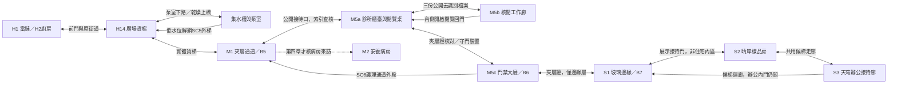

# 第三章「晴岸」完整劇本

ST-20，2026-10-10；敘事輸入與分支基準 `cad760fe0b844631b12f9ff1e0db5ee7884dec32`。本稿交付原創繁體中文文稿、演出、任務及狀態契約，正式章節由ST-21生成與驗證；文稿不是可玩包、三語審稿或畫面驗收。逐條自查見 [CH03_SCRIPT_REVIEW.md](CH03_SCRIPT_REVIEW.md)。因果依 [全章路線](../20-campaign-experience/CAMPAIGN_NARRATIVE.md) 與 [審查門檻](../20-campaign-experience/SCRIPT_REVIEW_GATE.md)，前章狀態依已交付 [第二章](SCRIPT_CH02.md)。

## 1. 為什麼上去，以及上去不能知道什麼

前夜凜與鷺在當舖屋頂核對市場委託，原帳指向「夾層診所月報17」。次日是週日，凜有索引、公開錯收證據與待查目標，沒有原資料盤。她打算先問收費依據，再看晴岸樣品房，親眼知道480,000要買的是什麼。老 K反對她去上面，卻不肯說清原因；她帶走目錄和索引，修好廣場貨梯的水位聯鎖，到診所查三份公開去識別資料。

三份資料證明天穹把同批100名錨人中8名仍需持續護理的人列作轉存排除，才把11%寫成3%。這不是凜個人帳，凜仍把自己的一成抽成當保單費用；本章只增加「公開數字不能全信」與「老 K真的交過她的備份資料」。守門人的工作迴圈妨礙通行，玩家解除外部門禁裝備的威脅，不殺這個用盡者。凜抵達玻璃邊緣，參觀樣品房、看見葉的手背，在辦公接待廊聽到一筆實際交易。她回家沒有說，鷺的下一個週日邀約把調查引向第四章的真正帳本。

| 必須守住的事實 | 本章可見／不可越界 |
|---|---|
| 原盤、索引與結案 | 原盤第一章已交；前章720／120／250各交易不再發。診所索引是查月報的依據，不是原表、病房通行證或所有病人的個資 |
| 第二章父女兩路 | cut：isolated=true、revoked=true、read_count=0、黃傘認知true；keep：isolated=true、revoked=false、read_count=1、黃傘認知false。兩路阿勇／小薇均活，restoration_agreed=false。本章沒有恢復連結或再讀小薇，父女不進診所戰區與辦公室 |
| 11%的分母 | 月報17同批100名錨人，11名達持續護理標準。這是該批的護理耗損比例，非每次記憶減11%、非全市永久常數、非凜的個人百分比。公開3%是排掉8名後的錯報，不把母群改成92名 |
| 凜復原費與畫面 | 沿既有普通死亡5%現金扣款、上限及首次建檔規則；不改成報表的3%／11%或老 K的一成抽成。第三章不顯示凜錨人姓名、91%或匿名個人耗損帳；第四章中點才變個人狀態列 |
| 診所門與證 | 月報查核櫃檯屬公開接待區，憑索引可達。核對完成後芷姐本人發「夾層證：公開查核」，不是偷職員證；只開診所側通道與邊緣電梯，安養病房房門、廠房、塔及日照住宅內區仍關 |
| 守門人的人與裝備 | 約60歲，用盡者，名牌「請洽櫃臺」、頭目副標JANUS。HP顯示「門禁裝置穩定度」；只打外部盾架、掃描臂與通訊器，身體不是有效傷害目標。打敗後他活著，芷姐解除工作架、扶他坐回櫃檯 |
| 葉與樣本 | 葉41歲、風控長，凜前章已聽過她遠端聲音。本章確認老 K把凜的備份交她、以此換取條件，是實際隱瞞。交易價碼、私設錨椅與誰替凜付耗損仍不知，不改成誤會或善意假交易 |
| 錨人耗損症 | 只是去識別護理資料上的病名，芷姐說明是錨人的記憶與生活能力受影響；沒有凜／老 K姓名。凜不知道自己的錨人是誰，不能用這份一般說明完成第五章指認 |
| 葉手背與錄音 | 主線看見她有寫字習慣；SQ7可讀「他叫阿翰。你愛他。」、取得錄音者阿翰的片段，但不由旁白交代哥哥、十二次、孩子或她的全部生平。第五章才問她這個名字 |
| 林小姐與房間 | 林小姐30歲業務員，職業與晴岸用途同場解釋。三間均480,000故事目標價；提案不是買房或替老 K簽約，不扣現金、不發鑰匙。第七章才問她的家屬並得正式參觀證 |
| 第一次陽光與汐 | 本章只有玻璃邊緣／樣品房／相鄰接待廊；街道全區、花園、塔頂都不開。遠處白髮女人與白傘無名，汐仍活著但不在可辨識鏡頭內；不畫墓，不用空椅暗示她已死 |
| 鷺的週日 | 前章末「明天是週日、不接案」在本章成立。她只在傍晚聯絡，不陪凜做診所外勤。第四章調查約在下一個週日，章末與續章皆顯示一週後，不偷換成同日接案 |

## 2. 一頁地圖、節奏與教學

H／M／S地名是文稿節點，ST-21以實際LevelData驗證腳底格座標、可達性與標記；本圖不是實測關卡或座標。

| 區域／首次估計 | 小弧線、張力與遭遇 | 迴圈、秘密、獎勵及地標 |
|---|---|---|
| H1／H14，5–6分 | 日常勸阻→看見貨梯受阻→安全引水；低至中 | 貨梯纜輪可遠看，前門接原街道。泵室上橋與下路成環，回程SC5外梯免重解。高架維修盒看得到，低水位後給20 |
| 泵室，4–5分 | 排水→供電→升梯；中峰。2場開放短戰，各20–40秒，可沿上橋繞 | 近戰抽水巡檢器1＋高處絕緣巡檢器1，新章身份；非人類病患。斷電後下槽可拿1個20秘密盒，無主線技能費 |
| M1／M5a，4–5分 | 首見夾層→登記→問報表；回落。通道1場雙巡檢器可繞，診所內無雜兵 | B5與門診招牌為地標；公開櫃檯不用夾層證，避免證鎖證。未領資料不顯示病人私名 |
| M5b，6–8分 | 三份資料→三處核對→申請異議；調查峰 | 閱覽桌為安全中心，檔案任意順序。內側回門開成環；第三抽屜錄音可選、不能作解謎必需 |
| M5c，5–7分 | 合法證件仍被舊門禁卡住→守門人→扶回櫃檯；最高戰峰 | B6在安全前室，3盾擊撲空裂盾、打斷蓄力、繞背停增援。SC6開回M1，只到護理通道外段，不看第四章角色名牌 |
| S1／S2，5–7分 | 暗轉亮→第一次陽光→樣品房提案；長谷 | 三房圍繞接待桌形成迴路。玻璃、窗與陰影是互動，無戰鬥；三窗全測與業務細問可選 |
| S3，3–4分 | 葉的手背→實際交易→凜收起筆記；敘事峰 | 合理近距漏音，安全確認再聽；候梯廊接回S1，禁辦公深處。看字不要求有錄音 |
| 返回H1／H2，3–4分 | 開通跨區線→留飯→兩次問傘→下一週日邀約；收束 | 已開外梯與護理通道回港；真正交通未接線時用步行版。回家不是下張試玩關的任意傳送點 |

主路35–46分、含三窗完整測量／林小姐細問／錄音與手背調查約42–55分，為製作估計。戰鬥約7–10分、垂直探索／機關約8–10分、文書操作約7–9分，其餘是可走的轉場與日常；必要資訊／電影閱讀約8–10分，已明列鎖操作，不假稱純探索。日照安全區允許數分鐘不遇敵，沒有為比例增怪。

| 動詞 | 安全引入 | 練習／組合 | 考驗與回看 |
|---|---|---|---|
| 排水與聯鎖 | 看水尺、安全轉排水輪，低水位燈與纜輪對應 | 泵室上橋避巡檢器，下槽關帶電支路；世界開關保留 | 貨梯可呼叫、SC5實接，回港不因換場恢復積水；不需以死解謎 |
| 三份對帳 | 第二章已學本金／利息，本章先確認同批分母 | 公開報表／輪班名單／追蹤名冊對照，次數不等於人數 | 同時提交母群100、護理11、排除8三個事實，得11%；錯誤指出缺證，不罰款 |
| 對裝置打斷 | 前室看門禁臂蓄力和安全維修鎖 | 近戰打斷、格擋／繞背；重複招式有同一預兆 | 守門人的遺忘迴圈與外部盾架，不發新重擊必買鑰匙，射擊亦有解法 |
| 問／測／記 | 林小姐邀坐窗邊，明示看房非簽約 | 三窗遮陽、紙尺測窗臺、試坐椅子與記時間 | 提案或暫不提案，承認沒問老 K；第七章帶本人來重新選 |

## 3. 演出政策與逐場索引

所有長交談由玩家確認開始、可返回，接近不自動鎖。正式電影可21:9，資料閱讀、泵操作、陽光過渡、廣播／氣泡無遮幅；戰鬥全視野。每段至少有新資訊／物品／選擇，說完至多三句就有視線／翻頁／操作變化。自願檔案長頁可捲動；一般臺詞單段≤56字、氣泡≤30字、bark≤16字，每次最多兩句bark、同屏最多兩句氣泡。

完成與結果同事務寫入；入口快照不標完成。略資訊電影同結尾，略選項停在玩家尚未決定處，不能自動買房、拿錄音或同意邀約。已完成回訪用本稿短句，收藏重播不發錢、不改時間、不觸發真死亡。舞臺成人H為基準，桌0.43H、椅座0.27H、門1.25H、杯0.06H；坐、蹲、靠都有真支撐，站起先把腳落回地面。手把提示沿實際輸入對映，不寫死按鍵。

| 場號／原事件 | 起因與資訊增量 | 玩家行動／固定演出+首次閱讀估計 | 入口、略／中斷及重試 |
|---|---|---|---|
| C00／3.01 | 索引帶出發目的，老 K勸阻 | 吃／收紙／確認出門；8+55秒 | 必要交談可略資訊，出門意向自己確認 |
| C01／3.02前 | 貨梯受水位聯鎖鎖住 | 查水尺與圖；3+20秒 | 不鎖操作，回訪只現況 |
| C02／3.02 | 排水才能升梯，不能把危險當按鈕 | 轉輪、隔離支路、呼梯；10+35秒 | 操作非電影，錯誤當場再試 |
| C03／3.03 | 夾層樞紐、B5與診所位置 | 登記或走過；3+25秒 | 無強制登記／死亡，廣播可略 |
| C04／3.04入口 | 公開區可以查核，芷姐說清資料範圍 | 出示索引、取核閱號；5+45秒 | 必要交談可略，同核閱號 |
| C05／公開報表 | 公開3%的母群及排除註記 | 檢視／影印；2+25秒 | 檔案自願閱讀，取得即存 |
| C06／輪班表 | 護理次數與人數要分開 | 輪班格選不同編號；2+30秒 | 錯算有具體提示，不刷獎 |
| C07／去識別名冊 | 轉存8名仍在同批／仍需護理 | 比對日期與追蹤欄；2+30秒 | 安養內門不開，不洩私名 |
| C08／三處確認 | 11%由三份證據推出，異議留下回執 | 三事實確認、問制度；5+65秒 | 缺證可離開，完成才領證與報酬 |
| C09／SQ7-G1 | 阿翰錄音只是一件家屬寄存物 | 抽屜、聽片頭、借出選擇；4+50秒 | 完全可選；略播放可拿已選借出，不預選借走 |
| C10／3.05前 | 新證可用，守門工作架仍讀舊指令 | 試掃證、看失效安全鎖；8+40秒 | 安全前室確認進戰，重試短版 |
| C11／守門人戰 | 遺忘迴圈、盾架與掃描臂 | 躲／擋／打斷／拆裝置；戰中提示≤8秒 | 無模態長對話，首次敗北才提示卡 |
| C12／3.05結果 | 人活、工作架停止，護理通道開 | 扶椅／取停機回執；8+35秒 | 可略同終態，不反覆打倒他 |
| C13／3.06陽光 | 玻璃內的亮度與上層邊界 | 升梯、遮眼、可繼續走；6+20秒 | 全程可走，停留反應可略 |
| C14／白傘遠景 | 主動望遠，不知道花園人物身份 | 看或直接進接待；0+15秒 | 非主門檻、無新姓名圖鑑 |
| C15／3.07入口 | 林小姐與晴岸看房規則 | 坐接待椅／取展示圖；6+40秒 | 必要參觀可略，不扣480,000 |
| C16／SQ3-C1 | 三窗比較，替老 K先作提案 | 測／坐／記／提案或不選；6+75秒 | 全測可選，未選不填房間預設 |
| C17／林小姐細問 | 熟悉房間的工作者也有生活 | 問安靜／工作，還圖；3+30秒 | 可選無額外貨幣，家屬真相留七章 |
| C18／3.08接近 | 合理在候梯迴廊碰見老 K | 取回頁／停步看側門；4+25秒 | 可退回，漏音點明確，不強制潛行追逐 |
| C19／SQ7-G2 | 手背字與名字，非完整生平 | 主線看到字、可選讀清；3+25秒 | 讀清才節點獎，無錄音亦可 |
| C20／3.08交易 | 看見資料交易與凜的隱瞞 | 確認聽、把筆記收起；12+70秒 | 安全電影可略，同已知交易，不偷簽協議 |
| C21／3.10 | 跨區路已通，回家有具體路 | 選實際交通／步行；3+20秒 | 服務未接不用假傳送，已訪站才可用 |
| C22／3.09 | 老 K留飯／問傘兩次，凜不說交易 | 揭蓋、端碗、回應；12+65秒 | 可略同回家，不能靠近就預演第二問 |
| C23／第四章銜接 | 公開報表不足，鷺邀查真正帳本 | 確認下週日見面、章末卡；6+50秒 | 未決邀約略不停作選擇，完章存檔不進舊第四關 |

## 4. 逐場完整稿

### C00　索引帶上，別替我把房買了

H1當舖／H2廚房，次日週日早上。凜、老 K，燈稍後通訊。桌面一碗飯、一壺水、晴岸目錄與索引；前夜二章結算都已完成。凜0.30W朝右，老 K0.70W朝左。目錄是紙冊，索引夾在筆記內，不畫原盤。雨、匙碰碗、老 K手上布摩擦，低當舖BGM。

| 拍 | 對白／動作／玩家參與 |
|---|---|
| 1 | 玩家確認早飯。老 K把飯往桌中推：「先吃完喔，昨晚那杯茶不能算一頓。」凜坐在有靠背的椅上：「我今天去夾層診所，月報十七還沒查。」 |
| 2 | 她把索引攤出。老 K沒接紙，按住旁邊目錄：「帳在這裡也能算，別去上面。那邊的規矩跟市場不一樣。」凜說「副本裡沒有原表，我不能一直拿猜的對帳。」 |
| 3 | 玩家拿回目錄，老 K放手而非拔槍攔門。凜說「查完我想看晴岸，至少知道那筆錢要買什麼。」老 K說「別替我把房間訂下來喔，我還沒說要住。」凜說「我只看窗，不簽，不先付錢。」 |
| 4可選追問 | 凜問「你去過上面？」老 K把壺蓋轉正：「做生意的人都得跑幾個地方。妳把該看的紙看完，就回來吃飯。」不是否認從未去過，之後辦公室出現不矛盾；未追問主線相同。 |
| 5 | 玩家確認出門。燈說「廣場貨梯能上夾層，入口那支水尺還亮紅燈。你到現場我再對聯鎖圖。」凜把索引收妥：「我先去貨梯，查完診所，再看晴岸。」老 K把桌上雨具桶推近，她取紙未取傘。 |
| 結果 | `ch3_departure_done`，HUD「到廣場貨梯，檢查上夾層的路。」若玩家先不出門，可查工作檯再來；不設已買房，不領前章報酬。 |

回訪老 K：「索引夾好了就走，回來先吃，紙別放到鍋上喔。」不重播按目錄、不推進第二次問傘。

### C01　貨梯底下還有水

H14廣場。高處纜輪連貨梯車廂，兩側導軌落到地基；梯下集水槽、水尺、乾燥維修上橋、排水輪。凜、燈遠端，無人在梯內；通行告示僅一張。貨梯廂淨高1.6H、門1.25H、纜輪固定桁架，入口地面有乾燥停點。燈的聲音由通訊器，不讓本人憑空站在上層。

玩家查控制箱，完整提示「集水槽水位過高，貨梯安全聯鎖未解除。沿右側上橋去排水泵室。」凜氣泡：「梯子沒壞，是下面還泡著水。」燈氣泡：「先看水尺，紅線下面才可送電。」兩句各≤30字、不鎖操作；水聲與繼電器短響。圖示把槽→泵→水尺→貨梯連成同頁，不只顯示紅色鎖圖。

| 互動 | 完整反應／可繼續做什麼 |
|---|---|
| 查水尺 | 凜說「紅線在車廂底下，排水輪在對面，從上橋過去。」低水位目標有刻度與字樣，色盲亦可讀。 |
| 呼梯太早 | 控制箱說「水位尚未到安全線，請先排水。」未消耗金錢／充能、不錯發能用旗標。 |
| 看上層盒 | 凜說「那個維修盒從下槽才爬得上去，先讓水退。」只示可見不可達20盒，不用無名高牆誘自殺。 |
| 結果 | 取得泵室位置與水位目標；只記已看圖，不寫聯鎖完成。H14出入港區始終可走，泵室不是關死玩家的戰鬥場。 |

### C02　排水、斷支路，再把梯叫下來

H14泵室，上橋與下槽相接。新敵人是**抽水巡檢器**（短地面衝撞、原泵室保全）與**絕緣巡檢器**（小型吊軌脈衝機），身份僅本章機房使用，不能換色套前章人形。兩場開放遭遇可從乾燥上橋繞；每場≤3個活敵、同時近戰1／遠端1。首次衝撞地面亮0.7秒，脈衝充電0.8秒後單束，玩家可擋／蹲／跳；不是把水中病患當雜兵。

| 拍 | 操作與對白／反饋 |
|---|---|
| 1安全引入 | 上橋轉排水輪，輪高0.55H可達，凜站穩轉動。燈說「先把水導進旁邊的蓄水槽，水尺到低線才放開車廂。」轉錯方向只停在原水位，沒有偷偷加水淹死。 |
| 2排水 | 水流改道、主槽到低線，物理浮標落到刻度；下槽照明亮。玩家可從側梯下去，濕地區電纜仍有警示護罩；安全路徑有上橋，不在人物落點開必中電。 |
| 3隔離 | 玩家在乾地關泵室旁支路，提示「關閉浸水支路，再接通貨梯主路。」燈說「支路是泡水那條，主路在上橋。你關的是支路，不是整座泵。」錯關主路可當場改，明示現況。 |
| 4練習／秘密 | 已低水位能拿維修盒20；下槽背面有工具櫃的20盒，門標「維修備料」。取得各一次，工具只是場景物不生成有價無限扳手。主路不需兩盒、重擊升級或義體磁吸。 |
| 5呼梯 | 玩家回控制箱，凜說「水退了，支路也關了，我把車廂叫下來。」貨梯確實沿導軌下行，卡位物不會壓玩家；呼叫完成前有安全等待區，最多8秒可加速但不能跳到不存在的落點。 |
| 6捷徑 | 車廂穩定後解鎖SC5外梯，玩家放下靠廣場的平臺梯，兩端接觸可見。燈說「外梯放好了，回程不用再繞泵室。」玩家進廂確認上行，纜輪轉、雨聲減，不切空白黑畫面冒充升梯。 |
| 結果 | 低水位、支路關閉、主路接通分別存世界值；三項實際成立才`ch3_freight_ready`。SC5與兩盒獎獨立一次。出廂提交`ch3_mezzanine_reached`，H14–M1雙向可用。 |

掉下普通槽臺若HP未歸零，抓側梯／近處乾地返回，不算真死亡；電擊等真正HP歸零按本輪死亡流程，不把「排水完成」倒回未排、也不加小薇讀取。泵室已完成再呼梯只顯示樓層，箱不復活。

### C03　這一層的招牌朝裡面

M1夾層通道，凜、燈遠端。冷白管線、低照護理入口、向內的診所招牌與B5。上層玻璃只反光，尚未跨過日光介面；不先播首次陽光。下方維修帶有一場兩巡檢器，玩家可以從照護步道繞，不讓門診混戰。

| 拍 | 對白／互動 |
|---|---|
| 1 | 凜可走，氣泡「診所招牌朝走廊裡，不朝港區。」燈回「對，貨梯口往右，先找公開櫃檯。」兩句≤30字，相隔下一組至少20秒。 |
| 2亭子可選 | B5終端說「可在此登記夾層復原位置。交通幹線尚未接通。」玩家登記才改實際復原點，已在前章建檔者不再初次建檔；從未真正死亡者沿初次規則，單次登記本身不假稱死過。 |
| 3路牌 | 文字「公開報表查核向右；安養病房來訪請洽護理櫃檯；廠房暫停通行。」沒有棠／芸／桐的病人名牌，沒有塔證預告。 |
| 4可選父女狀態核對 | 玩家在公共通知終端看前章收款批號的轉介回執。cut文字「父女連結已撤銷，兩人完成安全離場；未讀取。」keep文字「連結維修暫停，兩人完成安全離場；既有讀取1次，未恢復。」凜說「這筆不是診所月報，不能混成同一個人。」無新增任務／金錢、不出私址。 |
| 結果 | 走到公開門診入口才更新主目標「出示月報17索引，詢問診所公開查核。」登記、通知、巡檢戰都不是必需旗標。 |

### C04　芷姐只給能看的那幾頁

M5a公開櫃檯。芷姐36歲護士、凜、燈通訊。芷姐身後是鎖住的病歷內櫃，桌前有公開去識別冊；主線不用突破病房。兩人0.30W／0.70W相向，凜把三張市場副本與索引放在桌前，不遞原盤。翻紙與印章聲，診所BGM低到能聽鍵盤。

| 拍 | 對白／動作／玩家參與 |
|---|---|
| 1 | 凜出示索引：「市場代收說費用照月報十七，我來看原始公開表。」芷姐接紙：「我是這班的護士芷姐。十七是月份批號，不是你的診斷號。」同場解釋身份與索引。 |
| 2 | 她先看委託回執：「市場錯收已結案，查核權還在。你能看的是去掉姓名的統計，不是每個人的病歷。」凜說「我先對同一批人，有名字也不替他們作答。」 |
| 3 | 玩家取核閱號Q17，芷姐指三處：「公開報表在桌上，輪班表在工作廊，追蹤名冊在門邊閱覽櫃。三份都用編號，日期要一起看。」核閱號是只讀許可，不算第四張世界通行證。查核告示「核閱異議處理報酬180信用點，三份證據確認後結算」，由診所公開查核帳支付，不是芷姐私人錢。 |
| 4可選問病名 | 凜問檔案標頭的「錨人耗損症」：「這是復原的人生病，還是付帳的人？」芷姐說「這一冊追蹤的是錨人的記憶與生活能力，不是受錨者的新身體。」凜說「我先查這份總表，不把它貼到自己名字上。」 |
| 5 | 芷姐拉回個人內櫃：「有問題拿編號來問，我能解釋轉介欄。有人正在休息，裡面的門今天不開。」沒有含糊「之後再說」作路障，公開三證能實到。 |
| 結果 | `ch3_clinic_access`／Q17；HUD「核對公開報表、輪班表與追蹤名冊。」若略交談同公開權，仍不顯示已拿三證、不發夾層證。 |

回訪芷姐：「先看月份與編號，有一份缺了就從原櫃再印。我不收查核入場費。」缺證可重取不重複領錢；索引損毀可由前章已提交事務再印，不重新交盤。

### C05　百分之三寫在最大的一格

M5a閱覽桌，凜可檢視、影印、離開。這是可捲動檔案，不配黑邊／全屏悲劇CG。

公開頁P17逐欄全文如下，標籤與數字不是口語句子：

| 欄位 | 檔案內容 |
|---|---|
| 批號／觀察期 | 月報17，當月1日至30日；同批錨人100名，編號R17-001至R17-100 |
| 公開結論 | 達持續護理標準3名；公開耗損比例3% |
| 納入名單 | R17-001、004、009 |
| 頁尾註記 | R17-012、018、024、037、053、067、082、096列轉存，不計入需持續護理人數 |
| 轉存去向 | 轉存：帳房；追蹤狀態另見護理表，沒有治療已完成的證明 |

凜說「大字寫三，下面把八個編號排出去了。排去哪裡？」燈說「先找同批追蹤欄，我不能只看標題說它們已經好了。」玩家選「儲存公開頁副本」，當場記`ch3_public_report_taken`，可在日誌重看；不提交答案、不發每頁小額獎。牆上天穹標語沿創辦人聲音短播，凜能關掉；正文不宣稱雨是耗損冷卻，更不映出個人錨人姓名。

### C06　一個人兩班，還是一個人

M5b工作廊的公開護理表，凜。檔案固定在玻璃板外側，藥耗只是一份表的註腳，不另造第四把解謎鑰匙。護理推車在旁留1.1H通行淨寬，凜不開啟藥箱。

| 欄位 | 護理表N17全文 |
|---|---|
| 範圍 | 月報17同批；30日白班與晚班追蹤，統計單位為不同編號的人 |
| 白班 | R17-001、004、009、012、018、024、037、053、067、082、096，共11名 |
| 晚班 | 同上11名；交班檢視共22次，並非22名 |
| 狀態與註腳 | 上述11名在30日仍需持續護理；護理物料22份對應兩班，未列停止追蹤 |

玩家把兩班重複編號合併，介面不倒數。凜說「兩班各十一筆，二十二次不是二十二個人。」燈說「用編號去重，保留十一個。再看轉出去的八個是不是仍在這個月裡。」若錯填22，完整提示「同一編號出現兩班，請計不同編號；目前11名。」只解釋讀法，不替完成三處確認。存`ch3_nursing_roster_taken`；轉出名冊的位置仍指M5a門邊。

### C07　轉出去，不等於從這批消失

M5a門邊閱覽櫃，凜、芷姐隔櫃回話。病房內門磨砂玻璃，沒有可辨名字／臉；不提前進第四章的棠、芸或桐床邊。名冊T17的公開頁只列編號與核閱狀態。

| 欄位 | 名冊T17全文 |
|---|---|
| 母群 | 1日建檔的同批錨人100名；月底仍用原100為觀察母群，換院不移出本月母群 |
| 本站持續護理 | R17-001、004、009，3名 |
| 轉介仍追蹤 | R17-012、018、024、037、053、067、082、096，8名；月底仍達持續護理標準 |
| 轉介完成含義 | 只完成院區轉介；不是治癒，不是中止記憶耗損。公開報表需把這8名納入 |

凜拿公開頁到櫃前：「報表說不計，名冊卻寫還在追蹤。」芷姐說「換病房的是人，月份沒有跟著換。我能證明這八個還在同批，但對外那頁不是我核發的。」她不自稱竄改者或推知葉的私事。玩家儲存名冊`ch3_followup_register_taken`，可選追問「轉存帳房是什麼？」芷姐說「統計交給中央帳房留存，這個櫃檯沒有中央原帳。」她只給機構位置資訊，不放行塔。

### C08　三個地方都對不上

M5a閱覽桌，凜、芷姐、燈通訊。三份證據同頁可切，玩家提出三個具體核對，不靠盲猜「3／11／22」碰巧過關。安全無戰鬥，缺證可以返回來源。

| 玩家提交 | 正確事實與完整提示 |
|---|---|
| 一、誰還在母群 | 選T17「換院不移出」對P17排除註記，確認100。若把8名從分母扣掉，提示「名冊仍以原100名觀察，轉介不把母群改成92名。」 |
| 二、多少人仍需護理 | 選N17的11個不同編號對公開只列3人；確認11，不是22次。漏N17則「先到工作廊核對不同編號，不能把護理次數當人數。」 |
| 三、差的8名去哪裡 | 選T17轉介仍追蹤8人對P17不計欄，確認3+8=11、11/100=11%。漏T17則「回門邊閱覽櫃核對轉介完成的意思。」缺P17則「先取公開頁，確認它到底省掉哪一欄。」 |

| 拍 | 對白／動作／結果 |
|---|---|
| 1 | 凜指三處：「同一批一百個人，有十一個仍需要護理。公開那頁只算三個，另外八個被寫成轉存。」她逐頁排列，不說全市每次復原都磨11%。 |
| 2 | 芷姐說「你對的是這一批的比例。別拿它當每次死一次就少十一，也別拿我的護理表替你個人的帳簽名。」凜說「我沒有個人原帳，先把這八個補回去。」 |
| 3 | 燈說「市場那筆重複利息結案了，月報這裡又排掉人。你現在有異議證據，還沒有中央原帳。」凜說「我要先問誰負責那張公開表。」 |
| 4 | 芷姐替她在終端提出Q17異議，回執「三處核閱一致，公開3%與追蹤11%不一致；已要求原發布端回覆」。主線不假造立刻全面更正。芷姐從抽屜取「夾層證：公開查核」交她：「這張只開側通道和邊緣電梯，去那邊的接待廊能投遞異議。」 |
| 5 | 凜取證：「不是職員證，我不拿它進病房。」芷姐說「對，護理內門還是鎖的。晴岸的展示接待也在邊緣層，參觀不等於住宅入住。」同場交代證用途與下一步。 |
| 結果 | 三處確認+異議回執取得後`ch3_report_reconciled`／夾層證，同事務查核報酬180信用點。先前資料每份即存，未提交無180；兩章交易不同ID，不追加前章250。HUD「到診所門禁大廳，持夾層證前往邊緣接待層。」 |

回訪芷姐：「你那份異議有回執了，原發布端還沒答。三張紙都留著，不能只拿十一那一格。」本章看到資料矛盾、用盡者與小薇既有後果，但還沒有凜的匿名耗損證據，第四章中點仍有新資訊。

### C09　第三個抽屜不是第三份報表（SQ7-G1）

M5b閱覽迴廊有一個寄存櫃，三個抽屜：第一借出單、第二空帶盒、第三舊錄音。P／N／T三證來自桌／牆／閱覽櫃，不放在這第三抽屜，避免略SQ7就卡三證。寄存標籤「家屬尋人錄音，可聽片頭；帶出須登記」。芷姐保管的病人手錶仍在她的私人內櫃，本章不把手錶改為免費可偷道具。

| 拍 | 原創對白／玩家行動 |
|---|---|
| 1 | 玩家開第三抽屜，帶盒標「錄音者：阿翰／寄存」。凜說「這卷有名字，卻沒有收件人。」芷姐說「阿翰留下給家屬找回線索，片頭同意公開。你想聽就放這臺，不要當月報附件。」 |
| 2播放 | 成年男人的錄音，只有帶噪與播放輪聲，無少女／兒童演員。阿翰說「我是阿翰，你哥哥。哪天妳想不起我，就先聽我把名字說完。」停一拍翻紙聲，再說「妳以前會替我留一盞燈。我把這句錄下來，不要妳裝作記得，只想讓妳有一條路找我。」錄音不提葉姓名或孩子。 |
| 3 | 凜說「他連對方可能忘掉都預先錄好了。」芷姐說「你聽見的是他給人的話，別替收件人答應。要帶走我開借出單，找到本人再還。」 |
| 選借出 | 凜說「我先記借出，不把它當我的。」玩家取帶與借出單，寄存櫃顯示已借；芷姐說「拿去找收件人可以，不能賣掉，也別把它交到公開報表裡。」 |
| 選留櫃 | 凜說「名字我看見了，先留在這裡。」芷姐說「下次來還在第三個抽屜，想借再找我。」只記聽過／名字，不發拿錄音獎。 |
| 結果 | 片頭聽清或主動略已開始片段後`sq7_ahan_clip_heard`；借出確認才`sq7_ahan_recording_held`與G1獎20信用點／小XP。可第四至六章回取；不借照樣領夾層證、打守門人、看房、偷聽。 |

回聽完整片頭在日誌，內容同上，不追加交易價碼；帶在凜劇情欄不能賣／當／消耗。後章可交本人或芷姐，但未交前保持借出物，不憑收藏回放複製第二卷。

### C10　證件是新的，他還在等昨天

M5c門禁大廳，凜、芷姐、守門人JANUS；安全前室B6、後方邊緣電梯。約60歲男人在支撐式工作架中，背部外接通訊器連門機、胸前外部盾架與掃描臂為機械裝備；身體與頭不是鎖定傷害目標。制服名牌「請洽櫃臺」是職務牌，不當作本名。臉與手有獨立原生角色需求，不用舊人形換色。

| 拍 | 對白／演出／玩家行動 |
|---|---|
| 1 | 玩家先掃夾層證，門燈綠卻未開。守門人說「請問您有預約嗎？證件放在臺上，我替您核對。」凜說「公開查核完成了，護士給了這張。」不是非法闖關被正常工作人攔。 |
| 2 | 芷姐按櫃檯解除鍵：「這張有效，讓她過邊緣電梯。」守門人看職務牌：「對不起，我還沒核對，請先不要走。」工作架螢幕反覆顯示「昨日日程／查無Q17」，機械夾閘合上。 |
| 3 | 芷姐指維修框：「他記不得新日程，工作架卻一直把拒絕通行當命令。手動解除也卡住了；別打人，把外面的門禁架停下。」她開維修申請：「診所委託停機處理，一百信用點在停機回執成立時結算。」她退至硬安全門後，照護通道仍可退。 |
| 4 | 燈說「盾架擋正面，掃描臂蓄力時可以打斷。背上的通訊器在架子外側，停它就沒有增援。」前室示意圖示橙色可打部件、灰色人物保護區；彈道撞保護區無傷害、不能屍解素材。 |
| 5 | 玩家確認解除門禁。凜收好紙：「我停機器，證件放這裡，你不用再問同一遍。」守門人抬盾架：「不好意思，請站回等待線。」登場卡「守門人／JANUS」，血條名「門禁裝置穩定度」。 |
| 結果 | `ch3_janus_intro_seen`只完成登場，門禁未解除、獎未發；略電影同戰前安全狀態，不能默殺或搬走人。退回前室有B6可登記，0錢亦可進戰，無必買武器。 |

### C11　他重複了剛才那一招

診所大廳足夠繞盾架，地面乾燥、不放平民作盾。兩條側路在同平面柱後與短上臺成環，沒有投射物穿到公開閱覽區。核心機制只有「遺忘迴圈」：工作架受到有效部件打擊，守門人有時忘了流程位置，重複上一招；同樣的預兆仍先出現，玩家不是失去輸入、延遲攻擊或反向控制。

| 招式／階段 | 預告、玩家解法與人物反應 |
|---|---|
| 盾擊 | 長1.0秒抬盾、地面扇區線；向側面躲或格擋，撲空外部盾鎖露出。3次有效盾擊撲空後裂盾，計數與裂盾儲存。聲音是機械鎖而非人體骨折 |
| 掃描臂 | 橫線0.8秒預告後掃過，蹲／跳避；蓄力時近戰打橙色臂鎖中斷，亦可在繞背視窗射擊外接臂鎖。首次中斷bark「不好意思，我重新核對。」≤16字，沒有反覆哀嚎 |
| 通訊增援 | 背部通訊器燈閃0.8秒，最多2巡檢器、同屏最多3（含頭目）；破壞器後不再呼叫，保留停機結果。敵人只機房裝置身份，門診護士／病人不是雜兵 |
| 通知單 | 外接列印頭亮0.7秒，慢格狀紙片一次一型，有清楚空縫；背景紙不是傷害判定。玩家鑽縫或擋／射破單張，不用新能力 |
| 遺忘迴圈 | 每次有效受擊依穩定遭遇亂數取約30%機率進重複一次；頭上「？」與機臺「程式重播」同時出現。禁止連鎖重播超過2次，慢招不被無限卡住。重複同一招仍完整蓄力，凜首次bark「他會重複，先看蓄力。」≤16字 |
| 50%穩定度 | 掃描臂掃域較大但慢一拍；盾架僅在累計3次盾擊撲空後裂開，未達3次仍完整；有明顯新地面預告，無突然全屏扇掃。人物握職務牌，重複「請先在等待線後面。」動作機械化來自原本耗損，不發生本章復原 |
| 完成 | 裝置穩定度到0後，玩家拔外接門機維修插銷，工作架斷電停住。守門人仍站在支撐架內呼吸，無流血、死亡黑畫面、讀取或人體處決。輸出所有武器只對橙色外部部件生效，累計足夠才拔銷，不能開戰一秒直接按互動略掉戰鬥 |

首次真死的敗北卡全文：「看他蓄力，再打斷橙色的掃描臂。盾擊撲空三次會裂盾，繞背停通訊器就能阻止增援。」其後第2／3／10次短復原，提示可手動開，沒有每次長登場。世界盾裂／通訊器破壞／裝置剩餘穩定度保留，已打破的件不補；當前攻擊與短命巡檢器重建到安全起手，不能玩家重生同幀受傷。職務牌不掉成金錢材料。

### C12　謝謝光臨，先坐一下

門禁大廳，凜、芷姐、守門人。戰鬥結算先穩定，再播放8秒固定扶椅動作／35秒閱讀；武器掛好，病人椅位在乾地，背靠與腳部位置都實接。

| 拍 | 對白／動作／玩家行動 |
|---|---|
| 1 | 凜按停機確認，門閂退開。守門人看空白的顯示器：「謝謝光臨，歡迎您再來。」凜沒有追擊，說「你先坐，門已經開了。」不是拿他的歉意做處決獎勵 |
| 2 | 芷姐從安全門進來解除支撐帶，先扶膝、再移到椅上，兩腳著地：「現在休息，我把牌子放到桌上。」玩家協助把椅拉到指定乾地，若略同坐好終態 |
| 3 | 守門人問「請問您有預約嗎？」芷姐說「這一筆我核過了，你不用再站起來。」他停在椅上，不因回訪再次機械化開戰。凜在筆記上寫「證有效，機器仍不讓過」 |
| 4 | 玩家從內側推開SC6護理通道外門，看到回M1的短廊，病房內門仍關。芷姐給停機回執：「側路開了，邊緣電梯也是你的證能去的範圍。帶回市場的紙別弄丟。」 |
| 結果 | 停機事務`ch3_janus_disabled`、主路處理報酬100信用點一次；人仍活、門可過。扶椅電影結尾記`ch3_janus_aftercare_done`／SC6已開，HUD「乘邊緣電梯，到晴岸接待層投遞異議。」不寫世界所有用盡者都復原不了或凜自身記憶消失 |

M3匿名片段此時置可讀，不要求自殺：H1貨架「未署名的記錄」或戰後首次真正死亡可看到。完整原創句：「她談價的時候，指尖總在桌邊敲三下。我提醒過她，她說這樣才能把數字記穩。」凜說「這人一直記我的小動作，卻不寫自己是誰。」不署名K，不稱守門人／鷺記憶，不用片段指認付帳人。

### C13　玻璃不再只是反光

M5c邊緣電梯→S1玻璃展示層，凜、燈遠端。電梯沿導軌從冷白通道升至接縫上方，玩家在廂內可走、扶欄、確認停層，門開時有實際平臺。曝光在安全平臺內3秒由暗轉明，不突然過曝吞人物。雨聲留在玻璃外側、廂內為低輪軸聲，沒有空氣從封閉玻璃穿過的風雨。

| 拍 | 原創反應／可操作行動 |
|---|---|
| 1 | 電梯抵S1，凜抬手遮眼，不自動站到玻璃外。氣泡「這裡的光，照到地上是暖的。」燈回「你在玻璃內側，外面住宅還沒開。」兩句≤30字，後段可繼續走，沒有黑邊蓋落點 |
| 2自選停留 | 玩家停在光斑，凜把手翻過來看指節，再看衣袖乾濕：「原來沒有雨的時候，影子會落得這麼清楚。」燈說「先看夠，診所的紙又不會跑掉。」前章已見亮公告屏不代表已見日光，這裡才是完整陽光 |
| 3向前 | 窗外住宅有真玻璃邊界，門提示「住宅內區需正式參觀證，今天只開展示接待。」夾層證不會被消耗／變塔證；B7可登記，此次尚無交通幹線服務。玩家直接走過也留場景轉變，不強迫驚嘆 |
| 結果 | 實際到S1記`ch3_sunlight_reached`，主目標「到晴岸接待桌投遞公開異議，參觀展示房。」停留反應另記一次，只影響回訪短句，不獎錢或改死亡規則 |

回訪氣泡：「今天還有光，我先看這一頁。」沒有每次再遮眼、重播首次升梯或加賺曝光獎。

### C14　遠處的白傘（可選望遠）

S1玻璃邊緣，凜。觀景框固定在玻璃內，遠處天穹塔上有小花園，白髮年長女人持白傘照看盆栽。旁邊低背椅被植栽與傘面遮去大部分，看不清有誰；汐仍活在花園，沒有墓碑、祭品、黑白照片或死者名牌。此鏡頭不能放大到讀筆記或人物姓名。

玩家可看15秒／直接離開。凜說「晴天還撐白傘，是怕光還是怕花被曬？」燈說「從這裡看不清，我不替她答。接待桌在你左邊。」兩人不認出沈望，更不點名汐。觀景圖只標「塔頂花園遠景」，收藏可回看同未知事實，沒有NPC支線、金錢、碼解謎或塔頂可走標記。

### C15　林小姐先請她坐下

S2展示接待，凜、林小姐30歲。三房A晨窗、B靜窗、C晚窗圍繞公共接待桌，展示層在玻璃邊緣內，無住宅內區住戶或可偷的床頭抽屜。林小姐0.70W，凜0.30W；她先把椅子拉到桌前，凜坐下腳著地，臉不被前景盆栽蓋。紙圖、椅腳、微弱空調，暖低音樂。

| 拍 | 對白／動作／玩家參與 |
|---|---|
| 1 | 林小姐說「不好意思，雨具可以先放在門旁，地上才不會滑。」她看凜兩手是紙：「您沒帶傘，那我替您拿張擦水布。」凜擦袖說「不用替我找傘，我來看晴岸的房。」若實際裝備欄已帶傘則用「我把傘放在門旁，紙留手上」版本，不讓現有可見道具消失；本輪故事未送傘，預設無傘 |
| 2 | 林小姐接名：「我是晴岸的林小姐，負責這層樣品房。這裡是展示，不是入住，您可以先坐一下。」凜把診所異議回執放在指定公文格：「先幫我投到相鄰天穹接待廊，這張不是購房申請。」 |
| 3 | 玩家確認公文投遞，林小姐蓋收件章：「公開查核件下午轉風控接待，不用跟房間綁在一起。看房也不需要先交訂金。」交易目的合理存在，不是無因上樓買房支線才聽到老 K |
| 4 | 凜翻目錄：「三間都寫四十八萬，差的是窗？」林小姐說「三間總價同樣是四十八萬，差朝向、光照時間和安靜程度。真正入住還要本人看過，我今天不請您簽。」480,000不進可花錢結算，也不承諾已有可得足額 |
| 5 | 玩家起身到第一扇展示窗，林小姐說「您可以量窗臺、試坐，記下想帶誰再來。也可以今天先不選。」凜說「我替老 K先算一下，他在下面老嫌光太少。」說的是凜推測，不把他真偏好當已問過 |
| 結果 | 接待公文收件與`ch3_clearwater_tour_started`；至少進展示窗區／離開確認參觀後`ch3_clearwater_tour_done`。C16房間提案可選，不讀為C18／C20的門鑰匙。主目標「參觀展示房後，沿候梯迴廊取異議收件回執。」 |

必要參觀承接愛的動機，但三窗全測與房間提案屬SQ3。使用「先不選」保留room_choice=unset；不因玩家略支線替老 K默選，也不暗發已預留房訊息。這裁定取代舊SIDEQUESTS的C1必須三房全做，保留C1在主線可見的入口與後章選窗回收。

### C16　把每一扇窗都記在帳上（SQ3-C1）

玩家可任意順序進三房，紙尺與遮光板是展示物，無需技能、錢或阿梨住處旗標。凜測窗臺、推展示小窗的內側遮陽板、坐椅，看定時光照圖與影子；外窗為封閉安全玻璃，不能推開跳到日照全區。量的是陳列窗尺寸與展示圖時間，時間不會因反覆測量改成一整天過去。

| 房與玩家動作 | 完整對白、記錄及明示差別 |
|---|---|
| A晨窗，東側 | 凜拉紙尺、記晨光圖：「早上先照到椅背，老 K起來時就能看見。窗臺也放得下一個碗。」林小姐說「這間偏晨光，上午圖示八到十點最亮，下午有遮陰。您先試坐，不用只看我那張圖。」玩家記A晨窗、早亮／晚陰，凜坐下再站腳回地面 |
| B靜窗，北側 | 凜關內遮陽板、停聽空調：「窗不對主路，吃飯時大概不用一直聽車。」林小姐說「這間少直曬，靠反光也很亮；安靜有人喜歡，也有人睡不著。」凜說「他在店裡連滴水都聽得出，我先記，不能當他一定喜歡。」玩家記B靜窗、少直曬／低路聲 |
| C晚窗，西側 | 凜移椅到下午光圖處：「下午才亮，他忙完貨架也能坐一下。我把椅子靠裡，別讓光直接照眼睛。」林小姐說「這間下午圖示兩到四點最亮，夏天更要用遮陽板。您現在替他擺得很仔細，他還沒坐過這張椅子吧？」凜說「還沒有，我先留一個提案。」玩家記C晚窗、午後亮／需遮陽 |

| 選擇／中斷 | 對白／結果 |
|---|---|
| 提案A／B／C | 至少實際看過所選房一扇窗後，玩家選「把這間記作提案」。確認框「只記房間提案，不簽約、不扣款。老 K仍可親自改選。」凜說「我先記這間，回去不把它說成他已經答應。」林小姐說「我在您的看房卡寫提案，這不是預留名額。」room_choice=morning/quiet/late |
| 暫不選 | 凜說「三間我先記差別，今天不替他填房間。」林小姐說「可以，下次帶本人坐過再決定。」room_choice=unset，tour_done仍可成立，無C1獎。從未看三房也可先走，不能日誌自稱全測 |
| 改提案 | 本章結束前可重新測另一窗並明確確認，林小姐只換卡上的房名，獎勵記錄不重給。不是三次交易買三套房 |
| 完整測三窗 | 三個測量值分別存。都做完只增加完整比較頁，不另造第四個支線節點或第二次錢；不能用「完整比較」要求主線繼續 |
| 結果 | 看過所選窗+明確提案才`sq3_room_proposal_done`，SQ3-C1小20信用點／小XP一次；收藏卡是凜的章節探索獎勵，不冒稱林小姐支付訂房佣金。放棄可第四章前回訪，再看；第七章本人仍能改提案，整條SQ3未完成，不發參觀證或房鑰匙 |

後章room_choice不是老 K偏好；第七章他實際坐／答後才有最終房間決定。若第三章沒提案，第五章只報三房同價，第七章當場選；B結局依最終本人選定窗。沒有本人選擇的普通結局用普通房畫面，不假稱凜提前答應過。

### C17　這麼安靜，妳每天都在這裡嗎（可選細問）

S2接待桌，凜、林小姐，公文仍待相鄰廊回執。玩家可還紙尺、問房間生活、不問直接走；本段不另發貨幣／XP，不提前完成第五或第七章SQ3節點。

凜問「妳剛才說有人太安靜睡不著，妳每天都聽這些？」林小姐把紙尺捲回盒：「我每天開展示窗，椅子有沒有挪過，我都知道。有人不是怕吵，是怕忽然什麼聲音都沒了。」凜說「我只把漏水算成壞掉，沒把聲音也算進去。」林小姐說「您可以把這一句帶回去問，但不用現在替他回答。」她依舊先有禮、不說母親、員工家屬福利或自己將成護理員。

臨走林小姐把看房卡與公文取件單並排：「不好意思，您的公文回執在候梯廊的取件格。從那邊回電梯，比再走展示房近。」凜把兩紙分開收：「房間是提案，診所是異議，我不夾成同一筆。」玩家走真候梯迴廊，既可跳細問也有同取件單，維持主路方向。

### C18　他從員工門走出來

S2→S3共用候梯迴廊。這是日照邊緣的對外接待，不是天穹塔內辦公深處；玻璃內門有門禁但迴廊可到。凜來取已投異議收件回執，老 K與葉在側辦公室，林小姐不跟她偷聽。老 K早飯後走合法員工貨運接待線來赴舊客戶約，不走凜剛修的公共水位梯；前場他承認做生意跑地方，不是忽然會傳送或永遠在家。

| 拍 | 原創對白／動作／位置 |
|---|---|
| 1 | 凜在公文格取回執，標「風控接待收件／月報17查核件」。側門開啟一縫，她看到老 K收起來客卡，走進葉面前；不能讀卡上的私設錨椅或當年協議 |
| 2 | 凜可退回S2，氣泡「他叫我別上來，自己卻在這裡。」燈回「我只知道你那張公文送到了，裡面的約不是我排的。」兩句≤30字；燈不監聽全部辦公資料、也不順便點名錨人 |
| 3 | 老 K移向側辦公桌，葉把透明傘掛在桌旁保護手背。安全臺邊有靠牆等候長椅，凜能停在漏音格，沒有追捕兵或攝影警報迫她在三秒內偷聽 |
| 結果 | 實際取回執存`ch3_petition_receipt_taken`；看到老 K存`ch3_k_at_office_seen`。HUD「在接待廊確認老 K的來意。」尚未完成偷聽，不發新證，離開可再來同時段入口 |

門縫本來用防夾止扣留0.03H，距凜約0.6H；桌離門約1.2H，對話可透門縫與上方回風格漏音。牆與玻璃隔絕大部分環境，近處話聲降低但完整字幕由可聽距觸發；超出距離不顯全句。不是遠處穿透厚玻璃字幕。

### C19　葉在手背補一行字（主線觀察／SQ7-G2）

S3等候臺，凜在門縫側、葉在桌右側0.70W、老 K在左側0.30W。葉停筆把手背翻向自己看，字在手背外側，兩個名字並未貼在玻璃上；可讀視點在接待臺合法停留位置，鏡頭不跨門進房。原生手背道具字層需求見資源表，不在角色部件上臨時打亂貼圖。

| 行動 | 完整文字／結果 |
|---|---|
| 主線看到 | 凜看她先寫字才開啟檔案，說「她先在手上補字，才繼續談。」燈回「你看到她的習慣，還不知道她為什麼這樣做。」`ye_handwriting_seen`，不自動完成可選讀清 |
| 可選讀清 | 玩家確認「看清手背上那一行」。字全文「他叫阿翰。你愛他。」凜只說「她把一個名字寫在身上，像怕它不見。」有錄音者補「抽屜那捲也寫阿翰，我還沒有問過她。」無錄音者說「我先記這個名字，不替他們猜關係。」沒有當場詢問葉或向燈揭完整家族 |
| 不細看 | 凜先聽老 K的談話；主線仍可C20，日誌只記有寫字，不能後章替玩家說已讀到阿翰 |
| 結果 | 讀清或主動略已開始讀清資訊後`sq7_ye_name_seen`、G2小20信用點／小XP一次；錄音在或不在皆可完成。名字線只公開「這行字的意思」，第五章才問本人。不發塔內捷徑、批准例外或兄妹記憶 |

回放手背只看既有當下字，不變成未來洪水暈字；錄音對照只是凜提出可能相同的人，日誌記「未向本人確認」。

### C20　他交出去的是她的資料

S3漏音等候臺。玩家確認「留下，聽完這段談話」才進安全電影，12秒固定手部／檔案動作與70秒首次閱讀估計，分成三小段可略。凜靠在可支撐實牆，手持筆記不跪蹲假隱身；門邊陰影有空間，老人不因隔牆聽見她的心聲。

| 拍 | 完整原創對話／鏡頭與動作 |
|---|---|
| 1實際交易 | 老 K把收件號推到桌上：「妳收了她那份備份，我不是來賣第二次。你們排外勤前，先看清她會碰到什麼。」葉對照舊協議夾：「資料在天穹保管，交付人是你。這一點沒有改。」鏡頭只拍兩人手與檔案封面「交付協議」，看不到錨人簽名頁 |
| 2 | 老 K說「妳上次答應的條件，不是讓她一直去換命。我今天要你把危險的派案停掉。」葉說「樣本要活著，研究才有意義。我可以撤掉清理區的排案，不能答應所有街上都安全。」她真的要保護一個可活的樣本，但也承認控制的界線，不用假反派宣言 |
| 3真隱瞞 | 老 K扶桌：「她不知道那份資料是我交的，妳別把這個拿到她面前。」葉把封面蓋住：「你把資料交來，換的條件也已經執行。這件事不是她同意過的，我不替你把它說成同意。」此處明確交易與未問當事人，不能第五章改成從未賣備份 |
| 4 | 老 K說「我知道她沒答應，我沒讓她看。」葉說「那就先履行眼前的條件。你守原協議，我保留既有安排；別讓她碰這份協議。」本次只維持過去交付後的既有協議，沒有追加備份或新資料交付。「安排」不具體說私設錨椅／收屍人僱主／錨人身份或贖回價；第五章仍有新事實 |
| 5 | 他抬頭說「不要再把她送到會死的地方。」葉看手背、再看公文：「我剛收到一份月報異議。有人把排除欄對出來了，你家那位也會對紙。」老 K手指停住：「這張你回你的，我回去跟她說。」葉說「回覆只能走收件人，不替你撤。」沒有神秘超能力，她從當日凜的署名公開異議認出她 |
| 6凜反應 | 凜把筆記合起：「他拿我的備份談條件，回家卻只說吃飯。」燈說「我聽到的是交付與條件，價碼和原因還沒說清。我沒有這份協議。」凜說「我現在不問他，先把今天聽到的記下來。」玩家選「記錄談話」確認，不選代簽／撤異議／交新資料 |
| 7退出 | 凜收起筆記，從候梯廊回S1，不闖進辦公室、不進塔。葉接檔案，老 K仍在房內，凜先回家；交通時間足夠老 K經員工線稍後先到家，C22不宣稱他一直沒離開 |
| 結果 | 談話結束並確認記錄後才寫`ch3_trade_overheard`及已知「老 K交凜備份、有條件、未問本人」。略電影只略已確認資訊，仍停在記錄確認；退出未完不算本場完成。HUD「回當舖，把診所副本與今日記錄收好。」不填錨人K、不認定付帳人身份，不假稱證實雨的機制 |

此章不給「都是為妳好」的旁白洗掉交易。凜的懷疑是有證據的，未知的是價碼、完整動機和錨椅安排；第四章帳本與第五章協議各自增加具體事實。電影回放重聽不重建公文或給第二張夾層證。

### C21　回去的路接上了

S1→M5c→SC6外廊→M1→H14，凜、燈。展示層門後保持限制，不從樣品房窗跳港區。玩家可以走原線；已有合法實際交通服務的版本才提供跨區候車，主線不因該服務未開發而停。

| 版本／行動 | 原創通訊與功能契約 |
|---|---|
| 已有交通服務 | 燈說「港區到夾層的幹線接通了。已到過的候車站能互通，日照住宅內區和塔都不在這條線上。」B5／B6／B7既已親訪才可選，未訪只線亮不給落點。交通是搭車快行，不改電話亭復原機制 |
| 步行備案 | 燈說「貨梯與護理外廊都通了，沿邊緣電梯下去，從廣場回家。交通終端還沒啟用，我先把步行路標接好。」不顯示不能點的「傳送」按鈕、不設假已可搭車值 |
| 主動問 | 凜說「那張護理表能不能傳回去？」燈說「你儲存的副本可以放日誌，公開原表仍由診所保管。先把同批和日期寫一起。」資料不需要買網路或回原盤才能攜帶 |
| 結果 | L2路線資訊已說明`ch3_l2_route_announced`；實際服務可用才`cross_region_l2_ready`。回到H1門前主目標「進當舖吃留飯。」帶著副本／索引／錄音借出物不被通行裝置消耗 |

交通版與步行版由ST-21明確選用並在NE-235實測，不允許同一存檔聲稱交通已能用卻只剩裝飾終端。首訪B7若登記而交通未實作，復原可用是另一件事，不畫快速移動目的地。

### C22　兩次問傘，中間隔了一碗飯

H1→H2當舖廚房，傍晚。凜、老 K；燈收線。老 K已從合法員工接待線回來，桌上有一碗留飯、鍋蓋與抖字標籤「今天的」，非新存款／死亡事件。凜的筆記與看房卡放凳旁，交易記錄夾在內頁，沒有盤。桌椅拆前後層，坐定腳著地、手在碗旁，低安全音樂與雨聲。

| 拍 | 原創臺詞／動作／玩家行動 |
|---|---|
| 1門口 | 老 K拿布擦她椅背：「回來了喔，帶傘了嗎？」凜說「沒有，貨梯那邊淋了一點。」這是本場第一問，不由玩家靠近重複觸發 |
| 2 | 玩家揭留飯蓋。凜看標籤：「今天的，字怎麼抖得這麼厲害？」老 K說「紙濕，筆不好寫。先端出來，別連鍋也算進帳。」他說自己的解釋，不由旁白確認唯一原因；錄音／凜真死數不被這場自動增加 |
| 3 | 玩家端碗坐下。老 K把壺蓋放正，說「診所那張紙看到了？」凜說「公開那頁跟護理表對不上，我有異議回執。」她回答真的診所事，不假造自己沒上樓 |
| 4留白 | 老 K看她內頁夾紙，沒有伸手搜：「晴岸也看了？」凜說「看了樣品房，沒有簽約。」有room_choice另說「窗我先留提案，還沒當你答應。」未選說「幾扇窗不一樣，我先沒填房間。」老 K說「有空再說，飯先吃喔。」不在此明確同意買房或自揭交易 |
| 5第二問 | 兩人各有實際動作後，老 K把傘桶往門旁挪，再問「帶傘了嗎？」凜停匙看他：「剛才我說沒有。下次要不要帶，等出門再問。」他摸桶沿：「好，飯還熱，今天先吃。」這裡的重複是角色失序證據，非一般回訪迴圈 |
| 6隱瞞 | 玩家選「把交易記錄先收進筆記」。凜沒有向老 K說辦公室談話，他也不讀到她收起的頁。鏡頭看內頁被合上／飯標籤，沒有地下室透視、錨椅音效或錨人姓名 |
| 結果 | 揭蓋／端碗／兩問與收紙完成`ch3_home_supper_done`；HUD「在店內接鷺的通訊，確認下一步。」略電影同飯已吃／紙收好狀態，不代作房間提案，不結算任何報酬或真死亡 |

回訪老 K：「碗洗過放左邊喔，索引別壓在水壺下面。」回訪只這句；不每次再問兩遍，免把這場唯一異樣消成日常bug。

### C23　下個週日，別只帶那張百分比

H1窗邊通訊／H7屋頂入口均可接，不強迫爬屋頂才完章。凜、鷺遠端、燈短回；鷺本週日外出私人行程，無棠名／病床畫面／她必死預告。固定6秒通訊接通與50秒首次閱讀，安全電影可略資訊；邀約確認不能被略過代選。

| 拍 | 對白／玩家行動／結果 |
|---|---|
| 1 | 鷺說「今天我不接案，還是想問你一句，月報查到了嗎？」凜說「同批一百，實際護理十一，公開只算三。轉出去那八個被排了。」她沒有把11%當自己死亡費 |
| 2 | 鷺說「這張夠證明少算人，不夠知道每次的讀取記在哪裡。中央帳本不在公開櫃，我想拿真正的那一本。」凜說「我不想再拿一張轉存欄猜下一張。」不是突然隨機接新委託 |
| 3 | 凜可選「告訴鷺老 K交備份」或「先只說報表」。告知版凜說「我聽到老 K承認以前把我的備份交給葉，他們有條件，我沒聽到價。」鷺說「他承認了交易，原因還沒說清。先拿原帳再問。」只報表版鷺說「你今晚說得很仔細，剩的沒說也先留在你本子裡。」不讀心猜K交易 |
| 4邀約 | 鷺說「下個週日到夾層病房外櫃檯找我。我先走我熟的轉介路，你帶三張副本與異議回執。」凜問「你不是週日不接案？」鷺說「我那天本來就去見一個人。見完再一起查，不把那次見面也算成工作。」不點名棠或保證有能力救她 |
| 5玩家確認 | 選「下週日先去病房外櫃檯核對轉介」／「先收好，回頭確認」。後者可繼續本章安全區、主目標仍確認，不假完成。確認後凜說「我會帶副本，沒有名字那一頁也留著。」鷺說「來之前吃飯，別把查帳當晚餐。」無老闆非法案子變善良之類洗白 |
| 6收束 | 燈說「我把日期記成下一個週日，病房位置先只標外櫃檯。裡面的來訪權到時再核。」凜把索引、三副本、看房卡分頁收；鏡頭看光消退的玻璃反射與店內飯碗，非沈望花園真相 |
| 結果 | `ch3_next_sunday_agreed`／`ch3_complete`，已知交易是否告鷺單獨存。章末卡「第三章 晴岸 完／下一章 空殼／一週後的週日，到夾層病房外櫃檯找鷺。」獨立第三章包存檔後回主選單；有第四章正式資料才載其入口，不自動進舊level_04 |

邀約只是去核對轉介並準備拿中央帳本，尚未有廠房位置、阿梨口供、清理隊名、棠身份、凜匿名個人耗損91%或錨人K。第四章需以新的來訪／阿梨線索完成這些因果，不能用第三章旗標把整本帳無因放進背包。

## 5. 正式任務、支線、錢與物品

本表是ST-21應寫回第三章故事source的語義；本文只給設計地點，實際level與腳底cell由生成後核對，UI不能自寫完成或用fixture替本章。

| 主線目標／背景 | 前置、步驟與可查地點 | 完成／報酬／阻塞與建議 |
|---|---|---|
| 到夾層診所查月報17。前章原帳只有索引。 | 二章完／索引→H1出門→H14水位與聯鎖→M1→M5a公開接待 | C04公開核閱完成；沒索引去前章公用終端再印，未完二章顯示既有目標，不刷前章報酬 |
| 核對三份公開資料。報表排除轉存者，需確認同批與護理狀態。 | P17／N17／T17任意順序→100／11／8三處確認 | C08異議提交、回執與夾層證同事務；180。缺證據用C08原文，不需錄音、真死或錢 |
| 解除診所門禁裝置。證件有效，舊工作架拒絕放行。 | 夾層證→M5c前室確認→拆部件／停機→SC6外廊 | C12停機主結果100；後護理動作另完成。守門人活，不把人當有價材料 |
| 到晴岸展示層投遞異議。風控接待在玻璃邊緣。 | 邊緣電梯→S1→S2收件→看至少一個窗區→S3取回執 | C15 tour_done＋C18receipt。房間提案／三窗全測可選、room_choice可unset；無訂金或入場費 |
| 查清老 K在辦公廊做什麼。凜在取回執路看見他。 | S3合法候梯迴廊→看字習慣→確認聽完交付談話 | C20trade_overheard，無額外偷聽賞金，錄音不作鑰匙。不能離開即自動標聽完 |
| 回家收好副本，確認下一週日的調查。公開月報不足以找到完整帳。 | 已聽交易→C21真路回H1→C22飯→C23邀約確認 | C23完章，下一目標明確；未確認仍能回安全區並再接通訊 |

| 支線／公開與前置 | 完成動作、選擇後果與地點 | 節點獎、錯過與後章 |
|---|---|---|
| SQ3-C1，C15公開「比較樣品房的窗」。無需前章阿梨／父女特定結果 | S2看所選窗並明確記提案才完成；三窗全測可選，暫不選沒有C1。不簽約、不代答入住；提案可本章改一次又一次但無新獎 | 小20＋小XP一次。room_choice=morning/quiet/late或unset。未選第五章普通報價，第七章帶老 K親自選；不提前結整條SQ3、參觀證／房鑰匙／護理員結局 |
| SQ7-G1，Q17公開查核後可見寄存第三抽屜 | M5b聽阿翰片頭＋確認借出；留櫃只知名字／聽過。帶與借出單同存，不偷私錶 | 小20＋小XP一次。第四至六章仍可取。未取不影響對帳、門禁、樣品房、偷聽；第五章問名字和第七章交錄音仍讀真持有物 |
| SQ7-G2，C19主線見字後公開「看清葉寫的名字」 | S3合法視點讀清手背字，錄音可有可無；沒有交談不確認關係。只看到寫字習慣不能假作G2 | 小20＋小XP一次。錯過後章可看到新的手背場再問，但本章不補獎；第七／八章有無帶錄音的版本只讀held／已交事務，不讀heard |

小XP沿既有支線小節點約兩場普通戰的成長比例，具體XP／升級價由NE-231 owner核定，本文不改經濟或做空XP指示。本章確定新主路180+100=280信用點、支線20+20+20=60、兩探索盒20+20=40；普通巡檢敵掉落估30–60另計、不含上述。0現金仍可排水、取證、解除門禁、投異議、提案／略支線及回家。480,000是房價故事目標，不扣、不送同額現金／存款，不拿實際5%死亡款對11%報表。

| 物品 | 進入／所有者／離開／完成時點與用途 |
|---|---|
| 月報17索引／前章查核證／交盤回執 | 二章已有凜持有；不可賣／當。索引C04出示不消耗，前章證只公眾市集，兩者都不是夾層證。原盤不在本章出現 |
| Q17核閱號／P17、N17、T17副本 | 芷姐與公開來源給凜，取得即儲存。病人真名不含；C08上傳不吃副本，第四章對照仍可讀同批日期 |
| 異議回執／接待收件回執 | C08／C18分別取得。前者申請原發布端查核，後者只確認風控收件；不等於全面更正或撤掉所有派案 |
| 夾層證：公開查核 | C08芷姐親手發；範圍診所側通道與邊緣電梯，持續有效，不被一次刷門消耗；證遺失由提交事務找芷姐補，不再發180 |
| 看房卡／房間提案 | C15林小姐提供，C16玩家明確提案才寫room_choice。對本人偏好沒有簽名，不是鑰匙／房契／第七章參觀證 |
| 阿翰錄音／借出單 | C09借出確認：寄存櫃→凜；不可賣當。留櫃無held。返還芷姐或後章交本人須物品離開+結果同事務，收藏回放不複製實體帶 |
| 交易摘要 | C20凜自己記，不偷葉原協議，無錨人簽名／價格／私設錨椅資料；C22收內頁，告不告鷺只有C23選擇寫入 |
| 道具／傘／職務牌 | 紙尺／展示遮光板仍屬展示房；職務牌回守門人櫃檯。凜本章故事不獲傘，林／葉雨具各自所有，小薇黃傘沿前章、鷺破傘仍她持有 |

### 後章必須讀取的契約

| 第三章輸出 | 第四至第九章要做的事／不能代做 |
|---|---|
| P17公開3%、同批追蹤11%／異議未回 | 第四章中央原帳揭個人付帳與累計，不能把第三章統計再演成第一次聽說錨人耗損，也不能把11%改成凜個人91%前已看過 |
| 老 K交備份已確認，協議全貌未知 | 第五章讓本人解釋價碼與錨椅，真實背叛仍成立；不以第三章「沒聽清」洗掉交付。tell_egret讀選擇，不讓她無因知道全部 |
| room_choice提案或unset，三窗各自紀錄 | 第七章老 K本人坐／答後才存final_room_choice；第三章選擇不得自動簽約。B結局讀最終本人選窗；沒選用明確普通版，不偽造提案。林母和林小姐轉護理員仍留後章 |
| 錄音heard／held／手背name_seen分開 | 第五章有name_seen可問阿翰，不必已帶帶子；第七／八章只有真held或真交付才用錄音版。名字不等於哥哥十二次與孩子已知，塔捷徑留九章 |
| 第二章cut／keep各項原樣 | 第三章只保留前章現狀；本輪至八章都不重接。cut父女上船／小薇認傘；keep兩人同船、阿勇代傘／女兒選距離。不能重套舊保留→持續磨損／父親孤身結局 |
| 下一個週日邀約 | 第四章入口顯示「一週後的週日」。這一週是章際明確過時，不自動做SQ3／SQ7、付錢、補地址或死亡。病房外櫃檯先核來訪，不以夾層證闖棠房 |

## 6. 旗標、數值與完成事務

新增值新遊戲清除；下表初值只對新輪，不用它蓋掉已完成存檔。前章資料只讀不重置，若缺值用相應回執／事務核對，不猜玩家選過哪路。場景中斷從本段入口續；已取得副本、開關、人物照護與獎勵在各自結果保留。

| 值／初始 | 寫入與完成時點 | 讀取、回退與重置 |
|---|---|---|
| 前章ch2_complete／索引／帳目與父女狀態 | ST-18正式結尾已有，本章不寫 | C00／C03入口與通知／後章；未完回前章目標。缺父女結果不能把讀取0猜成cut，先查制伏事務；損毀安全保持讀取停用並具體記錄 |
| `ch3_departure_done=false` | C00玩家確認出門／結尾同確認結果 | H14目標；略不代確認。新遊戲清 |
| `ch3_pump_low=false`、`ch3_wet_branch_isolated=false`、`ch3_lift_powered=false` | C02實際轉輪低線／乾地關支路／主路上電各完成 | 貨梯聯鎖與死亡世界；不同值不能合一假解鎖，缺值查機關現況，新遊戲清 |
| `ch3_freight_ready=false`、`ch3_sc5_open=false` | 三水電條件已成立／外梯放下落地 | H14–M1路線／回港捷徑；不能呼叫開始就寫已到上層 |
| `ch3_mezzanine_reached=false` | 貨梯停穩、人物出廂進M1 | C03目標、探索／交通訪站；不替登記B5 |
| `ch3_clinic_access=false` | C04 Q17核閱號實際給出 | M5公開廊三證／C09抽屜；紙不在則重印，不收費 |
| `ch3_public_report_taken=false`、`ch3_nursing_roster_taken=false`、`ch3_followup_register_taken=false` | C05／06／07儲存副本分別寫 | C08三事實；副本缺頁由原來源補，不發新副本獎 |
| `ch3_report_reconciled=false` | C08 100／11／8全核＋異議回執／夾層證／180同事務 | M5c門與電梯／第四章對照；核對中斷不提前發證，回訪不再加錢 |
| `sq7_ahan_clip_heard=false`、`sq7_ahan_recording_held=false` | C09片頭到終或明確略資訊／玩家確認借出＋物品＋G1獎 | 日誌名字／五章提問／七八章錄音版。held後若歸還改false、交付記錄另存，heard不能當物品 |
| `ch3_janus_intro_seen=false` | C10登場完成／略資訊 | 失敗重試5秒短提醒；不發停機獎 |
| `ch3_janus_shield_misses=0`、`ch3_janus_comm_broken=false` | C11有效盾擊撲空逐次寫、到3盾裂／外接通訊器破壞 | 戰場持久部件與增援／死亡快照；misses上限3，不重抽已破件 |
| `ch3_janus_device_stability=100` | C11有效部件傷害，0仍須拔插銷才停機完成 | 頭目HUD／重試；存範圍0–100百分比只設計，實際HP由NE-97配置；不是人的生命值 |
| `ch3_janus_disabled=false`、`ch3_janus_aftercare_done=false`、`ch3_sc6_open=false` | 拔插銷／100事務，C12扶椅與SC6各結尾 | 門禁與人椅姿／電梯與回M1；勝利當機不重打，照護未完從其入口續，無凜死亡費免除 |
| `m3_available=false`、`m3_seen=false` | 停機勝利置可讀；後真死或H1主動看同片段置seen | 匿名記憶收藏、回訪；不要求自殺，不指名K、不用守門人復原當觸發 |
| `ch3_sunlight_reached=false`、`ch3_sunlight_pause_seen=false` | C13實到S1／主動停留反應結束 | C15入口、曝光與回訪反應；略停留不假沒見陽光，未有第三章資料不先開S1 |
| `ch3_clearwater_tour_started=false`、`ch3_clearwater_tour_done=false` | C15公文投遞＋接待圖／實到窗區並確認離開參觀 | C16選窗公開／C18迴廊；兩值不代room_choice，不把未參觀當已量三窗 |
| `room_morning_measured=false`、`room_quiet_measured=false`、`room_late_measured=false` | C16對應窗測量、試坐／記錄完成各寫 | 比較頁、所選房提案前置；任意順序與返回，新遊戲清 |
| `room_choice=unset`、`sq3_room_proposal_done=false` | C16看所選窗＋明確確認提案，同看房卡／C1獎；改提案只改choice | 五章報價／七章本人最終房／結局；unset保留未選，取消不自選morning |
| `ch3_petition_receipt_taken=false`、`ch3_k_at_office_seen=false` | C18取收件回執／實際看K入門各結果 | C20當前動機／公文狀態；只看門不設trade完 |
| `ye_handwriting_seen=false`、`sq7_ye_name_seen=false` | C19主線見寫字／主動讀清「阿翰」與G2獎 | C20視線動作／五章可問／七八章差異；有held亦不能預填name_seen |
| `ch3_trade_overheard=false` | C20談話完／明確略已確認電影後，玩家記錄確認才同事務完成 | 回家目標／五章問協議；退出未完從入口，不補未知價碼或錨人 |
| `ch3_l2_route_announced=false`、`cross_region_l2_ready=false` | C21實際路線說明／服務已可用且路線接通才ready | HUD返家／候車；步行版僅announced不ready、復原登記值獨立 |
| `ch3_home_supper_done=false` | C22端飯／兩問／收紙結尾，略同結果 | C23聯絡／家回訪短句；不把近門或首問當完，不重複兩問 |
| `ch3_told_egret_trade=false`、`ch3_next_sunday_agreed=false`、`ch3_complete=false` | C23告知實際答完／玩家confirm邀約／章末完各寫 | 四章鷺已知範圍、日期卡、主選單繼續；未告保留false，不讀取筆記自動改true |

## 7. 死亡、略過、中斷、重試與跨章矩陣

這是文稿狀態走讀，不是引擎實測。ST-21與NE-230落地必須真退出再讀同故事／世界／成長／導覽快照。先穩定真死亡事務，再處理已提交勝利／待演照護／場景切換；關閉程式不能逃過既有5%扣款。電影內無普通戰鬥傷害，不讓安全偷聽被巡檢器遠擊。若本輪到這章仍未真死，第一次真死照正式首次建檔運送，不能直接套普通B5短復原；已建檔則依實際登記點恢復，無效點退最近有效點／既有診間並具體記錄。

| 情境 | 讀檔／中斷回到哪裡、哪些結果保留 | 目標／獎勵／物品與門 |
|---|---|---|
| 二章未完／已完但索引缺／父女cut／keep | 未完回前章目標；索引按實際原帳與提交事務再印；父女旗標逐值保留 | 不重交盤、不重發720／120／250，不重接父女讀取、不加小薇損耗 |
| C00資訊略／出門確認前退出／確認後 | 資訊略停意向；未confirm還店內；後主目標H14 | 不強買房／給傘，無新報酬 |
| C02只排水／錯關主路／呼梯未停／升梯途中退出 | 每個已完成開關保留，未停人物回最近安全平臺；再呼同貨梯 | 不落未生成車廂、不鎖出港區，沒有必須死亡或磁吸才能解 |
| 泵室普通跌落／電擊真死／連死2、3、10次 | 無HP0近側梯回；真死現有復原與扣款，排水／兩盒／SC5保持 | 不重發盒40、不恢復高水位，凜次數真增，父女read0/1不變 |
| C03登記B5／沒登記／復原點欄位損毀 | 按實際成功登記；缺點回最近有效點並記具體欄位 | 初次未建檔不假稱完成；交通未接不畫可用傳送 |
| C04出示索引途中略／退出／核閱完成 | 未完回公開櫃檯入口；略同Q17；完回訪可重印 | 公開區不讀夾層證門，病房內門仍關 |
| P／N／T六種順序／只拿二份／副本圖遺失 | 已儲存證據保留，缺原圖仍有全文；從來源補件 | C08指出缺哪份，無每頁獎勵／新增雜兵／盲猜懲罰 |
| C08誤算22人／扣母群8／只確認一處 | 留三證比較頁，已拿副本保持，假說不設完成 | 不發180或證、不抹原文；正確3處後同交易 |
| C08提交後當機／證已給但UI重開 | 依事務重建異議／180／證，回桌安全點 | 只有一證／一次180；HUD去門禁大廳，不能重傳新獎 |
| C09聽片頭後留櫃／借出確認前／借出後 | heard可真；未確認則held=false；借出後實體帶與單保持 | 沒held無G1錢，主線可通；已借不複製第二卷 |
| C10登場中退／略／敗後重試 | 未完前室從登場開始；略seen；失敗短提醒 | 未停機門仍阻，證保留，無必買裝備／傷害人體路線 |
| C11盾擊已撲空2／通訊器已破／連死2、3、10次 | 部件與穩定度保留，當前攻擊回安全起手，最多2巡檢重建 | 3次撲空才裂盾，不把人物當殘血病人；提示卡僅首敗自動 |
| C11裝置穩定度0未拔銷／拔完同幀凜HP0 | 前可在安全視窗續拔；後真死結算優先，停機事務已寫則保持 | 真死不因勝利免扣款；已停不重打、不吞C12照護 |
| C12扶椅中退出／略／開SC6後 | 扶椅從短段入口續，略同椅姿；已開SC6保持 | 一次100，人活、職務牌在桌、病房內門仍關 |
| C13升梯轉換當機／不停看光／停留後回訪 | 轉換回有效平臺重呼；實到S1記陽光；pause反應獨立 | 不能跳到住宅內區，復訪短句不重播曝光／給證 |
| C14不望遠／看完整／收藏重播 | 白傘仍無名、無汐可辨識狀態 | 主線不阻、不加墓/身份/塔標記/獎勵 |
| C15公文送前／送後退出／直接走窗區 | 送前可再投；送後收件保持；窗區訪問真實記 | 未tour_done不去取回執目標，room仍unset，無訂金 |
| C16只測A／三窗任意六順序／暫不選 | 各窗狀態儲存，未看不填測過；不選room unset | 主線仍通；選已看的提案才C1一次20，未選無C1 |
| C16確認提案前略／改房／重複量窗 | 略停選項，改房需明確確認，物品卡同更新 | 不自動選A、無第二次20，不把提案代成K同意 |
| C17未問／問後離開／全段略 | 同取件單與主路，細問僅已知文稿 | 不說林母、不發家屬證、無支線錢 |
| C18只見K／退回S2／取件已得 | 回同當日候梯入口或完成態，已取回執儲存 | 沒trade不能叫凜已聽全協議，不重複投遞證 |
| C19只見寫字／讀清名／無錄音讀清 | handwriting與name獨立，held按真實物品 | G2需讀清才20；無錄音照主線，不假知兄妹關係 |
| C20聽一段退出／開始電影後略／已完成回播 | 未完安全臺入口重播；略資訊仍停在玩家記錄確認，確認後才存三事實 | 交易真假不隨機，價碼／K錨人仍未知，不複製原協議 |
| C21實際交通已通／步行版／未訪站 | route_announced真，ready只實際服務；未訪落點不選 | 總有步行返家路，B5登記不等於L2可搭車 |
| C22第一問後／端碗中／第二問後收紙前退出 | 同飯場入口重來短段，尚未completion；完回訪只碗短句 | 不迴圈兩問，不因看抖字增加真死／耗損，不洩地下室 |
| C23告知／不告知／confirm邀約前略 | tell只實際說完寫；略停邀約；可回安全區再接 | 鷺知情不同，第四章日期同下一週日，未confirm不完章 |
| C23章末真退出／主選單繼續／第三章獨立包 | 完整故事/導覽儲存，第四章不存在就章末卡＋選單 | 不自動載舊第四關，不補支線／死亡／錄音，日期卡保留 |
| 父女結果旗標／room／held損毀 | 按實體/回執/事務複核；未知room保留unset、未知held回寄存核對；父女先安全停讀 | 具體日誌指出欄位；不能猜cut／再讀小薇／補獎／把未知錄音交Leaf |
| 從第三章進入第四至八章 | 名字／提案／錄音／K交易／父女現況各自保持；只章際明示一週過時 | 不跳第四章匿名91%／第五章K／七章家屬真相，keep直到八read仍1、cut仍0 |

## 8. 場景、演員、動作、聲音與製作責任

本票不生成角色、音源或關卡。八張角色票仍由原owner維護；下列是ST-21與對應owner可直接審用途的需求，不冒稱已完成。沒有實際資源則安全靜音／文字補全並記具體路徑；正式資料缺失不能只堆佔位旗標宣稱第三章可玩。

| 場景組 | 支撐、比例、圖層與必要動作 | 資源重用／製作責任 |
|---|---|---|
| H1／H2當舖 | 桌0.43H椅0.27H杯0.06H、目錄0.18H；按冊／取紙／坐定／端碗／擦椅／挪桶。桌與椅前後層，人腳有接觸陰影 | ST-21映已有當舖舞臺，只新增抖字標籤與紙頁；角色動作需求由原角色owner確認，不能改第一章生成器覆蓋舊場 |
| H14泵室與貨梯 | 車廂1.6H門1.25H、輪0.22H把手0.55H、上橋淨高1.3H；導軌、桁架、纜索皆實接。轉輪／閂開關／抓側梯／放外梯 | BG-20/21場景用途，ST-21水位/機關；舊level_02升降井只候選灰盒，重定入口目的／兩路，不能套舊航芽對白 |
| M1管線樞紐 | 管線不遮主路人物臉，B5亭地面乾、進出門一致；雨外/冷白內區分 | BG-20/21與既有亭候選；ST-21／NE-223正式定位，不拿設計M代號當坐標 |
| M5a／b公開診所 | 原三證桌／牆／櫃各有可達點，內櫃鎖；寄存三抽屜與三證分開。護士印章／遞證／翻檔案／拉抽屜 | 新診所／護士身份由主代理另開素材票；NE-154/196紙聲候選，ST-21檔案全文與收件劇情 |
| M5c門禁大廳 | 成年守門人與外部工作架分實體；盾0.55H掃臂與人頭有空間、背器0.20H；乾地椅、芷姐安全門、SC6落點 | NE-97守門人專屬裝備/程式，ST-21人物保護判定/世界部件/停機照護；不能用可殺用盡者臨時代替 |
| S1玻璃與日光 | 真透明/反光玻璃及實體邊界，腳底陽光，人物曝光漸變，不整張背景開閃爍；遠景傘≤0.08H視覺尺寸不可識字 | BG-20/21光場，NE-235 Forward+實際曝光；沈望白髮女人及白傘只遠景需求，汐不做第三章墓素材 |
| S2三樣品房 | 等價480,000、A東B北C西差異光圖；椅/窗臺接觸0.27H/0.48H、紙尺0.25H。測窗／坐／站／推內遮光板 | 3房共用基礎套組，以朝向/光/路聲差異；林小姐身份角色票由主代理開，ST-21選擇，NE-223標記與完整提示 |
| S3接待走廊 | 才0.03H門縫、防夾止扣、回風格合理漏音，平臺0.6H距離視聽點。葉與K相向各0.30/0.70W，凜靠實牆不同平面不穿門 | 葉手背字道具層/透明傘、舊協議只封面，不傷原角色rig；ST-21安全偷聽狀態與短回放，角色owner實測動作/字層 |
| 兩新巡檢器 | 抽水地面短撞／絕緣吊軌充束，兩種功能造型不同；預兆與落腳點，≤3同屏 | NE-97配置，主代理開具體身份素材；跨章重複敵身份總量按全章路線，第三章獨有不做舊市場人形換色 |
| 演出動作 | 凜遮眼/翻手/量窗/端飯/收本；芷姐扶椅/解帶；守門人握牌/重複起手/坐；林捲尺/拉椅；葉翻手寫字；K按冊/扶桌/停指 | 全是有具體目的/支援物的動作需求，未有姿勢時先安排可實作的站姿遞物備案，不憑需求冒稱骨架已完成。NE-222/221/218/79/80/81/90/224原owner不變 |
| 音訊與BGM | 泵/輪/繼電器/電梯纜/玻璃內外雨/紙印章/抽屜帶輪/盾鎖/掃描蓄力/椅腳/飯蓋/門縫低話聲 | NE-154/196來源/加工與音路由，ST-21cue。沿當舖safe，泵低機械、診所稀鋼琴、守門短重拍、首次陽光空氣低音、樣品房輕室內、偷聽壓BGM近人聲、回家低安全。無下載、無試聽宣稱 |

人物預算：凜與老 K／燈／鷺沿正式資源，只列新動作；新芷姐／林小姐／守門人與兩裝置敵各需獨立用途與接受檢查，不把每句對白作一張大圖。S3葉已有角色也只需求本章手背/手部與透明傘，不搶原owner或改其素材。

## 9. 下游放行與資料入口

ST-21依本稿生成獨立第三章source、正式quests、真地圖、舞臺、門禁裝置戰、三份文書、兩支線與交通選定版本。生成之後才跑StoryLint／CutsceneChecker／Continuity／QuestMap／SceneAudit與相應受影響測試，再做NE-235原生截圖、完整手把/繼續/包驗收。ST-20只驗本文真有內容，不能由靜態0錯誤推稱可玩、三語母語、HDR光、真人時長或全形色接縫已過。

第四章起稿者先讀本稿第5至7節：用下一週日／病房外櫃檯入口、三份證據與尚未回覆的異議、備份曾交付及是否告訴鷺、房間提案或未選、聽過錄音／持有錄音／讀清名字各別狀態、二章父女資格與0或1次讀取。第四章才增加棠與凜匿名91%、第五章才指名K與完整協議；順序不得靠共用舊章來源跳過。
