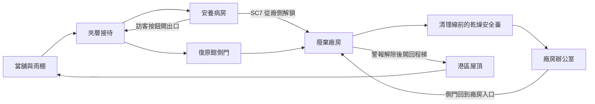

# 第四章〈空殼〉

第三章結束後的下一個週日，凜按約帶公開報表、追蹤名冊、護理輪班表的副本與異議回執去夾層病房。她要查到天穹怎麼把轉出的病人從月報裡排除。鷺先去見伴侶棠，之後才同行。這一章讓玩家親手查資料、替同伴選路，最後帶著一筆來不及問的帳回家。

## 前章狀態與人物所知

| 狀態或人物 | 本章可以使用的事實 |
| --- | --- |
| 凜 | 知道同批一百人有十一人轉入照護，公開月報只算三個。她有資料副本及異議回執。她親耳聽到老 K 曾交出自己的備份，尚不知道交換條件與受錨關係。 |
| 鷺 | 知道天穹另有原帳，固定探望棠。第二章完成真正復原之後累計是 214；第四章的終端拒絕請求，仍是 214。第二章曾問週日才會主動接上那次談話。只在凜已說出交易時提起她的話。 |
| 棠 | 認不出鷺。敲桌與哼歌是兩人用過的習慣，並未恢復棠的臉孔記憶。棠願不願意讓人靠近由她自己表示。 |
| 阿梨 | 知道天穹在換班時從舊廠側門收周轉箱。線索來自清理隊員在復原館的談話；她沒進過廠內。前章攤位申訴只影響私人問候。 |
| 裁 | 天穹的清理隊長。要隔離廠區、收回原帳，並知道如何擦除指定設施。只在第五章由阿梨指名。 |
| 燈 | 能查標語音軌和回復指令的回執。事前看不到棠的私人資料，也不知道凜的匿名錨人是誰。 |
| 老 K | 看出凜是獨自回來的。凜若曾說出偷聽所得，對象是鷺，老 K 不會憑空知道。 |
| 選房與錄音 | 保留晨窗／靜窗／晚窗／未提案及 SQ7 的借閱、辨字。阿翰錄音仍是獨立物品，廠內備份音軌不是同一卷。兩項先前選擇皆不構成通行條件。 |
| 讀取次數 | 帳本讀本輪已成功的復原計數，零可如實顯示。91% 是原帳出具時的歷史耗損值，比當前 HUD 的即時計數早，兩欄必須有時間標記。 |

## 路線與玩法

| 區域 | 操作、地標及獎勵 | 教學與壓力 |
| --- | --- | --- |
| 當舖與夾層接待 | 屋簷下出門，沿黃色病房牌走上夾層。安全臺階底的雨槽可看見繫著紅線的工具格，從上層回程踏板下去可取一份補給。接待、休息與存檔相連。 | 確認訪客路線，無敵人。 |
| 安養病房 | 暖色床頭燈標出可訪床位。先分頭看兩段自願供訪客看的示範，再操作床頭櫃。內廊出去後從低臺階繞回接待；後半從廠側開員工門接外廊。 | 獨立看線索、練習合起來輸入、可錯可改。另有圍巾及探視排程可查。 |
| 復原館與連廊 | 阿梨在吧台出口附近，收貨鐘能從兩層路辨認。背光的舊排班牌可確認箱子去向，安全出口回接待。 | 口頭線索與實物證據交叉核對，樓上走乾線，樓下可避開警戒。 |
| 廢棄廠房 | 臥式壓機作地標。先認白色清掃線與固定地面，接著可沿磁吸吊軌跨過暴露區，也可從低處的固定走道迂迴。不要求先擁有特定升級。兩場可繞警戒由看守與高處探頭分工，清空同時出手最多近戰二、遠程二。從內側打開 SC7。 | 在無傷示範、單線、兩層混合區各預告一次，可站在永久地面觀察。清掃只作用在作者標記的可拆物件。 |
| 安全臺、清理線與辦公室 | 頭目前一房可存，戰場留完整連接的底層。辦公室有帳本、紀錄終端與到入口的回程側門。 | 頭目把既有清掃線、瞄準窗及高低路組合起來。清理後把安靜留給查帳。 |
| 屋頂及回家 | 回程梯沿舊天線通到屋頂；先在屋簷等通訊，再走進當舖。能從店內返回病房，但危險區的出口已安全。 | 無強制戰鬥。可回訪床邊，角色留下來說話。 |

操作與戰鬥初估 20–27 分鐘，低強度探索與自主閱讀 9–13 分鐘。過場保留場 10（約 33 秒）與場 17（約 32 秒）；其餘以可操作走廊、可退出的對話與現地提示呈現。時長為製作估計。

## 逐場稿

### 01　屋簷下的回執

當舖，星期日早上。凜從筆記內頁取出四張紙。老 K 清一塊不漏水的桌面讓她把紙裝進防水套。

> 老 K「那幾張紙借我一下，袋口要折兩次，水才不會從縫裡跑進去喔。」
>
> 凜「我只帶副本。原本還留在診所，他們不能說少了一頁。」
>
> 老 K「我把袋子放門邊。你回來晚一點，記得先把濕的東西掛起來。」

取袋只確認已攜帶的證據，不再發副本。任務指向夾層病房外櫃檯。窗卡另留在筆記：有提案只顯示原房名，沒有提案仍未填。回訪看到原袋子的掛鉤，無重複道具。

### 02　簽訪客簿

夾層接待。鷺在病房外等，桌前保留一人轉身的空間。核對異議回執與訪客簿後，玩家決定何時進去。

> 鷺「從這裡進去是安養病房，接的是診所不再派人上門照顧的病人。裡面有一張床是棠的，她是我伴侶。」
>
> 凜「回執上只有批次。我給櫃檯看這張，妳的訪客簿不用翻給我。」
>
> 鷺「等她問妳是誰，再照妳自己的名字答就好。」

問過週日的分支，鷺接一句「我在屋頂說過週日要留給一個人，就是她。」若凜曾告訴她交出備份，補一句「上週妳提到的那份備份，我在這裡沒問人。病房的帳和訪客資料分開放。」缺選擇均可完成。確認探視後開內門，取消留在安全桌前。

### 03　床邊先問

病房。棠坐著折毛巾，鷺把探視椅挪回床外，讓棠看見才停下。

> 棠「妳要放東西嗎？先放這張桌子，我右邊的手拿得比較穩。」
>
> 鷺「我是鷺，今天來送乾毛巾。妳要我坐這裡嗎？」
>
> 棠「妳可以坐，可是手先讓我看得到。」
>
> 凜「我是凜。我在查轉介的事，想借妳床頭櫃裡那張公開的取件聯。」
>
> 棠「它收在下層。護士留了開法，妳可以先看。我自己想試也會去看。」

不觸碰病人即可操作。護士事先放好的示範不是調用棠的復原備份，也不讀私人檔。兩處各有字幕及可重看按鍵。

### 04　敲桌的手

走廊側的床頭示範屏。播放一次顯示完整手勢，桌緣同步顯示三個節拍，並標「先敲桌三下」。

> 護理示範「前面三下要敲在靠床的桌緣。敲完先停，讓櫃子收完訊號。」

中途退出仍可重看。另一支影片獨立於本段。第一次讀完才登記桌緣線索。

### 05　歌留在身上

窗邊耳機座。畫面指到聽筒，播放棠同意留下的短旋律。字幕標「再哼一段」，收音鍵可用單鍵輸入，不要求玩家開麥克風或辨音高。

> 護理示範「桌緣收完三下才會亮這個燈。對著收音鍵哼一小段，櫃門才會開。」
>
> 鷺「這個轉音她以前會嫌我唱得太高。她今天還是照原來的調子唱。」

讀完登記收音線索。聲音關閉或重聽都不改結果。

### 06　公用取件聯

回床頭櫃。選擇依序敲三下再按收音鍵、先按收音鍵、只敲一下，或離開。兩段線索皆看過才送出輸入。前置不足指出尚未看的示範，錯序只熄提示燈、可立即再試。

> 凜「我先敲桌緣三下，等燈亮再按收音鍵。」
>
> 棠「就是這樣開的。你們每個禮拜都來嗎？」
>
> 鷺「我每個禮拜日來。今天先陪妳坐一下。」
>
> 凜「我只拿公用的取件聯。它寫的是舊廠代收，沒寫任何病人的名字。」

開啟下層、取聯與標出復原館接點合在一次儲存。可關門重看紙本，無需再解。上層的小信尚未被放入。

### 07　換班箱子

復原館。阿梨把回收酒杯移開，給凜看吧台出口旁抄下的班次。有過攤位申訴的凜多聽到「上回我手上的那份差額已經交了，這回是另一個人的班表。」可問來源或先離開。

> 阿梨「剛才有人說，舊廠是天穹換班時清點轉介箱的地方。每箱先掃原帳，外面的月報只收最後一行。」
>
> 凜「箱子從哪裡進去？」
>
> 阿梨「聽起來是靠鐘那扇側門。門上的舊班表還在，妳看到標給病房的格子再進。」
>
> 鷺「如果樓上還走得通，我們就不跟箱子擠在一起。」

已持取件聯時，玩家查到同一批次就記下貨門，兩條進廠路才揭露。只聽不查可回訪，有鎖提示。

### 08　廠房還留一條底線

廢棄廠房。入口透過欄杆先看見一個無人平台被清掃。燈由低亮漸強，不用快速閃白。保留腳下完整走道。

> 燈「白線亮完才會掃過來。先貼黃色扶手走。」
>
> 鷺「下層的黃扶手釘在牆上。」

外牆可讀「記憶是自己的。」玩家自行決定走吊軌或底層，內側壓桿可以打開員工捷徑。從病房側只看到門的開法，沒有假可通行指示。

### 09　警告還留在喇叭裡

清理線前的安全臺。玩家先存檔，再確認進入工作帶，可退回換裝和探索。隊長從平台上對工作人員廣播，鷺以短句引導走固地。

> 隊長「這一班的原帳要留在辦公室。所有人退到黃線外，清理程序已經開始。」
>
> 鷺「我從高處替妳看清掃線。」
>
> 凜「先等他離開黃線，我再過去。」

白線擦除前有預告、殘影與地板圖示，紅色瞄準區靠形狀區別。撲空硬直時可反擊。凜普通敗北按既有復原規則結算，保留已清除的掩體及合法入口。

### 10　沒有下一次

首次跨過頭目半血界線，引擎先鎖定傷害與移動、暫停危害，再以近景呈現鷺將辦公室掛牌推給凜，自己靠在仍存的固定欄杆邊。雨聲留著，配樂停下。終端拒絕回執與鷺離隊在同一個寫入點，死亡畫面禁止觸發成功復原音軌。

> 凜「妳把手給我。我先拿終端接上。」
>
> 終端「無法執行復原。」
>
> 鷺「原帳在樓上。妳自己看。」

可略過，略過執行同一離隊與恢復戰鬥的結果。過場開始前的普通玩家死亡不能套用本事件。離隊後的普通輸掉戰鬥從第二階段繼續，回到安全臺便確認沒有重播，也不能刷回掩體。

### 11　清理完的工作帶

頭目第二階段縮短轉位間隔，分批標記轟炸。玩家沿固定地面在撲空間隔反攻。停止後隊長退進封閉的工作廊，沒有屍體、復原動畫或擊殺宣告。

> 燈「他退到工作廊裡了。辦公室的門現在解鎖。」
>
> 凜「我先帶原帳出去。」

本場完成後門可用。保留此前清掃狀態，以稀疏灰線交代曾存在的掩體。

### 12　原帳只有一欄遮著

上樓到廠房辦公室。從工作臺的帳冊核對取件編號。讀到同批資料後，攤開自己的頁面。證據頁同時顯示受錨者凜、錨人匿名、本輪累計復原次數與原帳耗損 91%。

> 凜「受錨者是我，付這筆的人欄位卻遮住了。」
>
> 燈「錨人會替受錨者分擔復原的代價。這張表只寫當時的耗損，寫的人把名字藏了。」
>
> 凜「把這一頁也存一份。我要保留它還在帳本上的樣子。」

顯示用執行期欄位，不把 91% 強寫到玩家當前狀態。自此可選的「付帳」解法先展示費用、需明確確認，主線全程有不必死亡的解法。後續復原資訊只新增匿名標籤，保持前章成功流程。

### 13　沒有播出的片尾

同一房間可從錄音列重聽第三十一版。凜可只錄下序號離開，仍可從床邊電台補聽。燈先說明它是天穹電話亭的標語試錄。

> 錄音「今天也可以重新開始。汐聽得見我的聲音嗎？」
>
> 燈「後半句沒有上架。我把它和號碼一起留存。」
>
> 凜「這個名字先只寫在錄音下面。」

若玩家持有阿翰錄音，筆記分開顯示借閱卷與天穹音軌，沒有也不補發。錄音的身份和汐的關係保留到後章。

### 14　最後一個週日

從辦公室側門進現地回放。玩家控制鷺走過同一條病房走廊，將短箋放入床頭櫃上層，再從廠側拉開 SC7，示範她預先留給凜的回路。歷史模式無槍、無交易、無戰鬥傷害；離開回放回到辦公室門口，可以略過或重看。世界捷徑只有凜實際拉壓桿才算開啟。

> 鷺「下層是妳要給訪客看的紙。我把我的信放上面，只要妳想看再拿。」
>
> 棠「妳把它放我伸得到的地方就好。」
>
> 鷺「我先把回去的門開給凜看。」

給尚未開 SC7 的玩家一條路。已開的人可直接朝屋頂前進。沒有把鷺重新加入隊伍或改寫實際死亡紀錄。

### 15　她留下的信

可選回病房。凜在上層看見標名信，只在棠同意後讀。

> 凜「上面寫妳的名字。妳想先看，還是我念給妳聽？」
>
> 棠「我今天不想聽太多。妳先念她寫了要找哪些人。」
>
> 信「如果妳想聽我的事，可以找市集的榕伯、復原館的阿梨、當舖的老 K，還有那天替妳辦入院的護理員。我沒有要他們說一樣的事。」

可保存四個地點的名單或留信。可在第五章回來，不因此跳過下次探視。旁邊空帽勾的圍巾可另查，標只有床位，仍不知道主人是誰。沒有貨幣回報，也不拿走棠的信。

### 16　每次都是明天

回程梯的屋頂，風從天線方向帶來小雨。凜可等通訊；退出不記已聽完。

> 燈「電話亭說歡迎回來的那句，是我十二歲的時候錄的。他們說新版明天就換。」
>
> 凜「我這一路都還聽得到你那一條。」
>
> 燈「我每次去問，他們都說明天。今天終端連我的錄音都沒播。」
>
> 凜「你需要我做什麼？」
>
> 燈「如果妳願意再去一趟病房，可以替我把話筒放到我媽床邊嗎？我想錄一句現在的聲音。」

最後兩句可選支線。接受就開探訪路標，可回病房做，或在第五章再做。播放時病房有固定話筒、棠的欄位與燈母親的床位分開。燈錄「媽，我今天有吃飯。我明天再跟妳說我去哪裡。」不產生回復成功聲，不移除原床位。

### 17　問到一半

返回當舖。老 K 在桌前把濕掉的標籤取下來，替凜往他那邊讓出座位；背景播放鷺待在病房時哼的旋律。凜把原帳副本壓在一張空標籤下面。

> 老 K「帶傘了嗎？妳把外套脫下來，我拿乾的給妳。」
>
> 凜「我把帳帶回來了。」

原本該有第二副濕外套的位置是空的。可略過，回到店面仍保留原帳及後續目標。凜決定下一次查看店裡的標籤與帳冊；地下室仍鎖著。第四章在這裡完整收束，第五章才展開查店。

## 狀態、任務與回退

| 玩家行為 | 儲存邊界及可重試結果 | 玩家看見的下一步 |
| --- | --- | --- |
| 從已完成第三章的舊存檔續玩 | 維持第三章原章末收據和裝備。只有已有正式入口才顯示進入下一地區。第四章開發測試直接以該合法章末資料導入。 | 帶文件到夾層接待。 |
| 接待中退回／有任何合法第三章分支 | 取消不開內門。回執可從已完成主線核對，沒有房間提案、錄音或額外任務都能簽到。 | 在外櫃檯簽訪客簿。 |
| 兩段示範互換順序、只看一段、錯答 | 分別保存證據。未看完可以再看。櫃子具體說欠哪個步驟，錯答與退出無代價。 | 看敲桌示範，再找收音鍵；或反過來。 |
| 進廠前與頭目前 | 沿原入口回安全處，玩家確認才開始戰鬥。短路只在遊戲世界的壓桿上打開。 | 對過班表後走貨門，當心清掃線。 |
| 頭目戰中敗北或退出 | 進入離隊段前鷺仍在。已離隊則不重播，場地只保留已成功儲存的損失。讀檔永遠由可走的安全臺回去；落地可達，不把玩家生成在被擦掉的物件。 | 查看剩下可走的底層路，回到清理線。 |
| 原帳及返回 | 離隊與清理完成皆存在才發章末證據。重看保留同一副本，讀檔不發獎勵兩次。略過關鍵過場只能執行既定結果。 | 把原帳帶回當舖。 |
| 截止時未做可選互動 | SQ2 信件與 SQ5 話筒都保持可回訪，SQ4 線索可由後章正式場景補見。前章已借出的 SQ7 錄音保留，未借不補發。 | 任務冊只列實際已知的位置。 |

## 製作與驗收

| 內容 | 來源與驗收 |
| --- | --- |
| 屋簷、接待、吧台及既有角色 | 重用正式當舖、夾層與復原館環境及原角色。依同一格高對齊出入口，後景件不做碰撞。 |
| 病房新演員與設施 | 棠需獨立骨架／立繪及手部可見的坐姿。床、雙層櫃、掛勾、話筒各畫可分層的遊戲物件；輪椅、起身與病人接觸點只在有對應演出時製作。 |
| 工廠 | 代表性壓機、吊軌、黃扶手、廠側門與辦公室臺面。可清掃件分塊有碰撞，避免掃除地板層。隊長可沿用回收員位移邏輯，外觀與預告須辨識為新敵人。 |
| 重點演出 | 鷺推掛牌靠欄、凜伸手接終端、終端文字與沒有成功音、老 K 讓出椅位。需要座標鎖定和雙方向視覺檢查。 |
| 聲音與無障礙 | 鷺、棠共用可辨認的原創旋律。兩段示範有字幕與可操作文字按鍵。清掃、轟炸同時有不同聲音、形狀與穩定輪廓，減少閃光時仍可辨識。 |
| 驗收分界 | 文稿通讀、實際地圖可達、正式存檔續玩、真實 Forward+、鍵鼠及手把、首次玩家完成時間分別記錄。章節遊玩與發行各有獨立驗收。 |
