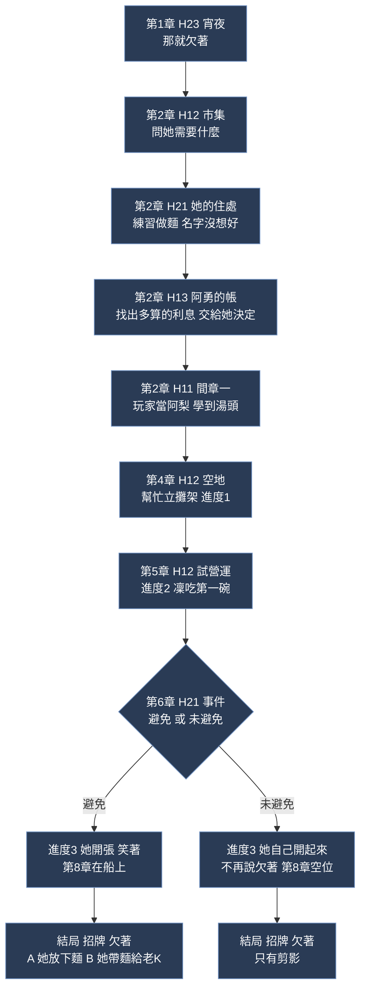
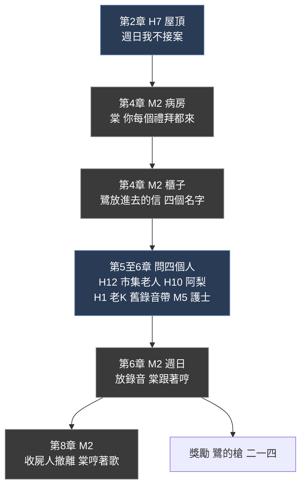
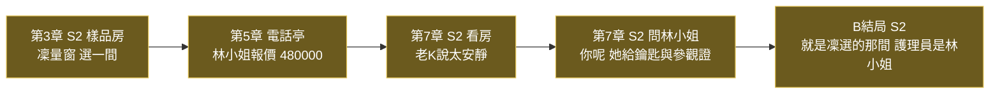
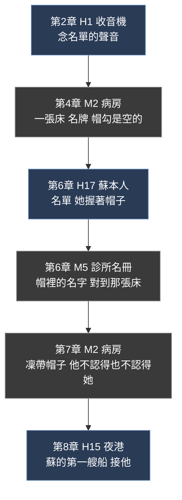
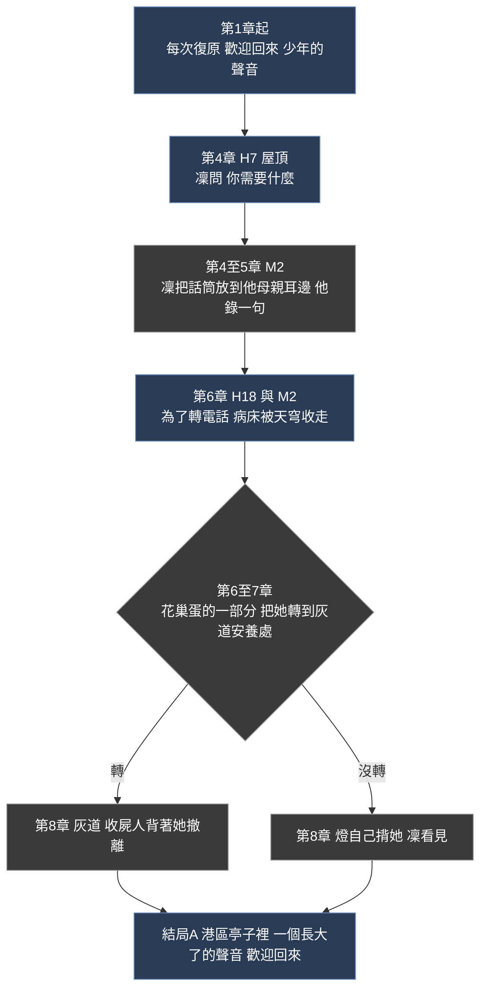
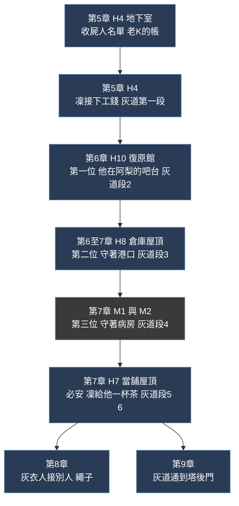
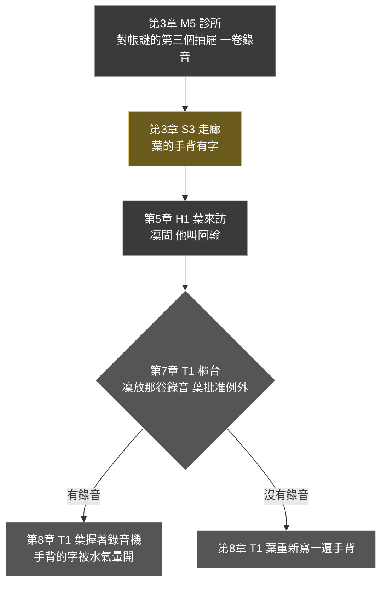

# 長線支線

> 來源：2026-10-04 使用者說現在有蠻多不同角色，可以設計一些**長線的支線劇情**，**單純打打怪、只講幾句話的支線不要**。
> 事件見 [EVENTS.md](EVENTS.md)，地圖見 [MAP.md](MAP.md)，角色見 [WORLD.md](WORLD.md)，解謎動詞見 [PUZZLE.md](PUZZLE.md)。這份是提案。

## 0. 原則

| # | 原則 | 說明 |
|---|---|---|
| 1 | **每條支線屬於一個角色，跨好幾章** | 角色有想要、怕、錯（WORLD.md）；支線是他們的弧線，不是任務板上的工作 |
| 2 | **每一步都是一場戲或一個謎** | 不是「去 A 拿 B 回 C」；每個節點在地圖上有固定地點、有人、有事發生 |
| 3 | **用「問」開始，不是靠任務指示** | 凜要學的是問。支線多半從凜**主動問一個人「你需要什麼」**開始 |
| 4 | **沒有任務標記，只有帳本** | 凜的帳本自動收錄線索（Outer Wilds 的做法），不指揮玩家去哪裡 |
| 5 | **可以錯過，但不卡主線** | 每個節點有時窗；過了就以「這件事過去了」收束，用另一個版本的結尾，不會永久鎖死或懲罰 |
| 6 | **獎勵是故事與裝備，不是經驗值** | 結局的畫面、灰道捷徑、武器與義體改裝、場景裡的新事物 |
| 7 | **支線互相交疊** | 標籤線是其他支線的線索網；灰道線讓別條線有捷徑；多條線在第 8 章同時回收 |
| 8 | **不碰底線** | 所有支線遵守 [MATURE.md](MATURE.md)：未成年角色不出現在任何性相關內容，也不放在可能涉及的場景附近 |

## 1. 八條支線總覽

| # | 支線 | 屬於 | 起點 | 跨度 | 收在 | 主要場景 | 可錯過 |
|---|---|---|---|---|---|---|---|
| SQ1 | **麵攤** | 阿梨 | 第 1 章宵夜 | 1～結局 | 結局 A 的招牌「欠著」；B 的麵 | H23、H12、H21、H11、H10 | 部分 |
| SQ2 | **週日** | 鷺、棠 | 第 2 章屋頂 | 2～8 | 第 8 章病房撤離 | H7、M2、H10、H12、H1、M5 | 部分 |
| SQ3 | **窗的方向** | 林小姐 | 第 3 章樣品房 | 3～結局 B | B 結局的房間與護理員 | S2 | 否 |
| SQ4 | **帽子** | 蘇 | 第 2 章收音機 | 2～8 | 第 8 章蘇的第一艘船 | H1、M2、H17、M5、H15 | 部分 |
| SQ5 | **病床** | 燈 | 第 4 章坦白 | 4～結局 A | A 結局的亭子 | H7、M2、H18、灰道 | 部分 |
| SQ6 | **灰無常的工錢** | 收屍人（必安） | 第 5 章地下室 | 5～9 | 灰道全開、第 8 章撤離 | H4、H10、H8、M1、M2 | 否 |
| SQ7 | **手背的字** | 葉、阿翰 | 第 3 章診所 | 3～8 | 第 8 章大廳 | M5、S3、H1、T1 | 部分 |
| SQ8 | **標籤** | 老 K | 第 5 章調查 | 5～結局 | 第 8 章漂浮的標籤、結局的貨架 | H1 與全區 | 部分 |

### 各章節點分布

| 章 | SQ1 麵攤 | SQ2 週日 | SQ3 窗 | SQ4 帽子 | SQ5 病床 | SQ6 工錢 | SQ7 手背 | SQ8 標籤 |
|---|---|---|---|---|---|---|---|---|
| 1 | 初見 | | | | | | | |
| 2 | 問、住處、帳、間章一 | 週日不接案 | | 收音機 | | | | |
| 3 | | | 樣品房 | | | | 診所錄音、手背 | |
| 4 | 蓋攤架 | 病房、信 | | 名牌 | 問燈 | | | |
| 5 | 試營運 | | 電話報價 | | | 名單、接手 | 葉來訪 | 標籤空白 |
| 6 | 事件 | 訪談、哼歌 | | 蘇本人、找人 | 病床被收 | 三位收屍人 | | 還原標籤 |
| 7 | | 週日 | 看房、鑰匙 | 帶帽子 | 轉床、錄音 | 必安的茶 | 葉批准 | 還原標籤 |
| 8 | 船上或空位 | 撤離 | | 第一艘船 | 撤離 | 撤離 | 大廳 | 漂浮 |
| 9 | 招牌、麵 | | B：房間 | | A：亭子 | 灰道到塔 | | 貨架 |

---

## 2. SQ1　麵攤（阿梨）

她的夢是一條繩子，與凜的巢蛋同構；麵攤是她「不用任何人付帳」的證明。凜在她身上學會**問**，也第一次可能失去一個人。

| 項目 | 內容 |
|---|---|
| 阿梨想要 | 開一間麵攤，名字還沒想好 |
| 凜的課題 | 不替她付，**問她要什麼**，把決定權留給她 |
| 地圖狀態 | **麵攤進度 0～4**：市集一塊空地逐章長出攤架、攤車、燈、招牌（MAP.md §7） |

| 節點 | 章 | 地點 | 內容 | 型態 |
|---|---|---|---|---|
| A2 | 2 | H12 | 凜掏錢（習慣）或問；問才知道她要的是攤位與許可 | **問**（教學） |
| A3 | 2 | H21 | 看她練習；凜幫忙洗碗；「名字還沒想好」（若第 1 章沒留下，這是第二次機會） | 演 |
| A4 | 2 | H13 | 阿勇帳本裡阿梨那一筆被多算的利息：凜**不替她銷掉**，帶去給她，讓她決定 | 對帳＋問 |
| A5 | 2 | H11 | 間章一：玩家就是阿梨，學到她的湯頭來自一位客人過世的母親 | 間 |
| A6 | 4 | H12 | 立攤架：一個小機關謎（供電與水位），做完空地變成攤架 | 探 |
| A7 | 5 | H12 | 試營運夜，凜吃第一碗；阿梨：「這碗不用欠。」 | 演 |
| A8 | 6 | H21 | **阿梨事件**，結構見 [PLOT.md](PLOT.md)、[MATURE.md](MATURE.md)；不演出，只留後果 | 主線 |
| 結 | 結局 | H12 / 夜港 | 招牌寫著「欠著」；A：走進麵攤；B：每週帶麵去看老 K | 演 |

| 項目 | 內容 |
|---|---|
| 時窗 | A2 在第 2 章；A6 在第 4～5 章；之後是主線。錯過 A6 時，進度由阿梨自己補到 2，凜只是「後來才知道」 |
| 獎勵 | 麵攤成為市集的**回復點**（復原餐：補血與短時間增益）；結局畫面 |
| 對主線的影響 | 阿梨事件的避免條件之一（`knows_ali_address`）從 A2/A3 或第 1 章宵夜來 |

## 3. SQ2　週日（鷺與棠）

鷺每週日去病房對一個不記得她的人自我介紹。鷺死後，凜替她走完剩下的週日。

| 項目 | 內容 |
|---|---|
| 想要 | 讓棠再聽一次那首歌 |
| 凜的課題 | 替一個**不再能回答的人**做一件小事，而不替她決定任何大事（與第 5 章呼應） |

| 節點 | 章 | 地點 | 內容 | 型態 |
|---|---|---|---|---|
| B2 | 4 | M2 | 主線的回放謎之後，棠對凜說：「你每個禮拜都來。」她把凜當成鷺 | 演 |
| B3 | 4 | M2（間章二） | 間章二裡鷺放進櫃子的信，凜在鷺死後打開：四個認識鷺的人 | 回放 |
| B4 | 5～6 | H12、H10、H1、M5 | **問**四個人各自記得的鷺：市集老人（最難相處的鷺）、阿梨（每週日訂一碗麵）、老 K（鷺押過一卷錄音帶，標籤是空白的，連到 SQ8）、診所護士（棠入院那天） | 問 |
| B5 | 6 | M2 | 週日，凜放那卷錄音帶，棠跟著哼；她看著凜：「你好，我是……」凜：「我是凜。」 | 演 |
| B6 | 8 | M2 | 洪水夜，收屍人背著棠撤離，她一路哼 | 演 |

| 項目 | 內容 |
|---|---|
| 時窗 | B4 的四個訪談在第 5～6 章；B5 要在第 7 章之前完成。錯過時，B6 改為棠被撤離但沒有哼歌 |
| 獎勵 | 鷺的手槍「二一四」（工作檯取得）；結局的一個畫面 |

## 4. SQ3　窗的方向（林小姐）

林小姐是晴岸的業務員，她說「這裡很安靜，安靜得有人睡不著」。她的母親也住在晴岸。這條線把第 3 章裡「凜替老 K 算窗戶的方向」那場戲，變成 B 結局那間房。

| 項目 | 內容 |
|---|---|
| 林小姐想要 | 待在母親旁邊（她賣房，是為了每天走進這裡） |
| 凜的課題 | 用她的方式愛：把一切算好；這是她愛的方式，也是她錯的方式（第 3 章弱點的補強） |
| 備註 | 林小姐是新增的人物，需要使用者確認（§8） |

| 節點 | 章 | 地點 | 內容 | 型態 |
|---|---|---|---|---|
| C1 | 3 | S2 | 三間樣品房，凜在每間窗邊站一下，記下朝向；選一間（`room_choice`） | 探＋選 |
| C2 | 5 | 任一亭 | 林小姐報價，480,000 與贖回費是同一個數字：「一間晴岸的房」 | 演 |
| C3 | 7 | S2 | 凜帶老 K 看房，他坐在窗邊：「太安靜了。」（呼應漏水桶） | 演 |
| C4 | 7 | S2 | 凜問林小姐：「你呢？」她第一次說出母親的事；給她**參觀證**與房間鑰匙 | **問** |
| C5 | 結 | S2 | B 結局：窗是凜選的那一扇；問「今天要帶傘嗎？」的護理員，是已經離職、改當護理員的林小姐 | 演 |

| 項目 | 內容 |
|---|---|
| 時窗 | C1 在第 3 章，不能錯過（在主線上）；C4 是主線上的**問**，不問就只得到普通版的參觀證 |
| 獎勵 | B 結局的畫面（窗與護理員）；問了林小姐，第 7 章多一段她陪凜走到電梯的演出 |

## 5. SQ4　帽子（蘇）

蘇曾是丈夫的錨人，她不記得他，卻留著他的帽子。這條線讓斷錨派不只是「港區的一個聲音」，也解釋她為什麼在最後一夜**第一艘開進洪水**。

| 項目 | 內容 |
|---|---|
| 想要 | 把記憶還給大家；也想知道那頂帽子的主人是誰 |
| 凜的課題 | 替別人找一個答案，不替別人決定她要不要見 |

| 節點 | 章 | 地點 | 內容 | 型態 |
|---|---|---|---|---|
| D1 | 2 | H1 工作檯 | 調頻時聽見一個平淡念名字的聲音（伏筆） | 探 |
| D2 | 4 | M2 | 病房一張床沒有名牌的帽勾，床邊有一張字條（伏筆，不點破） | 探 |
| D3 | 6 | H17 | 蘇念名單；她手上握著一頂帽子，帽沿內側縫著一個名字，她不認得那個名字 | 演 |
| D4 | 6 | M5 | **對帳**：帽沿的名字對診所的用盡者名冊，對到病房的那張床 | 對帳 |
| D5 | 7 | M2 | 凜把帽子放到他手上；他不認得，也不認得她；凜把這件事轉告蘇，**不替她決定去不去** | 演＋問 |
| D6 | 8 | H15 | 蘇的船是第一艘，她接的第一個人是病房的他 | 演 |

| 項目 | 內容 |
|---|---|
| 時窗 | D3～D5 在第 6～7 章；錯過 D5，蘇在第 8 章自己去找，結局是另一個版本（他在船上，她沒有帽子） |
| 獎勵 | 斷錨派的義體改裝；第 8 章的船為凜開一條捷徑 |

## 6. SQ5　病床（燈）

港區所有終端的「歡迎回來」是燈十二歲時錄的。他靠賺錢供母親住用盡者的病房，第 6 章為了一通電話失去了那張病床。凜**問他**需要什麼。

| 項目 | 內容 |
|---|---|
| 燈想要 | 母親的病床不被收走 |
| 凜的課題 | 為別人**花自己的 480,000**：她的巢蛋是她所有的理由，這是她第一次從那裡拿 |

| 節點 | 章 | 地點 | 內容 | 型態 |
|---|---|---|---|---|
| E2 | 4 | H7 | 燈坦白之後，凜**問**：「你呢？你需要什麼？」他答：「我媽的病床。」 | **問** |
| E3 | 4～5 | M2 | 凜在病房，把亭子的話筒線拉到母親床邊，燈在另一頭說話；母親把他當成別人，他還是說完 | 演 |
| E4 | 6 | H18／M2 | 燈轉了電話，天穹收了病床 | 主線的後果 |
| E5 | 6～7 | 港區亭子 | **選擇**：花掉巢蛋的一部分，把她轉到灰道的安養處（收屍人照顧，SQ6）。HUD 的巢蛋會少一截 | 選 |
| E6／E7 | 8 | 灰道／港區 | 有轉：收屍人背著她撤離；沒轉：燈自己背，凜看見（呼應間章三的老 K） | 演 |
| E8 | 結局 A | 任一亭 | 凜走過整張地圖，亭子裡傳來一個**長大了的聲音**：「歡迎回來。」 | 演 |

| 項目 | 內容 |
|---|---|
| 時窗 | E2 必須在第 4 章燈坦白後；E5 在第 7 章前。錯過 E5，走 E7 |
| 獎勵 | 燈的通訊提示更多（解謎提示第一層更貼近）；亭子傳送的線路接得更快（第 6 章起額外一段）；結局的聲音 |

## 7. SQ6　灰無常的工錢（收屍人）

每個月同一天，老 K 付現金給一群灰衣人，他們每次凜死後十分鐘內把她送到終端。老 K 失去記憶後，**這筆錢沒人付了**。

| 項目 | 內容 |
|---|---|
| 收屍人想要 | 繼續在她死的時候出現（他們各自有理由，不只是工錢） |
| 凜的課題 | **接手付帳**：她成為「付帳人」，不是被付的人 |
| 與地圖 | 每位收屍人換一段**灰道**：捷徑網因此擴大（MAP.md §5），這是最直接的地圖獎勵 |

| 節點 | 章 | 地點 | 內容 | 型態 |
|---|---|---|---|---|
| F2 | 5 | H4 | 凜把老 K 的帳接過來：每月同一天的現金，她從自己的錢付；灰道第一段 | 選 |
| F3～F5 | 6～7 | H10、H8、M1／M2 | 三位收屍人，各自一場短戲：**問**他們為什麼做這份工；每人換一段灰道。名字與理由待 [NAMES.md](NAMES.md) 補 | 問 |
| F6 | 7 | H7 | 必安：不說話的人。凜遞給他一杯茶（呼應第 2 章屋頂的鷺），他接了 | 演 |
| F7 | 8 | H7 等 | 他們在洪水夜接別人（第 8 章主線的畫面） | 演 |

| 項目 | 內容 |
|---|---|
| 時窗 | 第 6～8 章；每位收屍人在對應的地點，一直都在，不會消失 |
| 獎勵 | 灰道六段全開（跨區捷徑），第 9 章可直通塔後門；灰道的小桌子變成補給點 |

## 8. SQ7　手背的字（葉與阿翰）

葉每天早上在手背寫：「他叫阿翰。你愛他。」她復原過哥哥十二次，不記得他的臉，但他有兩個孩子，那兩個孩子是活的。這條線補上葉第 7 章之後的**空白**（OUTLINE.md 弱點 1）。

| 項目 | 內容 |
|---|---|
| 葉想要 | 讓 89% 的人不必死 |
| 凜的課題 | 替一個**對手**做一件事，不為了交換 |
| 備註 | 有沒有找到錄音，會讓第 7、8 章的兩場葉的戲換成不同版本 |

| 節點 | 章 | 地點 | 內容 | 型態 |
|---|---|---|---|---|
| G1 | 3 | M5 | 對帳謎的**第三個抽屜**（不是主線必需）有一卷舊錄音，標籤寫「阿翰」 | 探 |
| G2 | 3 | S3 | 隔著玻璃，凜看見葉的手背 | 演 |
| G3 | 5 | H1 | 葉來買沉默；凜**問**：「他叫阿翰？」葉第一次沉默 | **問** |
| G4 | 7 | T1 | 把命當了的櫃台：凜把那卷錄音放在櫃台上，葉聽完，批准那筆例外 | 演 |
| G5／G6 | 8 | T1 | 有錄音：葉握著錄音機；沒有：她重新寫手背 | 演 |

| 項目 | 內容 |
|---|---|
| 時窗 | G1 在第 3 章；錯過之後在第 4～6 章回診所仍能找到（抽屜還在） |
| 獎勵 | 葉給的塔內一條電梯捷徑（第 9 章可跳過一層）；葉的一段獨白 |

## 9. SQ8　標籤（老 K）

貨架上每件東西都有一張手寫標籤，記著它的來歷；他不再講，標籤開始空白。第 5 章之後，凜翻到老 K 的筆記本，開始**一張一張把故事問回來**。這是其他支線的**線索網**。

| 項目 | 內容 |
|---|---|
| 想要 | （老 K 無法回答）凜替他保存 |
| 凜的課題 | 把他的「過去」當成他的東西，而不是替他決定要留什麼 |
| 結構 | 12 張空白標籤，分三組各 4 張：**港區的客人、夾層的客人、日照區的客人**；每張是一件舊貨和它背後的一個人 |

| 範例標籤 | 地點 | 與哪條線交疊 |
|---|---|---|
| 一台壞掉的收音機 | H12 市集的老人 | SQ2（鷺的故事）、第 2 章的收音機 |
| 一卷沒有標籤的錄音帶 | H1 貨架 | **SQ2**（棠的歌） |
| 一支舊手錶 | M5 診所護士 | **SQ7**（阿翰的手錶） |
| 一件舊雨衣 | H8 碼頭 | 洪水夜 |
| 一個舊玩偶 | H13 阿勇據點 | 阿勇與小薇 |
| 一把沒有弦的吉他 | M2 病房 | 鷺 |
| 其餘六張 | 待補，由逐章劇本設計 | |

| 節點 | 章 | 內容 | 型態 |
|---|---|---|---|
| L1 | 5 | 調查現場：空白標籤的位置，第一組 4 張 | 探 |
| L2 | 5～7 | 凜**問**每個客人，聽完寫回標籤；舊貨成為**裝備**（武器配件、義體模組、消耗品，各自帶一段故事） | 問 |
| L3 | 8 | 洪水夜，標籤漂在水上：**還原的數量決定漂浮的標籤有多少張還有字** | 演 |
| L4 | 結局 | A：當舖洪水退後，標籤泡掉一半，**還原過的那些還清楚**；B：晴岸的房間裡，貨架上擺著那些標籤 | 演 |

| 項目 | 內容 |
|---|---|
| 時窗 | 第 5～7 章；每位客人一直都在 |
| 獎勵 | **裝備**（這是全作最主要的一批「有故事的裝備」）；結局畫面 |

---

## 10. 支線與真結局：借帳

真結局「結清」靠**借帳**：用身邊人對凜的記憶換立即的好處，被借的人從此忘了她。支線決定了**她身邊有誰、關係多深**，因此也決定了**能借的籌碼與代價**。

| 被借帳的人 | 因為哪條支線 | 借帳之後 | 對應的痛 |
|---|---|---|---|
| 阿梨 | SQ1 | 不再說「欠著」、不再認得凜 | 麵攤的招牌沒人解釋 |
| 燈 | SQ5 | 「歡迎回來」變成陌生的聲音 | 那句話本來是對她說的 |
| 林小姐 | SQ3 | 護理員只問「今天要帶傘嗎」，不認識她 | |
| 蘇 | SQ4 | 帽子不再被認出 | |
| 收屍人 | SQ6 | 灰道的路還在，路上的茶沒了 | |
| 葉 | SQ7 | 手背上的字多一行 | |

支線做得越多，真結局越痛；**沒做的人，借了也沒有感覺**，這是刻意的：玩家用自己累積的關係去付帳。

## 11. 獎勵彙整

| 支線 | 實質獎勵 | 地圖或系統影響 | 結局畫面 |
|---|---|---|---|
| SQ1 麵攤 | 市集回復點、復原餐 | 麵攤進度（市集空地） | 招牌「欠著」、麵 |
| SQ2 週日 | 鷺的手槍「二一四」 | 病房有人哼歌 | 第 8 章的撤離 |
| SQ3 窗 | 參觀證的完整版 | — | B 結局的房間與護理員 |
| SQ4 帽子 | 斷錨派義體改裝 | 第 8 章船的捷徑 | 第一艘船 |
| SQ5 病床 | 更貼近的提示、額外線路 | 灰道安養處 | A 結局的聲音 |
| SQ6 工錢 | 灰道六段、補給點 | **跨區捷徑網** | 第 8 章撤離 |
| SQ7 手背 | 塔內電梯捷徑 | 第 9 章少一層 | 葉的兩個版本 |
| SQ8 標籤 | **12 件有故事的裝備** | 當舖的標籤完整度 | 漂浮的標籤、B 結局的貨架 |

## 12. 待你決定

| # | 問題 | 我的建議 |
|---|---|---|
| 1 | 八條支線是否合意？是否有想加或想刪的？ | 合意；已涵蓋阿梨、鷺、燈、蘇、收屍人、葉、老 K |
| 2 | **林小姐**是新增人物（母親住晴岸、之後轉當護理員），是否同意？ | 同意；補第 3 章的戲劇動作，也讓 B 結局的護理員有來歷 |
| 3 | 小薇（阿勇的女兒）要不要有自己的支線？ | 先不要；牽涉未成年角色，等整體規模定了再議 |
| 4 | 支線的獎勵以裝備與捷徑為主、不給經驗值，是否合意？ | 合意；與升級系統如何掛鉤，開票時另議 |
| 5 | 沈望視角的第五段間章（「早上先開窗」）是否加入？ | 若加，放第 7 章之後，並接 SQ7（葉）與帳房的伏筆 |
| 6 | 兩對女性伴侶（鷺／棠、沈望／汐）是否都維持？ | 之前問過，尚未回覆 |
