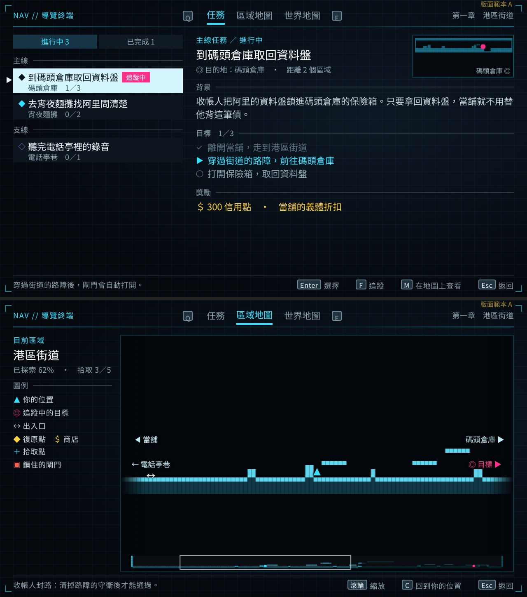
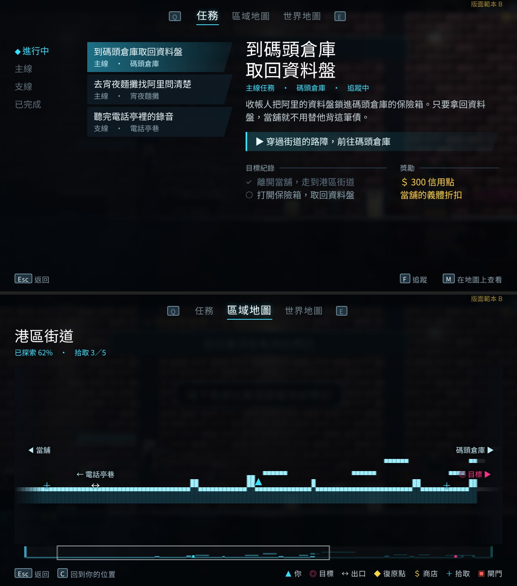
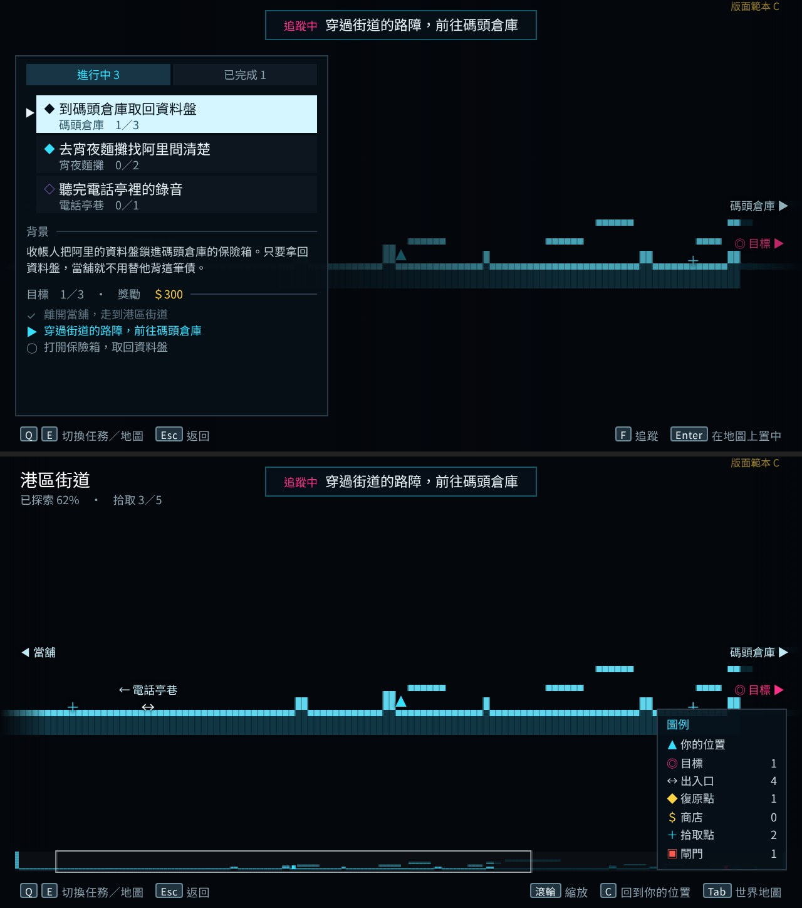

# 任務與地圖畫面：業界實例與改版方向

> 來源：2026-10-11 使用者看了任務目錄截圖：「整個版面配置都可以優化一下，字體有點太大，整體設計有點簡陋，缺乏設計感。」並指定參考 gameuidatabase.com 與 interfaceingame.com，看多款遊戲後依目前風格總結，做幾個範本讓使用者選。
> 對應票：NE-223（需求第 5 點「視覺設計要好看」）。

## 1. 看了什麼（實際看過圖片）

- **interfaceingame.com**：從動作、RPG、平台、獨立四類清單挑 27 款與本作相近的作品，下載 130 張任務、日誌、地圖、暫停與背包畫面縮圖，逐張看過；其中 10 張開原尺寸細看。
- **Steam 官方截圖**：Leyla In Veil（15 張）、Hollow Knight（15 張）、Hades（11 張）。
- **gameuidatabase.com**：雲端瀏覽器停在 Cloudflare 的人機驗證頁，打不開，沒有繞過，也沒有用到這個網站的內容。需要的話可在本機瀏覽器補看。

| 作品 | 畫面 | 實際看到的做法 |
|---|---|---|
| Cyberpunk 2077 | 日誌 | 頂部一條分頁列，兩側標按鍵；左欄任務列、選中列整塊填色；右側標題、勾選式目標、長文可捲動，右上角放目的地小地圖；右下角只留「Esc 關閉」 |
| Horizon Forbidden West | 任務 | 不畫框；左側分類直列、右側大標題＋一行分類與等級＋短描述；「目標紀錄」「獎勵」兩欄各有小標與細線；底部左「關閉」右「在地圖上顯示」 |
| Prince of Persia: The Lost Crown | 任務、地圖 | 任務分頁兩側標 LT／RT，選中列是斜切色帶加角色頭像，目前目標用斜切橫幅；2D 地圖上方置中寫目前目標，左上是區域名與收集數，右側圖例分類可開關，底部是按鍵提示 |
| Dying Light 2 | 日誌 | 選中卡片亮邊＋「追蹤中」標籤；中間細節卡：目前目標、獎勵圖示格；右欄已完成目標淡化並打勾 |
| Control、Star Wars Jedi、The Ascent | 地圖 | 藍圖或全像式的房間輪廓；左上區域名與探索百分比；圖例收在角落；按鍵提示在底部一列 |
| Hollow Knight | 地圖、護符 | 只有螢幕四角有裝飾，內容不加框；頁首中央標題、兩側 LT／RT 與相鄰頁名；地圖邊緣用「名稱＋箭頭」標出通往的區域 |
| Leyla In Veil | 背包、讀檔 | 沒有面板框；清單列是扁平暗色條，左圖示、標題、下方小字，右側數量；選中列整列反白並有 ▶；頂部分頁圖示兩側標 Q／E |

## 2. 共通原則（套用到 Nest Egg）

1. **一頁一個主角**：任務頁的主角是選中任務的細節，地圖頁的主角是地圖；其他資訊退成小字與細線，不再每塊都是同樣重量的框。
2. **文字至少三階**：內文 11、標題 14、說明小字 9（平滑字體；像素字體的小字退回 11 才銳利）。頁面標題不再用 22 的大字，層級靠位置、顏色與留白拉開。
3. **頁首一條分頁列、頁尾一條按鍵提示列**：分頁兩側標切換鍵（Q／E、LB／RB），返回、追蹤、看地圖寫在底部提示列（滑鼠可點）；畫面中央不放一排大按鈕。
4. **清單列結構固定**：狀態圖示＋一行標題＋下方小字（地點、進度 1／3），選中列整列反白，追蹤中加小標籤。
5. **目標是勾選清單**：完成的淡化打勾、目前的一步用亮色與 ▶、之後的用空心圈，標出 1／3。
6. **強調色有紀律**：青色只給目前位置與目前選項，洋紅只給追蹤目標，黃色只給獎勵與商店；裝飾線壓到兩成以下亮度。
7. **地圖**：寬而矮的區域依高度放大並以主角為中心，下方附整區縮圖與目前視窗框；畫面外的出口貼邊寫目的地名；左上區域名與探索百分比；圖例只在一處。

## 3. 範本

三份範本都用第一章「港區街道」的真實地形資料與遊戲色盤、字型繪製，任務文字是版面用的範例句，不是正式劇情；確認方向後才在 Godot 實作。

- **A 終端機雙欄**：深色終端底、極淡格線、四角括號；左欄任務清單、右欄細節與目的地小地圖；地圖頁左側區域資訊與圖例。
- **B 場景疊層**：暫停當下的遊戲畫面模糊壓暗當底；左側分類直列與斜切任務條，右側大標題與目前目標橫幅；地圖疊在場景上，圖例收進底部提示列。
- **C 地圖優先**：任務頁就是地圖加左側抽屜，上方置中寫追蹤中的目標；地圖頁右下角圖例附數量。

