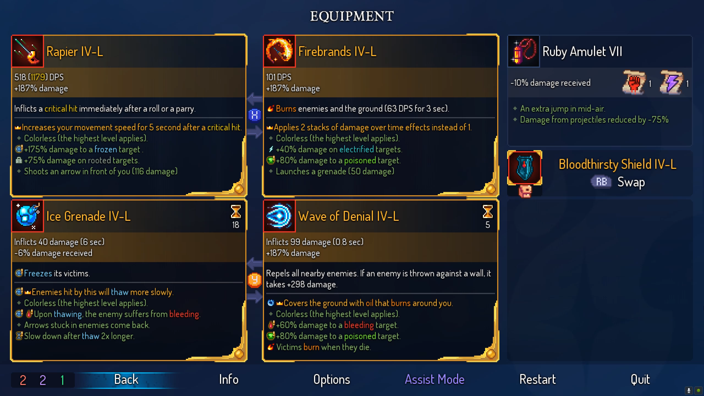
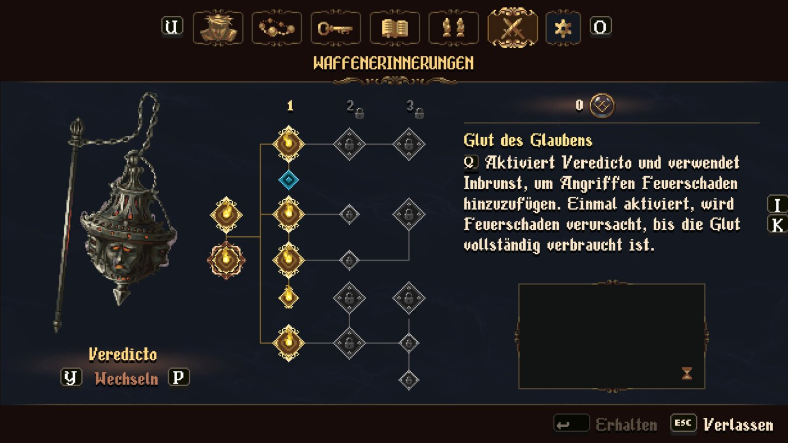
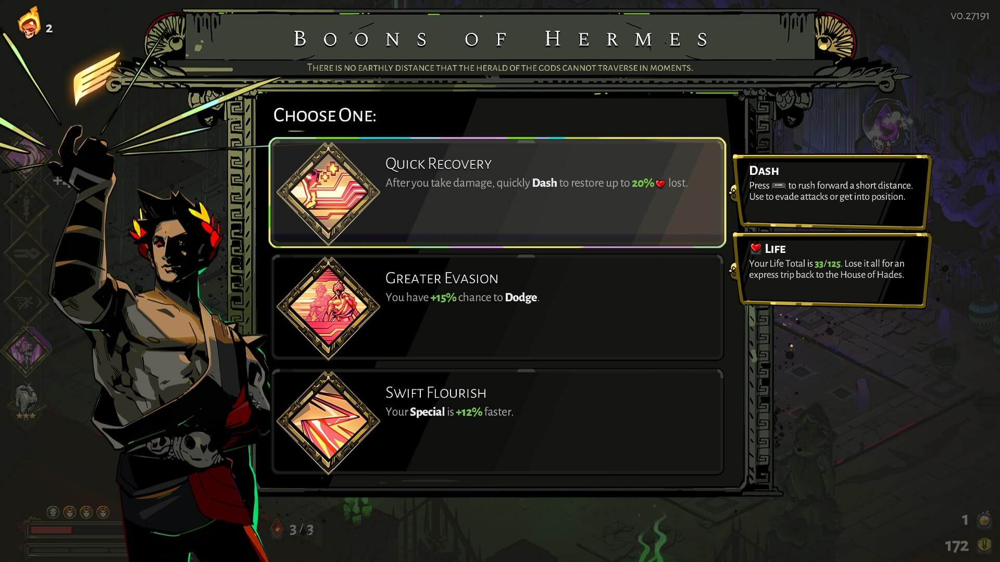
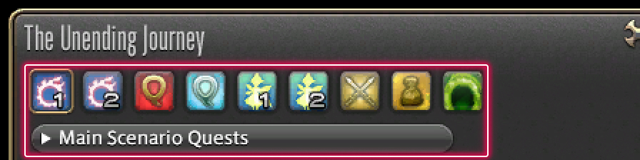

# 圖鑑回顧（NE-279）

2026-10-17。先讀 `pm/user_guide.md`：維持高清像素介面、清楚分區、完整返回焦點，不把研究圖當遊戲驗收。

## 參考與取捨

先比較同類橫向動作／探索作品，再補充回顧功能的案例。以下為實際下載並目視檢查的靜態圖，不代表試玩、觀看影片或玩家民調；圖片權利屬原作者，只保存於不進遊戲包的 pm 研究附件。來源和雜湊見 [來源帳本](../../pm/Nest-Egg/attachments/NE-279-references/sources.json)。

| 作品／團隊 | 實際看到 | 採用原則與限制 |
|---|---|---|
| [Hollow Knight／Team Cherry](https://interfaceingame.com/screenshots/hollow-knight-inventory/) | 頂端相鄰分頁與按鍵提示、暗底、物件與右側描述分區 | 分頁與詳情位置固定；不沿用花飾與素材。此圖為背包，不能稱為回放功能證據 |
| [Metroid Dread／MercurySteam、Nintendo](https://www.nintendo.com/au/news-and-articles/metroid-dread-report-vol-11-power-through-with-these-pointers-for-exploration-and-combat/) | Mission Log 分 Events／Tutorials，選中列有整條高亮，底部返回提示 | 使用依序清單與明確選中列，從內容返回仍停原位；不照搬其配色或故事 |
| [Katana ZERO／Askiisoft](https://steamcommunity.com/app/460950/screenshots/) | VHS 帶上的章節名稱與上方電視預覽，當前帶高亮 | 已看過的故事應容易辨識、可直接選；不額外做會拖慢選取的擬物操作。此圖是關卡選取，不當成無副作用回顧證據 |
| [Dead Cells／Motion Twin、Evil Empire](https://mp1st.com/news/dead-cells-update-1-39-slices-out-for-enter-the-panchaku-update-this-september-7) | 裝備資訊按用途分區，底部固定返回與選項列 | 底部操作位置固定；回顧不照搬高密度數值面板 |
| [Blasphemous 2／The Game Kitchen](https://www.gamepro.de/galerien/blasphemous_2%2C136599.html) | 頂部分類、中央選中節點、右側說明及底部返回 | 選取與詳情分開；不把技能樹分支套到線性故事清單 |
| [Hades／Supergiant](https://interfaceingame.com/screenshots/hades-boons-of-hermes/) | 中間可選列與旁側說明，選中列明亮框線，背景退後 | 克制焦點層級、細節不塞進每張卡；不照搬整幅人物或技能畫面 |
| [FFXIV／Square Enix](https://na.finalfantasyxiv.com/uiguide/faq/faq-other/setting_cs_repeat.html) | 官方 Unending Journey 分類頁籤與分類下拉，文章明列回看既有演出 | 回顧與遊戲進程分開；本作只有少量可回看場景，不增加多層下拉 |
| [Detroit／Quantic Dream](https://interfaceingame.com/screenshots/detroit-become-human-chapters/) | 章節縮圖、當前章節底條、下方操作提示 | 章節順序可見；本作不採啟動章節／改進度功能 |
| [Life is Strange: Before the Storm／Deck Nine](https://interfaceingame.com/screenshots/life-is-strange-before-the-storm-gallery/) | 相簿分頁、未解鎖鎖圖與已解鎖圖片 | 避免劇透；本作直接省略未看過過場，不堆滿鎖卡 |

## 玩家可觀察的行為

- 圖鑑分「敗北紀錄／回顧」，沿用現有按鈕、色盤、焦點與前後分頁鍵；主選單和暫停皆可進入。
- 左側只列本輪已完成且劇本允許回看的場景，順序、名稱和語言來自 Story；右側顯示選中名稱、一句說明與重看按鈕。空清單明示原因。
- 選中清單項目可直接重看；看完、略過後回原分頁、同一項目與捲動位置，不退回第一項。播放期間藏起圖鑑，避免較高圖層蓋住過場。
- 維持暫停頁原有暫停責任。重看只用既有 presentation-only 接點，不寫旗標、物品、任務、觀看紀錄或存檔。離開圖鑑也釋放自己啟動的回看。
- 若暫停頁開在仍未讀完的重要通訊之上，圖鑑保留可讀，但提示先讀完當前對話才啟動回看，避免原對話層與回看同時覆蓋畫面。
- 三語名稱沿用劇本，新增說明／頁籤／操作文案也依劇本語言。驗證 720p／1080p 和放大文字、鍵鼠與合成手把事件；實體手把／硬體 GPU另列限制。

技術核對：[Godot 暫停與處理模式](https://docs.godotengine.org/en/stable/tutorials/scripting/pausing_games.html)。焦點規則另參考 [XAG 113](https://learn.microsoft.com/en-us/xbox/accessibility/xbox-accessibility-guidelines/113)，作為補充，並非唯一視覺來源。
