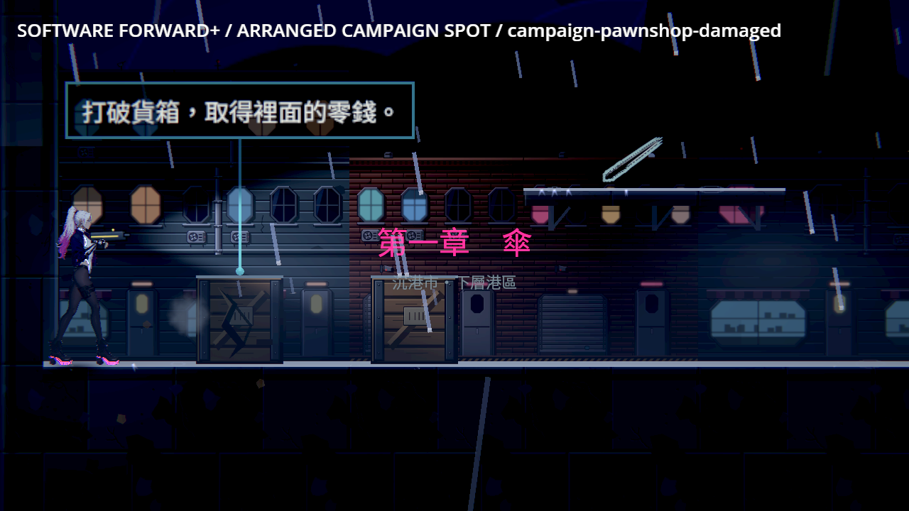
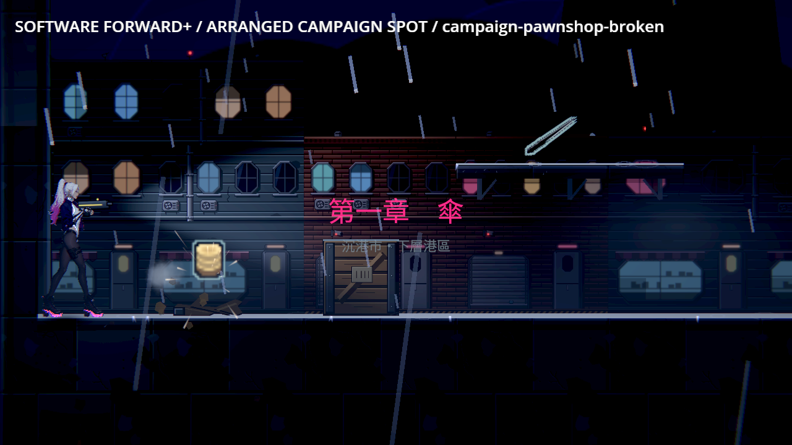

# 正式機關與破壞狀態（BG-47）

2026-10-20，固定基準 `83e7d318`。實作前已讀 User-guide、BG-47、BG-21、FIXTURE_ASSETS、pm-ticket、free-asset-pipeline 與 visual-verification。

沿用 BG-21 可重跑的賽璐璐繪製管線與鋼灰／墨線／警示黃色盤；小規則物件需要準確對齊碰撞與重複導軌，使用同一繪製工具，不另生成來源不明素材。角色美術、骨架與場景家具擺位維持各自 owner。

研究先實際檢視 Ghost Song、九日、The Last Faith、Dead Cells、Hollow Knight 各兩張正式商店圖；[本批五款原圖與來源](../../pm/Nest-Egg-BG/attachments/readability-references-2026-10-20/sources.json)已隨本票保存。觀察限畫面：Ghost Song 的地形／衣甲分層，九日的牆面燈與櫃體支撐，The Last Faith 建築與剪影，Dead Cells 箱體與戰鬥高亮的主次，Hollow Knight 平台上緣與裝飾。圖片沒有呈現這些遊戲每一種碎裂或存檔實作，不將其當作該機制已查證。

## 交付設計

木箱以木板、金屬包角與封條，油桶以分層鋼環、凹口與易燃標誌，玻璃以有固定鉚釘的框與透明板面辨識。各有完整、受損與碎裂貼圖；碎裂只生成短暫外觀殘片，不新增碰撞、掉落、傷害或存檔狀態。從檢查點還原已破壞物不重播碎裂。

固定油桶沿既有爆炸時序；可撿油桶沿 NE-254 引信與敵我傷害。兩者共用外觀但不互換規則。引信亮點與範圍提示保留，減閃光不改引信或爆炸時刻。

升降平台的承載面等於原本碰撞的頂面／寬度；導軌留在原地，平台移動。電源開關使用獨立的配電座、線管、拉桿和斷電／供電狀態燈；互動範圍與停電規則不變。

缺圖記錄具體路徑並保留原簡單畫法；章節稽核要依實際必要貼圖存在與否報缺口，不能只刪掉原占位清單。測試必須涵蓋正式節點的貼圖掛載、受損／破壞、還原與相同碰撞；圖像檢視不取代功能測試。

## 驗證（2026-10-20）

[證據索引與全部 raw](../../pm/Nest-Egg-BG/attachments/BG-47-fixture-states/README.md)。51 群 55,603 checks 零失敗；正式當舖與排列實驗場共 17 張、29 項狀態檢查零失敗，修前同工具六項缺圖失敗。三章 30 區程式占位歸零；序章地圖 ch1_prologue.tres 歸在第一章的 11 區中，亦已稽核。實體 Forward+ 光影、遮擋與支撐的人工驗收仍依原票。

## 本機原生補證（2026-11-11）

BG-54 發現舊擷取工具先量化線性影像再轉 sRGB，會丟失暗部階調；第一批 PNG 的視覺判定已撤回，原始影像、舊收據與日誌保留。以修正後 helper `390789818b405f341a6a0a24a880971353349c8c09dc907e9fd9d8538d98addd` 重新啟動正常、回退、正式倉庫三個原生程序，逐張檢視二十四張全新 PNG 後再完成驗收。不是對舊圖重新轉色，也不是調整遊戲光影或幾何。

AMD Radeon RX 9070 XT／Godot 4.7.2／Vulkan Forward+：正常 106／0、載入拒絕回退 68／0、正式倉庫原位油桶 4／0，三個原生程序均沒有非預期錯誤或退出洩漏。[原圖、故障注入、負控制與所有早期失敗](../../pm/Nest-Egg-BG/attachments/BG-47-native-2026-11-11/README.md)。

每個新程序前後的來源與素材指紋一致，十四個正式 PNG 保持不變。被雜湊的來源檔、原始程序輸出及新 PNG 都以原始位元組封在 ZIP；外層 Markdown／JSON 可依 Git 文字政策正規化，不能拿它們替代已封存的原始證據位元組。

排列場明示使用目前正式章節與相同 facility 設定；等待玩家真正落在移動承載面上後才取樣，不放寬原腳底與接觸門檻。原無燈排列場的暗部不足以推論正式關卡有相同問題，因此另核對碼頭倉庫原位油桶；保留原光照、位置和素材，以一次真投射物傷害核對完整／破損貼圖與斜裂、鋼圈缺口。沒有改全區亮度或令暗處物件自發光。

缺檔先以真正不存在的路徑確認產品診斷與快取；正式十四種素材則在獨立程序使用資源快取的路徑接管，注入錯誤類型以測載入拒絕。正式 PNG 從未移動，前後雜湊一致；不能把這份證據寫成刪除正式 PNG 後運行，亦不以工具手動報錯取代產品診斷。舊 chapter_01 樣本的退出洩漏保留，使用目前正式章節的成功不代表它已被修好。
