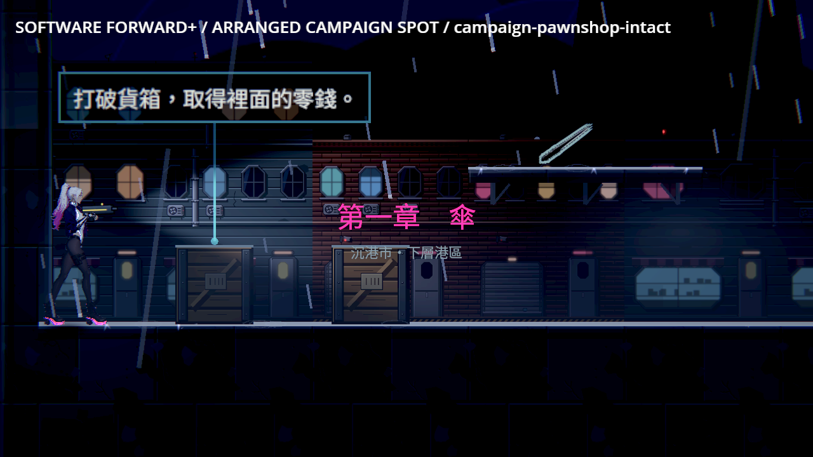

# 正式機關與破壞狀態（BG-47）

2026-10-20，固定基準 `83e7d318`。實作前已讀 User-guide、BG-47、BG-21、FIXTURE_ASSETS、pm-ticket、free-asset-pipeline 與 visual-verification。

沿用 BG-21 可重跑的賽璐璐繪製管線與鋼灰／墨線／警示黃色盤；小規則物件需要準確對齊碰撞與重複導軌，使用同一繪製工具，不另生成來源不明素材。角色美術、骨架與場景家具擺位維持各自 owner。

研究先實際檢視 Ghost Song、九日、The Last Faith、Dead Cells、Hollow Knight 各兩張正式商店圖；[本批五款原圖與來源](../../pm/Nest-Egg-BG/attachments/readability-references-2026-10-20/sources.json)已隨本票保存。觀察限畫面：Ghost Song 的地形／衣甲分層，九日的牆面燈與櫃體支撐，The Last Faith 建築與剪影，Dead Cells 箱體與戰鬥高亮的主次，Hollow Knight 平台上緣與裝飾。圖片沒有呈現這些遊戲每一種碎裂或存檔實作，不將其當作該機制已查證。

## 交付設計

木箱以木板、金屬包角與封條，油桶以分層鋼環、凹口與易燃標誌，玻璃以有固定鉚釘的框與透明板面辨識。各有完整、受損與碎裂貼圖；碎裂只生成短暫外觀殘片，不新增碰撞、掉落、傷害或存檔狀態。從檢查點還原已破壞物不重播碎裂。

固定油桶沿既有爆炸時序；可撿油桶沿 NE-254 引信與敵我傷害。兩者共用外觀但不互換規則。引信亮點與範圍提示保留，減閃光不改引信或爆炸時刻。

升降平台的承載面等於原本碰撞的頂面／寬度；導軌留在原地，平台移動。電源開關使用獨立的配電座、線管、拉桿和斷電／供電狀態燈；互動範圍與停電規則不變。

缺圖記錄具體路徑並保留原簡單畫法；章節稽核要依實際必要貼圖存在與否報缺口，不能只刪掉原占位清單。測試必須涵蓋正式節點的貼圖掛載、受損／破壞、還原與相同碰撞；圖像檢視不取代功能測試。

## 驗證（2026-10-20）

[證據索引與全部 raw](../../pm/Nest-Egg-BG/attachments/BG-47-fixture-states/README.md)。51 群 55,603 checks 零失敗；正式當舖與排列實驗場共 17 張、29 項狀態檢查零失敗，修前同工具六項缺圖失敗。三章 30 區程式占位歸零，序章無獨立稽核列。實體 Forward+ 光影、遮擋與支撐的人工驗收仍依原票。

