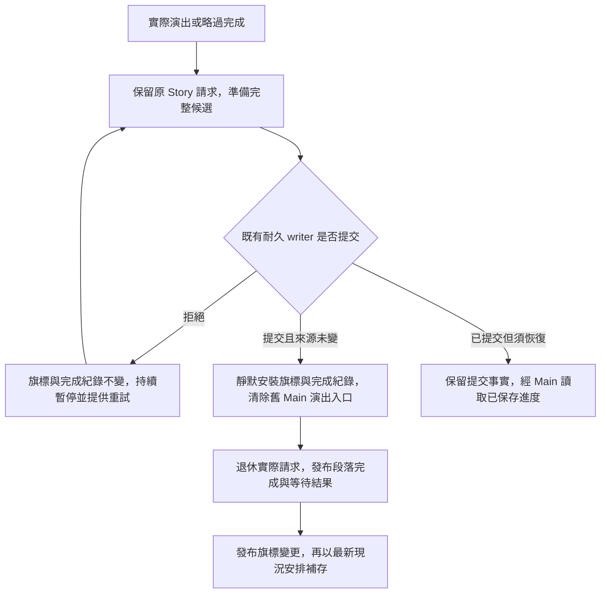

# 自動回家段落的旗標保存邊界

第一章回家段落原本在演出／略過後立即寫入 `ch1_home_done`、`ch1_complete` 與完成紀錄，並喚醒等待的 Level；磁碟寫入可能尚未成功。最後版本的結算保護能拒絕結算保存，但不會撤回已對外發布的段落結果。

本次由 Main 擁有的共用旗標模組接住這個較早的邊界。來源編譯器只替 binding 為 home、無選項／續段、結果全為旗標的正式動畫加入 `completion_policy: main_flags_v1`；目前正式資料只有 `ch1_c14_home` 增加這個欄位。這個政策限定正式 Main 遊戲；獨立演出工具沿用既有呈現行為。它不是未來通用 `atomic_v1` 交易政策。

準備先讓 `Level.run_snapshot()` 合併當前區域，再捕捉四個資料 owner 的來源證明。原始結果清單先以共用契約驗證，才讀取旗標操作。政策未知、非旗標結果、選項／續段、交付、非實際末區 intro 請求或自動發道具均拒絕，不在 Main 降級成舊完成路徑。合法空檢查點／裝備字典會在每次保存時補成完整格式，非旗標 state 以相同 canonical 規則比較；物品與錢包仍與實際 owner 比較，修復由整輪讀取負責。

拒絕時不清除當前請求或 Main 的原始演出入口，也不發布旗標、段落完成或成功等待結果。Main 的補存保持阻擋。自動回家已結束舞台，提示只提供重試，Back 不會把玩家丟回無法繼續的結束狀態；事件提示用不透明底色，避免露出尚未首繪的世界影格。三語、放大文字、焦點與備份恢復文案沿用同一 UI。

成功時只靜默安裝旗標與 Story 完成紀錄，先清 Main 舊演出入口，避免後續保存或路由回寫舊入口。Story 接著退休原請求、發布完成並喚醒等待者；旗標通知已排在 Level 的 deferred 完成路由之前，通知後只補存最新現況，不重新安裝舊候選。已提交後必須恢復時，先撤掉舊入口再經 Main 讀取已提交檔；未提交且回滾失敗時則讀原備份，兩種文案不混用。

原通訊檔案路徑保留為共用模組的相容入口；Main 的舊通訊欄位保留唯讀 getter，既有原生探針仍可使用。原通訊的准入與取消政策保持獨立，沒有把所有電影、NPC 或氣泡一併宣稱已耐久化。

驗證包括原通訊／writer 回歸、真正 Story 請求的拒絕與重試、三語 UI，以及真 Main 自動回家、實際略過、檔案系統拒絕與獨立程序續玩。`.tmp` 目錄造成輪替前拒絕，可要求主檔與備份 bytes 都不變；較晚 rename 的既有回滾契約只保證完整原主檔恢復，不誤稱備份檔名也保持。所有原始失敗、修正原因與實際範圍留在 ST-9 交付資料。

ST-9 的通用交易／物品／世界 coordinator、交盤與麵攤的必要道具演出仍需接續；本次不勾選那些整票條件。
