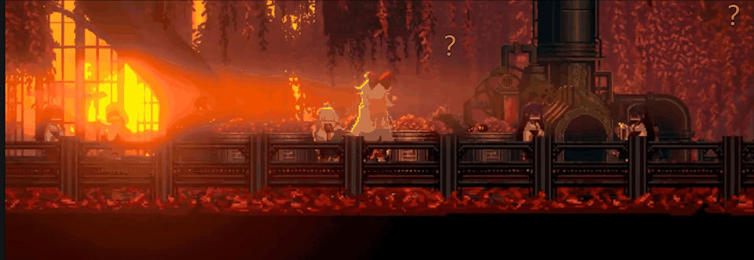

# 景深、圖層與主光

2026-11-27，使用者提供兩張同一個場景的參考畫面（另一款像素風橫向遊戲，不同時刻），說這種效果很好、前景與後景做得很好；並指出本專案的前景與後景有問題、沒有類似的效果，敵人與 NPC 的圖層甚至有問題。本文記錄從參考畫面拆出來的做法、專案現況的問題與決策。只取技法，不取對方的美術、角色與題材。

第一張參考畫面：

第二張（使用者說明「這是太陽被遮住比較多的情況」，沒有存檔）：同一個鏡頭，光源的大片光暈收小，改成幾道從左上往右下斜射的光柱，穿過垂掛的枝葉；整個畫面仍然是同一個紅橘色系，角色的亮邊變淡。

## 參考畫面在做什麼

| 技法 | 畫面上看到的 |
|---|---|
| 一個主光 | 整個畫面只有一個決定方向與顏色的光源（左側的窗）。其他燈都很小、不搶 |
| 光會漫出來 | 光源周圍有一大片柔光，蓋過前面的欄杆與附近的角色；靠近光源的東西變成光裡的剪影 |
| 主光會變 | 遮得少：大片光暈；遮得多：光暈收小，出現一道道斜射的光柱。同一個場景有兩種樣子 |
| 單一色系 | 背景、地面、道具、角色暗部全部落在同一個色相（紅橘），只有明暗不同；主光是唯一最亮、最暖的東西 |
| 前景真的在前面 | 一整排欄杆畫在角色前面、蓋住角色的小腿；最前面還有一層落葉。前景是不透明的深色剪影 |
| 上緣有垂掛物 | 枝葉從畫面上方垂下來，壓住上緣、框住畫面，並和光柱交錯 |
| 中景有東西 | 角色後面不是一面平牆：有花台、機器、管線，再後面才是整片的葉幕 |
| 遠近用明暗分 | 越遠越淡、越接近主光的顏色；越近越暗、對比越高 |
| 角色被主光勾邊 | 朝光的那一側有亮邊，背光側沉進環境色 |

## 專案現況（2026-11-27 調查，main b18ce136a 之後）

**圖層**

- 玩家、敵人、NPC 的根節點都在同一層，零件依骨架資料排在 −9 到 +12。兩個角色重疊時是零件對零件交錯：一個角色的手臂蓋住另一個的身體，腿卻在對方的腿後面。過場舞台有替每個演員分一組圖層，關卡裡沒有。
- 子彈在第 4 層、特效第 6 層、霧第 7 層、雨第 8 層，全部落在角色零件的範圍裡。霧會蓋住角色的腿，卻被手臂、武器、外套蓋住；子彈會從軀幹前面、手臂後面穿過。
- 標成「前景」的擺設排在第 3 層、不透明度 0.7：角色的外套、手臂、武器畫在它前面，腿在它後面；而且半透明，看起來像鬼影不像前景。全專案只有 4 件前景擺設。
- 真正在最前面的只有前景層（第 15 層）：畫面上緣的管線與地面以下的欄杆，刻意不蓋到角色；低畫質時整層消失。

**後景**

- 角色正後方是一面平的建築立面，直接接到遠景；中間沒有「在走道上、角色後面一點」的中景物件層。
- 遠景層之間有霧色（BG-65），但立面與遠景之間沒有。

**光**

- 沒有主光：每個區段是環境光加上一盞盞小場景燈。向陽區（第三章）是全專案最該有陽光的地方，畫面上卻只有一面彩色窗戶牆與一大塊地磚。
- 後製已經有陰影色調與亮部色調（依明暗各乘一個顏色），可以把畫面拉向單一色系，但現有的光影設定都只用了很淡的量。
- 角色的輪廓光已經有（光影設定的 rim），方向固定，不跟光源走。

## 決策

### 角色與特效的圖層（NE-402）

- 關卡裡每個角色佔自己的一整組圖層，組與組不交錯：重疊時一定是整個角色在另一個前面。
- 排序規則：玩家永遠最前面（玩家要看得到自己）；其餘依出現順序固定，不在重疊時跳動。同時在畫面上的角色很多，圖層不夠分時共用最後一組並記錄，不是崩潰。
- 子彈、特效、霧、雨移到所有角色之上；接觸陰影、拾取物維持在所有角色之下。
- 前景擺設移到所有角色之上，並且不透明。會擋住戰鬥判讀的位置不放前景擺設，這是擺放規則，不是用半透明解決。

### 前景層（BG-68）

- 新增「近前景」：畫在角色前面、不透明的深色剪影，放在走道外緣（欄杆、矮牆、落葉、管線）與畫面上緣（垂掛的纜線、布、枝葉）。
- 只蓋到角色的小腿以下與頭頂以上，不蓋軀幹、頭、武器與敵人的弱點；戰鬥區段的近前景更矮或不放。安全區與劇情區可以放得更滿。
- 近前景比走道捲動得略快，垂掛物會被風與經過的角色帶動（沿用 BG-64）。
- 低畫質保留近前景（它是構圖的一部分，不是特效），只關掉動態。

### 中景與空氣（BG-69）

- 立面與走道之間加一層中景物件：靠牆的花台、機櫃、管線、棚架，比角色暗一階，讓角色不是貼著一面平牆。
- 立面本身依高度與距離加上和遠景同一套的霧色，往上、往遠變淡。

### 主光（BG-67）

- 一個區段可以有一個主光：位置、顏色、光暈大小、光柱的方向與數量寫在資料裡。
- 主光有「被遮住的程度」，隨時間緩慢變化（雲、枝葉、路過的車）：遮得少時是大片柔光，遮得多時光暈收小、光柱變明顯。變化慢到不會被當成閃爍；「減少動態」時固定在中間值。
- 光暈大部分畫在角色後面，讓靠近光源的角色變成剪影；只有很淡的一層畫在角色前面當作光的漫射。這樣主角的白髮不會被光暈直接加到過曝。
- 有主光的區段把光影設定的色調拉向單一色系：暗部偏向環境色、亮部偏向主光色、整體略降飽和。角色最低可讀亮度與既有的曝光檢查照舊。
- 角色的輪廓光顏色跟主光一致。
- 低畫質關掉光暈與光柱，保留色調與那盞實際照亮表面的光。
- 第一個示範場景：第三章向陽區（觀景框那一段）。它不是戰鬥區，可以把前景、中景、主光一次做滿，當作其他區段的樣板。

## 驗證

每張票附同一格鏡頭的修前修後；主光另附「遮得少」與「遮得多」兩個狀態。圖層的票要附兩個角色重疊、角色站在前景擺設後面、角色站在霧與雨裡的近拍。既有的可讀性與曝光檢查都要通過。
