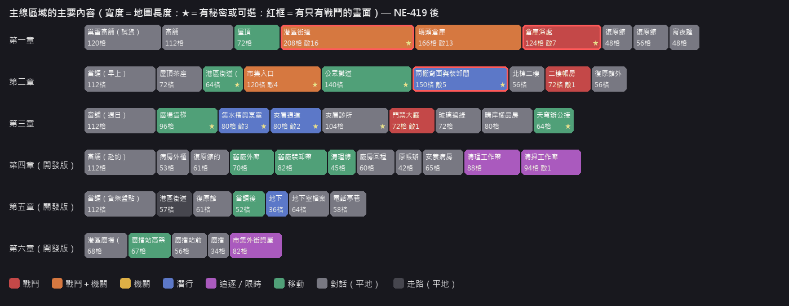

# 關卡多樣性盤點（NE-416）

2026-11-28，地圖線第 1 項。目的：逐章改動線之前，先用資料找出哪裡只有一條平的走道、哪裡只有開槍、哪裡同一件事連續做太久。使用者說過現在的密度只是 Demo，正式劇情章節會疏很多，所以這份看的是**種類與交替**，不是數量。

## 怎麼算的

全部由 `tools/level_variety_report.tscn` 從正式關卡資料算出（`data/levels/*.tres` 與地圖 JSON），改了地圖就重跑：

```
godot --headless --path . res://tools/level_variety_report.tscn -- --out=<絕對路徑.md> [--json=<絕對路徑.json>] [--chapter=ch3_clearwater]
```

| 欄位 | 算法 | 算不到什麼 |
|---|---|---|
| 主線 | 章節入口經過每個主線任務步驟的地點到章末的最短路（與經濟帳本 `CampaignLedger` 同一條） | 玩家實際的繞路順序 |
| 長（格） | 地圖寬度，一格 16 像素；一個畫面約 40 格 | — |
| 估計分鐘 | 節奏估計 `PacingEstimate`（走路、戰鬥、對話、拾取、機關） | 真人遊測時間 |
| 高低差（層／列） | 主角走、跳（上 5 格、橫 7 格）、落、搭升降梯到得了的站立格（場景檢查 `SceneAudit` 的可達性），被至少 6 欄用到的高度算一層；列是最高層與最低層的落差（角色約 3.5 列） | 跳躍手感、是否好找 |
| 上下兩層比例 | 可走的欄裡，同一欄有兩個相差 4 列以上的可站高度的比例 | 雨棚與走道是「另一條路」還是只是頭頂的平台 |
| 第二路線段 | 上下兩層連續 12 欄以上算一段 | 兩層是不是都通往出口 |
| 機關與危險地形 | 地圖字元對到的機關資料（閘門、開關、水坑、吊掛貨箱、蒸汽閥、通電纜線、輸送帶、可破壞物、可投擲物）與尖刺、雷射、光橋 | 機關擺得好不好 |
| 潛行 | 可射暗的燈、誘餌收音機、避開遭遇 | — |
| 追逐限時 | 掃描通道、追逐光幕、載具、移動試煉 | — |
| 敵人種類 | 每區每種敵人的數量（含頭目）；「同一種敵人連續出現」只看主線上有敵人的區域，沒有敵人的區域不打斷 | 敵人的行為差異（見敵人線的 `ENEMY_ROSTER.md`） |
| 遭遇（場／敵） | 場數用節奏估計的分群（相鄰敵人 8 格內算一場），敵人數含頭目 | 遭遇的開場方式（伏擊、巡邏） |
| 有敵人的畫面／其中只有戰鬥 | 每 40 格一個畫面；有敵人、卻沒有任何機關、人物、調查點、秘密、梯子、危險地形的畫面算「只有戰鬥」（路上的信用點、貨箱、可投擲物是戰鬥的一部分，不算另一種玩法） | — |
| 秘密與可選 | 裂牆（打破露出隱藏房間）、看得到但要空中再躍才拿得到的信用點、比那一欄的地面高出 6 列以上（要爬上去）的信用點、區域挑戰 | 自然藏起來的角落 |
| 人物／調查／商店 | 可交談的人、可調查的物件、商店 | 對話內容 |
| 主要內容 | 依序取第一個成立的：追逐／限時 → 潛行 → 有遭遇（含小頭目；有機關就是「戰鬥＋機關」）→ 機關 → 有第二路線（移動）→ 有人物或調查點（對話，平地）→ 走路 | 一區裡的節奏起伏 |
| 單調分數 | 長度（畫面數）×（1 + 0.15 × 敵人數）÷（1 + 活動種類數）；只用來排序 | 品質 |

「樣式是 hidden 的出入口」只是不另外畫門框的樓梯間，不算秘密。

## 修訂紀錄

- 2026-11-28 NE-416：第一次盤點。
- 2026-11-28 NE-419：加上「敵人種類」一欄與同一種敵人連續出現的段落（主 session 轉達敵人線的需求）。修正兩個算法——門禁大廳是守門人的小頭目戰，原本因為只有 1 場遭遇被算成「平地對話」，改成有遭遇就算戰鬥；要爬上去才拿得到的信用點也算可選。第三章改完動線後重跑，下面的表是最新的數字。

## 結論



### 各章摘要（只算主線區域）

| 章 | 正式章節 | 主線區域 | 主線總長（格） | 平地單線的長度比例 | 沒有機關的長度比例 | 遭遇 | 秘密與可選 | 主線上連續 3 區以上同一種內容 |
|---|---|---|---|---|---|---|---|---|
| 第一章 ch1_kasa | 是 | 9 | 954 | 29% | 61% | 22 | 7（裂牆 2、空中再躍 1、要爬上去 4） | 交接櫃 → 復原館 → 麵攤，都是平地對話 |
| 第二章 ch2_heron | 是 | 9 | 842 | 22% | 68% | 5 | 7（空中再躍 4、要爬上去 1、挑戰 2） | 無 |
| 第三章 ch3_clearwater | 是 | 9 | 760 | 58%（NE-419 前 66%） | 79% | 4 | 6（裂牆 1、空中再躍 3、要爬上去 2；NE-419 前是空中再躍 3、要爬上去 1） | 無（NE-419 前：玻璃邊緣 → 樣品房 → 辦公接待廊連續 3 區平地對話） |
| 第四章 ch4_hollow | 開發版 | 11 | 772 | 51% | 76% | 1 | 1（支線接線廊的限時挑戰，NE-418） | 當舖 → 病房櫃檯 → 復原館換班口（平地對話）；外廊 → 裝卸帶 → 安全臺（同樣的移動）；屋頂 → 辦公室 → 病房（平地對話） |
| 第五章 ch5_paymaster | 開發版 | 7 | 440 | 80% | 92% | 0 | 0 | 無（但 7 區裡 6 區是平地對話或走路） |
| 第六章 ch6_unmooring | 開發版 | 5 | 307 | 51% | 73% | 0 | 0 | 無 |

「平地單線」＝沒有第二路線段、高低差不到 6 列、沒有梯子與升降梯。

### 連續三個以上只有戰鬥的段落

**沒有。** 區域層級：主線上沒有任何一區是「有敵人、卻沒有別的事」。畫面層級：用最嚴格的標準（不把地形高低當成另一種玩法，只看機關、人物、調查點、秘密、梯子、危險地形）也沒有連續三個畫面只有戰鬥。

只有戰鬥的單一畫面在這幾處：第一章港區街道 2 個（共 4 個有敵人的畫面）、第一章倉庫深處 2 個（共 3 個）、第二章裝卸間 1 個、第四章接線廊 1 個。

所以單調的主因不是「一直開槍」，而是反過來：

1. **平的對話區連成一串**：第三章後半連續 5 區、第四章兩段各 3 區、第一章章末 3 區，每區都是一條平地、一兩個人說話就走。
2. **戰鬥區的另一種玩法偏少**：第一章三個戰鬥區（街道、倉庫、深處）的「另一件事」多半是可投擲物與高低層，倉庫深處除了一面裂牆沒有任何機關。
3. **秘密幾乎只有一種**：真正藏起來的房間（裂牆）只有第一章兩處；其他章的「秘密」都是看得到、要空中再躍才拿得到的信用點，第四到六章一個都沒有。
4. **很多機關只出現在一章**：蒸汽閥只在第一章、可射暗的燈只在第二章、輸送帶只在第四章（見下表），違反「每種玩法至少在兩章出現」。

### 同一種敵人連續出現三個區域以上

只有第一章：監視蜂、清掃兵、收帳人·槍手三種，在街道 → 倉庫 → 倉庫深處三個戰鬥區都出現，三區的組成幾乎一樣。第二章（押運手、票據投手）只有兩個戰鬥區；第三章兩種巡檢器只在泵室與夾層。改第一章時遭遇的組成和動線一起換；敵人線整理出可以進章節的種類表之前，不把舊開發關卡的敵人擺進章節。

### 每章最單調的三個區域

依工具的單調分數；後面寫理由與要不要改。

| 章 | 區域 | 理由 |
|---|---|---|
| 第一章 | 港區街道（4.4） | 208 格、16 個敵人，是全遊戲最長的戰鬥路段；另一種玩法只有 1 個蒸汽閥與 6 個可投擲物，4 個有敵人的畫面裡 2 個只有戰鬥 |
| 第一章 | 碼頭倉庫（3.1） | 全遊戲遭遇最多（10 場、13 個敵人）；4 個有敵人的畫面都有機關（開關、閘門、水坑、吊掛貨箱），分數高是因為戰鬥量重，改的時候減量與換開場方式優先，不是再加機關 |
| 第一章 | 倉庫深處（2.1） | 91% 上下兩層，但除了一面裂牆沒有任何機關；3 個有敵人的畫面裡 2 個只有戰鬥 |
| 第二章 | 裝卸間（1.1） | 第二章最長的區域，已有吊掛貨箱、射燈、不被發現挑戰；入口段 1 個畫面只有戰鬥 |
| 第二章 | 市集入口（1.0） | 已有通電纜線、環境擊倒挑戰與兩段第二路線；分數來自長度與敵人數，缺的是藏起來的房間 |
| 第二章 | 公眾攤道（0.9） | 91% 上下兩層，但整區沒有任何機關，只有人物 |
| 第三章 | 當舖（週日）（1.4） | 112 格的平地，沒有商店、沒有秘密，只有對話 |
| 第三章 | 夾層診所（1.2） | 96 格的平地，只有對話與調查（NE-419 加了裂牆後的備品間） |
| 第三章 | 門禁大廳（1.0） | 守門人的小頭目戰，但沒有任何機關或第二路線（只有 11% 兩層、0 段第二路線）；頭目戰的場地交給敵人與頭目線 |
| 第四章 | 當舖（赴約）（1.4） | 112 格的平地，只有一個人物 |
| 第四章 | 廠房接線廊（1.3） | 第四章唯一的正式戰鬥區（4 個敵人），但在支線上、沒有秘密；有 1 個畫面只有戰鬥 |
| 第四章 | 安養病房（0.8） | 6 個調查點都在同一條平地上，沒有第二路線 |
| 第五章 | 港區街道（1.4） | 57 格，什麼都沒有，只有走路 |
| 第五章 | 當舖（貨架盤點）（1.4） | 9 個調查點都在同一條平地上 |
| 第五章 | 地下室檔案間（0.8） | 平地，5 個調查點 |
| 第六章 | 港區廣場（0.8） | 平地，只有一個調查點 |
| 第六章 | 廣播站前庭（0.7） | 平地，4 個調查點 |
| 第六章 | 高架維修道（0.6） | 有兩層，但沒有任何機關或秘密 |

### 每種機關目前出現在哪裡

| 機關或玩法 | 出現的區域 | 章數 |
|---|---|---|
| 吊掛貨箱 | 第一章倉庫、第二章裝卸間 | 2 |
| 通電纜線／積水 | 第二章市集入口、第三章夾層通道、第四章接線廊 | 3 |
| 誘餌收音機 | 第三章泵室、第三章夾層通道 | 1 |
| 蒸汽閥 | 第一章街道 | 1 |
| 可射暗的燈 | 第二章裝卸間 | 1 |
| 輸送帶 | 第四章接線廊 | 1 |
| 開關、閘門、水坑 | 第一章倉庫 | 1 |
| 裂牆（秘密房間） | 第一章街道、第一章倉庫深處 | 1 |
| 區域挑戰（環境擊倒／不被發現） | 第二章市集入口、第二章裝卸間 | 1 |
| 掃描通道 | 第四章工作帶、第四章清掃廊 | 1 |
| 避開遭遇 | 第五章樓梯口 | 1 |
| 移動試煉 | 第六章屋簷 | 1 |
| 梯子出入口 | 第一章、第二章當舖 | 2 |
| 升降梯 | 無 | 0 |

## 逐章修改順序

依「平地單線的比例」「同一種內容連續幾區」「秘密種類」排；正式章節優先，開發版章節的劇情還在改，排在後面並先和故事線對齊。每張票一章，照下面的方向做，細節在各自的票裡決定。

1. **第三章（最先，NE-419）**：平地單線 66%、後半連續 3 區平地對話（原本寫 5 區，門禁大廳其實是小頭目戰，見修訂紀錄）、沒有任何藏起來的秘密。
   - NE-419 做了：辦公接待廊加天花板下的維修廊（回頭路＋要爬上去的信用點）、診所加裂牆後的備品間、修好產生器。主線不再有連續 3 區同一種內容。
   - 沒有照原計畫做的：玻璃邊緣是畫面線的光影樣板，主光、花台邊、中景、地面剖面都把每欄最上面的可站面當成走道，加平台會讓這些畫錯，所以不動；門禁大廳是頭目戰場地，交給敵人與頭目線；可射暗的燈、蒸汽閥都要有敵人才有用，第三章後半沒有敵人。
   - 還不夠的：當舖、診所、樣品房仍是平地，主線平地單線比例只從 66% 降到 58%。需要一種不靠敵人的機關（例如要操作才開的門、會動的平台）才能讓安靜區也有事做，已向玩法線提需求。
2. **第四章**：平地單線 51%、三段連續同一種內容、0 個秘密、主線只有 1 場遭遇。
   - 病房那一串（櫃檯、換班口、病房）加一段安靜的探索或潛行；廠房三區（外廊、裝卸帶、安全臺）換掉其中一區的玩法（機關或戰鬥），不要三區都是同樣的跳台。
   - 至少兩個秘密；接線廊的戰鬥與輸送帶、通電纜線的組合往主線帶。
3. **第一章**：戰鬥最多（22 場），但三個戰鬥區的另一種玩法偏少，章末 3 區平地對話。
   - 街道與倉庫深處的「只有戰鬥的畫面」各加一個機關或繞過遭遇的路（街道是蒸汽閥之外的第二種，深處目前沒有任何機關）；倉庫減一點量、換遭遇的開場方式（制高點、伏擊點）。
   - 章末三區是劇情的谷，保持安靜，但其中一區加一個小角落，打斷「連續 3 區一樣」。
4. **第二章**：目前最有變化（NE-405、NE-410、NE-411 剛加過），只補缺口：公眾攤道加一個機關，補一個藏起來的秘密房間；捷徑先核對現有的迴圈再決定要不要加。
5. **第五章、第六章（開發版）**：幾乎沒有戰鬥，7 區裡 6 區是平地；劇情與流程還在故事線手上。等故事線定下這兩章的流程，再照同樣的方向排，先問故事線哪些區域可以動。

每章另外做一個不靠射擊、讓人記得的場面（待辦清單地圖第 3 項），和上面這張票分開。

## 附錄：逐區明細（工具輸出）

2026-11-28 NE-419 改完第三章後重跑。

### 第一章 ch1_kasa

| 順序 | 區域 | 主線 | 長（格） | 估計分鐘 | 高低差（層／列） | 上下兩層比例 | 第二路線段 | 梯／升降 | 機關與危險地形 | 潛行 | 追逐限時 | 遭遇（場／敵） | 敵人種類 | 有敵人的畫面／其中只有戰鬥 | 鎖場 | 秘密與可選 | 人物／調查／商店 | 主要內容 | 除了開槍還做了什麼 |
|---|---|---|---|---|---|---|---|---|---|---|---|---|---|---|---|---|---|---|---|
| 1 | ch1_prologue 巢蛋當舖（試貨） | 是 | 120 | 4.3 | 1／0 | 4% | 0 | 0／0 | — | — | — | 0／0 | — | 0／0（共 3） | 0 | — | 3／2／0 | 對話（平地） | 對話／調查, 練習 |
| 2 | ch1_pawnshop 當舖 | 是 | 112 | 3.5 | 2／4 | 5% | 0 | 1／0 | 可破壞物×2 | — | — | 0／0 | — | 0／0（共 3） | 0 | — | 1／6／1 | 對話（平地） | 移動／高低差, 機關或危險地形, 對話／調查, 商店 |
| 3 | ch1_rooftop 屋頂 | 是 | 72 | 1.1 | 6／18 | 20% | 1 | 0／0 | — | — | — | 0／0 | — | 0／0（共 2） | 0 | — | 1／0／0 | 移動 | 移動／高低差, 對話／調查 |
| 4 | ch1_street 港區街道 | 是 | 208 | 4.5 | 5／20 | 25% | 3 | 0／0 | 可投擲物×6, 蒸汽閥×1 | — | — | 9／16 | 監視蜂×4, 清掃兵×7, 收帳人·槍手×3, 收帳人·督察×1, 收帳人·打手×1 | 4／2（共 6） | 0 | 裂牆×1, 要空中再躍的信用點×1 | 0／0／0 | 戰鬥＋機關 | 移動／高低差, 機關或危險地形, 秘密／可選 |
| 5 | ch1_warehouse 碼頭倉庫 | 是 | 166 | 5.3 | 9／32 | 21% | 1 | 0／0 | 開關×2, 可投擲物×8, 吊掛貨箱×1, 閘門×4, 水坑×1 | — | — | 10／13 | 監視蜂×3, 清掃兵×4, 收帳人·槍手×3, 看門狗×1, 收帳人·打手×2 | 4／0（共 5） | 0 | — | 0／1／0 | 戰鬥＋機關 | 移動／高低差, 機關或危險地形, 對話／調查 |
| 6 | ch1_vault 倉庫深處 | 是 | 124 | 2.8 | 8／36 | 91% | 2 | 0／0 | — | — | — | 3／7 | 監視蜂×2, 清掃兵×2, 收帳人·槍手×2, 收帳人·督察×1 | 3／2（共 4） | 0 | 裂牆×1, 要爬上去的信用點×4 | 0／0／0 | 戰鬥 | 移動／高低差, 秘密／可選 |
| 7 | ch1_handoff 復原館外交接櫃 | 是 | 48 | 0.4 | 1／0 | 0% | 0 | 0／0 | — | — | — | 0／0 | — | 0／0（共 2） | 0 | — | 0／1／0 | 對話（平地） | 對話／調查 |
| 8 | ch1_lounge 復原館 | 是 | 56 | 1.2 | 1／0 | 0% | 0 | 0／0 | — | — | — | 0／0 | — | 0／0（共 2） | 0 | — | 1／0／0 | 對話（平地） | 對話／調查 |
| 9 | ch1_stall 宵夜麵攤 | 是 | 48 | 1.9 | 1／0 | 0% | 0 | 0／0 | — | — | — | 0／0 | — | 0／0（共 2） | 0 | — | 1／0／0 | 對話（平地） | 對話／調查 |
| 10 | ch1_booth_alley 電話亭巷 | 支線 | 56 | 0.4 | 1／0 | 0% | 0 | 0／0 | — | — | — | 0／0 | — | 0／0（共 2） | 0 | — | 0／1／0 | 對話（平地） | 對話／調查 |

- 「監視蜂」連續出現在 3 個有敵人的主線區域：ch1_street → ch1_warehouse → ch1_vault

- 「清掃兵」連續出現在 3 個有敵人的主線區域：ch1_street → ch1_warehouse → ch1_vault

- 「收帳人·槍手」連續出現在 3 個有敵人的主線區域：ch1_street → ch1_warehouse → ch1_vault

- 主線上連續 3 個區域都是「對話（平地）」：ch1_handoff → ch1_lounge → ch1_stall

- 單調分數最高的三區：ch1_street（4.4）、ch1_warehouse（3.1）、ch1_vault（2.1）

### 第二章 ch2_heron

| 順序 | 區域 | 主線 | 長（格） | 估計分鐘 | 高低差（層／列） | 上下兩層比例 | 第二路線段 | 梯／升降 | 機關與危險地形 | 潛行 | 追逐限時 | 遭遇（場／敵） | 敵人種類 | 有敵人的畫面／其中只有戰鬥 | 鎖場 | 秘密與可選 | 人物／調查／商店 | 主要內容 | 除了開槍還做了什麼 |
|---|---|---|---|---|---|---|---|---|---|---|---|---|---|---|---|---|---|---|---|
| 1 | ch2_pawnshop 當舖（早上） | 是 | 112 | 1.8 | 2／4 | 5% | 0 | 1／0 | — | — | — | 0／0 | — | 0／0（共 3） | 0 | — | 1／1／1 | 對話（平地） | 移動／高低差, 對話／調查, 商店 |
| 2 | ch2_rooftop 屋頂茶座 | 是 | 72 | 1.0 | 2／2 | 0% | 0 | 0／0 | — | — | — | 0／0 | — | 0／0（共 2） | 0 | — | 1／0／0 | 對話（平地） | 對話／調查, 練習 |
| 3 | ch2_harbor_street 港區街道（白天） | 是 | 64 | 0.2 | 2／12 | 76% | 2 | 0／0 | — | — | — | 0／0 | — | 0／0（共 2） | 0 | 要空中再躍的信用點×1 | 0／0／0 | 移動 | 移動／高低差, 秘密／可選 |
| 4 | ch2_market_gate 市集入口 | 是 | 120 | 1.7 | 4／10 | 64% | 2 | 0／0 | 通電纜線×2 | — | — | 2／4 | 收帳人·押運手×3, 收帳人·票據投手×1 | 2／0（共 3） | 0 | 要空中再躍的信用點×1, 要爬上去的信用點×1, 挑戰：環境擊倒 | 2／0／0 | 戰鬥＋機關 | 移動／高低差, 機關或危險地形, 秘密／可選, 對話／調查 |
| 5 | ch2_market 公眾攤道 | 是 | 140 | 1.8 | 2／12 | 91% | 2 | 0／0 | — | — | — | 0／0 | — | 0／0（共 4） | 0 | 要空中再躍的信用點×1 | 4／2／0 | 移動 | 移動／高低差, 秘密／可選, 對話／調查 |
| 6 | ch2_loading 雨棚背面與裝卸間 | 是 | 150 | 2.1 | 3／7 | 57% | 1 | 0／0 | 吊掛貨箱×1 | 可射暗的燈 | — | 2／5 | 收帳人·票據投手×2, 收帳人·押運手×3 | 2／1（共 4） | 0 | 要空中再躍的信用點×1, 挑戰：不被發現 | 0／4／0 | 潛行 | 移動／高低差, 機關或危險地形, 潛行／繞路, 秘密／可選, 對話／調查 |
| 7 | ch2_ledger_front 北棟二樓前室 | 是 | 56 | 0.6 | 1／0 | 0% | 0 | 0／0 | — | — | — | 0／0 | — | 0／0（共 2） | 0 | — | 0／2／0 | 對話（平地） | 對話／調查 |
| 8 | ch2_ledger_office 二樓帳房 | 是 | 72 | 2.9 | 3／9 | 54% | 3 | 0／0 | — | — | — | 1／1 | 阿勇×1 | 1／0（共 2） | 0 | — | 1／1／0 | 戰鬥 | 移動／高低差, 對話／調查 |
| 9 | ch2_lounge_front 復原館外 | 是 | 56 | 1.0 | 1／0 | 0% | 0 | 0／0 | — | — | — | 0／0 | — | 0／0（共 2） | 0 | — | 1／2／0 | 對話（平地） | 對話／調查 |
| 10 | ch2_ali_home 阿梨的小廚房 | 支線 | 48 | 0.2 | 1／0 | 0% | 0 | 0／0 | — | — | — | 0／0 | — | 0／0（共 2） | 0 | — | 1／0／0 | 對話（平地） | 對話／調查 |

- 單調分數最高的三區：ch2_loading（1.1）、ch2_market_gate（1.0）、ch2_market（0.9）

### 第三章 ch3_clearwater

| 順序 | 區域 | 主線 | 長（格） | 估計分鐘 | 高低差（層／列） | 上下兩層比例 | 第二路線段 | 梯／升降 | 機關與危險地形 | 潛行 | 追逐限時 | 遭遇（場／敵） | 敵人種類 | 有敵人的畫面／其中只有戰鬥 | 鎖場 | 秘密與可選 | 人物／調查／商店 | 主要內容 | 除了開槍還做了什麼 |
|---|---|---|---|---|---|---|---|---|---|---|---|---|---|---|---|---|---|---|---|
| 1 | ch3_pawnshop 當舖（週日） | 是 | 112 | 1.9 | 2／4 | 5% | 0 | 0／0 | — | — | — | 0／0 | — | 0／0（共 3） | 0 | — | 2／2／0 | 對話（平地） | 對話／調查 |
| 2 | ch3_plaza 廣場貨梯 | 是 | 96 | 1.0 | 2／12 | 60% | 2 | 0／0 | — | — | — | 0／0 | — | 0／0（共 3） | 0 | 要空中再躍的信用點×1, 要爬上去的信用點×1 | 0／3／0 | 移動 | 移動／高低差, 秘密／可選, 對話／調查 |
| 3 | ch3_pump 集水槽與泵室 | 是 | 80 | 1.2 | 3／20 | 100% | 1 | 0／0 | — | 誘餌收音機 | — | 2／3 | 絕緣巡檢器×1, 抽水巡檢器×2 | 2／0（共 2） | 0 | 要空中再躍的信用點×1 | 0／2／0 | 潛行 | 移動／高低差, 潛行／繞路, 秘密／可選, 對話／調查 |
| 4 | ch3_mezzanine 夾層通道 | 是 | 80 | 0.8 | 4／20 | 100% | 1 | 0／0 | 通電纜線×1 | 誘餌收音機 | — | 1／2 | 絕緣巡檢器×1, 抽水巡檢器×1 | 1／0（共 2） | 0 | 要空中再躍的信用點×1 | 0／1／0 | 潛行 | 移動／高低差, 機關或危險地形, 潛行／繞路, 秘密／可選, 對話／調查 |
| 5 | ch3_clinic 夾層診所 | 是 | 104 | 2.6 | 1／0 | 0% | 0 | 0／0 | — | — | — | 0／0 | — | 0／0（共 3） | 0 | 裂牆×1 | 1／5／0 | 對話（平地） | 秘密／可選, 對話／調查 |
| 6 | ch3_gate_hall 門禁大廳 | 是 | 72 | 2.3 | 2／5 | 11% | 0 | 0／0 | — | — | — | 1／1 | 守門人×1 | 1／0（共 2） | 0 | — | 1／1／0 | 戰鬥 | 對話／調查 |
| 7 | ch3_glass_edge 玻璃邊緣 | 是 | 72 | 0.5 | 1／0 | 0% | 0 | 0／0 | — | — | — | 0／0 | — | 0／0（共 2） | 0 | — | 0／2／0 | 對話（平地） | 對話／調查 |
| 8 | ch3_showroom 晴岸樣品房 | 是 | 80 | 1.4 | 1／0 | 0% | 0 | 0／0 | — | — | — | 0／0 | — | 0／0（共 2） | 0 | — | 1／3／0 | 對話（平地） | 對話／調查 |
| 9 | ch3_office_hall 天穹辦公接待廊 | 是 | 64 | 1.0 | 2／6 | 50% | 1 | 0／0 | — | — | — | 0／0 | — | 0／0（共 2） | 0 | 要爬上去的信用點×1 | 0／2／0 | 移動 | 移動／高低差, 秘密／可選, 對話／調查 |

- 單調分數最高的三區：ch3_pawnshop（1.4）、ch3_gate_hall（1.0）、ch3_showroom（1.0）

### 第四章 ch4_hollow（開發版）

| 順序 | 區域 | 主線 | 長（格） | 估計分鐘 | 高低差（層／列） | 上下兩層比例 | 第二路線段 | 梯／升降 | 機關與危險地形 | 潛行 | 追逐限時 | 遭遇（場／敵） | 敵人種類 | 有敵人的畫面／其中只有戰鬥 | 鎖場 | 秘密與可選 | 人物／調查／商店 | 主要內容 | 除了開槍還做了什麼 |
|---|---|---|---|---|---|---|---|---|---|---|---|---|---|---|---|---|---|---|---|
| 1 | ch4_pawnshop 當舖（赴約） | 是 | 112 | 0.6 | 2／4 | 5% | 0 | 0／0 | — | — | — | 0／0 | — | 0／0（共 3） | 0 | — | 1／0／0 | 對話（平地） | 對話／調查 |
| 2 | ch4_ward_reception 病房外櫃檯 | 是 | 53 | 0.3 | 1／0 | 0% | 0 | 0／0 | — | — | — | 0／0 | — | 0／0（共 2） | 0 | — | 1／0／0 | 對話（平地） | 對話／調查 |
| 3 | ch4_revival_lounge 復原館的換班口 | 是 | 61 | 0.4 | 1／0 | 0% | 0 | 0／0 | — | — | — | 0／0 | — | 0／0（共 2） | 0 | — | 1／0／0 | 對話（平地） | 對話／調查 |
| 4 | ch4_factory_approach 舊廠外廊 | 是 | 70 | 0.3 | 2／6 | 26% | 1 | 0／0 | — | — | — | 0／0 | — | 0／0（共 2） | 0 | — | 0／1／0 | 移動 | 移動／高低差, 對話／調查 |
| 5 | ch4_factory_loading 舊廠裝卸帶 | 是 | 82 | 0.7 | 4／6 | 34% | 1 | 0／0 | 可破壞物×1 | — | — | 0／0 | — | 0／0（共 3） | 0 | — | 0／3／0 | 移動 | 移動／高低差, 機關或危險地形, 對話／調查 |
| 6 | ch4_factory_safety 清理線安全臺 | 是 | 45 | 0.4 | 2／6 | 33% | 1 | 0／0 | — | — | — | 0／0 | — | 0／0（共 2） | 0 | — | 0／2／0 | 移動 | 移動／高低差, 對話／調查 |
| 7 | ch4_factory_roof 廠房回程梯與屋頂 | 是 | 60 | 0.5 | 1／0 | 0% | 0 | 0／0 | — | — | — | 0／0 | — | 0／0（共 2） | 0 | — | 0／1／0 | 對話（平地） | 對話／調查 |
| 8 | ch4_factory_office 原帳辦公室 | 是 | 42 | 0.4 | 1／0 | 0% | 0 | 0／0 | — | — | — | 0／0 | — | 0／0（共 2） | 0 | — | 0／2／0 | 對話（平地） | 對話／調查 |
| 9 | ch4_nursing_ward 安養病房 | 是 | 65 | 1.2 | 3／4 | 16% | 0 | 0／0 | — | — | — | 0／0 | — | 0／0（共 2） | 0 | — | 0／6／0 | 對話（平地） | 對話／調查 |
| 10 | ch4_factory_work 清理工作帶 | 是 | 88 | 0.4 | 4／6 | 66% | 1 | 0／0 | 可破壞物×1 | — | 掃描通道, 掃描通道 | 0／0 | — | 0／0（共 3） | 0 | — | 0／1／0 | 追逐／限時 | 移動／高低差, 機關或危險地形, 追逐／限時, 對話／調查 |
| 11 | ch4_factory_cleaning 清掃工作廊 | 是 | 94 | 1.9 | 4／6 | 29% | 1 | 0／0 | 可破壞物×1 | — | 掃描通道, 掃描通道 | 1／1 | 清理隊隊長　裁×1 | 1／0（共 3） | 0 | — | 1／1／0 | 追逐／限時 | 移動／高低差, 機關或危險地形, 追逐／限時, 對話／調查 |
| 12 | ch4_factory_relay 廠房接線廊 | 支線 | 94 | 0.8 | 4／6 | 59% | 2 | 0／0 | 輸送帶×1, 通電纜線×1 | — | — | 2／4 | 探照無人機×2, 清掃兵×1, 切割者×1 | 2／1（共 3） | 0 | TIMED_REACH | 0／0／0 | 戰鬥＋機關 | 移動／高低差, 機關或危險地形, 秘密／可選 |
| 13 | ch4_ward_lamp_bay 病房側窗床位 | 支線 | 34 | 0.2 | 1／0 | 0% | 0 | 0／0 | — | — | — | 0／0 | — | 0／0（共 1） | 0 | — | 0／1／0 | 對話（平地） | 對話／調查 |

- 主線上連續 3 個區域都是「對話（平地）」：ch4_pawnshop → ch4_ward_reception → ch4_revival_lounge

- 主線上連續 3 個區域都是「移動」：ch4_factory_approach → ch4_factory_loading → ch4_factory_safety

- 主線上連續 3 個區域都是「對話（平地）」：ch4_factory_roof → ch4_factory_office → ch4_nursing_ward

- 單調分數最高的三區：ch4_pawnshop（1.4）、ch4_factory_relay（0.9）、ch4_nursing_ward（0.8）

### 第五章 ch5_paymaster（開發版）

| 順序 | 區域 | 主線 | 長（格） | 估計分鐘 | 高低差（層／列） | 上下兩層比例 | 第二路線段 | 梯／升降 | 機關與危險地形 | 潛行 | 追逐限時 | 遭遇（場／敵） | 敵人種類 | 有敵人的畫面／其中只有戰鬥 | 鎖場 | 秘密與可選 | 人物／調查／商店 | 主要內容 | 除了開槍還做了什麼 |
|---|---|---|---|---|---|---|---|---|---|---|---|---|---|---|---|---|---|---|---|
| 1 | ch5_pawnshop 當舖（貨架盤點） | 是 | 112 | 3.0 | 2／4 | 5% | 0 | 0／0 | — | — | — | 0／0 | — | 0／0（共 3） | 0 | — | 1／9／0 | 對話（平地） | 對話／調查 |
| 2 | ch5_harbor_street 港區街道 | 是 | 57 | 0.1 | 1／0 | 0% | 0 | 0／0 | — | — | — | 0／0 | — | 0／0（共 2） | 0 | — | 0／0／0 | 走路（平地） | 只有走路 |
| 3 | ch5_revival_lounge 復原館 | 是 | 61 | 0.4 | 1／0 | 0% | 0 | 0／0 | — | — | — | 0／0 | — | 0／0（共 2） | 0 | — | 1／0／0 | 對話（平地） | 對話／調查 |
| 4 | ch5_back_alley 當舖後巷 | 是 | 52 | 0.3 | 4／6 | 34% | 1 | 0／0 | — | — | — | 0／0 | — | 0／0（共 2） | 0 | — | 0／1／0 | 移動 | 移動／高低差, 對話／調查 |
| 5 | ch5_basement_stair 地下室樓梯口 | 是 | 36 | 0.4 | 2／4 | 35% | 1 | 0／0 | — | 避開遭遇 | — | 0／0 | — | 0／0（共 1） | 0 | — | 0／1／0 | 潛行 | 移動／高低差, 潛行／繞路, 對話／調查 |
| 6 | ch5_basement_archive 地下室檔案間 | 是 | 64 | 1.6 | 1／0 | 0% | 0 | 0／0 | — | — | — | 0／0 | — | 0／0（共 2） | 0 | — | 1／5／0 | 對話（平地） | 對話／調查 |
| 7 | ch5_phone_alley 電話亭巷 | 是 | 58 | 0.3 | 1／0 | 0% | 0 | 0／0 | — | — | — | 0／0 | — | 0／0（共 2） | 0 | — | 0／1／0 | 對話（平地） | 對話／調查 |
| 8 | ch5_gray_path 灰道換班廊 | 支線 | 57 | 0.2 | 1／0 | 0% | 0 | 0／0 | — | — | — | 0／0 | — | 0／0（共 2） | 0 | — | 0／1／0 | 對話（平地） | 對話／調查 |

- 單調分數最高的三區：ch5_harbor_street（1.4）、ch5_pawnshop（1.4）、ch5_basement_archive（0.8）

### 第六章 ch6_unmooring（開發版）

| 順序 | 區域 | 主線 | 長（格） | 估計分鐘 | 高低差（層／列） | 上下兩層比例 | 第二路線段 | 梯／升降 | 機關與危險地形 | 潛行 | 追逐限時 | 遭遇（場／敵） | 敵人種類 | 有敵人的畫面／其中只有戰鬥 | 鎖場 | 秘密與可選 | 人物／調查／商店 | 主要內容 | 除了開槍還做了什麼 |
|---|---|---|---|---|---|---|---|---|---|---|---|---|---|---|---|---|---|---|---|
| 1 | ch6_harbor_plaza 港區廣場（廣播前） | 是 | 68 | 0.4 | 1／0 | 0% | 0 | 0／0 | — | — | — | 0／0 | — | 0／0（共 2） | 0 | — | 0／1／0 | 對話（平地） | 對話／調查 |
| 2 | ch6_broadcast_overpass 廣播站高架維修道 | 是 | 67 | 0.2 | 2／4 | 46% | 1 | 0／0 | — | — | — | 0／0 | — | 0／0（共 2） | 0 | — | 0／1／0 | 移動 | 移動／高低差, 對話／調查 |
| 3 | ch6_broadcast_outside 廣播站前庭 | 是 | 56 | 1.0 | 2／3 | 0% | 0 | 0／0 | — | — | — | 0／0 | — | 0／0（共 2） | 0 | — | 1／4／0 | 對話（平地） | 對話／調查 |
| 4 | ch6_recording_booth 廣播站錄音室 | 是 | 34 | 0.9 | 1／0 | 0% | 0 | 0／0 | — | — | — | 0／0 | — | 0／0（共 1） | 0 | — | 1／2／0 | 對話（平地） | 對話／調查 |
| 5 | ch6_rain_chase_alley 市集外街與屋簷 | 是 | 82 | 0.5 | 3／7 | 64% | 1 | 0／0 | — | — | 移動試煉 | 0／0 | — | 0／0（共 3） | 0 | — | 0／2／0 | 追逐／限時 | 移動／高低差, 追逐／限時, 對話／調查 |
| 6 | ch6_ali_homefront 阿梨家門廊 | 支線 | 34 | 0.2 | 1／0 | 0% | 0 | 0／0 | — | — | — | 0／0 | — | 0／0（共 1） | 0 | — | 0／1／0 | 對話（平地） | 對話／調查 |

- 單調分數最高的三區：ch6_harbor_plaza（0.8）、ch6_broadcast_outside（0.7）、ch6_broadcast_overpass（0.6）
