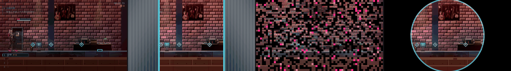
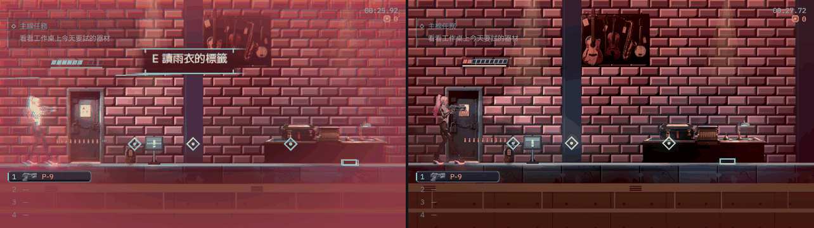
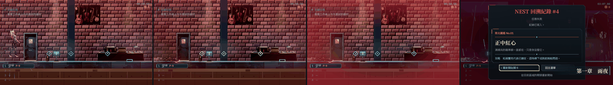
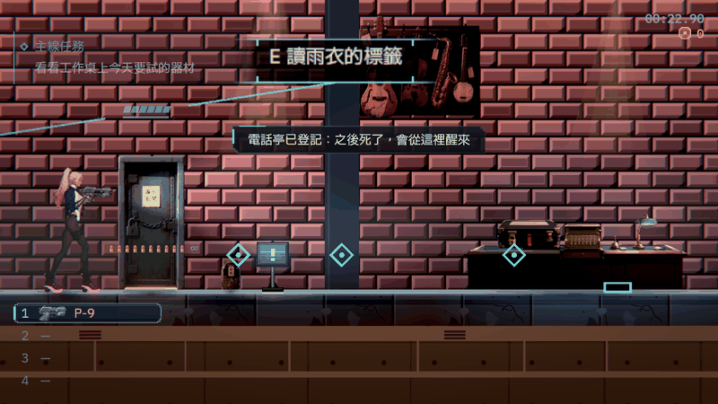
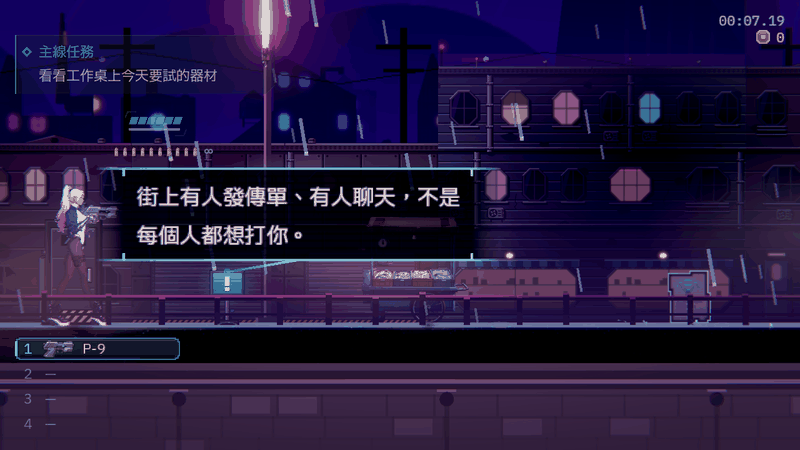
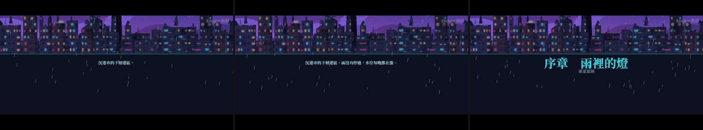
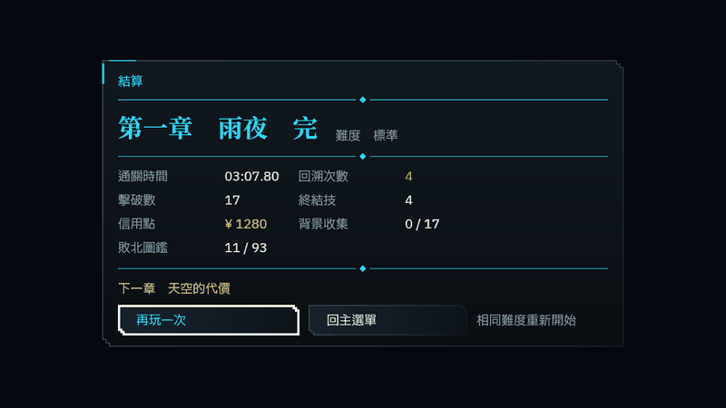
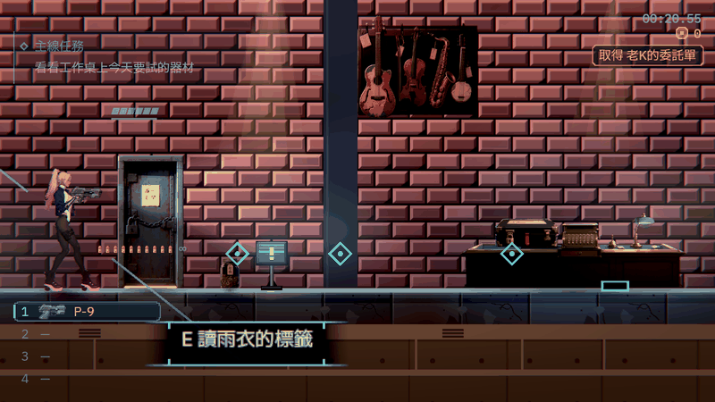
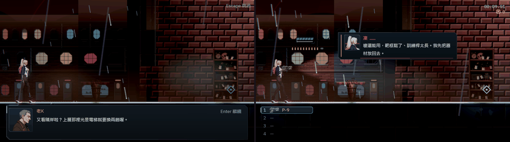
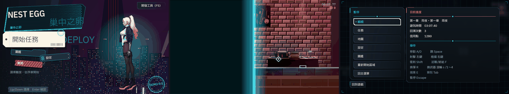

# 演出總檢

2026-11-28 第一版（NE-425）。範圍：開新遊戲到第一章結束，用第一章的真實資料在 Forward+ 實機拍攝。之後擴到其餘章節，每次補拍更新這份文件。

評等：

- **好**：設計過、和這個世界的語言一致，不用動。
- **可用**：沒有大問題，但有更好的做法；排在後面。
- **簡陋**：功能有，但看得出是預設值或第一版；要重做。
- **濫竽充數**：引擎預設、過度或和遊戲無關的東西；最優先處理或拿掉。

排序：依「最簡陋且最常被看到」——評等越差、一輪遊戲裡出現越多次的排越前面。屬於演出線的項目依這個順序一項一張票；其他線的項目只列出，由主 session 轉交。

參考來源：章節與地點的做法在 NE-421 查證過（見 `PRESENTATION.md`）；受傷、死亡、檢查點、瀕死的同類遊戲手法是業界常見做法的整理，逐項開票時再查證細節並寫進該票。

重拍：`--scenario=presentation_audit`（轉場、受傷、死亡、序章、對話、通訊、拾取、檢查點、街道入口）、`--scenario=presentation`（地點標示、章末、暫停、主選單）、`--scenario=screens`（主選單、暫停、死亡、結算、設定、背包、圖鑑）。

## 總表

| # | 時刻 | 出現頻率 | 評等 | 現況（一句話） | 歸屬 |
|---|---|---|---|---|---|
| 1 | 轉場（區域之間、章節之間、死亡重來、讀取） | 每次換區域、每次死亡 | 簡陋 → 可用（NE-427 統一；死亡重來待第 3 項） | 五種互不相干的轉場（淡出、青色掃描、灰色電梯門、洋紅雜訊、圓形光圈），沒有一致的語言；死亡用的雜訊整面閃爍 | 演出 |
| 2 | 受傷 | 每次被打中 | 簡陋 → 好（NE-471） | 被打中時整個畫面疊一層紅（約兩成落在畫面中央）並加色散，戰鬥中每次被打都蓋住判讀 | 演出 |
| 3 | 死亡與重來 | 每次死亡 | 簡陋 | 倒地後整個畫面慢慢變紅，接著是方框死亡畫面與洋紅雜訊轉場；三段各說各的 | 演出（死亡畫面版面歸畫面線） |
| 4 | 檢查點（電話亭登記） | 每個電話亭 | 簡陋 | 畫面上方中央一塊小方框橫幅寫一句說明，和教學看板擠在一起；電話亭本身沒有回應 | 演出 |
| 5 | 教學提示看板 | 序章與第一章前段很多次 | 簡陋 | 「!」看板展開成佔畫面四分之一的大方框，蓋在場景與角色上 | 畫面（已轉交） |
| 6 | 瀕死 | 戰鬥中常見 | 可用 → 好（NE-471；心跳聲另開） | 修前：整個畫面染成粉紅並脈動，在紅色調的場景（磚牆）裡反而看不出來；沒有聲音提示 | 演出 |
| 7 | 開場與標誌 | 每次啟動 | 濫竽充數 | 沒有設定開機畫面，啟動時顯示引擎預設的開機圖 | 演出 |
| 8 | 序章開場 | 一次 | 簡陋 | 天際線只佔上面三成，下面七成是空的暗色，旁白小字置中；「序章　雨裡的燈」是另一種標題樣式 | 演出（鏡頭與構圖）、畫面（舞台美術）、故事（文字） |
| 9 | 結算 | 每章一次 | 簡陋 | 一塊方框列出數字，畫面大半是空的；沒有進場的節奏 | 畫面（版面）、演出（進場節奏） |
| 10 | 拾取與任務更新 | 很多次 | 可用 | 右上角黃色小標籤「取得 老K的委託單」，不擋戰鬥；任務更新只有左上的目標文字換掉，沒有「更新了」的瞬間 | 演出 |
| 11 | 對話 | 很多次 | 可用 | 底部整條方框、左邊頭像；清楚但和拼貼語言不一致 | 畫面（版面）、故事（文字） |
| 12 | 通訊 | 很多次 | 可用 | 畫面中段的通訊卡片（頭像＋兩行字），清楚；位置有時蓋住前方的路 | 畫面 |
| 13 | 主選單進遊戲 | 每次開始 | 可用 | 主選單是拼貼版面（NE-412）；進遊戲用青色掃描線轉場 | 演出（轉場併入第 1 項） |
| 14 | 暫停、死亡畫面 | 常見 | 可用 | 方框面板，資訊清楚；章節與地點已寫進暫停（NE-421） | 畫面 |
| 15 | 章節與地點 | 每個區域 | 好 | 右下角雙語路牌、回訪短版、角色進來時讓開（NE-421、NE-422） | 演出 |
| 16 | 章節結束 | 每章一次 | 好 | 黑底章末畫面：序號、大字章名、「完」印、下一步（NE-421、NE-422） | 演出 |
| 17 | 存讀檔 | 每次開啟 | 好 | 主選單「繼續遊戲」寫出章節與地點（NE-421） | 演出 |
| 18 | 頭目登場與擊敗 | 第二章起 | 待拍 | 第一章沒有頭目（兩個頭目敵人都不在第一章的區域裡）；下一版從第二章拍 | 演出、敵人與頭目 |
| 19 | 地圖上的氣泡 | 很多次 | 待拍 | 氣泡要等講者在畫面裡才出現，這一版沒拍到 | 演出 |
| 20 | 商店與改裝的進出場 | 每次回當舖 | 待拍 | 這一版沒拍 | 演出（進出場）、畫面（版面） |
| 21 | 過場的鏡頭與走位 | 每段過場 | 待拍 | 序章的開門過場拍了三格；其餘過場的走位與鏡頭下一版逐段看 | 演出 |

## 逐項

### 1. 轉場

- **現況**：區域之間淡出（0.45 秒）、主選單進遊戲是青色掃描線、章節之間是兩片灰色電梯門、死亡重來是整面洋紅色像素雜訊、讀取是圓形光圈。五種各自為政；電梯門是素面灰板，光圈是很老的手法，雜訊整面閃爍（「減少閃光」要確認有效）。
- **同類遊戲**：Hollow Knight 房間之間一律很短的黑色淡出，玩家幾乎不會注意到；Celeste 每一章固定一種擦除，章內一致；Dead Cells 用一段「通道」房間代替轉場畫面。共同點是**一種主要轉場，特殊轉場只用在有意義的地方**。
- **處理**：區域之間統一成一種短的轉場（淡出加一點這個世界的質感，例如雨幕或掃描線，0.3 秒級）；章節之間的電梯門換成有畫面內容的過場或沿用章末畫面的黑底；死亡重來的雜訊收斂成短而克制的「回溯」效果（見第 3 項）；光圈移除。「減少動態」與「減少閃光」逐一確認。

### 2. 受傷

- **現況**：被打中時疊一層紅色閃光（`data/feel/screen_fx.json` 的 hurt：強度 0.26、八成往邊緣、兩成在中央）加色散與暗角，0.28 秒。
- **同類遊戲**：Hollow Knight 被打中時短暫停格、角色閃白、畫面邊緣出現裂痕；Dead Cells 畫面邊緣短暫泛紅；多數動作遊戲不會整片染色，因為會蓋掉判讀。
- **處理**：改成極短的停格、角色本身閃一下、畫面邊緣淡淡的紅色暈影；整片染色拿掉。「減少閃光」時不閃。

### 3. 死亡與重來

- **現況**：倒地 → 整個畫面慢慢變紅 → 方框死亡畫面（「NEST 回溯紀錄 #4」與敗北圖鑑）→ 洋紅雜訊轉場重來。
- **同類遊戲**：Celeste 死亡到重來不到一秒，用一個圈收起再展開；Katana ZERO 把死亡做成錄影帶倒帶（「不，這樣行不通」），和世界設定綁在一起；Hollow Knight 死亡有一段短的崩解再淡出。
- **處理**：這個遊戲的死亡是「NEST 回溯」——取 Katana ZERO 的手法，把倒地到重來做成一段短的回溯（畫面掃描、時間碼倒轉），和死亡畫面的「回溯紀錄」接成同一件事；整片變紅拿掉。死亡畫面的版面歸畫面線。

### 4. 檢查點

- **現況**：登記電話亭後，畫面上方中央出現一塊小方框橫幅：「電話亭已登記：之後死了，會從這裡醒來」。
- **同類遊戲**：Hollow Knight 坐上長椅、角色有動作、長椅本身亮起；Dark Souls 點燃篝火時有一行置中的大字，但只在第一次；Celeste 沒有任何文字。共同點是**回應發生在檢查點本身**。
- **處理**：電話亭自己回應（燈亮、話筒掛回、印出一張小收據）；說明句第一次出現在電話亭上的世界提示，之後只剩電話亭的回應，中央橫幅拿掉。

### 5. 教學提示看板（畫面線）

- **現況**：「!」看板展開成很大的方框，蓋住場景中段與角色前方。
- **處理建議**：縮小、靠近看板、只留一句；已轉交畫面線。

### 6. 瀕死

- **現況**：生命剩三分之一以下時，畫面邊緣有暗紅色的脈動暗角（「減少閃光」時脈動較小）；見第 2 項的第二格，在紅色調的場景裡幾乎看不出來。沒有聲音提示。
- **同類遊戲**：Hollow Knight 剩最後一格時面具裂開、有心跳聲；多數遊戲用畫面邊緣去飽和或暗角。
- **處理**：暗角改成和場景色調無關也看得出來的處理（邊緣去飽和加暗，而不是只加紅），加上很低的心跳聲；回血後退回。「減少閃光」時不脈動。

### 7. 開場與標誌

- **現況**：專案沒有設定開機畫面，啟動時是引擎預設的開機圖，接著直接進主選單。
- **同類遊戲**：多數獨立遊戲啟動時是黑底一個很小的工作室或遊戲標誌、一兩秒淡入淡出，或直接淡入主選單。
- **處理**：開機畫面換成黑底（不顯示引擎圖），主選單從黑淡入；如果之後有遊戲標誌，做成一兩秒的淡入淡出。

### 8. 序章開場

- **現況**：天際線佔上面三成，下面七成是空的暗色，旁白小字置中；接著「序章　雨裡的燈」大字。
- **同類遊戲**：Inside、Limbo 開場沒有任何字；Hollow Knight 開場是一首置中的詩，背景全黑、字是唯一的主角。
- **處理**：構圖二選一——全黑底只有字（字是主角），或讓舞台佔滿畫面、字放在畫面下方三分之一的安全區；序章標題和章末畫面用同一套字體層級。文字內容不動（故事線）。

### 9. 結算

- **現況**：一塊方框列出時間、擊破數、信用點；畫面大半是空的，直接出現。
- **同類遊戲**：Celeste 章節完成畫面逐項數上來（草莓、死亡數），有節奏；Katana ZERO 結算前重播整關。
- **處理**：版面歸畫面線；演出線負責進場節奏（承接章末畫面的黑底、數字逐項數上來）。

### 10. 拾取與任務更新

- **現況**：右上角黃色小標籤，不擋戰鬥，清楚。任務換目標時，左上的目標文字直接換掉，沒有「更新了」的瞬間。
- **同類遊戲**：Hollow Knight 撿到東西時物品圖示在畫面角落短暫放大；多數遊戲任務更新時目標列閃一下並有短音效。
- **處理**：任務更新時目標列有一個短的「蓋章」或掃描動畫與音效；拾取維持現狀，補上物品圖示。

### 11～14. 對話、通訊、主選單進遊戲、暫停與死亡畫面

- 對話框是底部整條方框，通訊是畫面中段的卡片；都清楚可讀。版面歸畫面線（拼貼語言推廣，BACKLOG 畫面第 5 項）。
- 主選單已是拼貼版面；進遊戲的轉場併入第 1 項。

### 15～17. 好的項目

地點標示、章末畫面、存檔欄位的章節名（NE-421、NE-422）。圖見那兩張票。

### 18～21. 待拍

- 頭目登場與擊敗：第一章沒有頭目；下一版從第二章的頭目拍登場、血條、階段轉換、擊敗。
- 地圖上的氣泡：要等講者在畫面裡；下一版把主角擺到講者旁邊再播。
- 商店與改裝：從當舖櫃檯打開商店，拍開啟與關閉。
- 過場的鏡頭與走位：逐段看第一章的過場（開門、老K、阿麗、診所、回家），記下鏡頭與走位不自然的地方。

## 演出線的處理順序

依上表，演出線一項一張票：

1. 轉場統一（第 1 項，含主選單進遊戲）
2. 受傷與瀕死的回饋（第 2、6 項）
3. 死亡與重來做成「回溯」（第 3 項）
4. 檢查點回應在電話亭上（第 4 項）
5. 開機畫面（第 7 項）
6. 序章開場的構圖（第 8 項）
7. 任務更新的回饋（第 10 項）
8. 結算的進場節奏（第 9 項，和畫面線的版面一起）
9. 頭目登場與擊敗、氣泡、商店進出場、過場走位（補拍後排入）
