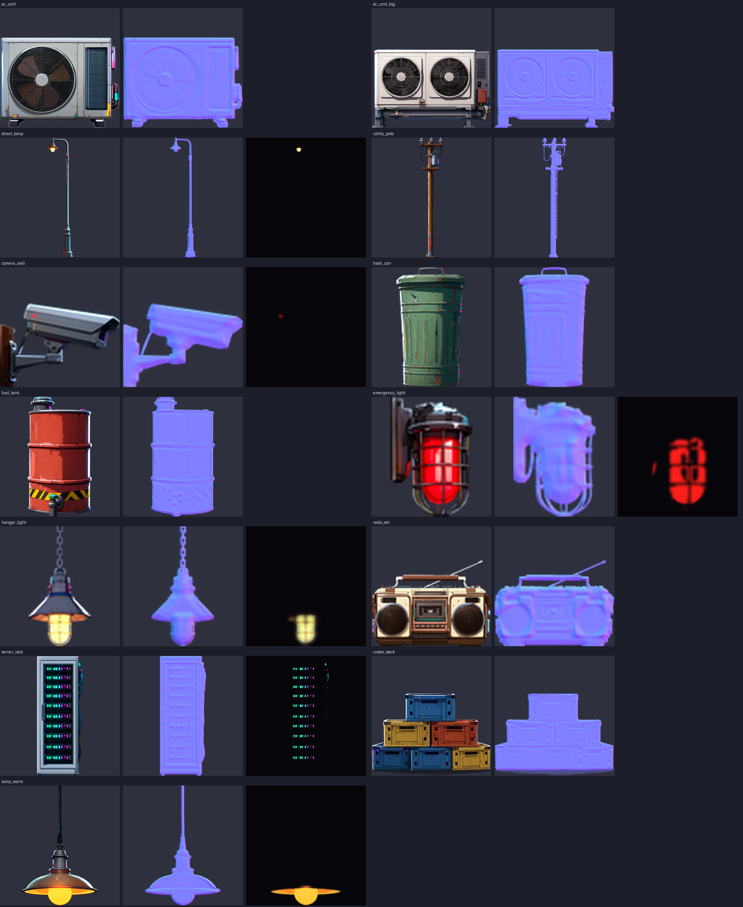
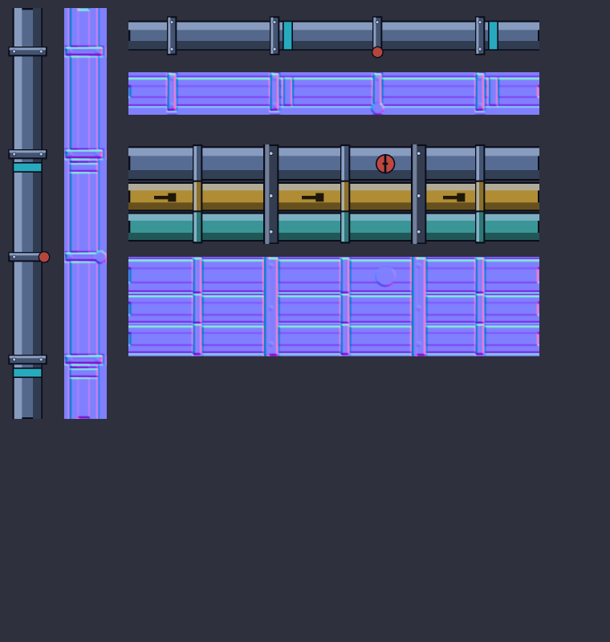
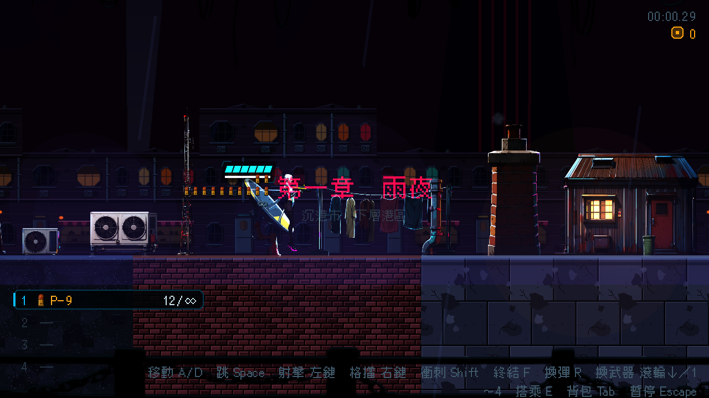
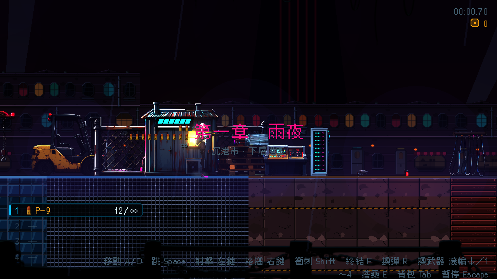

# [BG-10] 改用賽璐璐畫風重做模型渲染的舊道具

> 狀態：完成

## 內文

### 需求
有 16 件道具還是 Poly Haven 3D 模型渲染出來的寫實圖：冷氣室外機（兩種）、路燈、電線桿、牆上攝影機、垃圾桶、燃料桶、牆上緊急燈、機庫燈、收音機、電箱、貨箱、吊燈、三種管線（垂直、水平、設施）。其他道具、立面、天空都已改成賽璐璐畫風（NE-62、63，BG-1～4），這 16 件放在同一個畫面裡像貼了照片。改成同一畫風：平塗色塊、乾淨的深色描邊、硬邊雙色陰影、冷白輪廓光，依真實尺寸放大，仍有法線與自發光層，路燈與各種燈的光源位置與閃爍行為不變。

### 來源
2026-10-04，使用者要求繼續做場景與物件的賽璐璐化；BG-1～4 完成後盤點道具，發現這 16 件沒有被任何票涵蓋（BG-7 只處理室內類道具）。

### 驗收條件
- [x] 16 件道具全部改為賽璐璐畫風，依真實高度換算尺寸，畫廊逐個看過
- [x] 每個道具有法線貼圖；路燈、緊急燈、機庫燈、吊燈、攝影機的自發光層與光源位置保留
- [x] 擺放資料不需要改，第一章與第二章擺了這些道具的區段外觀正常，不遮擋敵人、子彈與危險物
- [x] 過場舞台與立面上用到的管線、冷氣機仍正常顯示

### 測試流程
1. 開道具畫廊逐個檢查
2. 從頭玩第一章與第二章，確認這些道具的外觀與光源
3. 執行環境元件、道具相關測試套件

---

# 跟其他票的關係

- Blocks：NE-66
- Blocked by：無
- Related：BG-1、BG-7、NE-62、NE-63

---

# Commit-1

## 內文

16 件模型渲染的舊道具還是寫實圖，放在賽璐璐的畫面裡像貼了照片。13 件（兩種冷氣機、路燈、電線桿、牆上攝影機、垃圾桶、燃料桶、緊急燈、機庫燈、收音機、電箱、貨箱、吊燈）改用本機 AI 以賽璐璐畫風生成，依真實尺寸放大（路燈、電線桿與燈類維持原本高度）；三種管線（直管、橫管、設施管束）又長又細，改用程式繪製，維持直線與原本長度。法線與自發光層保留，路燈與各種燈的光源位置與閃爍照舊；牆上攝影機的紅燈與電箱的指示燈新增了自發光層。電箱高度由 40 增為 51 像素（真實 1.7 公尺）。
驗收：道具畫廊逐個看過（畫廊補進了之前漏掉的 25 個道具）；擺了這些道具的第一章區段、過場舞台與立面的外觀看過；環境、道具與過場動畫相關測試套件通過，包含前層道具不遮敵人、擺放不卡進地形的檢查。

### 測試結果

| 項目 | 結果 |
|---|---|
| 相關測試套件（環境元件、道具、過場動畫、第二章、轉場） | 通過 1518 / 1518 |
| 素材檢查（大小與總量） | 通過（環境素材 22.8 MB／60 MB，單檔最大 0.6 MB） |
| 執行 log | 無非預期的 ERROR |

### 截圖

