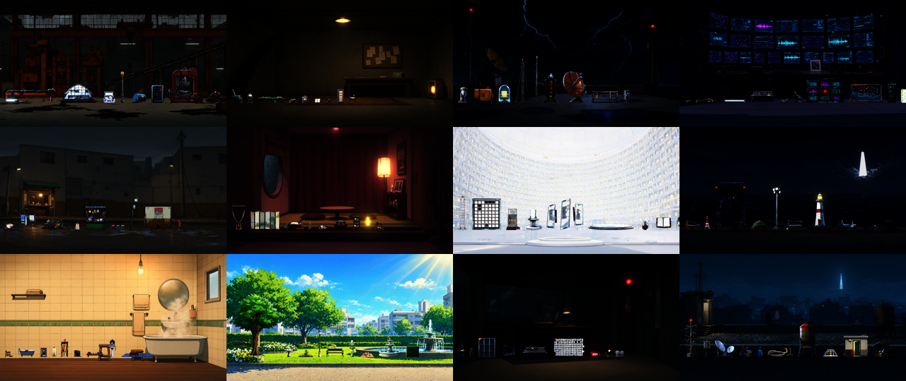

# [BG-11] 依劇情大綱建立各場景的背景與專屬物件包

> 狀態：進行中

## 內文

### 需求
故事 v2 的大綱（`design/13-story-v2/OUTLINE.md` 第 5 節）列出九章預計出現的場景（當舖、港區街道、碼頭倉庫、霓虹市集、夾層、日照區、病房與廢棄廠房、地下室、廣播站、花園、水閘廳、洪水街道、天穹塔、帳房、各結局場景……），但美術只有第一章的幾個舞台與通用道具。為每個場景畫出場景背景，並設計該場景專屬的物件（先每個場景 3 個，之後輪流各加 1 個，直到每個場景 10 個），讓之後做關卡、據點與演出時有現成的素材，場景之間的氣氛（夜雨、陰、白天、唯一的晴天）與物件各有特色。物件放在各場景自己的資料包，不混進共用的道具庫。

### 來源
2026-10-04，使用者要求：「從 OUTLINE.md 看目前預計的場景有哪些，畫出場景，然後根據不同場景設計不同物件（先每個場景 3 個，如果還沒有其他事情做，就輪流每個場景新增一個物件下去直到每個場景都 10 個為止）」。

### 驗收條件
- [x] 大綱第 5 節列出的每個場景（同一地點不同章節的狀態只算一個場景）都有一張賽璐璐畫風的場景背景，色調與光符合該章的天氣與氛圍（5.1 表）
- [ ] 每個場景至少 3 個專屬物件，並逐步補到 10 個；物件貼合場景與劇情，謎題道具與伏筆物件畫得與劇本一致
- [ ] 每個物件有法線貼圖，會發光或有動畫的有自發光層與動畫欄位，尺寸依真實高度換算
- [x] 登記表記錄每個場景的物件清單與進度，可以接續做
- [x] 場景包的素材總量在預算內，場景包不影響共用道具庫與既有關卡
- [x] 道具畫廊或預覽逐場景看過

### 測試流程
1. 開場景預覽，逐個場景檢查背景與物件
2. 執行環境元件、道具相關測試套件，確認共用道具庫與既有關卡不受影響
3. 檢查素材大小與總量

---

# 跟其他票的關係

- Blocks：無
- Blocked by：無
- Related：BG-5、BG-7、BG-10、NE-55

---

# Commit-1

## 內文

大綱第 5 節的場景有了背景與專屬物件：43 個場景（同一地點不同章節的狀態合併成一個場景，變體記在登記表）各有一張賽璐璐畫風的場景背景，亮點抽成發光層，白天章節用明亮的日光風格；394 個專屬物件，每個場景 9 個左右（階段 1 每場景 3 個全部完成，階段 2 輪流補到第 7 輪），放在各場景自己的資料包，不混進共用道具庫。使用者決定素材先做到這裡，剩下 36 個物件（每個場景的第 10 個）與少數不理想的物件登記在登記表，之後可接續。
場景包預覽逐場景檢查：43 個場景全部載入、395 個物件資料與貼圖都沒有缺漏。登記表另外記了重生 3 次仍不理想的物件（例如倒地的椅子畫成站立、帳房碎片與藤架中間有底色）、尺寸偏大或偏小需要在遊戲裡確認的物件，以及白色背景場景不抽發光層的原因。素材量 96.7 MB（場景包上限 160 MB）。
還沒做：每個物件在真實場景光影下的逐項檢查、場景環境主題指向資料包（等實際做關卡時一併做）、補到每個場景 10 個，所以票維持進行中。

### 測試結果

| 項目 | 結果 |
|---|---|
| 場景包預覽（43 個場景） | 全部載入，缺圖 0 |
| 素材檢查（大小與總量） | 通過（共用 23.4 MB、場景包 96.7 MB） |

### 截圖

