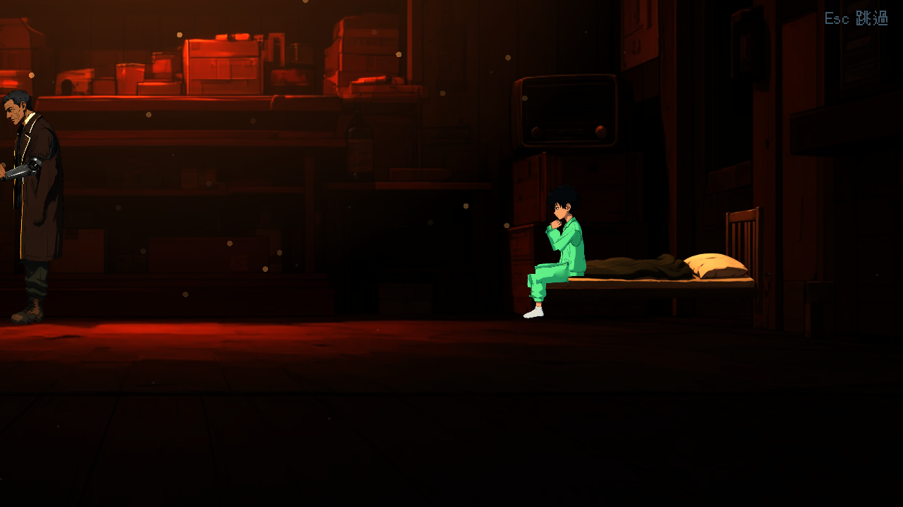
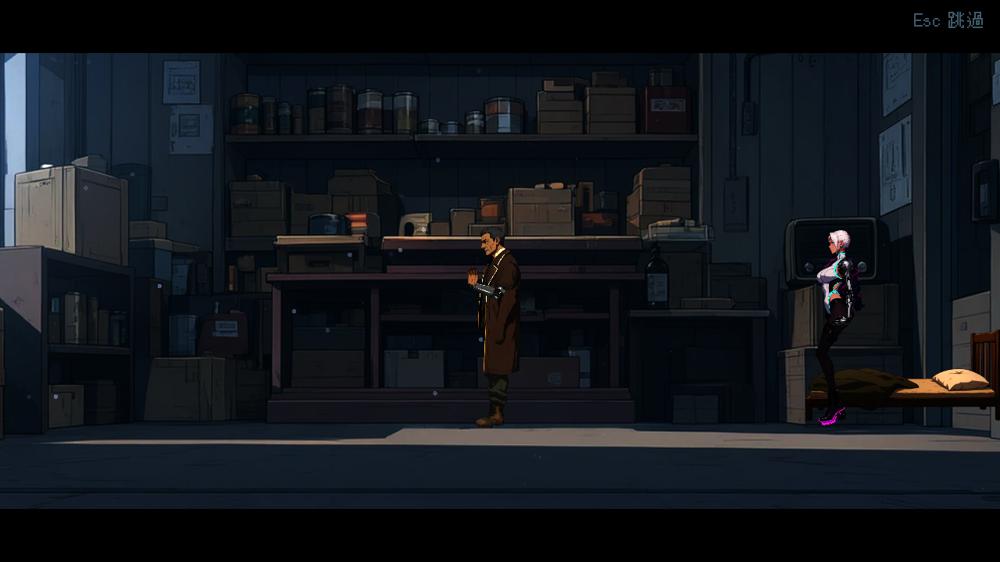

# [BG-11] 過場舞台補上老 K 舖子的床

> 狀態：完成

## 內文

### 需求
老 K 舖子的過場舞台沒有床，航的過場演出目前讓他坐在箱子前，位置自然但不是真的坐在東西上。要在舞台圖補上一張床（位置約在舞台座標 x=520），讓航坐在床上的演出成立，畫風與其他室內舞台一致。

### 來源
2026-10-04，NPC 場景內驗證（NE-85）：航的專屬動作是坐在床上、咳嗽、拉被子，但過場舞台沒有床。

### 驗收條件
- [x] 舞台上有一張符合室內舞台畫風的床，位置與航的坐姿吻合，身體落在床上、腳不穿過床
- [x] 航坐在床上時咳嗽與拉被子的動作不穿幫，被子與航的圖層順序正確
- [x] 床與舞台既有的燈光、陰影與視差一致，鏡頭推拉時沒有接縫
- [x] 使用到老 K 舖子舞台的所有過場動畫仍能完整播放，略過鍵正常

### 測試流程
1. 預覽老 K 舖子舞台，確認床的位置與畫風
2. 播放有航的過場動畫，確認坐姿與動作
3. 執行過場動畫相關測試套件

---

# 跟其他票的關係

- Blocks：無
- Blocked by：無
- Related：NE-85、BG-5

---

# Commit-1

## 內文

老 K 舖子的過場舞台沒有床，航坐在半空中。現在補了一張兒童單人床（賽璐璐畫風，由 `qwen_scenes.py` 生成，清單 `old_k_shop_bed`），床墊面對齊「坐姿」的臀部高度（舞台 y≈277），床尾在 x=500，小腿懸在床外、不穿過床；被子在床上、航坐在被子上，拉被子與咳嗽只動手臂與身體，不穿幫。床是舞台背景之後、角色之下的一層圖，隨鏡頭與背景一起推拉，沒有接縫。
第二章清晨舞台（凜問「航呢」）補了空床版本（`old_k_shop_dawn_bed`）：被子掀開成一團、枕頭有凹痕，呼應航不在。
驗收：第一章、第二章兩段過場全程截圖看過；過場與環境套件通過。

### 測試結果

| 項目 | 結果 |
|---|---|
| CutsceneSuite、ChapterCutscenesSuite、EnvironmentSuite | 檢查 1250、失敗 0 |
| 過場全程截圖（cut_c1_shop、cut_c4_dawn） | 播完、無新增 ERROR |

### 截圖

