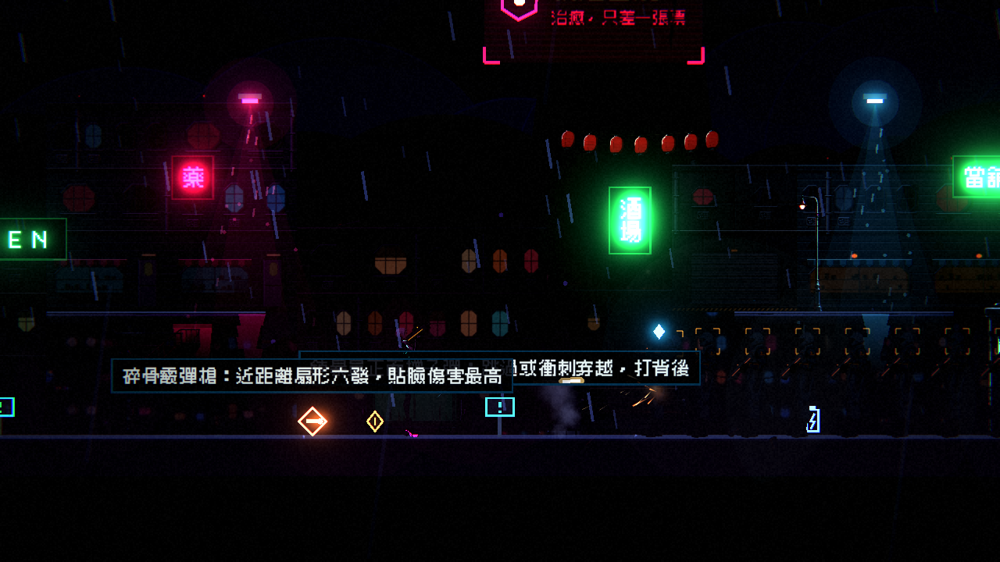
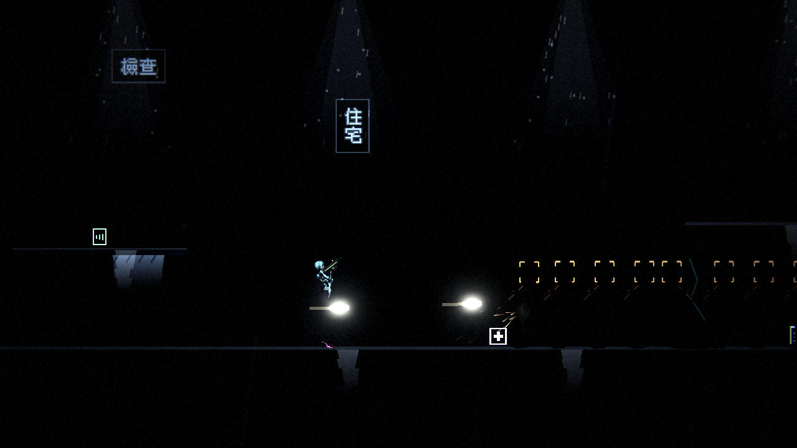
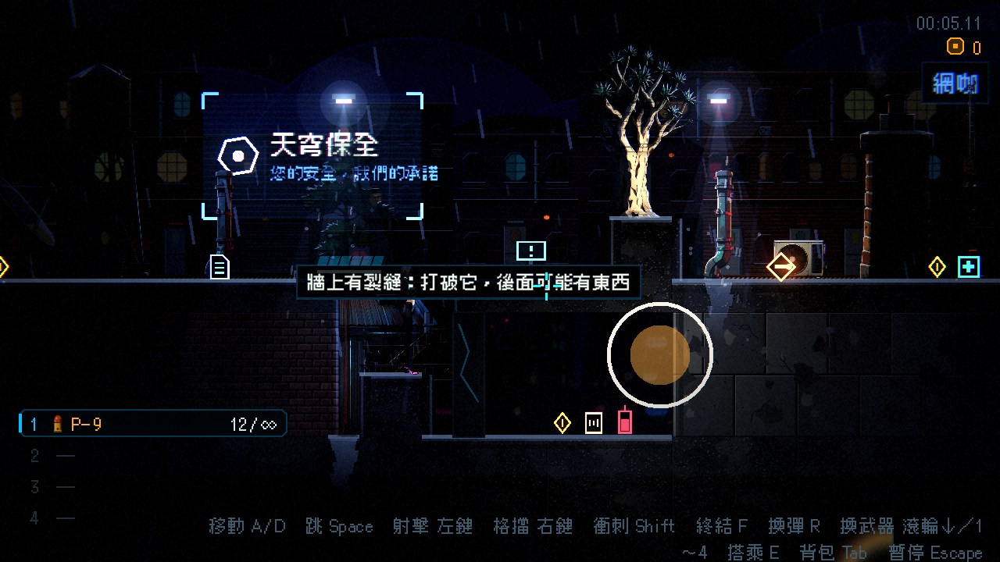

# [BG-12] 建立戰鬥光影與粒子的負載量測基準

> 狀態：完成

## 內文

### 需求
不知道戰鬥時光影與粒子到底吃多少效能：畫面上有多少繪製呼叫、多少光源、粒子場有多少顆、每影格幾毫秒，敵人變多時怎麼成長。沒有數字，之後加光源、粒子或場景物件時沒有依據判斷有沒有變慢。建立一個可重複的量測情境：玩家對一排敵人連續開火（真子彈、真受擊與死亡），在空曠場地與真實關卡的密集區段各量一次，印出每影格處理時間（關閉垂直同步）、繪製呼叫、光源數與粒子數，並把基準數字寫進光影設計文件。

### 來源
2026-10-04，使用者要求透過遊戲引擎觀察遊戲中擊中物件、光影與粒子是如何運作的，有問題或可以補強的就開票。

### 驗收條件
- [x] 有一個指令能在空曠場地或指定關卡的指定欄位跑戰鬥負載量測，輸出每項指標的最小、平均、最大值與節點類別統計
- [x] 量測時垂直同步與幀率上限關閉，截圖的瞬間不計入每影格耗時的結論
- [x] 基準數字（空場地 0、5、10、20 隻敵人，第一章霓虹市集與貨運站，第二章夾層）寫進光影設計文件
- [x] 列出量到的問題與可補強的項目，各自開票

### 測試流程
1. 執行量測情境並確認輸出
2. 把基準數字與觀察寫進設計文件

---

# 跟其他票的關係

- Blocks：無
- Blocked by：無
- Related：NE-21、NE-24、NE-95

---

# Commit-1

## 內文

不知道戰鬥時光影與粒子吃多少效能。新增「戰鬥負載量測」情境：玩家對一排敵人連續開火（真子彈、真受擊與死亡），在空曠場地或真實關卡的指定欄位量測，關閉垂直同步，每 0.5 秒取樣每影格時間、繪製呼叫、畫面物件數、節點數、光源數（全部、預算管理、啟用、陰影）、粒子存活數，結束時印出最小、平均、最大值與可見節點的類別統計。
量到的基準寫進光影設計文件：空場地 5.6 ms、10 隻敵人 7 ms；第一章霓虹市集 8.2 ms、貨運站 6.7 ms；第二章夾層最重，12.4 ms（p95 16.7 ms）。一個畫面內的骨架角色約 26 次繪製呼叫；光源預算有效（78 盞受管理的燈只啟用 7～14 盞）；粒子場戰鬥中存活 20～130 顆、沒有成長。量測也發現暗場中敵人幾乎全黑（開了 BG-13），並為大綱的場景開了光影預設與場景包預覽兩張票（BG-14、BG-15）。
驗收：對空場地與兩個關卡的三個位置各量過一次以上，輸出的卡頓全部落在截圖瞬間，不是遊戲本身的卡頓。

### 測試結果

| 項目 | 結果 |
|---|---|
| 量測情境 | 7 組情境全部跑完並輸出 |
| 相關測試套件 | 沒有改動遊戲程式，未重跑 |
| 執行 log | 無非預期的 ERROR |

### 截圖

