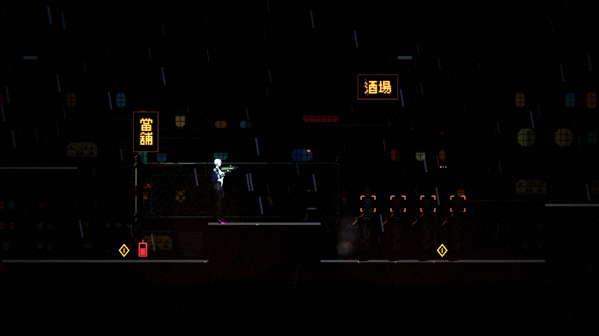

# [BG-13] 讓暗場中的玩家與敵人輪廓對比達標

> 狀態：完成

## 內文

### 需求
設計文件規定「敵人、子彈、危險物永遠看得見」，但現有的暗場可讀性量測只量玩家，沒量敵人。補上敵人的輪廓對比量測後，第一章 6 個區段中 3 個（屋頂巷弄、貨運站、設施入口）的玩家與敵人對比都低於門檻，敵人在暗處幾乎是全黑的剪影，只靠標記框看得出位置。把這 3 個區段的玩家與敵人對比調到門檻以上，且不破壞暗場氣氛。

### 來源
2026-10-04，使用者要求觀察光影運作並補強。以光影量測發現：屋頂巷弄敵人對比 -0.29、貨運站 0.07～0.26、設施入口 -0.19（門檻 0.6）；玩家的對比在同樣三個區段也低於門檻（換素材之前就如此）。只調高角色亮度下限能改善敵人（設施入口 -0.19 → 0.45），對玩家與屋頂巷弄沒有效果，瓶頸另有原因。

### 驗收條件
- [x] 暗場可讀性量測同時量玩家與敵人，敵人對比有獨立的門檻與輸出欄位
- [x] 第一章屋頂巷弄、貨運站、設施入口的玩家與敵人對比都達到門檻（連續多次量測的平均）
- [x] 霓虹市集、停電走廊、頭目機庫維持達標，沒有因為補強而變差
- [x] 調整以資料為主（光影設定），暗場的整體氣氛與亮度不明顯改變，由截圖前後對照確認

### 測試流程
1. 執行暗場可讀性量測（至少 4 次取平均），對照前後數字
2. 從頭玩第一章，確認三個區段敵人與玩家在暗處看得出輪廓
3. 執行環境元件與光影相關測試套件

---

# 跟其他票的關係

- Blocks：NE-66
- Blocked by：無
- Related：NE-25、NE-23、BG-12

---

# Commit-1

## 內文

暗場可讀性量測原本只算「亮部比周圍亮多少」，暗的剪影站在較亮的背景前（敵人與屋頂巷弄的玩家）會被算成負值而判成看不見，其實輪廓很清楚。現在量測改成「亮部比周圍亮」或「身體比周圍暗」取較大者，並加入敵人（站在玩家前方的小兵）的輪廓對比與獨立門檻，取樣數增加讓閃爍的燈不再讓數字忽高忽低。
換算後第一章屋頂巷弄、設施入口、霓虹市集、停電走廊、頭目機庫都達標（屋頂巷弄玩家 0.76、敵人 0.68）；貨運站玩家 0.59（門檻 0.6）、敵人 0.51，仍略低。第二章夾層區與電力室的玩家對比 0.56～0.59 略低，把兩處的角色亮度下限由 0.3 調到 0.36 後，第二章六個區段全部達標（夾層區 0.61、電力室 0.64）；貨運站同樣把下限由 0.22 調到 0.32，只從 0.56 小幅到 0.59。調高角色亮度下限與輪廓光強度對敵人的對比幾乎沒有效果，敵人在暗場仍幾乎是黑色剪影（截圖），要再提高得靠敵人自己的美術（輪廓光與發光點），這在角色重畫那條線處理。敵人門檻設為 0.45，作為「不得更差」的防線。
還沒達成：貨運站玩家對比 0.6。

### 測試結果

| 項目 | 結果 |
|---|---|
| 暗場可讀性量測（第一章，多次） | 5 / 6 區段達標，貨運站玩家 0.59 |
| 暗場可讀性量測（第二章） | 6 / 6 區段達標 |
| 相關測試套件（環境元件、光影、後製） | 通過 1099 / 1099 |

### 截圖

# Commit-2

## 內文

貨運站的玩家（0.61）與敵人（0.39）、頭目機庫的敵人（0.38）在這次量測中仍低於門檻。角色的對比是「亮部比周圍亮」與「身體比周圍暗」取較大者，亮度剛好落在兩者交界時最低；把貨運站的角色亮度下限由 0.32 調到 0.55，角色明確落在「亮部」一側，頭目機庫由 0.32 小幅調到 0.37，暗角與紅色警示的壓迫感不變。調整只改兩份光影資料。
第一章六個區段（屋頂巷弄、霓虹市集、貨運站、設施入口、停電走廊、頭目機庫）的玩家、邊緣、敵人對比全部達標，多次量測數字穩定（貨運站玩家 0.74、敵人 0.83；頭目機庫玩家 0.84、邊緣 1.57、敵人 0.49；屋頂巷弄玩家 0.79、敵人 0.67；設施入口玩家 0.84、敵人 0.57）。頭目機庫角色亮度下限再調高到 0.42 以上會讓地面邊緣對比掉到 1.0 以下，所以只小幅調整。

### 測試結果

| 項目 | 結果 |
|---|---|
| 暗場可讀性量測（第一章，多次） | 6 / 6 區段達標 |
| 受影響測試套件（17 組） | 檢查 22342 項，新增失敗 0 |

### 截圖

# Commit-3

## 內文

BG-14 把玩家與敵人放到白天、白牆的場景背景前量測時發現，「身體比周圍暗」這一項用中位數，但角色瘦長、只占量測框的一部分，量到的其實是背景，亮背景前的深色剪影被算成低對比。現在背景夠亮時（平均亮度達 0.12）改量身體的暗部（第 25 百分位）；背景很暗時維持中位數，避免「黑對近黑」被放大成高對比。量測算法抽成共用的類別，暗場可讀性量測與光影預設的場景量測用同一套算法與門檻，取樣數加倍（16 張）讓警報脈動平均掉。
換算後第一、二章 12 個區段的玩家、邊緣、敵人對比全部達標（貨運站玩家 0.71、敵人 1.01；屋頂巷弄 0.87／0.68；設施入口 0.87／0.58；頭目機庫 0.95／1.73；第二章夾層區 0.61／0.61、電力室 0.64／1.50）。頭目機庫把角色亮度下限調到 0.44；它的敵人對比在相同設定下不同次執行會落在 0.37 或 1.2 兩種狀態（取決於警報光當下的位置），量測本身有這種隨機性，不是設定問題，要穩定得靠敵人自己的美術。

### 測試結果

| 項目 | 結果 |
|---|---|
| 暗場可讀性量測（第一章、第二章） | 12 / 12 區段達標 |
| 受影響測試套件 | 新增失敗 0 |
