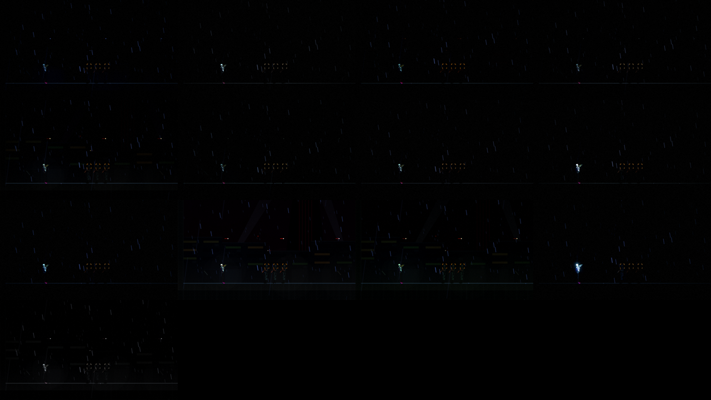
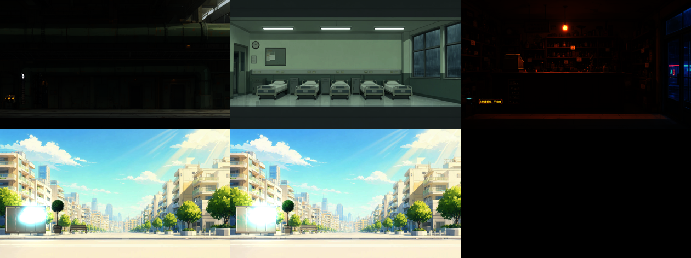
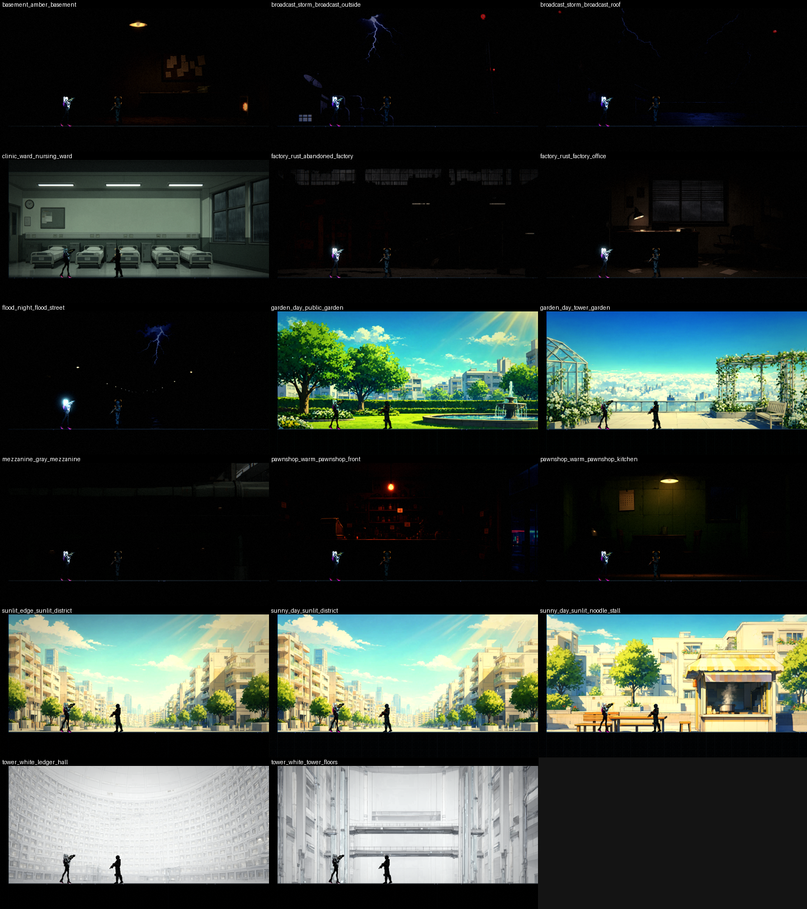

# [BG-14] 依章節畫面進程建立光影預設

> 狀態：完成

## 內文

### 需求
大綱（`design/13-story-v2/OUTLINE.md` 5.1）規定九章的天氣、主色調與光：第 3 章第一次看到隔著玻璃的陽光、第 7 章唯一的晴天與全作最亮的畫面、第 8 章暴風雨與洪水、第 9 章塔內冷白。目前的光影設定只有第一、二章用到的 13 組（屋頂、市集、貨運站、機庫、夾層……），沒有白天、陽光、洪水夜、塔內冷白這些。依 5.1 表建立缺的光影預設，讓之後的關卡與場景背景直接套用，且仍通過暗場可讀性守則。

### 來源
2026-10-04，BG-11 為大綱的每個場景畫背景與物件，場景要有對應的光影才能預覽與使用；使用者要求補強光影相關的內容。

### 驗收條件
- [x] 大綱 5.1 表中現有光影預設沒有涵蓋的章節與狀態（白天夾層與日照區、晴天花園與日照街道、暴風雨洪水夜、塔內冷白、當舖各章狀態）各有一組光影預設資料
- [x] 每組預設的環境光、霧、調色、光源色與角色補光符合 5.1 表的描述，第 7 章是全作最亮
- [x] 每組預設在代表性的場景背景上預覽過，玩家與敵人輪廓對比達到門檻
- [x] 新增預設不需要改程式，只新增資料檔

### 測試流程
1. 逐組預覽光影預設
2. 執行暗場可讀性量測（用測試場地）
3. 執行光影、環境元件相關測試套件

---

# 跟其他票的關係

- Blocks：無
- Blocked by：無
- Related：BG-11、BG-15、NE-19

---

# Commit-1

## 內文

新增 11 組光影預設（只新增資料檔）：當舖暖黃、夾層灰、日照區邊緣（晴岸）、病房灰綠、廠房鏽橙、地下室琥珀、廣播站暴雨、唯一的晴天、公共花園、洪水夜、塔內冷白，依大綱 5.1 表設定環境光、霧、調色、燈光色與角色補光；晴天是全作最亮的一組。目前只確認資料能載入、環境與光影測試套件通過。
還沒做：預設要放在代表性的場景背景上預覽、並量玩家與敵人輪廓對比。空曠測試場地幾乎全黑，看不出預設差異，要等場景背景（BG-11）齊了用場景包預覽接上。

### 測試結果

| 項目 | 結果 |
|---|---|
| 相關測試套件（環境元件、光影、後製） | 通過 1099 / 1099 |
| 執行 log | 無非預期的 ERROR |

### 截圖

# Commit-2

## 內文

場景包預覽改成：背景圖只乘光影預設的背景色調、物件才乘環境光（背景圖本身已畫好光影，再乘環境光夜景會暗兩次）。用現有的場景背景預覽新預設：病房灰綠、日照街道在「日照區邊緣」與「唯一的晴天」兩組下都明亮清楚（晴天更亮更暖）、當舖暖黃，色調符合大綱 5.1 表。其餘預設（廠房、地下室、廣播站、洪水夜、塔內、花園）的場景背景還沒畫好，預覽與玩家／敵人輪廓對比量測等那些背景到齊後再做。

### 截圖

# Commit-3

## 內文

BG-11 的場景背景已大多畫好，十一組新預設都能在代表性的場景背景上量測了。新增「光影預設場景量測」：玩家與敵人站在場景背景前、套用該預設，輸出截圖與玩家、敵人對比，並附一欄「沒有角色處的背景起伏」作為對照（角色對比要明顯高於它才有意義）。預設與場景的對應是一份資料檔，新增預設只加一行，缺背景圖標示「待背景」而不算失敗。
第一次量測 17 個組合中 4 組不足（當舖兩處、夾層、廠房辦公室），都是暗的室內。調整的全是資料：當舖暖黃、夾層灰、廠房鏽橙的角色亮度下限由 0.3 調到 0.5～0.56，廣播站暴雨 0.26 → 0.34（原本剛好在門檻上，補餘裕），其餘預設不動；白天（晴岸、晴天、花園）與塔內冷白的角色是亮背景前的深色剪影，原本就清楚。最終 17 個組合全部達標：玩家對比 0.62～1.25、敵人對比 0.46～5.56。暗而雜的背景（當舖、廠房）裡，沒有角色處的起伏本身就有 0.5 以上，數字的鑑別力有限，以截圖目視確認角色輪廓清楚。

### 測試結果

| 項目 | 結果 |
|---|---|
| 光影預設場景量測 | 17 / 17 組合達標 |
| 暗場可讀性量測（第一、二章） | 12 / 12 區段達標 |
| 受影響測試套件 | 新增失敗 0 |

### 截圖

