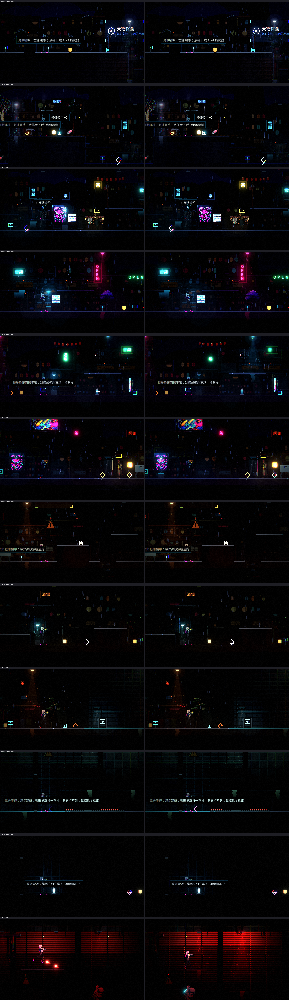
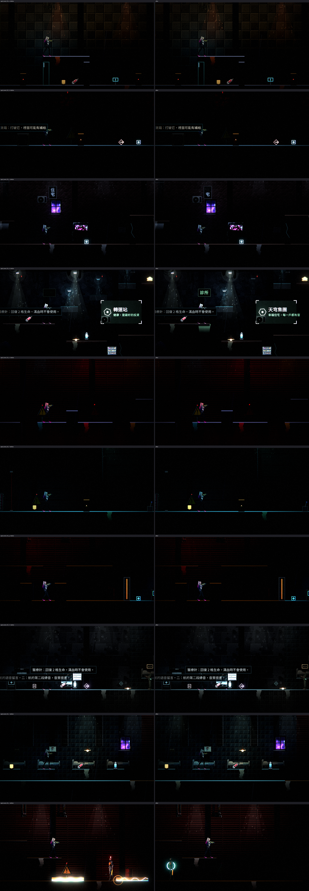
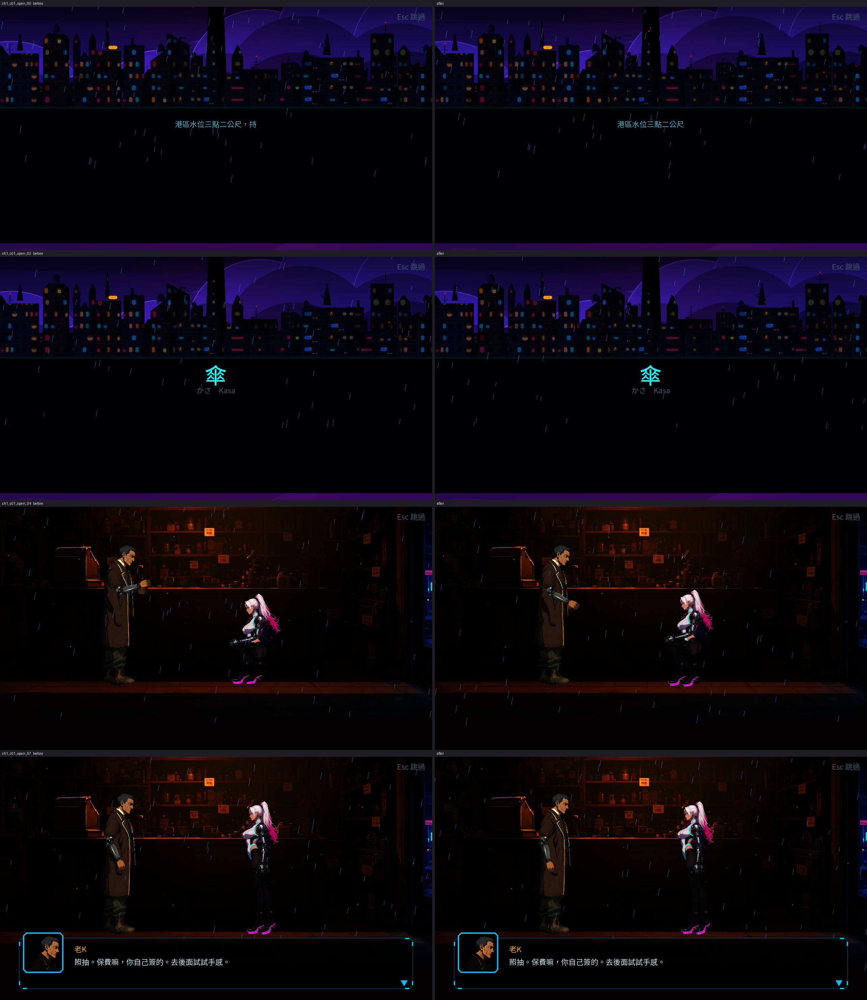

# [BG-17] 降低替換後環境貼圖的記憶體與取樣成本

> 狀態：進行中

## 內文

### 需求
NE-66 做替換前後的同機對照時發現，替換成高解析度的賽璐璐素材後，第一章載入的環境貼圖記憶體約 18 MB → 116 MB（關卡畫面上的貼圖，未壓縮估算），整個程序的貼圖記憶體 59 MB → 362 MB；同樣的機器與量測方式下，每影格耗時在光影品質「低」略增 4～25%、「高」略增 7～14%（繪製呼叫反而減少）。最大的幾張是天空（12 MB）、中景樓群與其自發光層（各 8.6 MB）、遠景天際線與其自發光層（各 6.6 MB），以及每件道具的自發光層（各約 2 MB）。需要在畫面不明顯變差的前提下，把環境貼圖的記憶體與取樣成本降到接近替換前。

### 來源
2026-10-04，NE-66「光影品質低時效能不低於替換前」的驗收量測。

### 驗收條件
- [ ] 第一章載入的環境貼圖記憶體降到替換後的一半以下，且各章節畫面與現在對照無明顯差異（截圖對照）
- [ ] 同機同法的對照中，光影品質「低」的每影格耗時不高於替換前的 105%
- [x] 做法以資料或匯入設定為主，新增素材時自動套用，不需要逐張手動處理
- [ ] 暗場可讀性量測仍全部達標

### 測試流程
1. 執行替換前後的同機對照（每影格耗時、繪製呼叫、貼圖記憶體）
2. 對照各章節截圖
3. 執行暗場可讀性量測與環境元件測試套件

---

# 跟其他票的關係

- Blocks：NE-66
- Blocked by：無
- Related：BG-12、BG-16、NE-58、NE-59、NE-60、NE-61、NE-62

---

# Commit-1

## 內文

沿用現有素材，以 Godot lossless 匯入解析度與移除未使用 mip 層降低記憶體；原圖未重產。新加工輸出自動套用同一份 JSON 政策，至少保留道具四倍解析度，保留地形、立面、前景與易取整變形的细長圖尺寸。視差及舞台補原始寬度渲染 metadata，家具 pos、scale、圖層順序、地圖、角色零件／骨架均未改；JSON 排除 metadata 的語義比較完全相同。共享鎖支援 Linux 並讓 linked worktree 使用主 checkout 的同一把鎖；未操作 ComfyUI。

本機 Forward+／llvmpipe 實測 321 張環境 diffuse/glow/normal 的匯入 payload：322,205,351 → 160,348,152 bytes（307.3 → 152.9 MiB，49.8%）；320×180 整程序 renderer 貼圖統計約 393.6 → 225.9 MiB。數據取自實際尺寸／格式／mips 及渲染器統計，不是縮圖檔案大小；**沒有實體 GPU，未量 dedicated VRAM**。記憶體預算已改善，實機 GPU 與完整章節觀感仍留待審查，第一條不冒充實機驗收。

低檔三處 mean：30.097／26.353／24.533 ms；同機同法替換前 ca369c71 為 20.831／18.581／18.466 ms，比例 144.5／141.8／132.9%，**105% 未通過**。原程式到現在亦有角色／戰鬥改動，不能把差距全歸因於環境；診斷只暫時 override shader，明確 NOT acceptance，未提交角色或全局光影改動。全圖 BC7 試驗約 62ms，因軟體取樣代價拒絕並還原。

640×360、每點 16 時間樣本的兩章 16 點可讀性：低檔頭目機庫、回收燈幕、看守長仍不足，高檔停電走廊、升降井入口、回收燈幕、電力室仍不足；未改動的 6f4805be 亦重現，不能宣稱全部達標。原始修前／修後 log 附在 attachments。票維持進行中，未解除 NE-66 相依。

## 測試

- `tools/run_tests_changed.sh 6f4805be`：39 組，43,239 checks，零 new／known failures；持續以本票前固定基準選擇，不使用 commit 後空 diff。
- 匯入政策 Python 3 項、共享鎖 Python 2 項通過；check_assets、政策 check、Python compile、git diff --check 通過。
- 初次抓到立面低於四倍、細長圖取整與舞台面積 fixture 退化，修復後重跑；劇情首句顯示初次失敗重跑通過，known_failures.txt 未加項。慢的 StageCoverageWorldSuite 基線獨跑 93 checks／0 failures，約 153 秒。
- GitHub CI 查詢 Forbidden，遠端 CI 尚未核對。合併最新 main 後的必要檢查另記整合紀錄。

## 截圖與重現

[完整同機條件、實測表、命令與跨組接手介面](attachments/BG-17-protocol.md)。待實體 GPU 量測、暗場不足處修正與使用者章節觀感審查，未代替使用者勾選。

舞台／場景整圖的縮圖在實際開場對照中使櫃台與地板變軟，因此保留全解析度；最終 152.9 MiB 仍低於修前一半。Stage 引用縮圖道具時仍用尺寸 metadata 補償。

## 最新 main 整合核對

已 rebase 到 5f9e3981，保留其他 Session 的故事、任務地圖、敵人配置與音樂修改。`tools/run_tests_changed.sh 6f4805be` 因主測試入口更新選擇完整 77 組：50,204 checks、new／known failures 皆 0。重新匯入與低檔 probe 完成，321 張環境 payload 仍為 160,348,152 bytes；mean 27.093／26.069／25.883 ms，仍未達替換前 105%。合併前後原始 log 分開保存，不將新地圖差異歸因於本票環境。

其後 rebase 到 293fcebb 的 ST-3 旗標／磁碟相容性修正，補跑 `tools/run_tests_parallel.sh --only=main,CutsceneSuite`：1,612 checks、new／known failures 皆 0（93 秒）。未改變環境匯入或渲染設定，未將這次測試冒稱為新的效能量測。

其後保留 e2d92f30 的 ST-15 文字與故事檢查；補跑 main、CutsceneSuite、StoryContentSuite、StoryLintSuite、MapBubblesSuite，結果見同目錄 `attachments/BG-17-integrated-story-tests.log`。
