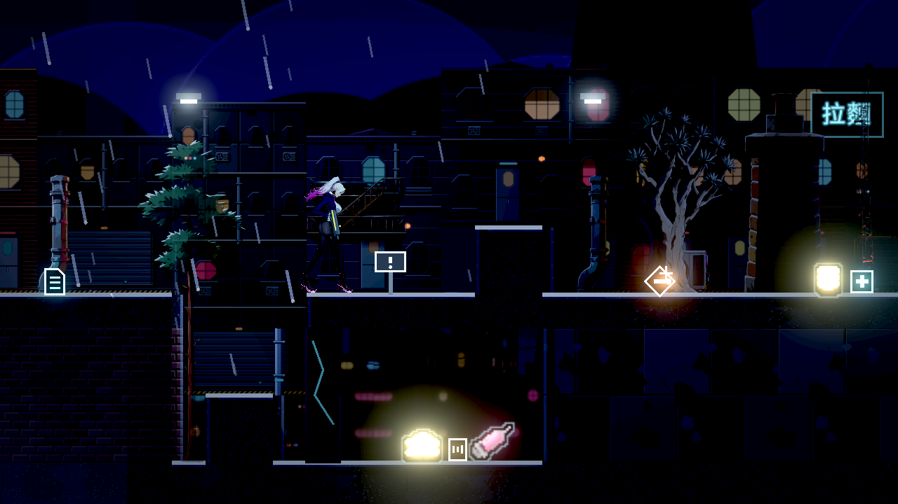
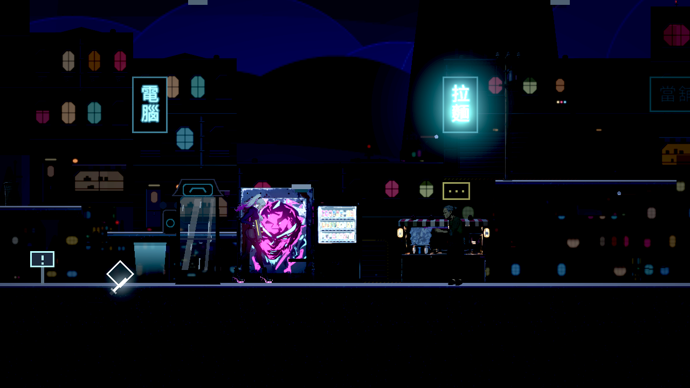
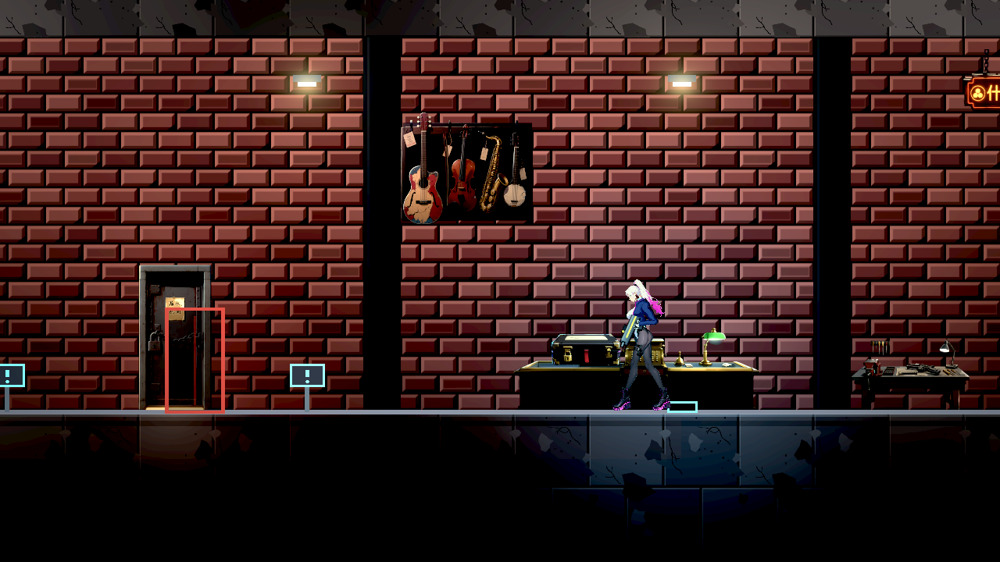
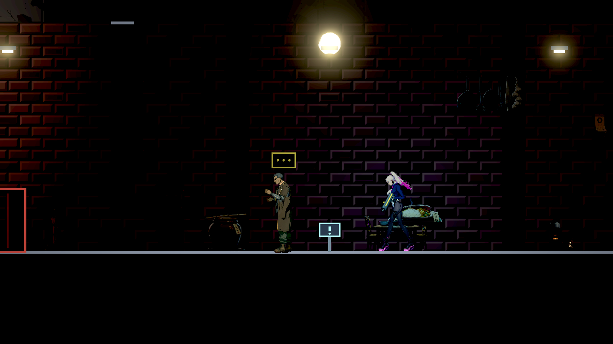
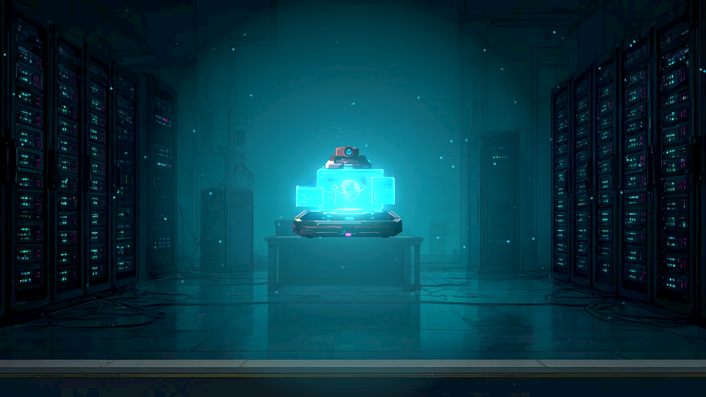
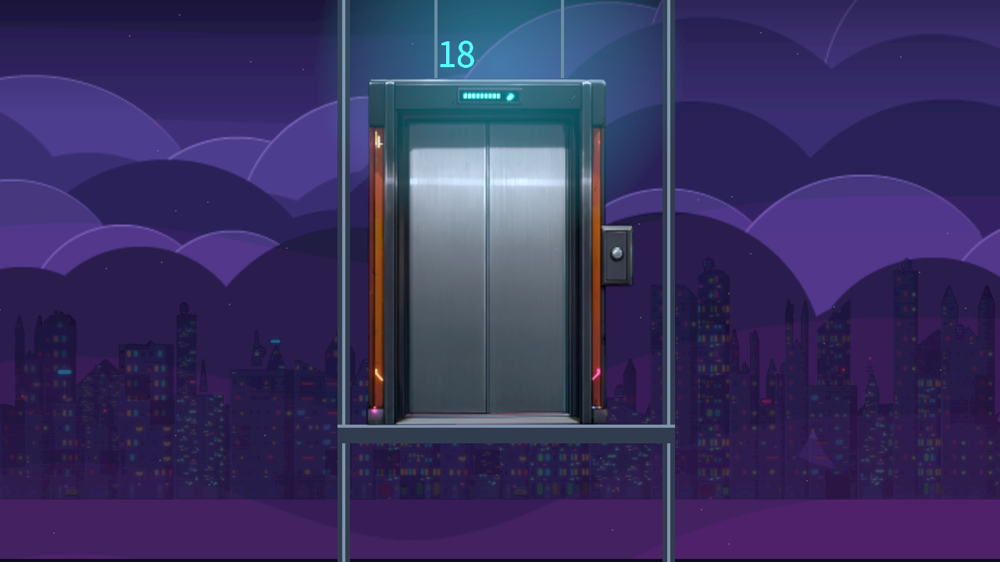

# [BG-19] 修正章節中缺少支撐的浮空佈景

> 狀態：封存（由 BG-26 取代）

## 內文

### 需求
全面盤點已實作章節與舞台的背景裝飾，修正出現在天空的地上物、沒有實際牆面卻掛在空中的物件，以及被放到天花板上方的地上佈景。依用途移除或放到合理的地面、牆面、屋頂與吊掛支撐位置。

### 來源
2026-10-10，Stanley 發現不該在天上的裝飾與沒有牆面支持的浮空立繪，要求全部找出並處理；設計見 design/19-world-item-art/DESIGN.md。

2026-10-10，Stanley 以電話亭巷「再來一次」海報截圖要求補查：海報不得伸入天空，所有物件的尺寸與位置需符合實際牆面、地面或支架。重新確認重建來源與最新原生畫面。

### 驗收條件
- [x] 所有正式已實作關卡與舞台有覆蓋表，每個缺陷記錄場景、座標、支撐類型與處置。
- [x] 地上道具底邊貼合可見承載面，誤吸到天花板或出界的物件移到正確地面；容許誤差不超過 2 世界像素。
- [ ] 壁掛物只在實際可見牆面上，屋頂／懸吊物有合理支架；沒有合適位置的天空裝飾移除。
- [x] 修前修後原生 Forward+ 圖涵蓋每類缺陷，合法遠景保留理由與圖證據。
- [ ] 重建地圖後問題不復發，新增錯誤支撐能被自動檢查抓到。
- [x] 相關局部測試通過，出入口、關卡碰撞、敵人及玩家動線不退化。

### 測試流程
1. 遍歷每個已實作關卡與舞台，對照物件用途及可見支撐。
2. 在缺陷座標拍修前修後圖，確認天空中不再有無支撐物件。
3. 重建關卡資料後重跑擺位檢查與相關局部測試。

---

# 跟其他票的關係

- Blocks：無
- Blocked by：無
- Related：無

---

# Commit-1

## 內文

全部 11 個正式關卡、10 張地圖、289 筆原佈景與 17 個舞台已逐項盤點。地上家具、招牌與吊架回到承載面；牆掛物避開天空、破洞和透明屋簷；吊掛物接屋頂或車棚。原圖透明底邊一併算入接觸，兩座消防梯移到實際牆面，保留可踩的平台。沒有合適支撐的 7 筆物件與 14 個地圖裝飾移除；合法遠景保留。終端機回到桌面，升降梯門加上連續導軌、纜線與底部平台。

[全場景覆蓋、處置與驗證紀錄](attachments/BG-19-coverage.md)；[每筆原位置與修後座標](attachments/BG-19-inventory.json)。所有地圖重建後結果一致，地形、敵人、出入口與劇情沒有變更。

### 測試結果

| 項目 | 結果 |
|---|---|
| 固定基準選出的 65 套受影響測試 | 46,658 checks，0 failures、0 known failures |
| 最新 main bca11c2f3 同步後 7 套相關複驗 | 12,742 checks，0 failures，無新腳本錯誤 |
| 所有關卡及舞台的支撐與場景檢查 | 通過；錯誤擺位、透明底邊、牆洞與平台保留反例均涵蓋 |
| 全地圖、足底及立面資料重建一致性 | 通過；地形、出入口、敵人與劇情資料保留 |
| 原生 Forward+／HDR 2D 畫面 | 17 個關卡視角與全部 17 舞台人工查看；46 張修前／修後圖存到 pm/Nest-Egg/images |

### 截圖

# 封存

使用者再次提供海報伸入天空的實機畫面，先前驗收未充分涵蓋這個案例。保留先前交付紀錄，補驗需求改由 BG-26 追蹤；新的驗收須包含同鏡頭原生畫面、作者重建與刻意錯誤位置的拒絕結果。
