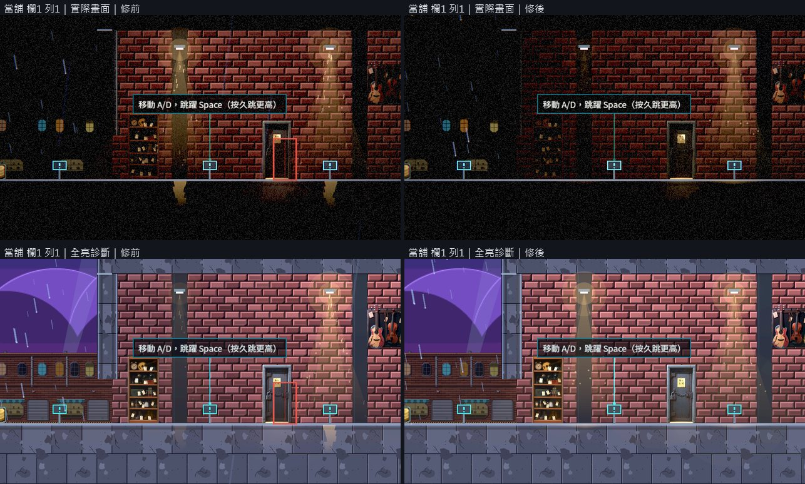
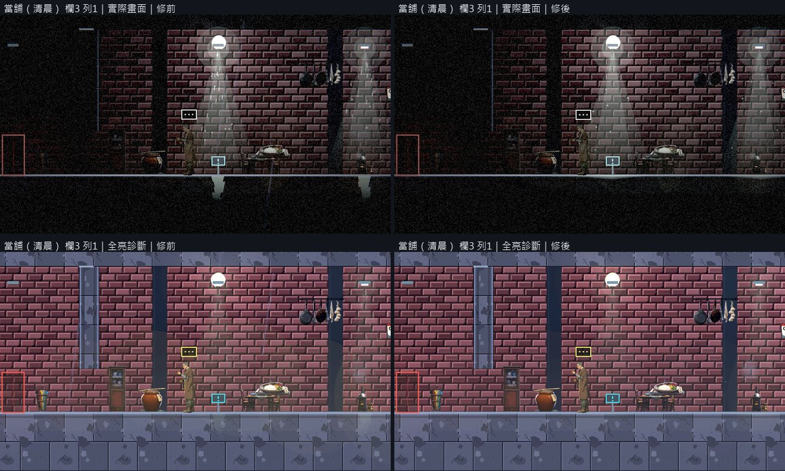
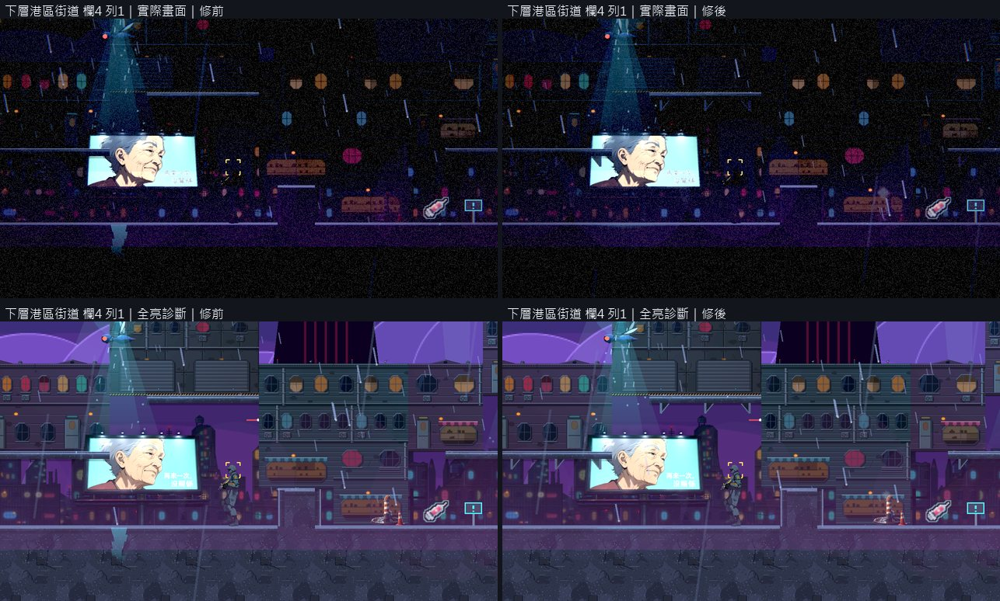
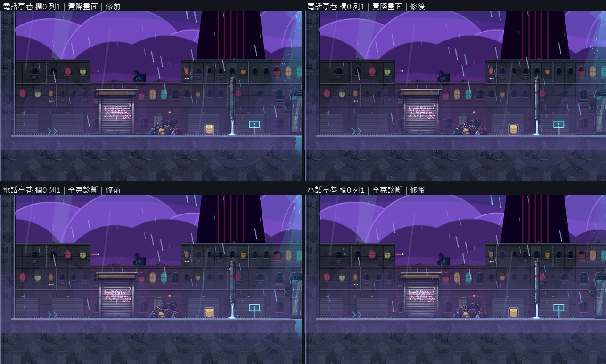
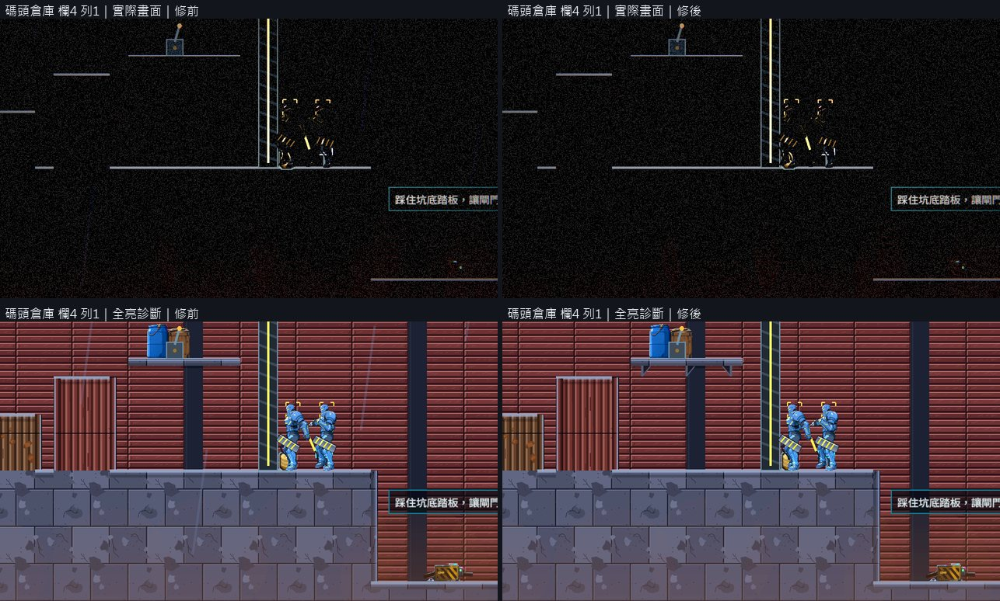
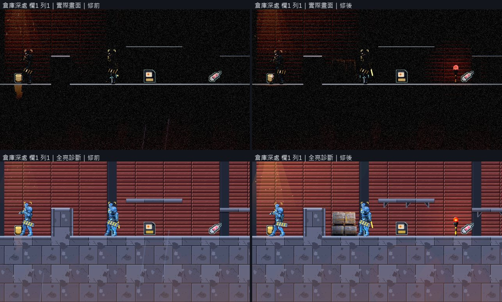
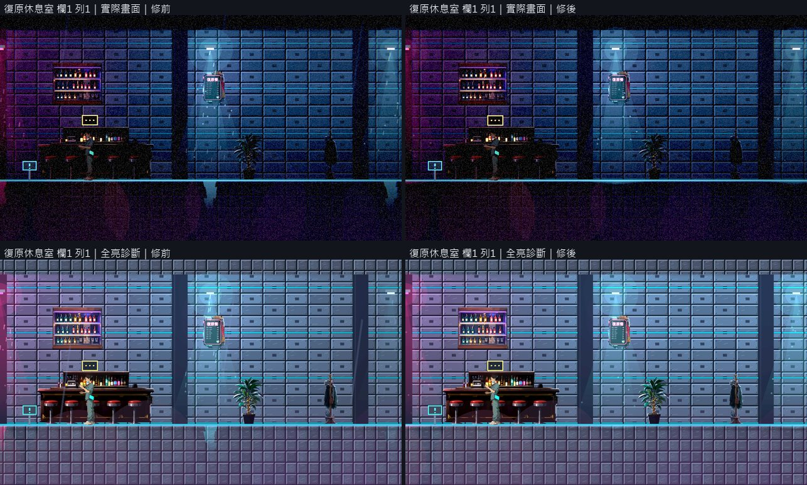
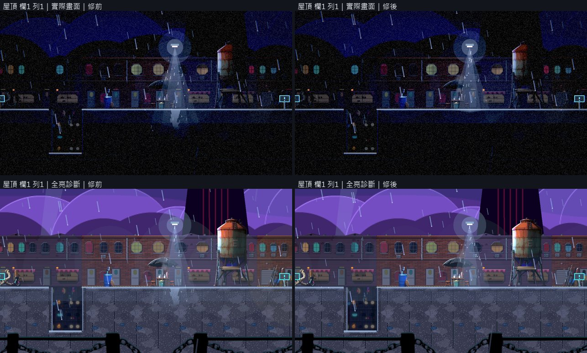
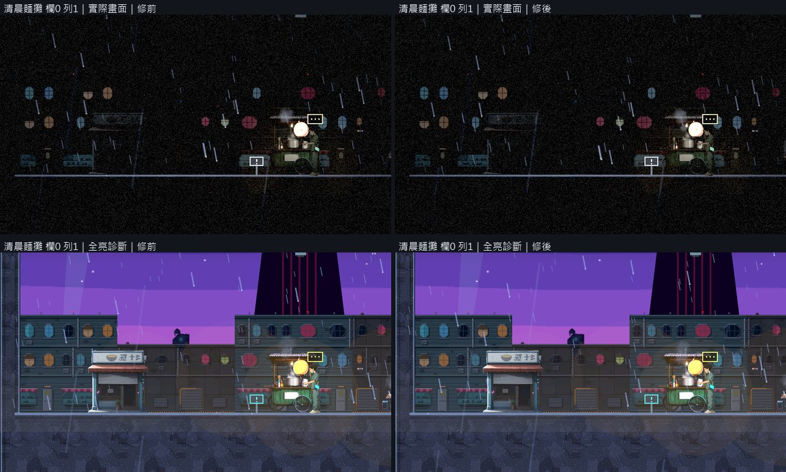

# [BG-20] 統一場景用途與裝飾邏輯

> 狀態：進行中

## 內文

### 需求
逐區清理雜亂與缺乏用途的場景裝飾，建立一致的空間、材質與視覺優先序，保留有敘事意義的細節。

### 來源
2026-10-10，使用者要求逐章完成與累積發行、高清像素UI、全流程手把、豐富合理敘事與動畫、場景減雜，並追加武器差異、子彈、方向護盾、可選連段升級與打擊感總驗收；一般設計選擇由實作者決定，持續推進。

詳見[整體設計](../../design/20-campaign-experience/DESIGN.md)與[研究依據](../../design/20-campaign-experience/RESEARCH.md)。

### 驗收條件
- [x] 逐區列出用途、色盤、材質、地標與裝飾清單，說明保留、移除、移位與替換理由。
- [x] 天空物件、假牆上的掛件、無支撐與錯誤圖層已修正；梯子、牆與電子看板有合理功能或敘事用途。
- [x] 背景、可走地形、互動與危險可區分，敵人、落點和主要路徑不被裝飾淹沒。
- [ ] 保留BG-19既有支撐成果；首批序章與第一章修正落地，後續章節可沿用同一裝飾邏輯。
- [x] 亮暗實際畫面與改前／改後逐區對照，沒有以減少細節掩蓋缺失的重要資訊。

### 測試流程
1. 逐區檢查實際畫面、用途、牆面／地面支撐與圖層。
2. 比較移除／移動／替換前後，在戰鬥與探索時確認辨識。

---

# 跟其他票的關係

- Blocks：NE-233、BG-21、BG-22
- Blocked by：無
- Related：BG-19、ST-10、NE-178、NE-66、BG-25

---

# Commit-1

## 內文

場景來源原本缺少逐區完整清單，提示牌、霓虹文字與背景貼圖容易混在一起。
第一章九個區域資料對應八張地圖的70筆擺設已列出原位置、支撐宣告、素材及功能引用；另分列25個提示牌標記與六筆招牌命名擺設。動態文字來源與貼圖文字的未知範圍分開記錄，沒有用缺少招牌欄位推論畫面上沒有招牌。
逐一核對217份來源的大小與雜湊一致，保留原有支撐修正的歷史紀錄；舊第二關與新第二章製作稿明確區分。這份清單用於後續逐區用途與畫面審查。

### 測試結果

| 項目 | 結果 |
|---|---|
| 來源完整性 | 217份大小與SHA一致；0筆不符 |
| 地圖原資料對照 | 8張地圖、70筆擺設；含共用地圖的九個區域共89筆 |
| 功能引用分類 | 80筆引用均可分類；無未知引用 |
| 受影響測試 | 純文件與票更動，選擇器0組，EXIT0 |
| 驗證範圍 | 來源盤點；支撐宣告與文字來源不計實際畫面驗收 |

[逐區來源清單](../../design/20-campaign-experience/SCENE_PURPOSE_INVENTORY.md)／[完整來源與雜湊](../../design/20-campaign-experience/SCENE_PURPOSE_INVENTORY.json)。

# Commit-2

## 內文

上一次交付只列了資料，沒有看畫面。這次把第一章九個區域依固定格子拍成原生畫面，實際光影與全亮的診斷畫面各一組。擺設本身大多對得上各區用途，問題集中在幾件各區共通的事：場景燈的光錐穿過地板，暗場景裡像地板下插著火把；當舖、倉庫這些有天花板的室內，光錐裡有雨絲、鏡頭前還飄著雨簾；街道與倉庫的窄平台和層架只是一條懸空的橫板；當舖地下室的鐵門旁邊多疊了一個偏移的紅框；倉庫深處五個畫面寬只有一個貨櫃。

現在光錐照到地面為止，地面反光只落在地板頂面，霓虹招牌的反光也一樣；頭上有屋頂的地方不再有雨絲與雨簾；平台下方自動加上三角托架；地下室出入口改用原本的鐵門當畫面；倉庫深處補上棧板、警示燈與探照燈三件倉庫自己的物件，戰鬥場地維持空曠。九區的用途、色盤、材質、地標、每件擺設的支撐與去留理由寫成[逐區審查](../../design/20-campaign-experience/SCENE_PURPOSE_REVIEW.md)，沒有移除任何擺設。另外做了一支場景巡覽工具，之後的場景票用同一組格子拍修前修後。

九區修前修後逐格看過：地板下不再有光錐，室內沒有雨，平台有托架，鐵門旁沒有紅框。場景檢查十一張關卡 0 錯誤 0 警告，原有的支撐修正都還在。實際光影下街道與屋頂的建築本體仍然太暗、只看得到窗光，倉庫斷電時牆與貨櫃看不到，全畫面雜訊也還在，這兩項分屬 BG-30 與 BG-27；出入口的空框屬 BG-21。所以第二、三條驗收條件還沒勾，序章的關卡資料也還不存在。

### 測試結果

| 項目 | 結果 |
|---|---|
| 場景檢查（11 張關卡、出入口連結、過場舞台） | 0 錯誤、0 警告 |
| 原生巡覽 | 9 區 × 實際光影與全亮診斷 × 修前修後，共 4 輪，每輪自然結束、0 錯誤 |
| 受影響測試 | 選擇器判定為全部套件：82885 項檢查；新失敗 0、已知失敗 0 |

分支 `feature/scene-lighting`；提交見[遠端 main 上本票的提交](https://github.com/deadline314/Nest-Egg/commits/main/pm/Nest-Egg-BG/%5BBG-20%5D%E7%B5%B1%E4%B8%80%E5%A0%B4%E6%99%AF%E7%94%A8%E9%80%94%E8%88%87%E8%A3%9D%E9%A3%BE%E9%82%8F%E8%BC%AF.md)。

### 截圖

每張上排是實際光影、下排是全亮診斷，左修前、右修後。

# Commit-3

## 內文

上一次交付留下兩條要等光影才能驗：實際光影下建築本體全黑，只剩窗光像燈籠飄在空中；倉庫裡敵人、牆與貨櫃糊成一片，看不出背景、可走的地面與敵人的分別。

這兩件事由 BG-27（拿掉全畫面雜訊）與 BG-30（提高環境光、背牆退後一階）解決，這張票沒有再改場景資料。

九區在新的光影下重新逐格看過：窗光都落在看得到的建築上，不再有飄在空中的光點；牆上的樂器、招牌、掛鍋、日曆、酒瓶層架、菜單板與海報後面都有牆面；地面頂面的亮邊、平台與托架、出入口和提示牌分得出來。量測上敵人的最低對比從 0.16～0.34 提高到 0.38～0.49。梯子通往屋頂、看板是劇情物件，都有用途。

第四條還沒勾：main 上還沒有序章的關卡資料（ST-16 尚未交付），沒有東西可以驗；光錐、雨、平台托架與霧的修正是共通的，之後加入的關卡會自動套用，等序章的關卡進來再跑一次場景巡覽。

### 測試結果

| 項目 | 結果 |
|---|---|
| 原生巡覽（9 區，新光影） | 逐格看過；敵人最低對比 0.38～0.49 |
| 受影響測試 | 純票更動，沒有要跑的測試 |

修後畫面見 BG-30 的截圖。分支 `feature/scene-lighting`。
