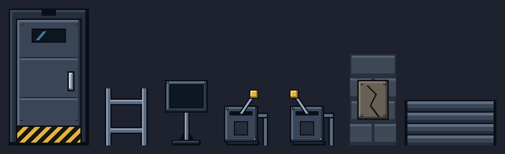
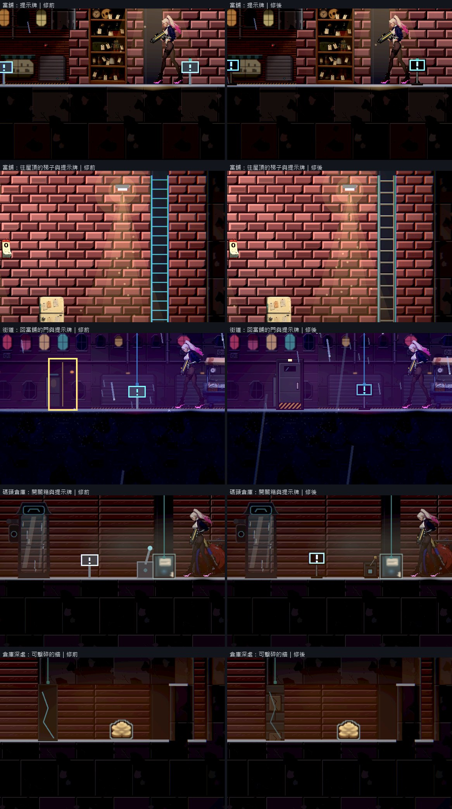

# [BG-21] 替換場景占位素材

> 狀態：審查中

## 內文

### 需求
為已確認需要替換的電子告示牌、梯子、牆面与道具製作符合游戏风格的正式素材，避免簡陋占位与过度生成痕跡。

### 來源
2026-10-10 追加：使用者明確指定地板、開關閥門、梯子與可擊碎牆；屋頂截圖肯定提示文字繞角色，要求替換簡陋牌體。詳見[本輪設計](../../design/20-campaign-experience/INVENTORY_WORLD_CLARITY.md)。

2026-10-10，使用者要求逐章完成與累積發行、高清像素UI、全流程手把、豐富合理敘事與動畫、場景減雜，並追加武器差異、子彈、方向護盾、可選連段升級與打擊感總驗收；一般設計選擇由實作者決定，持續推進。

詳見[整體設計](../../design/20-campaign-experience/DESIGN.md)與[研究依據](../../design/20-campaign-experience/RESEARCH.md)。

### 驗收條件
- [x] 地板、開關閥門、梯子、可擊碎牆與告示牌逐項換成正式材質或立繪；尺度、安装面、承重與用途合理。
- [x] 閥門啟動、梯子上下落點與牆面破壞狀態清楚，原有碰撞和可走路徑正確。
- [x] 告示牌保留目前文字避開角色的呈現，只改善必要牌體、支架與安裝位置，沒有重新增加多餘告示。
- [x] 根据場景用途盤點首批序章／第一章占位素材，逐項有尺寸、色盤、安装方式与替换位置。
- [x] 素材由主Session先做风格样本再交付正式图，轮廓与细节符合现有赛璐璐／像素应用范围。
- [x] 替换后在实际场景比例、透明边界、光影、支撑与前后遮挡正确，没有生成文字乱码或多餘裝飾。
- [x] 與地上道具圖示既有ST-8范围区分，正式来源与用途可追溯；後續章节缺口可按清单接续。
- [x] 本機實際畫面驗證可讀与素材成本，少量生成與加载不把全部来源图常驻記忆体。

### 測試流程
1. 核对需求清單與风格样本，再逐项放入实际场景。
2. 檢查尺寸、支撑、图层、边界、亮暗与素材成本，保存前後畫面。

---

# 跟其他票的關係

- Blocks：NE-233
- Blocked by：BG-20
- Related：ST-8、BG-17、NE-66

---

# Commit-1

## 內文

關卡裡的門、梯子、提示牌、開關、可擊碎的牆與閘門原本都是用線條和方塊暫代：門是一個黃色或紅色的空框，梯子是幾條亮線，提示牌是一個小方框插在一根線上。

這六種物件現在都有正式的賽璐璐貼圖：鋼製防盜門（有觀察窗、把手與警示踢腳板，門框頂端的燈顯示上鎖或可進入）、鋼梯（扶手與橫桿，橫桿間距照人體比例）、提示牌（底座、立柱加斜撐、有邊框的螢幕）、開關箱（拉桿有開關兩個方向，側面有管線接進地面）、可擊碎的補磚牆（釘著一塊有裂縫的補板，受損後裂紋照舊增加）與捲門式閘門。這批東西又小又規則，還要能上下平鋪，所以和地形材質一樣用程式繪製，沒有生成模型的雜紋或亂碼文字；先出了一張樣本一覽確認畫風才接進遊戲。門的大小、梯子的高度、互動範圍與碰撞都沿用原本的資料，沒有動路線；提示牌的數量與位置不變，文字仍由原本的提示框顯示並避開角色。貼圖比原本的亮線暗，所以梯子扶手與提示牌螢幕各留一條淡亮線，暗處也找得到。逐項的尺寸、色盤、安裝方式、出現位置與這一批沒涵蓋的缺口寫在[固定物件素材清單](../../design/20-campaign-experience/FIXTURE_ASSETS.md)。地板沿用既有的賽璐璐地形材質；先前看起來只是一條線，是光影太暗造成的，已在 BG-30 處理。

當舖、街道、碼頭倉庫與倉庫深處的實際畫面逐一看過：門站在地面上、梯子從地面通到天花板、提示牌有底座、開關箱旁有管線，前後遮擋與光影正確。七張貼圖合計 60 KB，只有用到的才會載入。貼圖讀不到時會記錄缺少的路徑並退回原本的畫法。序章目前沒有獨立的關卡資料，這些物件是各關共用的，之後的關卡會直接套用。

### 測試結果

| 項目 | 結果 |
|---|---|
| 素材檢查（大小、匯入設定） | 通過 |
| 貼圖載入、縮放、平鋪與缺圖退回 | 自動檢查通過 |
| 原生巡覽（當舖、街道、碼頭倉庫、倉庫深處） | 自然結束、0 錯誤 |
| 受影響測試 | 11007 項檢查；新失敗 0、已知失敗 0（補上貼圖檢查後環境套件另跑一次 6100 項全過） |

分支 `feature/scene-lighting`；提交見[遠端 main 上本票的提交](https://github.com/deadline314/Nest-Egg/commits/main/pm/Nest-Egg-BG/%5BBG-21%5D%E6%9B%BF%E6%8F%9B%E5%A0%B4%E6%99%AF%E5%8D%A0%E4%BD%8D%E7%B4%A0%E6%9D%90.md)。

### 截圖

