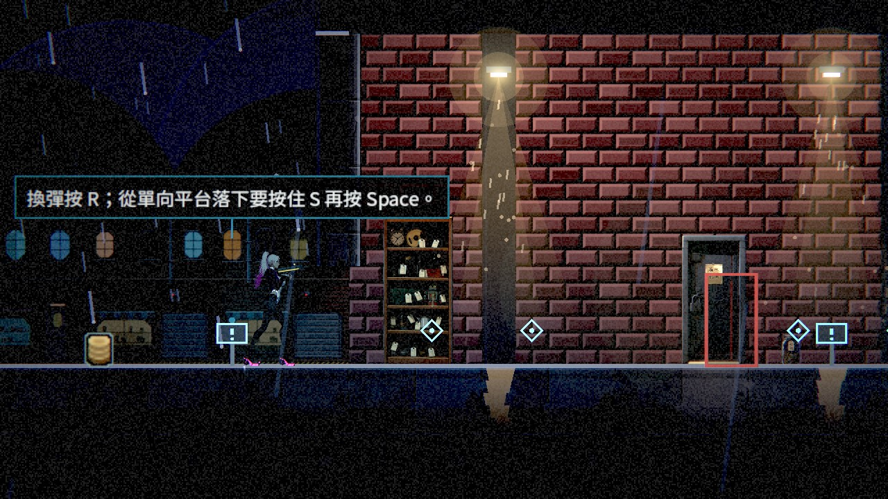

# [BG-22] 整併指引並精簡告示牌

> 狀態：進行中

## 內文

### 需求
減少重复教學板、無用途電子廣告與閱讀物件，將必要指引放在合適的序章、按需提示、任務或場景终端。

### 來源
2026-10-10，使用者要求逐章完成與累積發行、高清像素UI、全流程手把、豐富合理敘事與動畫、場景減雜，並追加武器差異、子彈、方向護盾、可選連段升級與打擊感總驗收；一般設計選擇由實作者決定，持續推進。

詳見[整體設計](../../design/20-campaign-experience/DESIGN.md)與[研究依據](../../design/20-campaign-experience/RESEARCH.md)。

### 驗收條件
- [x] 分別盤點功能教學、故事閱讀物件与環境廣告，列出原数量、整併後數量与保留理由。
- [x] 首批序章与第一章重复功能告示合併或移除，玩家仍知道目标、危險、机关与按键。
- [ ] 首次教學与剧情證据保留，整併後文字为完整易懂句子，鍵鼠／手把提示正確。
- [x] 广告与电子看板符合区域用途及安装面，不为填空而散放。
- [x] 告示牌與閱讀物件不觸發人物21:9接近預告，主線不依赖已被移除的牌子。

### 測試流程
1. 对照逐区清单与实际数量，走新游戏教学及第一章机关。
2. 用鍵鼠与手把检查提示、任務、劇情证据及接近遮幅排除。

---

# 跟其他票的關係

- Blocks：NE-233
- Blocked by：ST-16、NE-223、BG-20
- Related：ST-15、ST-22、BG-19

---

# Commit-1

## 內文

序章上線後，當舖後空地還立著移動、射擊、衝刺、近戰的教學看板，跟序章剛練過的一模一樣；「老 K 在桌邊」「鷺在等你」「說完才出得去」這類看板也和任務列、人物的互動提示重複。
這次先盤點序章與第一章的教學看板、劇情閱讀物件與廣告（清單在 GUIDANCE_INVENTORY.md），再依「操作教一次、目標交給任務列、危險與機關留看板、劇情證據全留」整併：教學看板 25 塊減為 17 塊。當舖只留背包與一句「換彈按 R；從單向平台落下要按住 S 再按 Space。」（序章沒教的兩件事），屋頂只留助跑跳縫的提醒，復原館與麵攤不再立「說完才出得去」；街道的完美反彈改寫成只講反彈。看門狗、水位、閘門、電話亭與資料盤的看板全部保留，劇情閱讀物件與廣告數量不變（廣告都在臨街立面或該地點本來就有的位置）。

### 測試結果

| 項目 | 結果 |
|---|---|
| 受影響範圍（基準 67b691d5，原選擇器） | 7,786 項、0 新失敗、0 已知失敗；另跑劇本掃描、第一章地圖、場景、任務地圖 2,434 項 0 失敗 |
| 主線不依賴被移除的看板 | 第一章流程與任務地圖測試照常走完；被移除的看板都只是重複任務列或人物提示 |
| 待本機原生驗收 | 手把按鍵在看板上的顯示、走一遍新遊戲教學與第一章機關 |

### 截圖

雲端軟體 Vulkan（Forward+）截圖。

分支：`claude/nest-egg-main-story-flow-ph1dnu`（[分支提交紀錄](https://github.com/deadline314/Nest-Egg/commits/claude/nest-egg-main-story-flow-ph1dnu)）。盤點與保留理由見 [GUIDANCE_INVENTORY.md](../../design/20-campaign-experience/GUIDANCE_INVENTORY.md)。「鍵鼠／手把提示正確」沒有勾：看板文字用目前綁定的按鍵代號，手把畫面待本機確認。
