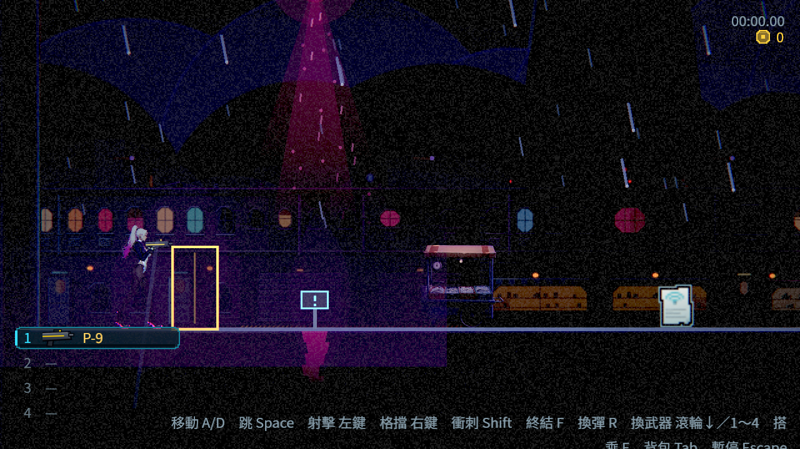
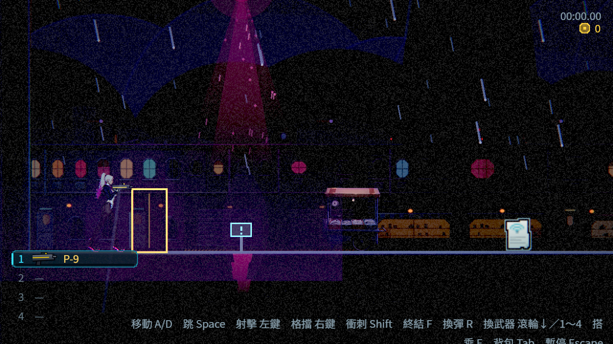
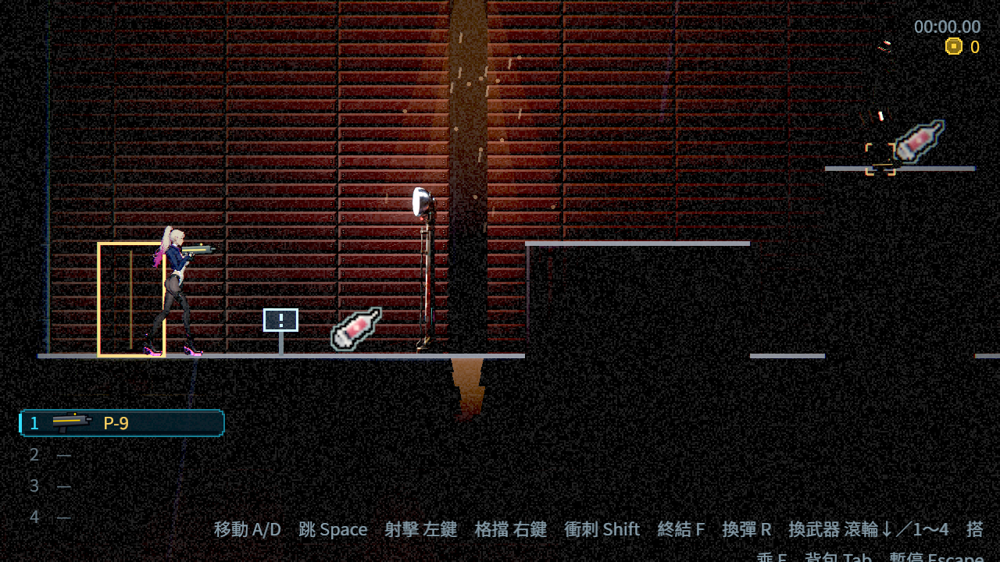
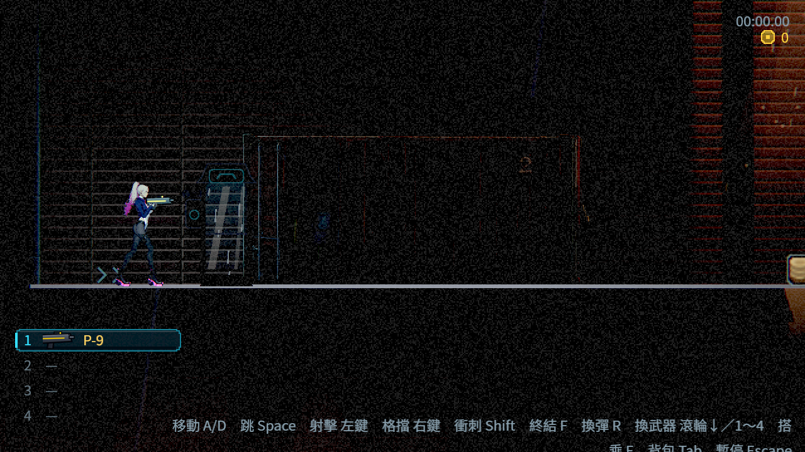

# [BG-23] 回收跨區預載並限制貼圖常駐

> 狀態：完成

## 內文

### 需求

背景預載不能隨跨區持續累積未回收貼圖。保留進場順暢與畫面完整，讓額外預載的數量、常駐量及回收結果能被實際量測。

### 來源

2026-10-10，使用者要求注意本機 RAM／VRAM，避免大量圖片常駐造成重新開機；本輪驗收發現背景載入沒有完成結果的領取流程。查核與預算界線見[預載設計](../../design/20-campaign-experience/PREFETCH_LIFETIME.md)。

### 驗收條件

- [x] 進行中、待載與額外快取均有明確上限，連續換區不超限；附服務計數與真實 RAM 量測，估算量不冒充 VRAM。
- [x] 完成或失敗的背景請求都能被回收；清除途中、暫停、回主選單及新遊戲不遺留失去追蹤的請求。
- [x] 重複路徑不重複排入；缺圖或載入失敗會指出具體資源並安全略過，不阻斷遊戲。
- [x] 正在遊玩的區域不因快取淘汰缺圖，背景、法線、發光與角色外觀在實際 Forward+ 保持正確。
- [x] 反覆跨區後額外快取保持有界；記錄退出警告的前後差異，不把既有警告直接隱藏。
- [x] 受影響測試全過，附反覆跨區紀錄與實際畫面；不修改其他 owner 的未提交環境貼圖工作。

### 測試流程

1. 隔離程序核對真正貼圖載入的完成／領取狀態，測重複、缺圖、失敗與清除途中。
2. 連續往返多區並回主選單，核對上限、回收、工作集與退出紀錄。
3. 實際 Forward+ 比對區域背景與角色，確認暫停／換區後仍完整顯示。

---

# 跟其他票的關係

- Blocks：無
- Blocked by：無
- Related：BG-17、NE-230、NE-233

---

# Commit-1

## 內文

跨區預載原本只發出背景請求，清除路徑後仍留著引擎持有的載入結果。現在完成與失敗結果都能領取，清除途中仍追蹤原請求；額外預載有數量與估算量上限，淘汰不影響現有場景。

真正貼圖對照驗出未領取會漏一個零參照物件，領取後則沒有。相同受控主流程走兩輪八區與返回主選單，舊版 438 個未領取結果對應退出 438 個物件警告，新版 2,493 次請求均已領取、退出無漏物件。這是隔離存檔的受控換區，不是人工通關；原先 265 個警告沒有逐件比對。

Forward+ 背景、牆面、道具、復原設備與角色實圖經目視保持完整。三輪換區額外快取最多 64 張、38.58 MiB 估算；真實程序工作集與引擎貼圖監測分別記錄，沒有宣稱 RAM 大幅下降或 VRAM 已限制在估算量。

最後整合基準 `fcd9ea756` 的原選擇器五組全過，並重抓相同受控路由三張 Forward+，根代理核對結果與實圖。舊版對照維持 `1be7bb0cf`；最新整合含其他骨架／盾面程式，RAM 前後數字不是單變數因果實驗。

### 測試結果

| 項目 | 結果 |
|---|---|
| 第一章地圖單組 | 1,374 checks／0 new／0 known；57 秒 |
| 最終受影響五組 | 1,872 checks／0 new／0 known；141 秒／exit 0；基準 `fcd9ea756`，單程序 |
| 清除途中、重用、暫停、容量與淘汰 | 通過，含無頭清除途中安全放掉舊快取 |
| 三輪八區相鄰預載 | 真實 Forward+／無頭各 81 checks，無 ERROR 或退出漏物件 |
| 相同受控主流程前後比較 | 舊版 108／新版 127 checks，皆無 ERROR；新版退出無漏物件 |
| 故意損毀／載入途中退出 | 5／2 checks；損毀錯誤完整保留並回收 |
| 原生完整紀錄 | [舊版](attachments/BG-23-baseline-engine.log)、[新版](attachments/BG-23-current-engine.log)、[服務量測](attachments/BG-23-service-native.json)、[真實程序工作集](attachments/BG-23-current-working-set.json) |
| 最終測試完整紀錄 | [console](attachments/BG-23-final-console.log)、[單 shard 原 log](attachments/BG-23-final-shard-0.log)，無 SCRIPT ERROR；原有刻意缺資料 ERROR 保留 |
| 無頭引擎最小對照 | [四槽錯誤原 log](attachments/BG-23-cycle-dummy-four-engine.log)保留；單槽與真實 renderer 四槽各 2,002 checks，無 ERROR；未更動測試過濾器或已知失敗清單 |

### 截圖

以下均為相同取景的隔離受控路由 Forward+ 圖證。

