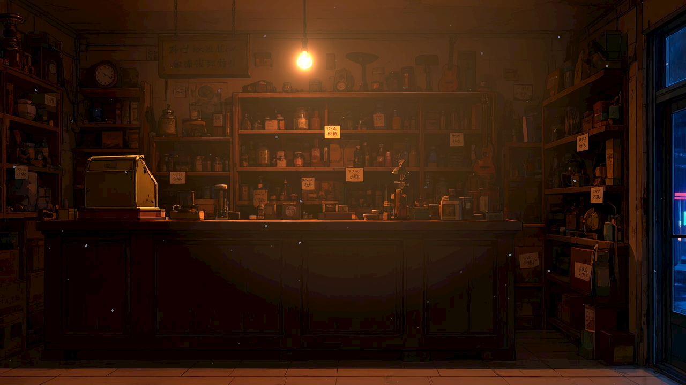
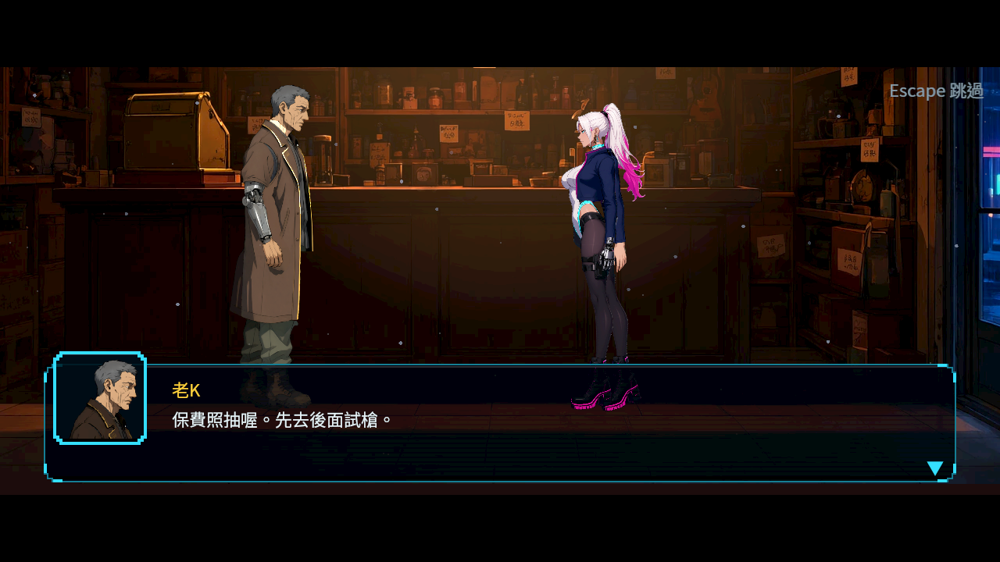
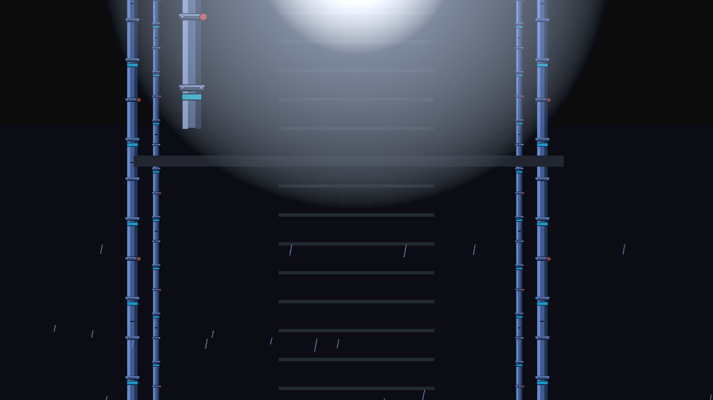

# [BG-24] 移除封閉室內的室外雨幕

> 狀態：完成

## 內文

### 需求

封閉的當舖前廳不應有雨線穿過人物與家具。修正真正的舞台來源，檢查其他有雨的過場是否符合室內外環境；已合理的戶外雨天保持原樣。

### 來源

2026-10-10，使用者要求逐場檢查不合理的場景要素；第一章原生畫面驗證發現室內當舖有全畫面雨幕。設計見 [室內天氣邊界](../../design/20-campaign-experience/INDOOR_STAGE_WEATHER.md)。

### 驗收條件

- [x] 當舖前廳正式過場沒有室外雨線穿過室內人物與家具。
- [x] 從正式來源重建後問題不會再次出現，且劇本、家具、人物和其他舞台沒有非必要變動。
- [x] 其他降雨過場逐一查核室內外語義，封閉室內無全畫面雨；開口中的天氣有合理範圍。
- [x] 受影響的局部測試通過，修改前後的原生畫面及查核紀錄留存。

### 測試流程

1. 播放第一章當舖前廳的正式過場，確認室內沒有落雨。
2. 重建正式舞台，比對修改範圍並重新播放。
3. 逐一檢查有雨的屋頂、港口、麵攤與升降井；比對正式演出及可見開口。
4. 執行受影響範圍的測試並保存修改前後畫面。

---

# 跟其他票的關係

- Blocks：無
- Blocked by：無
- Related：ST-10、NE-65

---

# Commit-1

## 內文

當舖前廳及升降井原本有室外雨線穿過封閉室內。現在取消這兩個全畫面雨幕，保留原有家具、人物、光線與鏡頭；重建第一章後仍保持正確。屋頂、雨夜港口及露天麵攤繼續保有雨天氣氛。

正式人物對話與四張舞台前後對照已檢查。受影響範圍及三項產生內容比對全部通過，完整原始紀錄留存於 [交付證據](attachments/BG-24-weather/manifest.json)。

### 測試結果

| 項目 | 結果 |
|---|---|
| 受影響局部測試 | 32 組、5962 項；0 新失敗、0 已知失敗；正常結束 |
| 重建及天氣查核 | 3 項通過；劇本及六張第一章舞台與正式來源相同 |
| 原生畫面 | 四張舞台前後對照、正式人物對話通過；原有鏡頭佈局另由 ST-10 驗收 |
| 原始紀錄 | 無腳本／解析／編譯錯誤；保留既有容錯測試錯誤訊息及產生器警告 |

### 截圖

