# [BG-25] 加入符合物件用途的場景動畫

> 狀態：審查中

## 內文

### 需求

場景除了立繪，也要有符合物件用途的動態，例如排水管出水、滴水落地、水面漣漪、風扇轉動與布料微動。優先完成可在遊玩中運作的循環動畫；保留像素畫風、合理固定點與接觸，特效不掩蓋角色、敵人、落點或互動提示。已存在的效果先檢查與改善，不重複疊加。

### 來源

2026-10-10，Stanley 要求場景不要只有立繪，舉水管流水為例，要求參考業界；能用 Godot 做就直接做，确實需要影片生成模型則先另開待辦票。設計與開發者參考見[場景動態設計](../../design/19-world-item-art/ENVIRONMENT_MOTION.md)。

### 驗收條件

- [x] 逐區列出既有動態、需要新增的物件、固定點與用途；首批涵蓋第一章電話亭巷、街道及合適室內場景。
- [x] 水由實際出水口流出，落在可見承接面並有克制的水花或漣漪；沒有穿牆穿地、懸空水花或重複效果。
- [x] 風扇、布料、蒸汽與燈光只動應活動的部分，支架與牆飾保持合理位置，循環沒有跳接。
- [x] 遊玩、戰鬥與對話時，動態不遮住角色、敵人、子彈、落點、危險與可拾取提示；各品質檔仍能清楚辨識。
- [x] 暫停、恢復、切區與重進場景後動態正常；連續往返不累積效果或記憶體，保存同機幀時間與記憶體對照。
- [x] 原生 Forward+ 的連續畫面與相關局部測試通過，效果大小、出水／固定点與圖層已逐件查看。
- [x] 需影片生成的具體演出有獨立待辦票及循環、分層、容量驗收；首批可由引擎處理的動態不以影片模型作依賴。

### 測試流程

1. 在目標場景確認原有動態與靜態物件，逐件查看出水口、支架、承接面與大小。
2. 用同一視角錄取循環的多個時刻，進行戰鬥、拾取與對話，確認順暢及辨識。
3. 暫停恢復、切區並往返十次，對照品質檔、幀時間、記憶體與效果數量。

---

# 跟其他票的關係

- Blocks：無
- Blocked by：無
- Related：BG-19、BG-20、NE-95、BG-35

---

# Commit-1

## 內文

電話亭巷排水管原本只在整體發光圖上呈現漣漪，水柱缺少向下流動的節奏。
現在水由管口向下流至可見地面，承接處保留克制的漣漪；硬管保持固定，水光降低，三個品質檔均能辨識。
真遊戲連續畫面確認水流變化，暫停時停止、恢復後繼續；十次往返切區均釋放局部動態，清理後節點數一致。

### 測試結果

| 項目 | 結果 |
|---|---|
| 受影響局部測試 | 41 groups、44,725 checks，0 新增失敗，exit 0 |
| 環境局部複驗 | 6,052 checks，0 failures |
| 資料與素材驗證 | 通過 |
| 原生畫面 | Godot 4.7.2，軟 Vulkan Forward+，1280×720，低／中／高品質 |
| 暫停恢復與十次切區 | 通過局部時鐘及釋放檢查 |
| 同機單次幀時間中位數 | 原效果 16.108 ms；候選 17.505 ms（軟渲染 320×180） |
| 原始 log | 沒有 SCRIPT/Parse/Compile ERROR；預期負面資料及引擎關閉資源診斷原文保留 |

完整原始 log、來源基線及驗收範圍見[驗證紀錄](../Nest-Egg/attachments/BG-25-motion-stage1/verification.md)、[測試摘要](../Nest-Egg/attachments/BG-25-motion-stage1/tests-summary.log)與[原生執行紀錄](../Nest-Egg/attachments/BG-25-motion-stage1/native-after.log)。

### 截圖

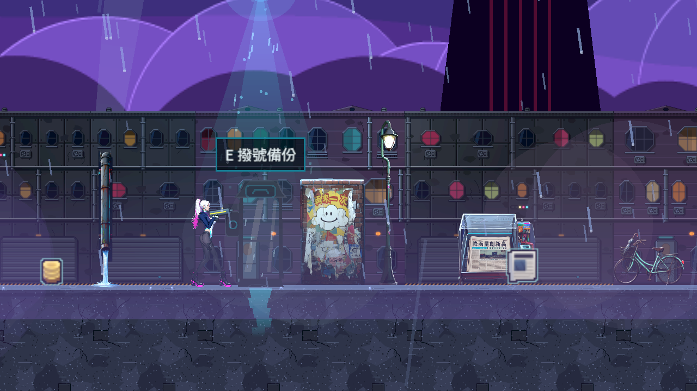
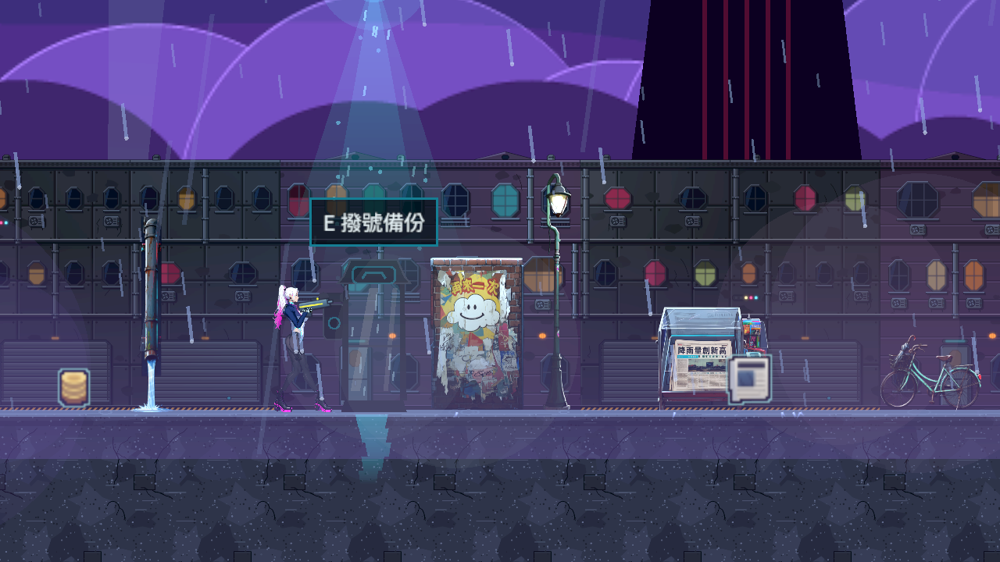
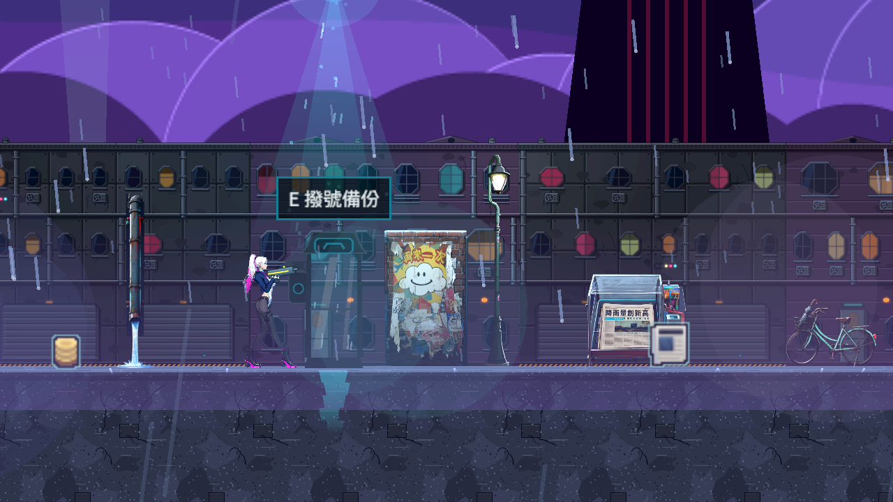
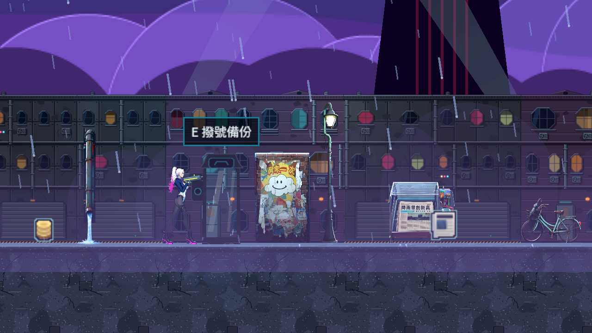

# Commit-2

## 內文

水管的雲端畫面已在本機獨立複驗。低、中、高品質水流都從固定管口落在地面；暫停會停住水流，恢復後繼續，射擊時仍能辨識角色與子彈。
十次往返切區後，局部水流均已釋放，清理後節點數一致。已保存原生顯示卡畫面與原始執行紀錄。

### 測試結果

| 項目 | 結果 |
|---|---|
| 本機原生執行 | Godot 4.7.2、Intel Arc B580、Forward+、1280×720，exit 0 |
| 連續畫面 | 三品質各三時刻，另含暫停、恢復、射擊與街道，共 13 PNG |
| 暫停與十次切區 | 水流時鐘停止；十次全部釋放，清理後節點均為 89 |
| 原始執行 log | 無 ERROR／WARNING |
| 記憶體量測 | 引擎配置約 134 MB 穩定；總 RAM／VRAM 尚無完整同機對照 |

驗收範圍與來源校驗見[本機紀錄](../Nest-Egg/attachments/BG-25-local-native/README.md)及[原始 log](../Nest-Egg/attachments/BG-25-local-native/native.log)。

### 截圖

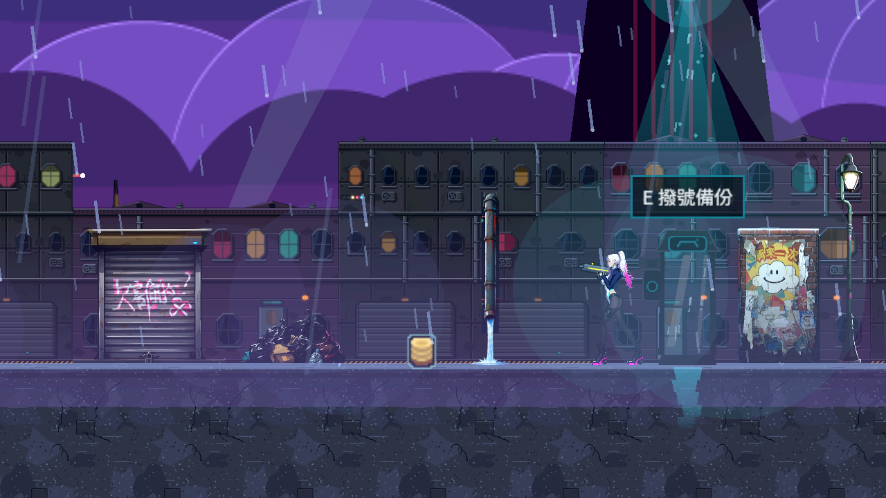
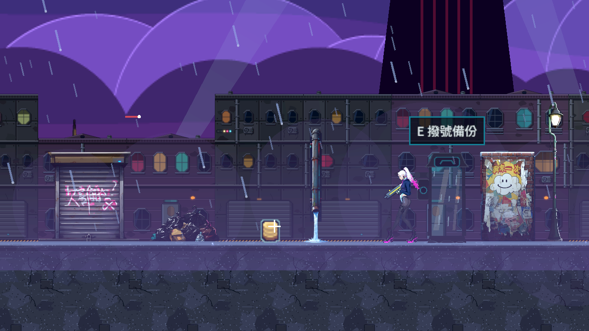
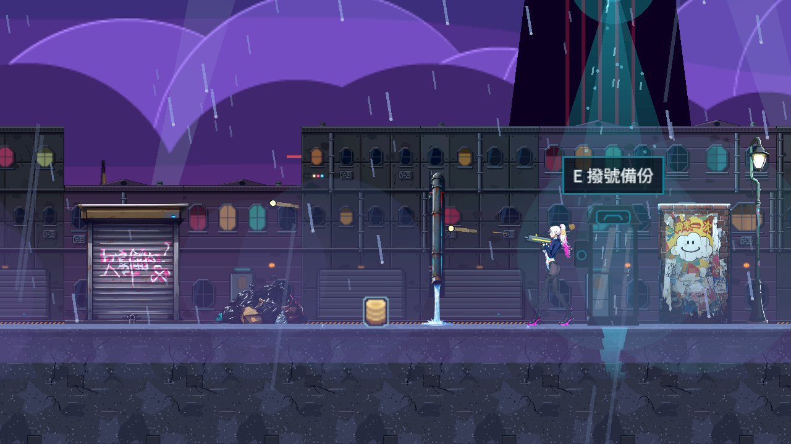
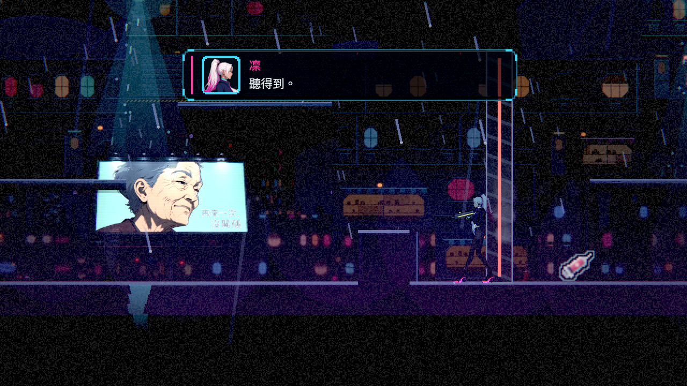

# Commit-3

## 內文

前兩次交付做了電話亭巷的水管與廚房水壺，其餘各區只有資料盤點，沒有逐件看過；當舖的漏水桶有出水口卻沒有水滴落下，屋頂接雨桶的動態是整張圖一起起伏，連落水管和桶身都在晃。

這次把第一章八個區域的每件擺設列成清單：有什麼動態、哪裡是不該動的固定點、為什麼留靜態。漏水桶新增滴水：水滴從牆上的出水口落進桶裡，越落越快，碰到水面濺開兩個小點。接雨桶改成只有水柱往下流、桶面有漣漪，落水管與桶身不動。其餘既有的蒸汽、懸掛搖晃與燈光閃爍逐件看過後沿用，沒有重複疊加。第一章沒有風扇，也沒有獨立的布料圖層，這兩類沒有動；沒有任何一項需要影片生成模型，所以沒有另開相關的票。

原生畫面連拍確認：水滴由出水口落到桶內水面，接雨桶的水柱落在桶面；吊鏈、紙罩燈、燈籠、盆栽、天線與電線只有下垂或上端的部分擺動，掛點、花盆、底座不動。新動態畫在擺設那一層，在角色、敵人、子彈與提示之後；光影品質「低」同樣看得到。暫停時滴水與水流停住，恢復後繼續；兩個關卡各重進十次，節點數每次相同、沒有孤兒節點，引擎配置不變，貼圖記憶體上下起伏但沒有往上走。每格時間約 3 到 5 毫秒，有沒有滴水分不出差別。搖晃與閃爍是依時間計算的著色器，暫停畫面後面仍會動，這一點照實記錄。

### 測試結果

| 項目 | 結果 |
|---|---|
| 滴水與水柱的自動檢查 | 通過（資料有效性、落下與水花、畫面外與暫停、資料錯誤時保留靜態圖） |
| 原生連拍（11 件擺設，共 48 張） | 自然結束、0 錯誤 |
| 暫停與恢復 | 滴水、水流的時鐘暫停時不變，恢復後前進 |
| 重進關卡 10 次 | 當舖節點 971、屋頂 858，每次相同；孤兒 0；引擎配置 139.3～139.4 MB 與 137.7 MB |
| 每格時間（關垂直同步） | 漏水桶 3.6 ms（拿掉滴水 5.1 ms）、接雨桶 3.0 ms |
| 受影響測試 | 48191 項檢查；新失敗 0、已知失敗 0 |

逐區清單與量測方法見[場景動態設計](../../design/19-world-item-art/ENVIRONMENT_MOTION.md)的第三階段，各擺設的原始紀錄在 [attachments/BG-25-motion-stage3](attachments/BG-25-motion-stage3/)。分支 `feature/scene-lighting`；提交見[遠端 main 上本票的提交](https://github.com/deadline314/Nest-Egg/commits/main/pm/Nest-Egg-BG/%5BBG-25%5D%E5%8A%A0%E5%85%A5%E7%AC%A6%E5%90%88%E7%89%A9%E4%BB%B6%E7%94%A8%E9%80%94%E7%9A%84%E5%A0%B4%E6%99%AF%E5%8B%95%E7%95%AB.md)。

### 截圖

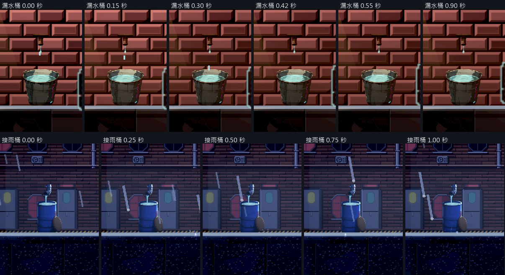

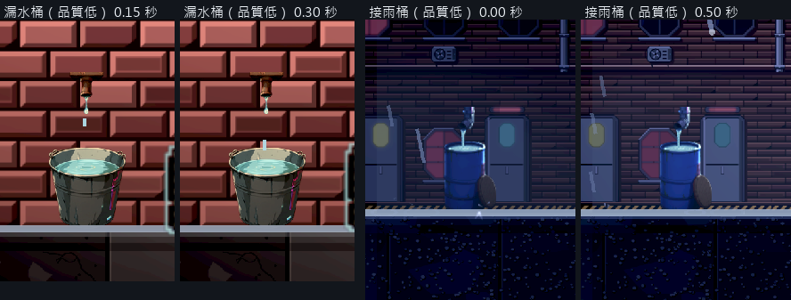

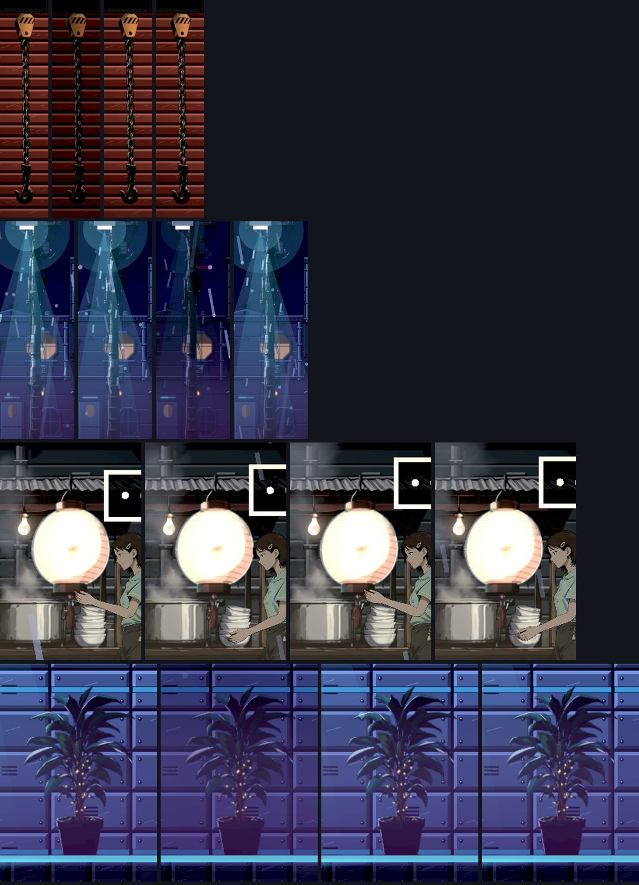
