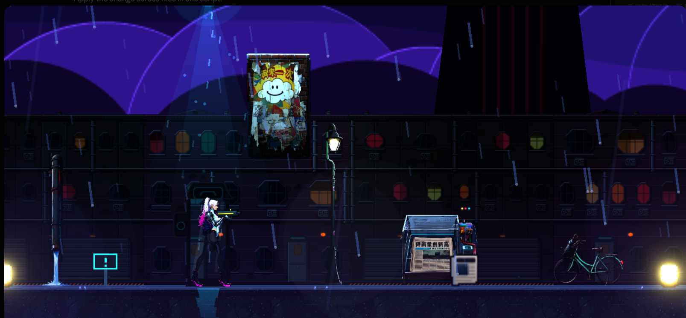
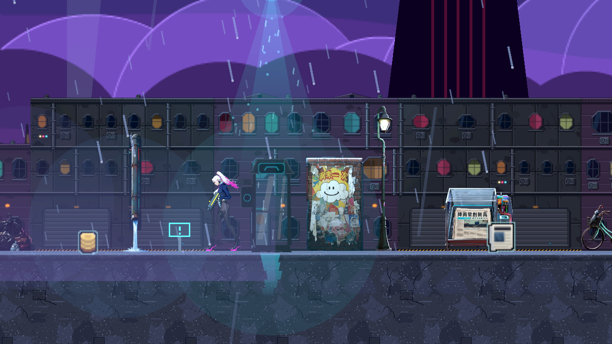
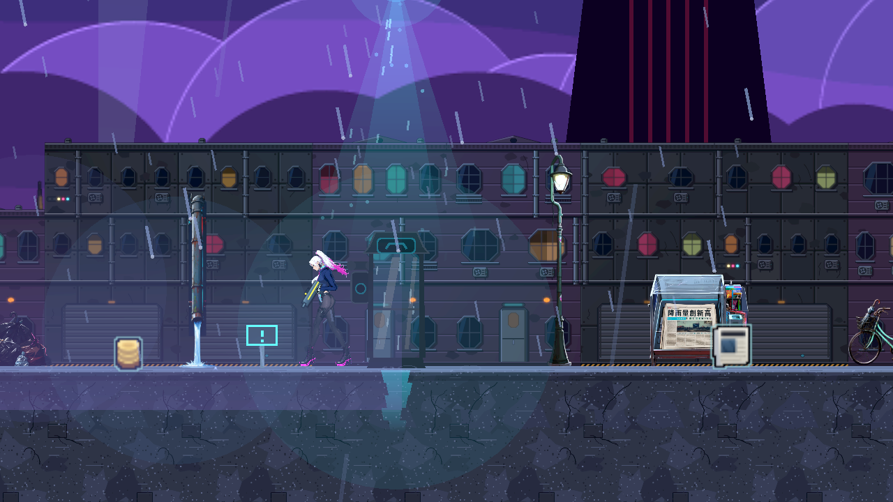

# [BG-26] 補驗海報與壁掛物的合理支撐

> 狀態：完成

## 內文

### 需求
電話亭巷「再來一次」海報不得伸入天空或缺少支撐。重新檢查已建立場景的壁掛物，確認完整圖片位於實際可見的支撐面，大小符合用途和角色比例；重建後維持正確位置。錯誤位置必須指出場景與物件並拒絕呈現，保留原回報與真正遊戲畫面作為證據。

### 來源
2026-10-10 使用者提供電話亭巷實機截圖，要求重新審查物件大小、位置及浮空情況。承接 BG-19 的驗收覆核。

### 驗收條件
- [x] 海報整張位於可見牆面內、底部接地；以角色為尺核對大小，未以放大背景掩蓋问题
- [x] 作者擺位、重建結果與正式資料一致；重建不讓海報回到天空
- [x] 同一海報移回錯誤位置時被拒絕，保留完整錯誤位置證據
- [x] 已建立關卡與舞台的壁掛支撐回歸通過，逐件核對透明邊界及尺度；整體構圖另由場景票驗收
- [x] 相關局部測試全過，附相同鏡頭的原生 Forward+ 正常與反例畫面

### 測試流程
1. 進入第一章電話亭巷，在海報旁查看整張圖片、牆面與地面，核對角色比例。
2. 重建作者區域，核對正式地圖格與全部道具是否一致。
3. 刻意把同一海報移回回報位置，確認執行期拒絕並留下可定位紀錄；恢復資料。
4. 執行受影響場景測試，核對既有關卡與舞台的支撐；以同鏡頭保存正常和反例原生圖。

---

# 跟其他票的關係

- Blocks：無
- Blocked by：無
- Related：BG-19

---

# Commit-1

## 內文

使用者回報電話亭巷「再來一次」海報伸進天空。最新正式畫面已有貼牆位置，作者擺位則仍保留較高的位置、依另一份修正設定移下。現在作者擺位統一成貼牆位置；海報保持原尺寸，整張位於牆面內、底部接地。原生畫面已重新確認，地圖格、九筆道具與玩家動線維持一致。

新增回歸會把同一張海報移回回報的舊位置；支撐檢查必須拒絕，遊戲會記錄位置並略過。原圖、正常畫面及刻意反例的完整紀錄分開保留。[補驗證據](attachments/BG-19-poster-recheck/native-manifest.json)。

### 測試結果

| 項目 | 結果 |
|---|---|
| 受影響的場景局部測試 | 324 checks，0 failures、0 known failures |
| 作者擺位與正式資料一致性 | 四項通過；所有地圖格與九筆道具一致 |
| 全部正式關卡及舞台支撐回歸 | 11 個關卡、17 個舞台通過；舊海報位置被拒絕 |
| 獨立壁掛來源覆核 | 62 件壁掛的牆面幾何、圖片透明邊界與尺寸已核對；來源與正常原生圖一致 |
| 原生 Forward+／HDR 2D | 同鏡頭正常位置與刻意錯誤位置已查看；正常位置無支撐警告或腳本錯誤 |

### 截圖

