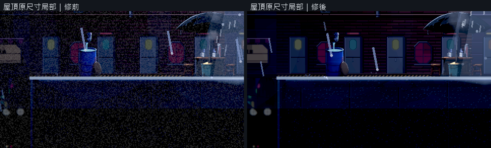
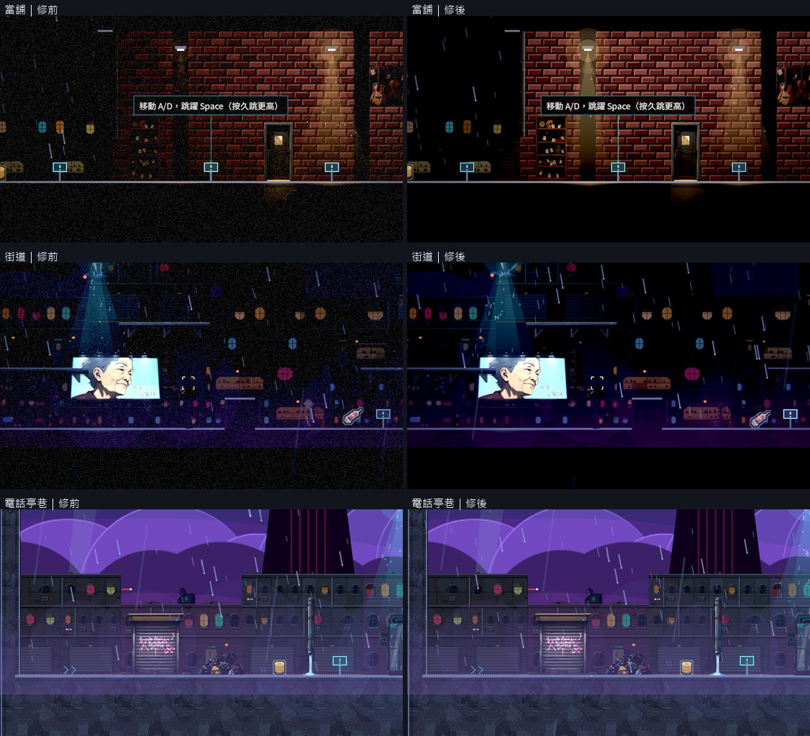
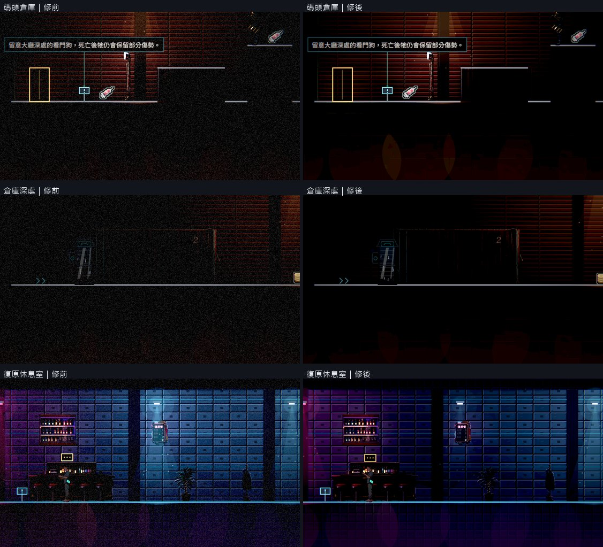
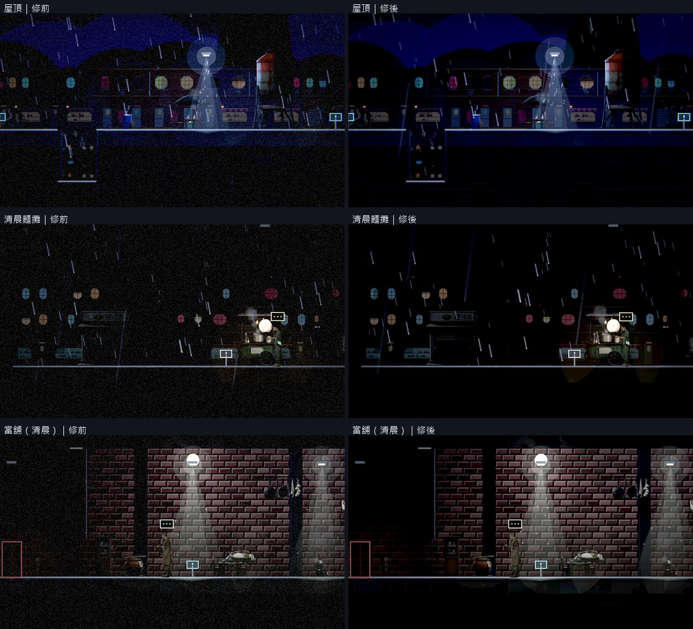
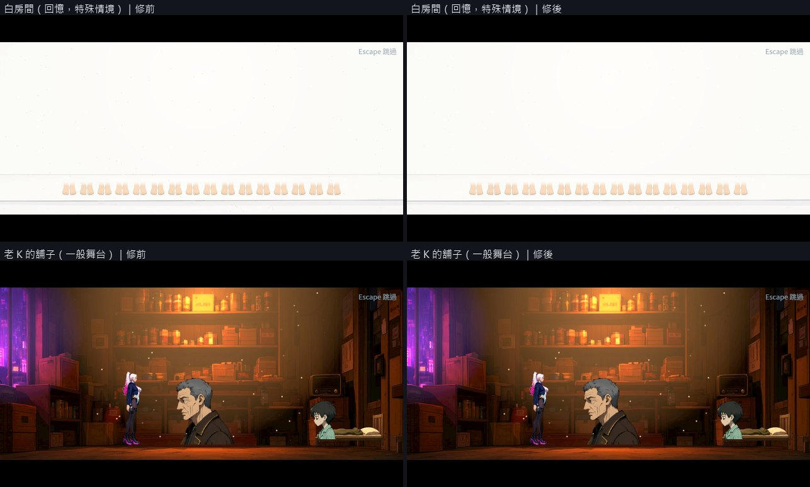
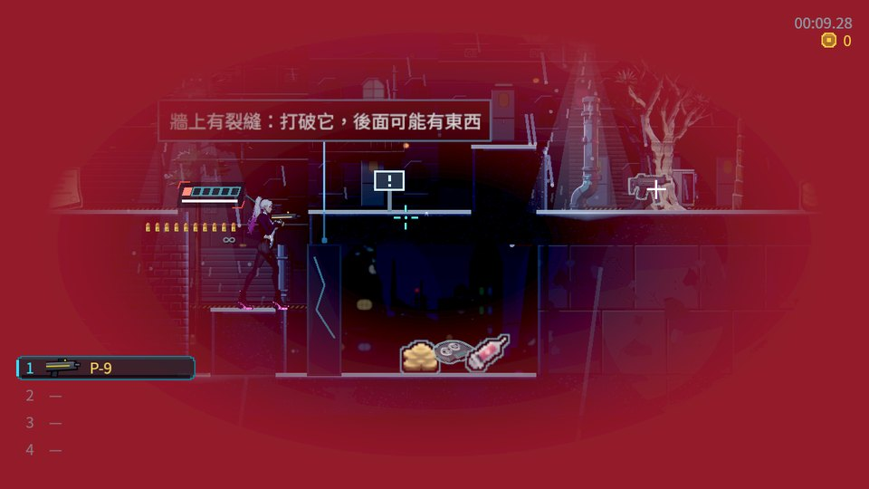

# [BG-27] 移除日常畫面的持續雜訊

> 狀態：審查中

## 內文

### 需求
一般遊玩、普通交談與過場保持乾淨畫面；顆粒僅在有敘事理由的回憶或特殊情境少量出現。

### 來源
2026-10-10，使用者提供背包參考圖與屋頂遊戲截圖，要求中性角色立繪、一般畫面減噪、合理材質與陰影、移除普通戰鬥封路、修正高低差造成的背景鏤空，並保留目前文字避開角色的告示提示。

詳見[本輪設計與研究](../../design/20-campaign-experience/INVENTORY_WORLD_CLARITY.md)。

### 驗收條件
- [x] 一般關卡與普通舞台沒有持續全畫面動態顆粒，不需降低整體光影品質。
- [x] 回憶或特殊情境的顆粒用途明確且克制；離開、取消、換區和續玩後正常清晰。
- [x] 調色、受傷提示、低血量辨識及合理雨水維持正確，文字與人物不被效果淹沒。
- [x] 正式來源重建後保持清晰；減動態設定有效。
- [x] 同鏡頭前後比較、特殊情境與返回正常畫面的原生驗證及局部測試留存。

### 測試流程
1. 在高光影品質下遊玩屋頂、室內及普通交談，保存減噪前後画面。
2. 測特殊效果進出、取消、換區與續玩，再重建來源確認不回復日常顆粒。

---

# 跟其他票的關係

- Blocks：NE-233
- Blocked by：無
- Related：NE-66、NE-95、NE-228、BG-30

---

# Commit-1

## 內文

每一份關卡光影設定都帶著顆粒，而且顆粒是直接加在還沒轉成螢幕亮度的畫面上，暗的地方被放大成一整片跳動的雪花；第一章本來就暗，所以九個區域全程都蓋著雜訊。過場舞台另外各有一層跳動的小白點。

現在一般遊玩的光影設定一律沒有顆粒，一般舞台也拿掉那層白點。顆粒只留給有理由的特殊情境：白房間的回憶畫面與藍天接縫各留少量（白房間從 420 點降到 140 點、也調淡），另保留一份「廣播風暴」光影設定可帶少量顆粒；這三處都寫明理由。之後任何光影設定或舞台要加顆粒卻沒寫理由，或超過上限，資料檢查會直接指出來。顆粒的算法也改成在接近螢幕顯示的亮度上疊加，暗部不再被放大。設定裡開啟「減少閃光」時，剩下的顆粒也會關掉。光影品質、調色、暗角、低血量的紅色提示與戶外的雨都沒有動。

九個區域同鏡頭修前修後逐格看過，畫面乾淨、沒有跳動的雜訊，光影品質維持「高」。白房間仍看得到少量顆粒，接著播的一般舞台是乾淨的。特殊設定套用後回到一般設定，顆粒歸零；兩個舞台產生器與第一章資料重新產生後結果不變。低血量的紅色暗角與提示文字照常顯示。

### 測試結果

| 項目 | 結果 |
|---|---|
| 原生巡覽（9 區，光影品質高） | 修前修後同一組格子；自然結束、0 錯誤 |
| 過場舞台原生畫面（10 個舞台） | 一般舞台無顆粒；白房間、藍天接縫保留少量 |
| 資料檢查 | 24 份光影設定只有 1 份有顆粒且附理由；有顆粒的舞台 3 個，皆附理由 |
| 受影響測試 | 選擇器判定為全部套件：85247 項檢查；新失敗 0、已知失敗 0（前一次執行有 1 項與本票無關的近戰粒子計時檢查失敗，該套件單獨重跑 3 次與整組重跑皆通過） |

分支 `feature/scene-lighting`；提交見[遠端 main 上本票的提交](https://github.com/deadline314/Nest-Egg/commits/main/pm/Nest-Egg-BG/%5BBG-27%5D%E7%A7%BB%E9%99%A4%E6%97%A5%E5%B8%B8%E7%95%AB%E9%9D%A2%E7%9A%84%E6%8C%81%E7%BA%8C%E9%9B%9C%E8%A8%8A.md)。

### 截圖

