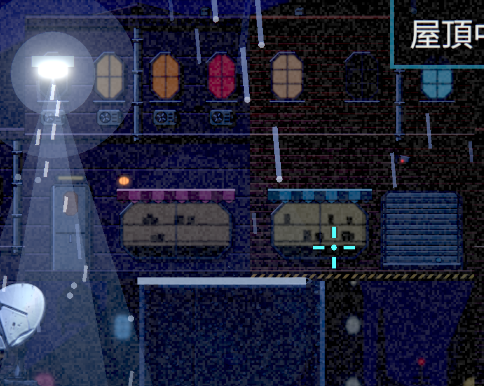
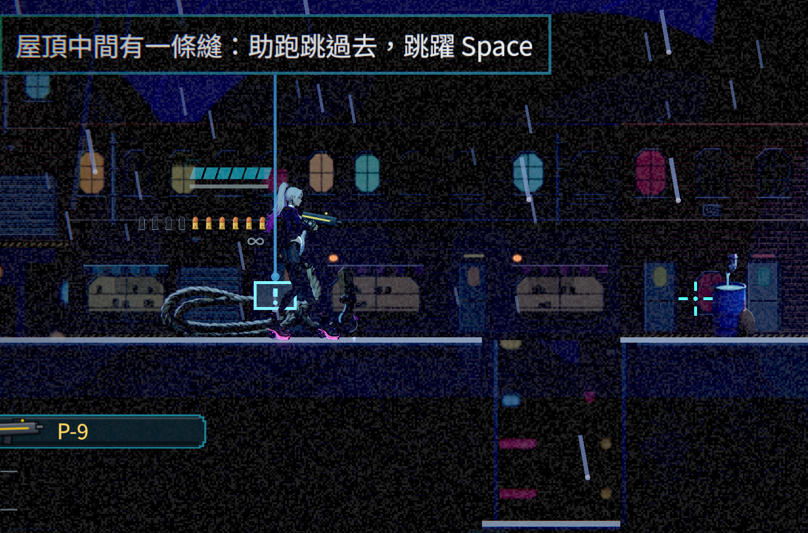
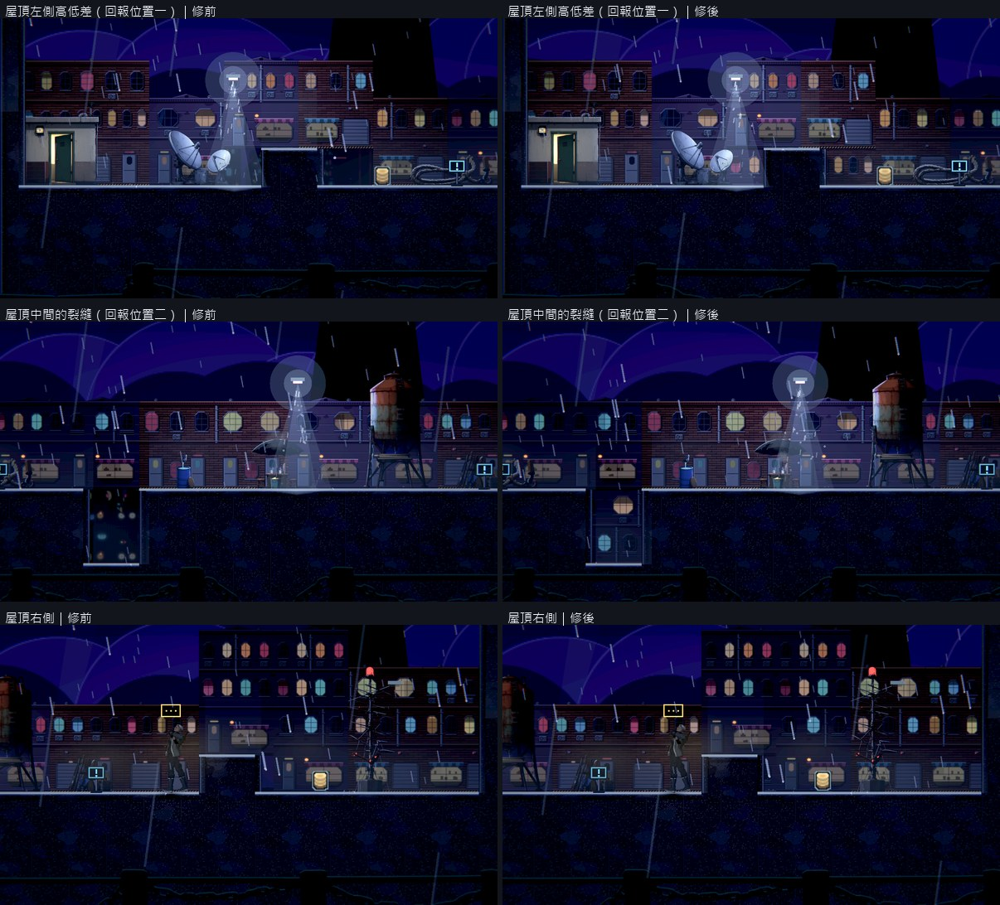
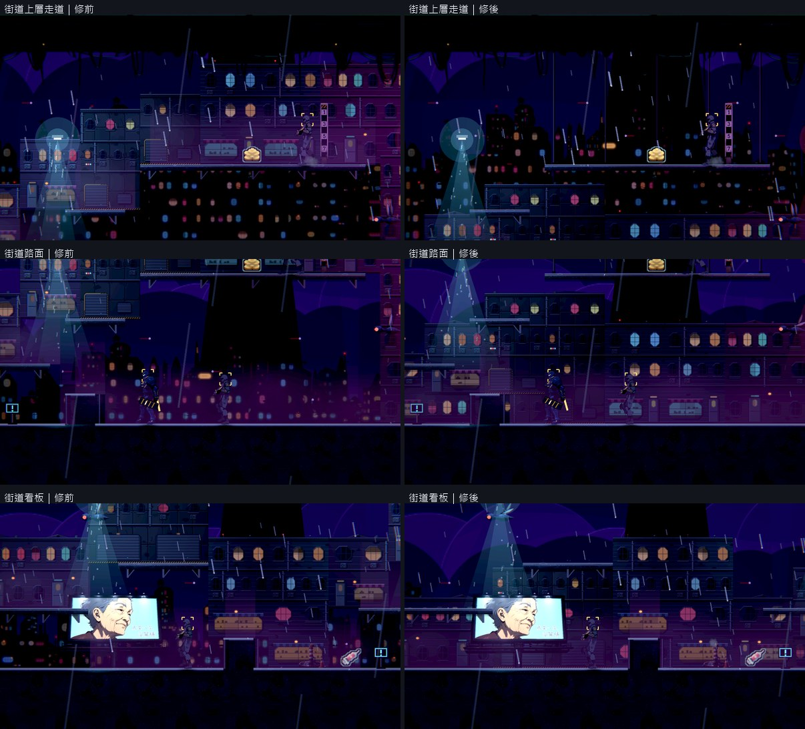
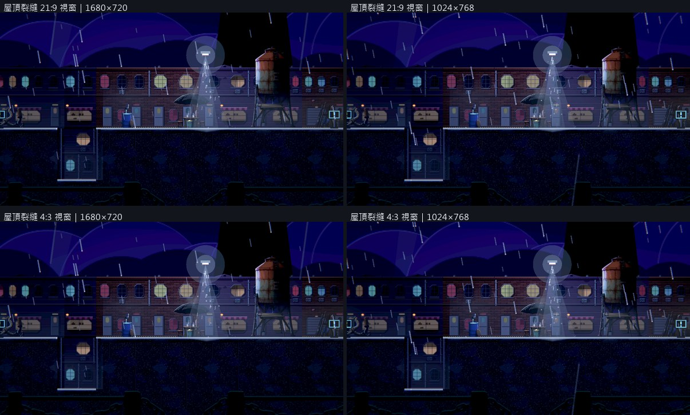

# [BG-28] 補齊高低地圖的背景覆蓋

> 狀態：審查中

## 內文

### 需求
修正房屋立面與地形高低差交界的背景鏤空，讓屋頂、下層與裂縫周圍的建築與側壁有完整合理覆蓋。

### 來源
2026-10-10，使用者提供背包參考圖與屋頂遊戲截圖，要求中性角色立繪、一般畫面減噪、合理材質與陰影、移除普通戰鬥封路、修正高低差造成的背景鏤空，並保留目前文字避開角色的告示提示。

詳見[本輪設計與研究](../../design/20-campaign-experience/INVENTORY_WORLD_CLARITY.md)。

參考來源圖：

### 驗收條件
- [x] 使用者回報的屋頂裂縫與相鄰高低處不再露出非預期背景缺口。
- [x] 逐區區分背景、側壁、窗外開口與真正天空，補齊內容符合建築用途。
- [x] 保留原有跳躍裂縫、高低差與路徑，不靠拉伸房屋或封平坑洞掩蓋問題。
- [x] 鏡頭上下與左右移動、不同視窗比例和重建後覆蓋正確，沒有接縫、重複穿幫或多餘常駐圖。
- [x] 受影響局部測試通過，附回報位置及相鄰區域的同鏡頭前後原生畫面。

### 測試流程
1. 定位回報的兩處屋頂，從上層移動到下層並左右巡查背景邊界。
2. 測不同視窗比例、換區與重建，核對地形玩法及建築覆蓋。

---

# 跟其他票的關係

- Blocks：NE-233
- Blocked by：無
- Related：BG-20、BG-21、BG-17、NE-178

---

# Commit-1

## 內文

背景的建築原本是「站在每一段最高的那個可站面上」往上蓋，下面什麼都不畫。所以屋頂中間的裂縫、屋頂左側的高低差，從縫裡看到的是遠景的光點；街道上的單向走道還會把整棟樓墊到半空中，樓的下方直接露出天空。

現在建築一律站在實心的地面上，並往下蓋到這一段看得到的最低處：屋頂的裂縫與高低差裡看到的是同一棟樓往下延伸的樓層。單向走道不再把樓墊高，街道的建築回到路面，上方留給真正的天空與地標高塔。走道的支撐依後面有沒有牆決定：有牆的地方是架在牆面上的托架，沒有牆的地方改成往上的吊索，吊在上一層走道或畫面外的結構。裂縫、高低差、走道與可走的路線都沒有動，沒有拉高房屋或填平坑洞。舊的開發用關卡裡，招牌與掛牆物是照舊規則擺的，所以那兩個主題用資料旗標保留「樓跟著走道長高」，同樣補上往下的延伸。

使用者回報的兩個位置與相鄰區域同鏡頭修前修後逐格看過：裂縫與高低差裡是牆面，不再是遠景光點；街道上層的走道吊在吊索上，敵人站在天際線前。鏡頭在上下兩排、左右各格之間移動，交界沒有接縫或重複。專案固定 16:9 畫面，21:9 與 4:3 的視窗是上下或左右留黑邊，看到的世界範圍相同，兩種視窗各拍了一張確認。重新進入關卡後的結果與巡覽一致（建築由關卡資料決定，沒有額外的常駐圖）。場景檢查十一張關卡 0 錯誤 0 警告，掛牆的招牌與擺設後面都還有牆。

### 測試結果

| 項目 | 結果 |
|---|---|
| 場景檢查（11 張關卡） | 0 錯誤、0 警告 |
| 建築覆蓋的自動檢查（裂縫、走道、舊主題） | 通過 |
| 原生巡覽（8 區修前修後；屋頂另拍 1680×720 與 1024×768） | 自然結束、0 錯誤 |
| 受影響測試 | 選擇器判定為全部套件：77562 項檢查；新失敗 0、已知失敗 0（前一輪同時在合成圖片時，有 1 項與本票無關的爆炸效能預算檢查超時，單獨重跑通過） |

分支 `feature/scene-lighting`；提交見[遠端 main 上本票的提交](https://github.com/deadline314/Nest-Egg/commits/main/pm/Nest-Egg-BG/%5BBG-28%5D%E8%A3%9C%E9%BD%8A%E9%AB%98%E4%BD%8E%E5%9C%B0%E5%9C%96%E7%9A%84%E8%83%8C%E6%99%AF%E8%A6%86%E8%93%8B.md)。

### 截圖

