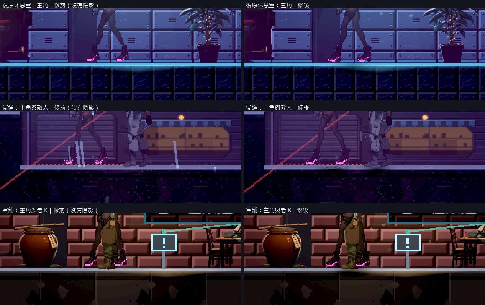
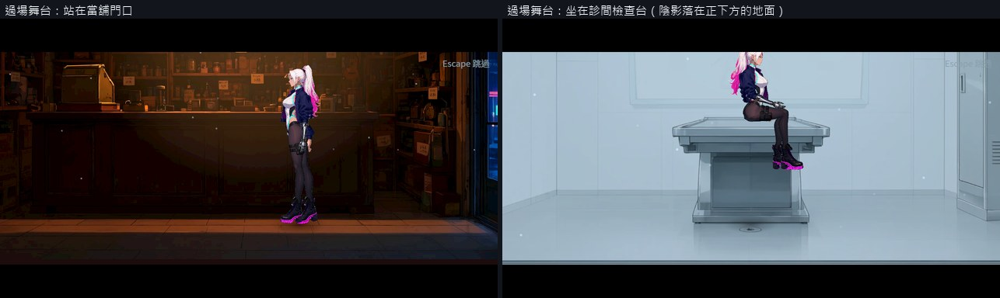

# [BG-29] 加入符合支撐面的角色陰影

> 狀態：審查中

## 內文

### 需求
玩家、NPC與敵人有符合體型、姿勢和地面的陰影，建立落地感並保持角色輪廓清楚。

### 來源
2026-10-10，使用者提供背包參考圖與屋頂遊戲截圖，要求中性角色立繪、一般畫面減噪、合理材質與陰影、移除普通戰鬥封路、修正高低差造成的背景鏤空，並保留目前文字避開角色的告示提示。

詳見[本輪設計與研究](../../design/20-campaign-experience/INVENTORY_WORLD_CLARITY.md)。

### 驗收條件
- [x] 玩家、人形NPC與不同體型敵人的腳底陰影符合真實支撐面及尺寸，不是固定同一黑圓。
- [x] 跳躍、落地、樓梯、高低平台與坑洞時陰影位置、範圍和強度合理，沒有浮空或穿到另一樓層。
- [x] 坐姿、死亡、四足及過場依各自承重與光源驗證；適合的主光源投影方向一致。
- [x] 多角色與不同光影品質下不遮住地面危險、互動或身體細節。
- [x] 原生明暗畫面、適用動作与局部測試留存，記錄多角色效能與記憶體成本。

### 測試流程
1. 在室內、雨天與多平台移動、跳落、換向，檢查角色與敵人承重。
2. 看NPC坐站、四足及過場，在多角色與光影品質設定保存原生畫面並量測。

---

# 跟其他票的關係

- Blocks：NE-233
- Blocked by：無
- Related：BG-30、NE-90、NE-222、NE-224

---

# Commit-1

## 內文

角色腳下原本沒有任何陰影，站、跳、落地都像貼在背景上。

現在主角、站在地上的敵人與人物 NPC 腳下都有接觸陰影。陰影會往下找實際踩得到的面（地面或平台）：寬度跟著體型，四足的看門狗比人寬；跳起來時陰影留在原本那一層、越高越小越淡，超過跳躍高度或腳下是坑洞就不畫；站在平台邊緣時只蓋住有支撐的那一段，不會懸在空中，也不會穿過上層畫到下一層樓。陰影整個落在地板頂面上，不爬上後面的牆，並依最近的場景燈往反方向偏一點。主角倒地後陰影放寬成橫躺的長度。過場舞台的演員另外依舞台的地面線畫陰影，坐在高處時落在正下方的地面並變淡。飛行、掛牆與固定在天花板的敵人沒有腳下的陰影。

實際畫面上，休息室、街道與當舖裡主角、敵人與老 K 腳下都看得到落在地板上的陰影；當舖門口與診間兩個舞台也有。自動檢查涵蓋站立、跳高、超過高度、平台邊緣、上下兩層與坑洞七種情況，全部通過。街道 13 個、倉庫 11 個角色同時有陰影時，每格的物理處理時間與拿掉陰影時差不到 0.3 毫秒，在量測誤差內；每個陰影是 6 個節點，沒有每格配置。光影品質高低都會畫。

主角、敵人與人物的建立處各加了一行掛上陰影，這三個檔案屬於其他組的範圍，改動只有掛載與倒地時放寬。

### 測試結果

| 項目 | 結果 |
|---|---|
| 陰影行為自動檢查（7 種情況） | 全部通過 |
| 多角色成本（街道 13 個、倉庫 11 個陰影，各量兩輪） | 物理處理 2.8～3.7 ms，有無陰影差距在 ±0.5 ms 的誤差內 |
| 原生巡覽（9 區）與過場舞台掃描（10 組） | 自然結束、0 錯誤 |
| 受影響測試 | 選擇器判定為全部套件：83168 項檢查；新失敗 0、已知失敗 0。併入最新 main 後重跑 83190 項，有 1 項與本票無關的效能預算檢查在 14 個程序同時跑時超出（十二個爆炸多 6.35 ms，預算 6 ms），該套件單獨重跑 3 次皆通過 |

分支 `feature/scene-lighting`；提交見[遠端 main 上本票的提交](https://github.com/deadline314/Nest-Egg/commits/main/pm/Nest-Egg-BG/%5BBG-29%5D%E5%8A%A0%E5%85%A5%E7%AC%A6%E5%90%88%E6%94%AF%E6%92%90%E9%9D%A2%E7%9A%84%E8%A7%92%E8%89%B2%E9%99%B0%E5%BD%B1.md)。

### 截圖

# Commit-2

## 內文

上一次交付寫的效能數字（「物理處理 2.8～3.7 ms」）取自引擎的處理時間監測值，後來發現那個值不是每格實際花的時間，不能拿來當成本的依據。

量法改成暫時關掉垂直同步，量相鄰兩格之間的實際間隔，每格取 60 格的中位數；巡覽工具也改用這個量法。陰影本身沒有改動。

同一台機器、同一組格子，有陰影與拿掉陰影各量兩輪：街道 13 個陰影是每格 4.05 與 4.17 毫秒，拿掉之後 4.20 與 3.96 毫秒；倉庫 11 個陰影是 3.13 與 3.06 毫秒，拿掉之後 3.12 與 3.02 毫秒。差距在兩輪之間的起伏內，分不出陰影的成本。

### 測試結果

| 項目 | 結果 |
|---|---|
| 街道（13 個陰影），每格實際時間 | 有陰影 4.05／4.17 ms；沒有 4.20／3.96 ms |
| 碼頭倉庫（11 個陰影），每格實際時間 | 有陰影 3.13／3.06 ms；沒有 3.12／3.02 ms |
| 受影響測試 | 只改開發工具與票，沒有遊戲程式更動 |

分支 `feature/scene-lighting`。
