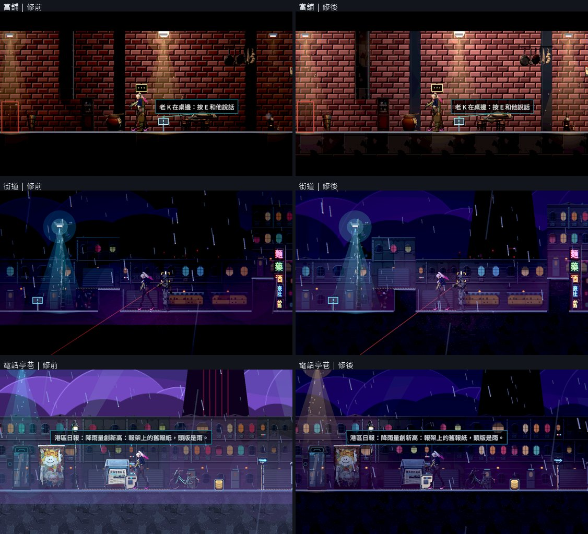
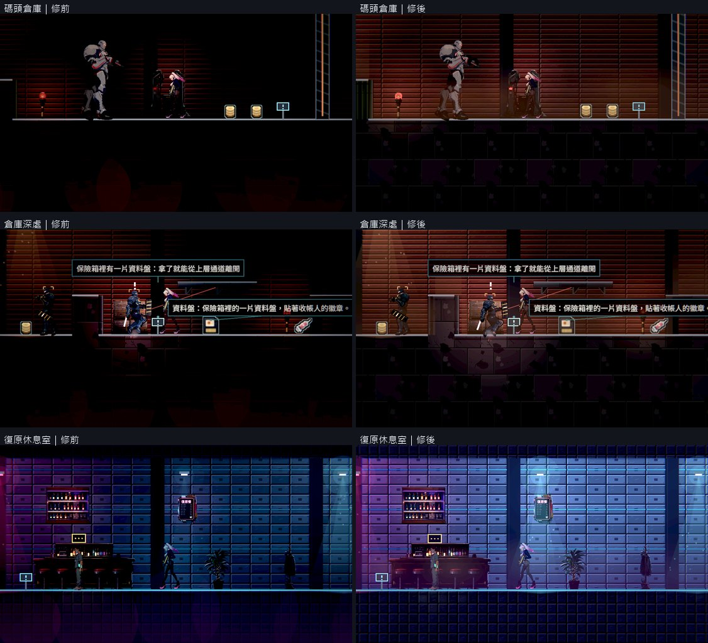
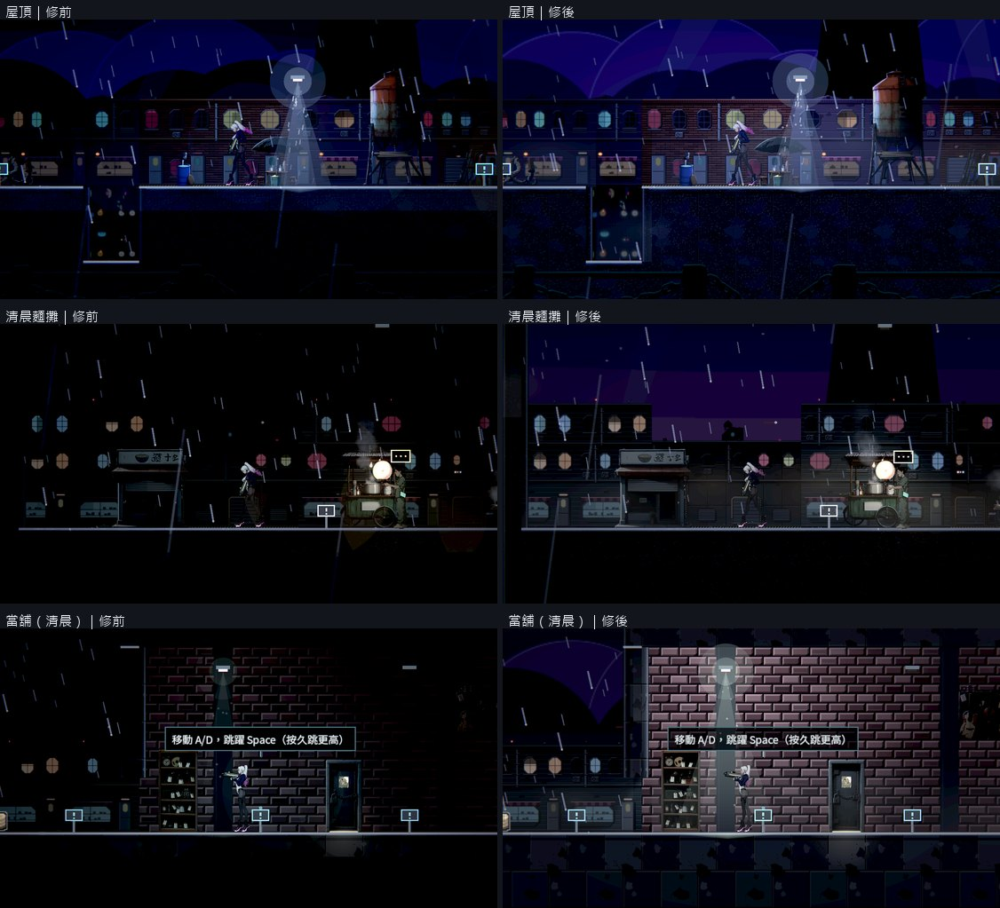
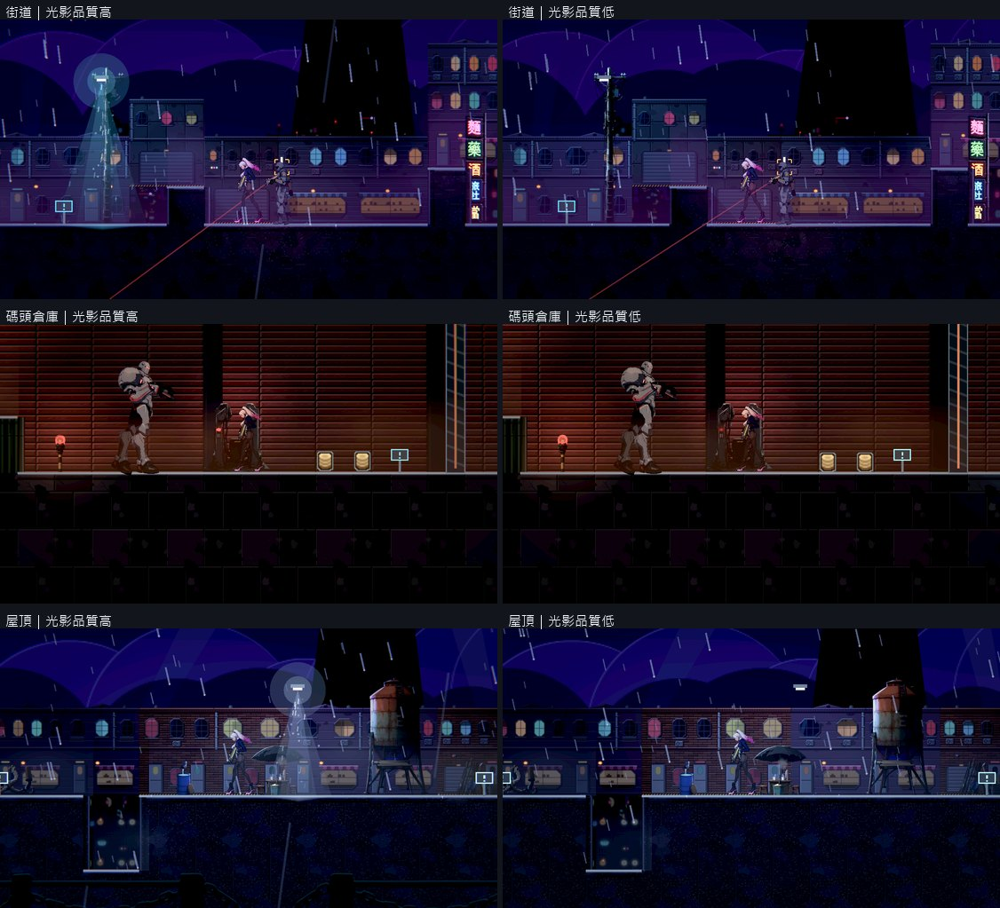
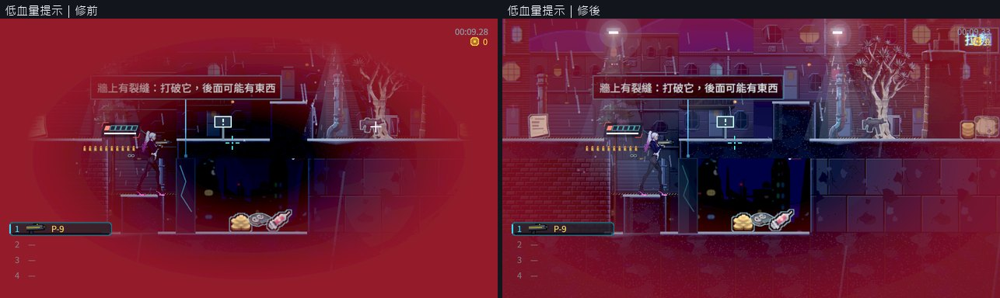

# [BG-30] 整理場景光影與視覺優先序

> 狀態：審查中

## 內文

### 需求
各區維持一致主光與少量實用光，減少混亂光束、反光與泛光，讓角色、路徑、敵人和互動物件清楚。

### 來源
2026-10-10，使用者提供背包參考圖與屋頂遊戲截圖，要求中性角色立繪、一般畫面減噪、合理材質與陰影、移除普通戰鬥封路、修正高低差造成的背景鏤空，並保留目前文字避開角色的告示提示。

詳見[本輪設計與研究](../../design/20-campaign-experience/INVENTORY_WORLD_CLARITY.md)。

### 驗收條件
- [x] 逐區記錄主要光源與視覺焦點，背景霓虹及裝飾不搶主角、敵人與落點。
- [x] 人物與材質在亮暗場景均完整可辨，沒有用過曝或過暗遮掩破圖。
- [x] 陰影、反光與光束符合實際空間；室內外與正常/特殊情境切換一致。
- [x] 光影品質與減動態選項均可用，重要危險與操作資訊不依賴高品質效果。
- [x] 同鏡頭前後畫面與真實Forward+量測留存，相關局部測試通過。

### 測試流程
1. 逐區同鏡頭比較角色、敵人、互動和背景的辨識與光源方向。
2. 測各光影品質、雨天/室內/特殊情境與多角色畫面，保存原生圖和效能紀錄。

---

# 跟其他票的關係

- Blocks：NE-233
- Blocked by：無
- Related：BG-17、BG-20、BG-27、BG-29、NE-66、NE-95

---

# Commit-1

## 內文

第一章的環境光太低，再疊上很重的暗角，街道與屋頂的建築本體、倉庫的牆與地面幾乎全黑，只剩自發光的窗像燈籠飄在空中；倉庫裡深色裝甲的敵人是黑底上的黑色剪影，最低對比只有 0.16（門檻 0.45）。地面霧氣是一顆顆邊緣銳利的圓盤，在倉庫還會畫進地面裡。電話亭巷用的是不調整的預設光影，整區全亮，和隔壁的街道接不起來。低血量的紅色暗角最強時幾乎蓋滿整個畫面。

先看了 Leyla In Veil 在 Steam 上的官方截圖：它每個房間一個主光、一個主色，其餘很暗。Nest Egg 借「一區一個主光、一個主色」這個原則，但因為有高低差與多條路線，玩家要看得到平台、牆與落點，所以不照它把環境壓到只剩光池。實際的改動是：五份第一章光影設定的環境光提高、暗角減輕；緊貼在角色後方的背牆整體比可玩層淡一階、略偏冷，角色與敵人從牆面前跳出來；主角的最低亮度同步提高，白色零件的曝光上限不變；霧改成貼著每一欄實際的地面、邊緣淡出；電話亭巷有了自己的夜色設定；低血量的紅色只留在畫面邊緣。九區的主光、點綴光與視覺焦點寫成[光影審查](../../design/20-campaign-experience/SCENE_LIGHTING_REVIEW.md)。

九區同鏡頭修前修後逐格看過：建築、牆面、地面與擺設看得出形狀，夜色與霓虹還在。量測上，敵人的最低對比從 0.16～0.34 提高到 0.38～0.48，中位數都在 0.56 以上；光影品質調到「低」數字幾乎相同，可讀性不靠高品質效果。有兩點沒有全過線：碼頭倉庫有一格敵人是 0.38（貨櫃頂上的守衛，背後是天花板暗處）；主角的中位數都在 0.63 以上，但街道、倉庫與倉庫深處各有一格是 0.57～0.58，略低於 0.6，原因是背景變亮後主角不再是黑底上的亮人。這幾格畫面上看得清楚，所以第二條先不勾，等角色陰影（BG-29）一起做完再重量；第三條的陰影部分同樣等 BG-29。

### 測試結果

| 項目 | 結果 |
|---|---|
| 原生巡覽量測（9 區，每格取 5 次中位數） | 敵人最低對比 0.16～0.34 → 0.38～0.48；主角中位數 0.63～0.88 |
| 光影品質低 | 主角最低 0.57～0.79、敵人最低 0.38～0.51，與品質高相近 |
| 原生執行紀錄 | 修前、修後高、修後低各一輪，自然結束、0 錯誤 |
| 受影響測試 | 選擇器判定為全部套件：77510 項檢查；新失敗 0、已知失敗 0 |

每一格的數字見 [量測紀錄](attachments/BG-30-lighting/)（before、after-high、after-low）。分支 `feature/scene-lighting`；提交見[遠端 main 上本票的提交](https://github.com/deadline314/Nest-Egg/commits/main/pm/Nest-Egg-BG/%5BBG-30%5D%E6%95%B4%E7%90%86%E5%A0%B4%E6%99%AF%E5%85%89%E5%BD%B1%E8%88%87%E8%A6%96%E8%A6%BA%E5%84%AA%E5%85%88%E5%BA%8F.md)。

### 截圖

# Commit-2

## 內文

上一次交付留下兩條沒勾：角色腳下還沒有陰影，以及等陰影做完再重量一次人物的可讀性。

角色陰影已由 BG-29 交付：落在實際的支撐面上，不懸空、不穿層。光錐照到地面為止、反光只在地板頂面、室內沒有雨絲，這幾項已在 BG-20 交付。

帶著陰影把九區重新量了一次，數字與上一次相同：敵人最低對比 0.38～0.49、中位數 0.54 以上；主角中位數 0.63～0.88。逐格看過畫面，人物、敵人、牆面與地面材質在亮的休息室與暗的倉庫都辨認得出來，沒有過曝，也沒有暗到看不見。仍有三格主角對比是 0.56～0.58、一格敵人是 0.38，略低於量測門檻（0.6、0.45），畫面上看得清楚；數字如實留在量測紀錄裡。

### 測試結果

| 項目 | 結果 |
|---|---|
| 原生巡覽重量（9 區，含陰影） | 敵人最低 0.38～0.49；主角最低 0.56～0.76、中位數 0.63～0.88 |
| 受影響測試 | 純票更動，沒有要跑的測試；程式部分見 BG-29 的紀錄 |

分支 `feature/scene-lighting`。

# Commit-3

## 內文

霧改成貼著地面之後，鏡頭在高處時會把懸空的單向走道也當成地面，在走道上方畫出一塊邊緣整齊的紫色霧，像一個半透明的方框。

現在霧只沉在實心的地面上，不會積在半空中的走道上。

街道上層走道的同一格修前修後看過，走道上方不再有紫色方框，路面的霧不變。

### 測試結果

| 項目 | 結果 |
|---|---|
| 原生巡覽（街道上層走道） | 走道上方沒有霧；路面的霧照常 |
| 受影響測試 | 與 BG-28 同一輪：77562 項檢查；新失敗 0、已知失敗 0 |

修後畫面見 BG-28 的街道截圖。分支 `feature/scene-lighting`。
