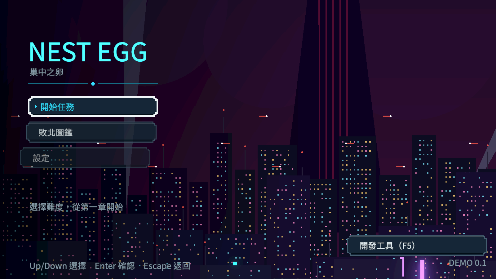
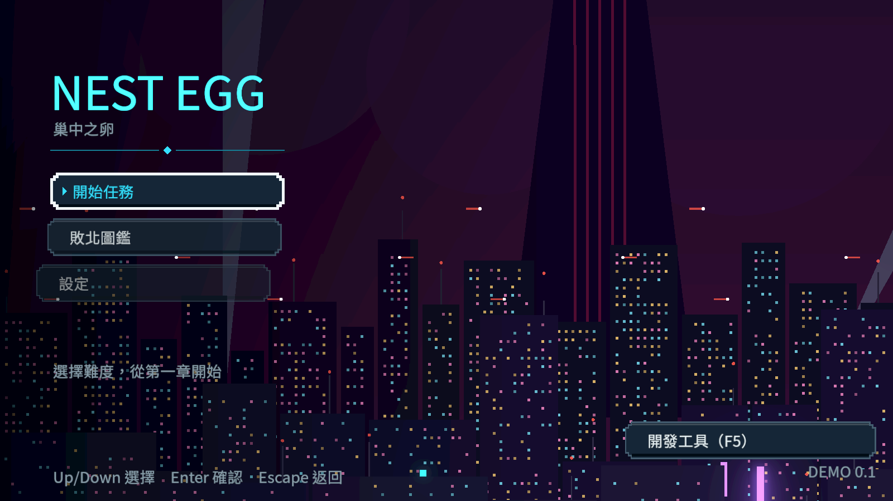
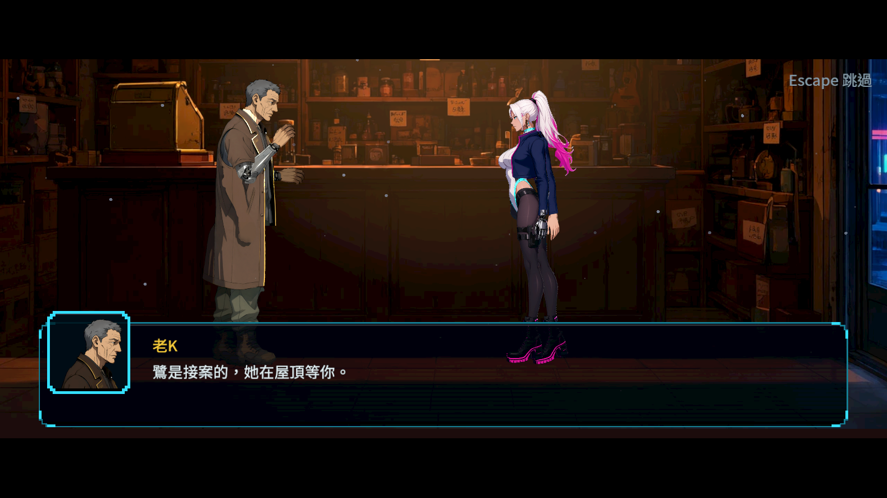
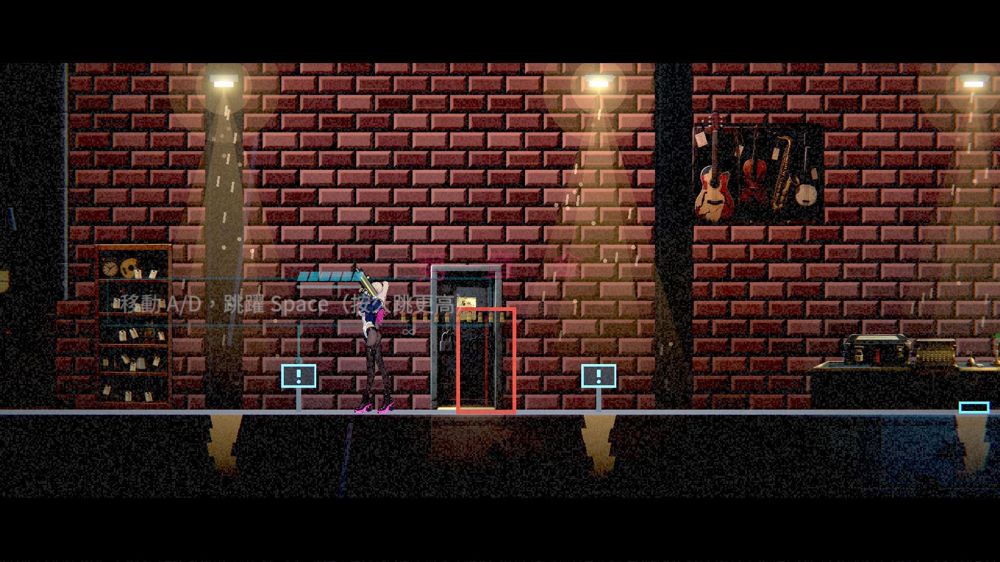
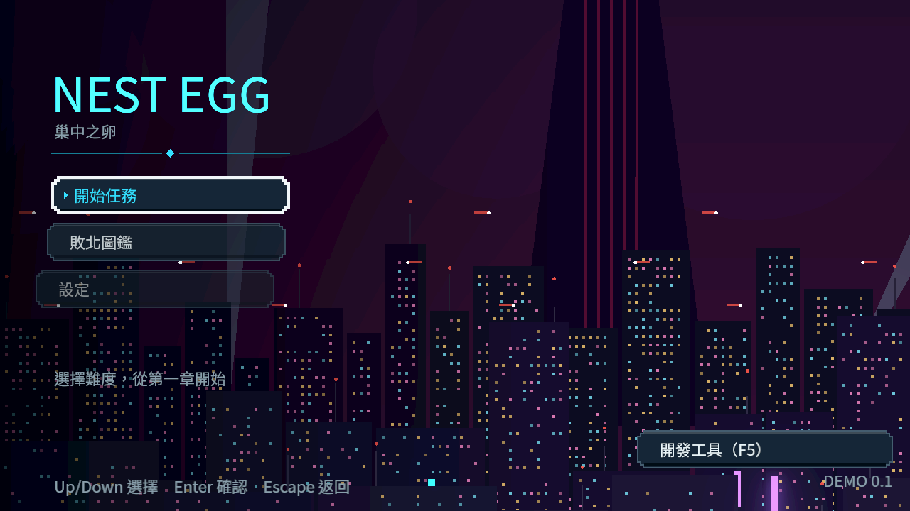
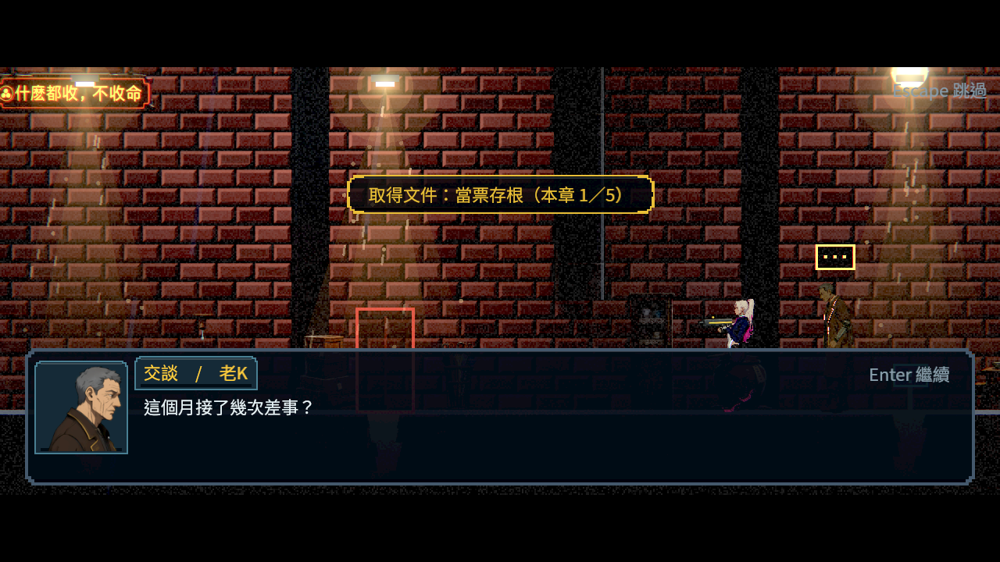
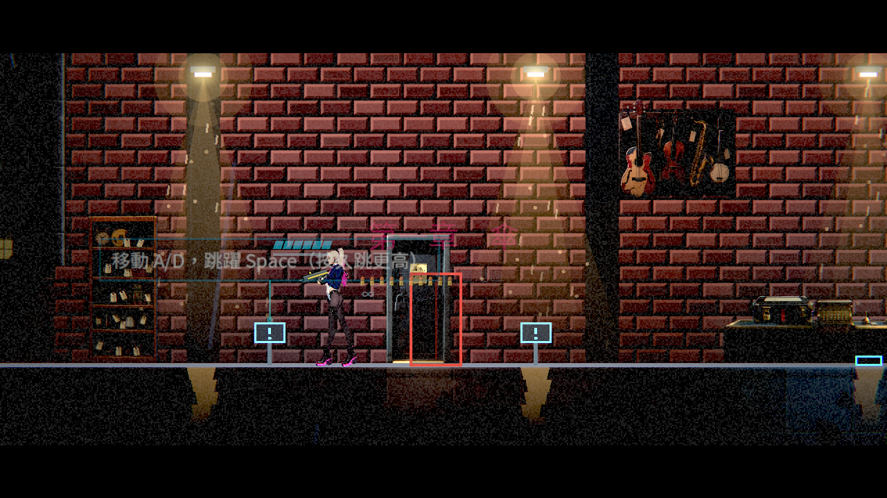

# [BG-31] 修正返回選單的渲染資源錯誤

> 狀態：審查中

## 內文

### 需求
完成對話、續玩及返回主選單時，畫面資源要安全切換，不得出現原生渲染錯誤、缺圖或卡住。保留正常載入速度、畫面效果及受限記憶體使用。

### 來源
2026-10-10，使用者要求發現問題留票、穩定交付且注意 RAM／VRAM；本機正式第一章讀檔驗收連續發現渲染資源錯誤。證據與定位界線見[渲染生命週期驗收](../../design/20-campaign-experience/RENDER_LIFECYCLE_REVIEW.md)。

### 驗收條件
- [x] 實際新遊戲、完成對話、獨立程序續玩與返回主選單的原生執行紀錄沒有渲染或腳本錯誤。
- [x] 讀訊與存檔結果完整保留，不重複完成、不跳过未讀內容，也不殘留凍結。
- [x] 切換前後人物、立繪、場景及介面完整；重複切換的資源回收與記憶體有實測紀錄。
- [x] 原受影響測試通過，並保存本機 Forward+ 修前修後畫面及原始紀錄。

### 測試流程
1. 開新遊戲，以實際互動完成第一章 NPC 對話並返回主選單。
2. 關閉程序後重新續玩，再互動及返回主選單；確認收據與故事紀錄沒有重複變動。
3. 在重要通訊保存拒絕、重試與取消的狀態切換畫面，確認文字與進度保留。
4. 反覆切換並核對原生 log、資源回收、程序記憶體與畫面。

---

# 跟其他票的關係

- Blocks：NE-246
- Blocked by：無
- Related：BG-23、NE-246、NE-247、NE-233

---

# Commit-1

## 內文

第一章對話、讀檔及返回選單時曾出現原生渲染資源錯誤。本次交付保留貼圖、法線與畫面效果的受限載入策略，以及主線新局、逐句完成開場、反覆返回選單與新程序續玩的回歸；原始失敗紀錄完整保留。

同步角色渲染修補後，以同一來源重跑原策略與修補策略。原策略本輪沒有重現 RID；修補後新局與獨立程序冷讀皆自然退出且 raw ERROR 0。六張修前修後選單、開場與世界圖已實際檢視，完整、沒有缺圖或黑掉；場景雜訊保留其原票範圍。

### 測試結果

| 項目 | 結果 |
|---|---|
| 最新主線原受影響七套件 | 2576 checks／0新失敗／0已知失敗；自然exit0；原filter後0非預期錯誤 |
| 主線原載入器對照 | 106／0；本輪未重現RID |
| 主線修補後新局與三輪返回／續玩 | 106／0；自然exit0；raw ERROR0 |
| 主線獨立程序冷讀與三輪返回／續玩 | 96／0；自然exit0；raw ERROR0 |
| 先前獨立貼圖繪製診斷 | 1599／0；原始不同來源保留 |

實測程序記憶體與原始來源見[交付證據](attachments/BG-31-primary-main/README.md)。2ms是soft時間預算；單張仍可超過，沒有VRAM或全遊戲固定記憶體上限的量測結論。私人NPC與重要通訊使用不同故事產品，另屬其正式整合驗收。

### 截圖

| 畫面 | 原策略 | 修補策略 |
|---|---|---|
| 選單 |  |  |
| 開場 |  |  |
| 世界 |  |  |

# Commit-2

## 內文

上一次交付只走到開場，沒有實際和人物對話；在最新 main 重跑時，行為檢查全過，但程序結束時偶爾出現「資源仍在使用」的原生錯誤（3 次中 2 次）。未回收的是配樂與環境音：結束時它們還在播放，音訊端來不及放掉串流，程序就關了。

現在結束遊戲前會先停掉配樂、環境音與音效，等音訊端放掉串流再關閉，最多多等 0.4 秒。驗收路線補上實際對話：用移動鍵走到老 K 面前、按互動鍵、逐句讀完，再回主選單與續玩三輪；另開新程序讀同一份存檔，讀下一段對話後再走三輪。每次回主選單也會核對節點數、孤兒節點、貼圖記憶體與物件數有沒有累積。

修正後 14 個獨立程序（其中 4 個用真實音訊驅動）全部自然結束，沒有渲染、腳本或結束時的錯誤，也沒有洩漏警告。兩段對話各記錄一次，續玩不重播已讀內容、接著播下一段未讀對話，讀完後沒有殘留暫停或鎖定。四次回主選單的節點數與貼圖記憶體完全相同，程序記憶體峰值沒有成長。選單、對話與關卡三張原生畫面逐張看過，人物、頭像、場景與介面完整，沒有缺圖或黑塊。

重要通訊的「保存被拒、重試、取消」是 NE-246 的功能，目前不在 main，測試流程第 3 步隨 NE-246 交付時做原生驗收。

### 測試結果

| 項目 | 結果 |
|---|---|
| 修正前（main f048d9d1）新局路線 ×3 | 行為 106／0；2 次結束時報「4 resources still in use at exit」 |
| 修正後新局＋對話＋三輪切換 ×7 | 各 126／0（首輪未含回收檢查為 122／0）；結束 0 錯誤、0 警告 |
| 修正後獨立程序冷讀＋對話＋三輪切換 ×7 | 各 117／0（首輪 113／0）；結束 0 錯誤、0 警告 |
| 回主選單水位（四次） | 節點 163、孤兒 0、貼圖 182.9 MB、顯示記憶體 229.5 MB，四次相同 |
| 程序記憶體峰值 | Working Set 503～510 MB、Private 793～802 MB，各輪無成長 |
| 受影響測試（7 個套件） | 2576 項檢查；新失敗 0、已知失敗 0 |

完整紀錄、修正前的錯誤 log 與各時點水位見[原生路線驗收](attachments/BG-31-native-route/README.md)。分支 `feature/scene-lighting`；提交見[遠端 main 上本票的提交](https://github.com/deadline314/Nest-Egg/commits/main/pm/Nest-Egg-BG/%5BBG-31%5D%E4%BF%AE%E6%AD%A3%E8%BF%94%E5%9B%9E%E9%81%B8%E5%96%AE%E7%9A%84%E6%B8%B2%E6%9F%93%E8%B3%87%E6%BA%90%E9%8C%AF%E8%AA%A4.md)。

### 截圖

| 主選單 | 與老 K 對話 | 回到關卡 |
|---|---|---|
|  |  |  |
