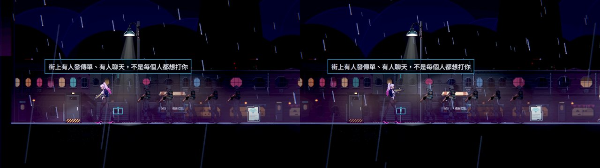
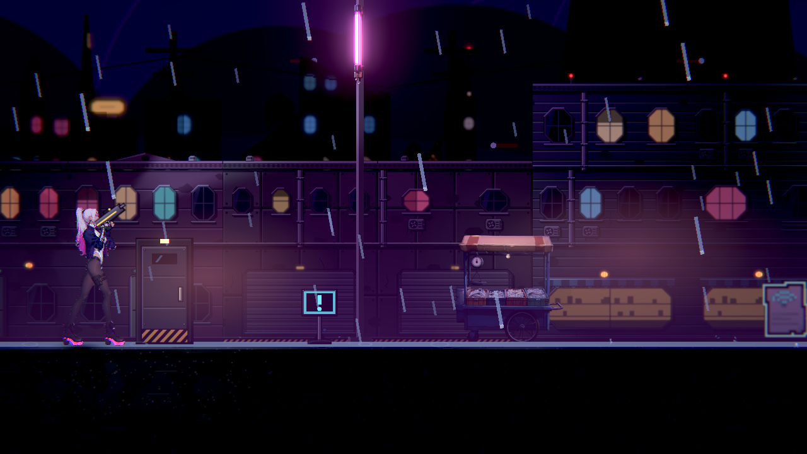
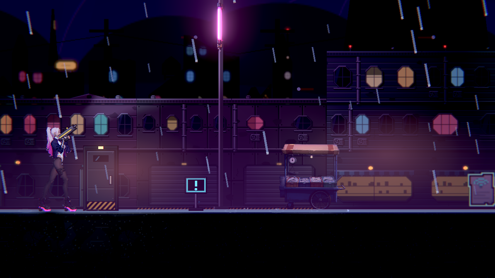
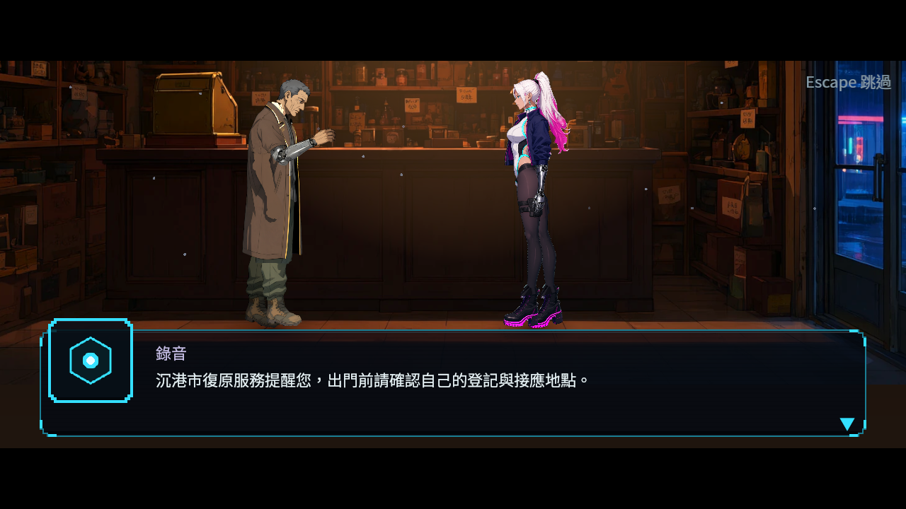
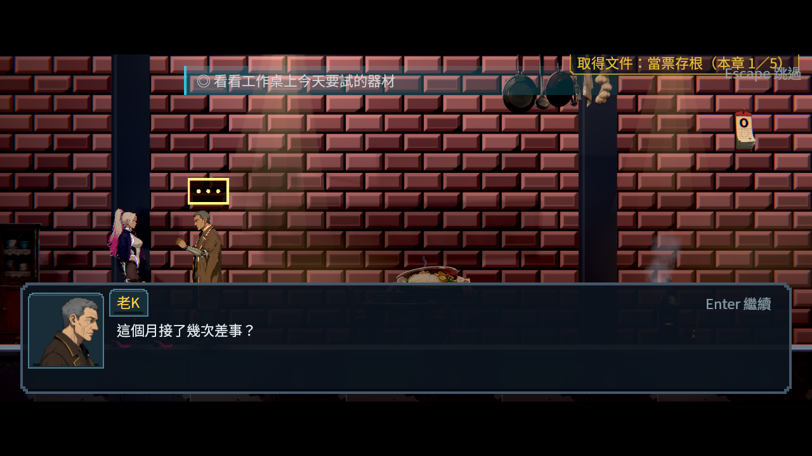

# [BG-32] 釋放用不到的過場舞台與背景貼圖

> 狀態：完成

## 內文

### 需求
遊戲載入過的環境貼圖會一直留在記憶體，不管現在的畫面用不用得到。在關卡裡量到的已載入環境貼圖中，有 12 張過場用的整張舞台與場景圖（共 35.4 MiB）和全部 12 張天空與遠景（共 22.1 MiB，包含這一關沒用到的）：舊第一關 151.9 MiB 裡占 57.5 MiB，第一章街道 85.5 MiB 裡占 57.5 MiB（67%）。玩得越久、看過的過場與走過的區域越多，留著的就越多。要讓記憶體只裝現在的關卡與正在播的過場需要的圖，同時不能讓切換關卡或進出過場變卡。

### 來源
2026-10-11，BG-17 本機原生量測時發現（逐張清單在 BG-17 的量測紀錄）。

### 驗收條件
- [x] 在關卡裡而且沒有過場在播時，已載入的環境貼圖不包含過場的整張舞台與場景圖
- [x] 天空與遠景只載入這一關用得到的
- [x] 依序走過第一章所有區域、看完沿途的過場，再回到街道：已載入的環境貼圖不高於第一次進街道時的 110%
- [x] 切換關卡與進出過場沒有新的原生渲染錯誤，也沒有比現在更長的停頓（主線新局、對話、返回選單、續玩的既有路線全過；記錄切換前後單次最長的影格時間）

### 測試流程
1. 原生執行環境量測工具，記錄舊第一關與第一章街道已載入的環境貼圖清單與總量，和修改前對照
2. 跑主線路線（新局、開場、對話、返回選單、續玩）三輪，看原生 log 與每輪回到選單時的貼圖用量
3. 依序進出第一章每個區域與過場，回到街道再量一次

---

# 跟其他票的關係

- Blocks：無
- Blocked by：無
- Related：BG-17、BG-31、NE-301

---

# Commit-1

## 內文

載入過的環境貼圖會一直留在記憶體。查到兩個原因：一、遊戲啟動時的資料檢查為了確認每一張過場舞台圖「在不在、多大」，把它們全部載進來，而且就此留在快取裡——所以還沒看任何過場，12 張整張的舞台與場景圖和一張沒用到的天空就已經佔著記憶體；二、貼圖快取只進不出，走過的區域、看過的過場的圖都不會放掉，預載也會把前幾個區域的圖一直留著。

現在資料檢查只問大小、不把貼圖留下來。換區域與過場結束之後，快取裡「除了快取以外沒有人在用」的環境貼圖會被放掉；場景上還在用的、預載手上拿著的不受影響。預載改成只留「現在這個區域的鄰居與它會播的過場」用得到的圖（上限 128 MB），換到下一個區域時，不屬於新區域鄰居的就放掉——所以記憶體裡是現在的區域加上隔壁的區域，走回隔壁時不必當場重新載入。角色的零件不在釋放範圍內。

做的過程中出過一個錯，已修並加了防護：背牆是用繪製指令畫的，畫完自己沒有留著貼圖，釋放機制把它們當成沒人用而放掉，整面背牆變成白色方塊（加上泛光就是一整條白光）。現在背牆自己留著畫過的貼圖；量測工具每一站都量畫面上純白的比例（超過 5% 就報錯），自動測試也檢查釋放之後背牆的貼圖都還在。

驗收（Arc B580，原生 Forward+，同一台機器、同一支腳本，修前修後交替各跑兩次）：照第一章出入口實際連接的順序走完九個區域再回到街道（共 11 站），每一站把它會播的過場舞台建出來再拆掉，每站停 300 個影格。
- 已載入的環境貼圖裡過場的整張舞台與場景圖：修前每一站都有 12～14 張，修後每一站都是 0 張。
- 直接進街道時的天空與遠景：修前 12 張（含一張這一關沒用到的），修後 11 張，都是這一關用的。
- 走一圈回到街道，已載入的環境貼圖（快取加預載）：修前從 107 MB 長到 181 MB（169%）；修後第一次進街道 89.5 MB、回來 89.9 MB（100.5%）。渲染器回報的貼圖記憶體：修前 224 → 332 MB，修後 207 → 235 MB。
- 進入每個區域後 90 個影格裡最長的一格（不含第一站的啟動）：修前兩次的平均是 69、71 毫秒，修後 66、63 毫秒；最長的一站修前 103、102 毫秒，修後 118、102 毫秒（同一站，兩次裡有一次多 17 毫秒，其餘各站持平或較短）。
- 每一站畫面上純白的比例最高 0.17%。釋放後又載入的貼圖一圈共 166 張次，都是回到走過的區域時經由預載重新拿到的；在同一個區域裡站著不動時是 0。
- 原生的選單流程（合成手把走主選單、新局、暫停、返回選單、續玩，36 項檢查）連跑三輪，三輪都 0 失敗、log 沒有錯誤。

要說明的地方：
- 第一條有一個刻意保留的例外：預載會把「現在這個區域自己會播的過場」的舞台圖先準備好（為了進過場時不停頓，這是原本就有的設計）。所以在有自己過場的區域裡，那幾張圖是在記憶體裡的——舊第一關 3 張（9.7 MB）、舊第二關 4 張；第一章各區域量到的是 0 張。別的區域的、已經離開的區域的舞台圖都不會留著。如果連這幾張也不要，代價是進過場時要當場載入，那是另一個取捨，沒有在這張票裡做。
- 可讀性量測（低、高）在這個提交與沒有這個提交的 main 上結果相同；量測當下機器有人在用，舊第二關「升降井入口」的主角對比在同一份程式上各次量到 0.50～0.88（門檻 0.60），不是這張票造成的，另外回報。
- 第三條原文是「不高於第一次進街道時的 110%」。只算快取（不含預載）是 113%，因為回到街道時隔壁區域的一部分貼圖同時被預載與快取拿著；把預載也算進去才是全部，那個數字是 100.5%，所以用它驗收。
- 第四條要求「每輪回到選單時的貼圖用量」：選單流程工具沒有量貼圖用量，這裡用走一圈的量測代替（三輪選單流程只確認沒有錯誤）。
- 這張票的範圍是環境貼圖；角色零件、音效沒有動。

動到其他組的檔案：預載（改成只留現在區域的鄰居、張數上限放寬）、貼圖快取（多了「只問大小」與「放掉沒人用的」）、過場的資料檢查（不再把舞台圖留下）、背牆（自己留著畫過的貼圖）。

### 測試結果

| 項目 | 結果 |
|---|---|
| 受影響的測試（`run_tests_changed.sh`，接到戰鬥組併入後的最新 main 再跑） | 通過 87,305 項檢查，新失敗 0 |
| 原生量測（`tools/texture_route_probe.tscn`，修前修後交替各兩次） | 舞台圖殘留 12～14 張 → 0 張；走一圈後 169% → 100.5%；換區域最長一格平均 70 → 65 毫秒；純白比例最高 0.17% |
| 原生量測（`tools/environment_probe.tscn`，直接進關卡） | 第一章街道渲染器貼圖記憶體 237～245 → 211～220 MB（含正在預載的隔壁區域）；舊第一關快取裡的環境貼圖 161 → 120 MB（另有 3 張這一關的過場舞台圖在預載裡，9.7 MB） |
| 原生選單流程（合成手把，三輪） | 36 項檢查 × 3，失敗 0，log 無 ERROR |
| 原生 log | 無 ERROR |

分支 `feature/lighting-assets`，提交見[遠端 main 上本票的提交](https://github.com/deadline314/Nest-Egg/commits/main/pm/Nest-Egg-BG/%5BBG-32%5D%E9%87%8B%E6%94%BE%E7%94%A8%E4%B8%8D%E5%88%B0%E7%9A%84%E9%81%8E%E5%A0%B4%E8%88%9E%E5%8F%B0%E8%88%87%E8%83%8C%E6%99%AF%E8%B2%BC%E5%9C%96.md)。

### 截圖

第一章街道同一個位置，左修前、右修後（釋放機制生效之後畫面沒有變）：

---

# Commit-2

## 內文

換成 9070 XT、使用目前故事與區域資料重驗，找到舊驗收漏掉的三個問題：第一趟街道預載只接受前 256 張，回來才補尾段，所以回街道仍達 114.64%；天亮當鋪即使沒有過場播放，仍預載自己的兩張整幅舞台；休息室及市集各留著一張本區不用的鄰區天空。這次依原本四條條件修正，不保留 Commit-1 的「本區舞台可例外」或以區域水位代替選單水位。

現在第一次就能接受完整的鄰居請求，仍受原來 128 MiB 總預算與每影格載入節奏限制。沒有過場時不固定留下自己的舞台，播放中的過場自己持有需要的圖；鄰居預載不再帶入本區主題不用的天空與遠景。沒有更換圖、關卡、角色、故事結果或渲染器。

9070 XT 原生 Forward+，同工具原版／候選交替測量：

- 第一章九區共 11 站，沿正式資料列出並建立／拆除 15 次舞台，另讓真過場播放器正常演完及中途取消；候選兩輪無閒置舞台殘留、無本區未用天空，結束／取消後舞台歸零。直接建立舞台的部分是資源壓力檢查，沒有宣稱自然玩過所有死亡、選項或整章劇情。
- 回街道環境貼圖 payload 原版 88,220,632 → 101,137,008 bytes（114.640992%），候選兩輪都是 98,655,808 → 101,137,008 bytes（102.515007%），低於原 110% 上限。包含快取與預載，依路徑去重，不以 PNG 大小估算顯示記憶體。
- 換區域同步載入與隨後影格全部計時。最終交替原版兩輪的各站最長影格平均為 303.868／150.871 ms，候選 150.438／148.762 ms；單站最長分別 732.174／221.734 與 218.725／214.769 ms。第一輪冷讀較長照實保留，不拿它宣稱效能改善；完整同步建立、舞台進出及原始影格數值見附件，沒有新增容差或宣稱消除原有停頓。
- 真主選單新局、讀完序章 6 句、人物對話、暫停、返回與續玩三輪，加上獨立程序冷續玩，共 252 項檢查通過。為測老 K 對話，序章後由正式 Main 換到當鋪，再以實際移動／互動輸入接近人物；這是受控測試安排，沒有宣稱自然完成序章任務或真人手把驗收。
- 每個程序都有 4 次真正返回選單的量測。環境 payload 每次皆為 46,474,208 bytes；新局程序的 renderer texture 每次 144,687,120 bytes，冷續玩程序每次 143,560,720 bytes，各程序內均未成長。這是實際選單水位，不以走區域代替；程序配置量與環境 payload 分開記錄，不冒稱實體專用 VRAM。

### 測試結果

| 項目 | 結果 |
|---|---|
| 正式受影響測試，基準 3713、2 程序共 10 組 | 11,759 項、新失敗 0、已知失敗 0，自然退出 0；來源前後一致 |
| 區域服務真資料回歸 | 原版 18 項中 4 項失敗；候選 18 項全過 |
| 第一章地圖局部完整套件 | 1,962 項通過 |
| 量測工具自檢 | 12 項通過；注入引擎錯誤會自然退出 1 |
| 原生漏建負控制 | 故意漏一個實際沿途舞台，自然退出 1 |
| 原生完整交替 | 原版兩輪各 4 個真 gate 失敗；候選兩輪原門檻全過、無引擎錯誤 |
| 真 Main 新局與獨立冷續玩 | 131 + 121 = 252 項通過，兩程序自然結束，原生 log 無 ERROR／SCRIPT ERROR／leak |

正式 headless 退出數字照實保留：候選初輪 2 Area／6 ObjectDB／3 resources，原版同五套件 1／4／2，候選 verbose 重跑又為 1／4／2。詳細輸出找到未入樹 CreditPickup；未改的原碼三條掉落路徑在同格釋放父節點時可穩定留下信用點／補給（孤兒 0→1／1／2），正常保留父節點時都是 0。這個原有生命週期缺陷已獨立開 NE-301；不能把初輪多出的未知 ID 假稱逐一追溯，也不能把不同數字改寫成相同。本票兩個真 Main 程序原生 log 乾淨，與 headless 家族診斷分開記錄；沒有修改測試腳本原有 filter。

全部舊失敗、工具觀測修正與當時來源保留：初輪漏判故事 move.then、前景錯當天空、Main 舊硬編句數及輸入被清除的失敗都有原報告與 PNG。沒有刪失敗湊成零。舊 B580 證據及 BG31 正式工具未改。

[完整原始報告、全部原圖、來源映射、負控制與可攜重算工具](attachments/BG-32-native-residency-2026-11-17/README.md)。原生候選到正式來源只改中文註解，保留兩版原 bytes 與可重算對照；正式測試使用最終候選。

### 截圖

同位置的 9070 XT 原版與候選（雨滴影格不同，未改貼圖或位置）：

真 Main 序章與實際人物互動：

