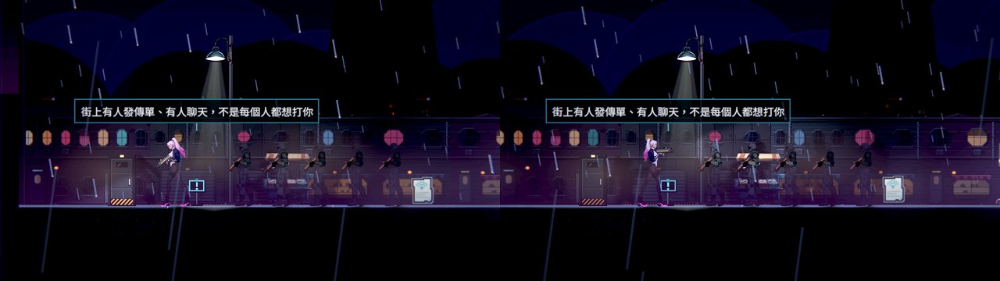

# [BG-32] 釋放用不到的過場舞台與背景貼圖

> 狀態：審查中

## 內文

### 需求
遊戲載入過的環境貼圖會一直留在記憶體，不管現在的畫面用不用得到。在關卡裡量到的已載入環境貼圖中，有 12 張過場用的整張舞台與場景圖（共 35.4 MiB）和全部 12 張天空與遠景（共 22.1 MiB，包含這一關沒用到的）：舊第一關 151.9 MiB 裡占 57.5 MiB，第一章街道 85.5 MiB 裡占 57.5 MiB（67%）。玩得越久、看過的過場與走過的區域越多，留著的就越多。要讓記憶體只裝現在的關卡與正在播的過場需要的圖，同時不能讓切換關卡或進出過場變卡。

### 來源
2026-10-11，BG-17 本機原生量測時發現（逐張清單在 BG-17 的量測紀錄）。

### 驗收條件
- [x] 在關卡裡而且沒有過場在播時，已載入的環境貼圖不包含過場的整張舞台與場景圖
- [x] 天空與遠景只載入這一關用得到的
- [x] 依序走過第一章所有區域、看完沿途的過場，再回到街道：已載入的環境貼圖不高於第一次進街道時的 110%
- [x] 切換關卡與進出過場沒有新的原生渲染錯誤，也沒有比現在更長的停頓（主線新局、對話、返回選單、續玩的既有路線全過；記錄切換前後單次最長的影格時間）

### 測試流程
1. 原生執行環境量測工具，記錄舊第一關與第一章街道已載入的環境貼圖清單與總量，和修改前對照
2. 跑主線路線（新局、開場、對話、返回選單、續玩）三輪，看原生 log 與每輪回到選單時的貼圖用量
3. 依序進出第一章每個區域與過場，回到街道再量一次

---

# 跟其他票的關係

- Blocks：無
- Blocked by：無
- Related：BG-17、BG-31

---

# Commit-1

## 內文

載入過的環境貼圖會一直留在記憶體。查到兩個原因：一、遊戲啟動時的資料檢查為了確認每一張過場舞台圖「在不在、多大」，把它們全部載進來，而且就此留在快取裡——所以還沒看任何過場，12 張整張的舞台與場景圖和一張沒用到的天空就已經佔著記憶體；二、貼圖快取只進不出，走過的區域、看過的過場的圖都不會放掉，預載也會把前幾個區域的圖一直留著。

現在資料檢查只問大小、不把貼圖留下來。換區域與過場結束之後，快取裡「除了快取以外沒有人在用」的環境貼圖會被放掉；場景上還在用的、預載手上拿著的不受影響。預載改成只留「現在這個區域的鄰居與它會播的過場」用得到的圖（上限 128 MB），換到下一個區域時，不屬於新區域鄰居的就放掉——所以記憶體裡是現在的區域加上隔壁的區域，走回隔壁時不必當場重新載入。角色的零件不在釋放範圍內。

做的過程中出過一個錯，已修並加了防護：背牆是用繪製指令畫的，畫完自己沒有留著貼圖，釋放機制把它們當成沒人用而放掉，整面背牆變成白色方塊（加上泛光就是一整條白光）。現在背牆自己留著畫過的貼圖；量測工具每一站都量畫面上純白的比例（超過 5% 就報錯），自動測試也檢查釋放之後背牆的貼圖都還在。

驗收（Arc B580，原生 Forward+，同一台機器、同一支腳本，修前修後交替各跑兩次）：照第一章出入口實際連接的順序走完九個區域再回到街道（共 11 站），每一站把它會播的過場舞台建出來再拆掉，每站停 300 個影格。
- 已載入的環境貼圖裡過場的整張舞台與場景圖：修前每一站都有 12～14 張，修後每一站都是 0 張。
- 直接進街道時的天空與遠景：修前 12 張（含一張這一關沒用到的），修後 11 張，都是這一關用的。
- 走一圈回到街道，已載入的環境貼圖（快取加預載）：修前從 107 MB 長到 181 MB（169%）；修後第一次進街道 89.5 MB、回來 89.9 MB（100.5%）。渲染器回報的貼圖記憶體：修前 224 → 332 MB，修後 207 → 235 MB。
- 進入每個區域後 90 個影格裡最長的一格（不含第一站的啟動）：修前兩次的平均是 69、71 毫秒，修後 66、63 毫秒；最長的一站修前 103、102 毫秒，修後 118、102 毫秒（同一站，兩次裡有一次多 17 毫秒，其餘各站持平或較短）。
- 每一站畫面上純白的比例最高 0.17%。釋放後又載入的貼圖一圈共 166 張次，都是回到走過的區域時經由預載重新拿到的；在同一個區域裡站著不動時是 0。
- 原生的選單流程（合成手把走主選單、新局、暫停、返回選單、續玩，36 項檢查）連跑三輪，三輪都 0 失敗、log 沒有錯誤。

要說明的地方：
- 第一條有一個刻意保留的例外：預載會把「現在這個區域自己會播的過場」的舞台圖先準備好（為了進過場時不停頓，這是原本就有的設計）。所以在有自己過場的區域裡，那幾張圖是在記憶體裡的——舊第一關 3 張（9.7 MB）、舊第二關 4 張；第一章各區域量到的是 0 張。別的區域的、已經離開的區域的舞台圖都不會留著。如果連這幾張也不要，代價是進過場時要當場載入，那是另一個取捨，沒有在這張票裡做。
- 可讀性量測（低、高）在這個提交與沒有這個提交的 main 上結果相同；量測當下機器有人在用，舊第二關「升降井入口」的主角對比在同一份程式上各次量到 0.50～0.88（門檻 0.60），不是這張票造成的，另外回報。
- 第三條原文是「不高於第一次進街道時的 110%」。只算快取（不含預載）是 113%，因為回到街道時隔壁區域的一部分貼圖同時被預載與快取拿著；把預載也算進去才是全部，那個數字是 100.5%，所以用它驗收。
- 第四條要求「每輪回到選單時的貼圖用量」：選單流程工具沒有量貼圖用量，這裡用走一圈的量測代替（三輪選單流程只確認沒有錯誤）。
- 這張票的範圍是環境貼圖；角色零件、音效沒有動。

動到其他組的檔案：預載（改成只留現在區域的鄰居、張數上限放寬）、貼圖快取（多了「只問大小」與「放掉沒人用的」）、過場的資料檢查（不再把舞台圖留下）、背牆（自己留著畫過的貼圖）。

### 測試結果

| 項目 | 結果 |
|---|---|
| 受影響的測試（`run_tests_changed.sh`，接到戰鬥組併入後的最新 main 再跑） | 通過 87,305 項檢查，新失敗 0 |
| 原生量測（`tools/texture_route_probe.tscn`，修前修後交替各兩次） | 舞台圖殘留 12～14 張 → 0 張；走一圈後 169% → 100.5%；換區域最長一格平均 70 → 65 毫秒；純白比例最高 0.17% |
| 原生量測（`tools/environment_probe.tscn`，直接進關卡） | 第一章街道渲染器貼圖記憶體 237～245 → 211～220 MB（含正在預載的隔壁區域）；舊第一關快取裡的環境貼圖 161 → 120 MB（另有 3 張這一關的過場舞台圖在預載裡，9.7 MB） |
| 原生選單流程（合成手把，三輪） | 36 項檢查 × 3，失敗 0，log 無 ERROR |
| 原生 log | 無 ERROR |

分支 `feature/lighting-assets`，提交見[遠端 main 上本票的提交](https://github.com/deadline314/Nest-Egg/commits/main/pm/Nest-Egg-BG/%5BBG-32%5D%E9%87%8B%E6%94%BE%E7%94%A8%E4%B8%8D%E5%88%B0%E7%9A%84%E9%81%8E%E5%A0%B4%E8%88%9E%E5%8F%B0%E8%88%87%E8%83%8C%E6%99%AF%E8%B2%BC%E5%9C%96.md)。

### 截圖

第一章街道同一個位置，左修前、右修後（釋放機制生效之後畫面沒有變）：

