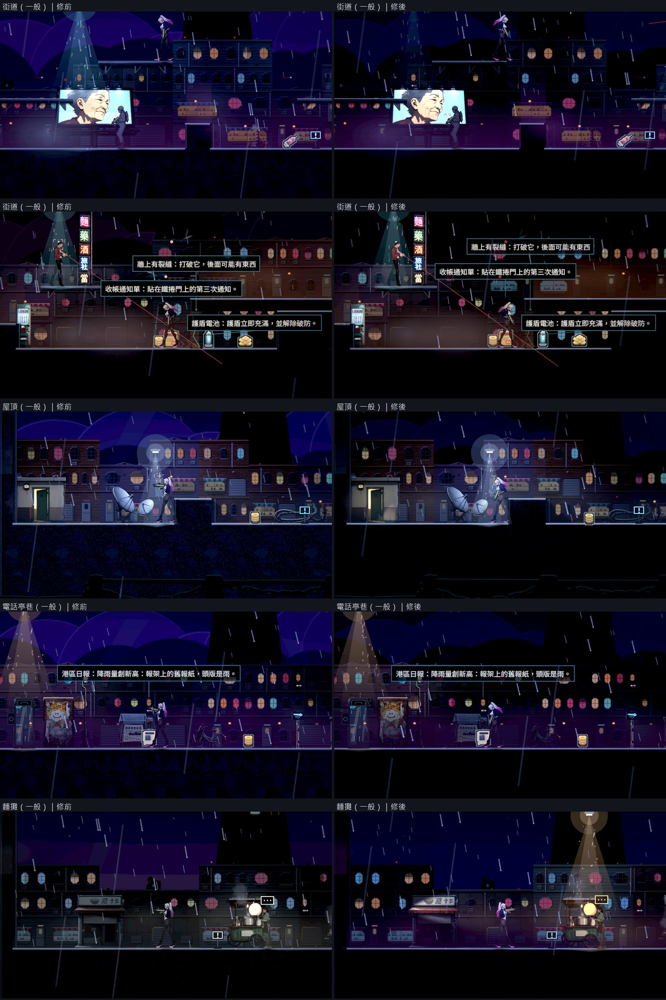
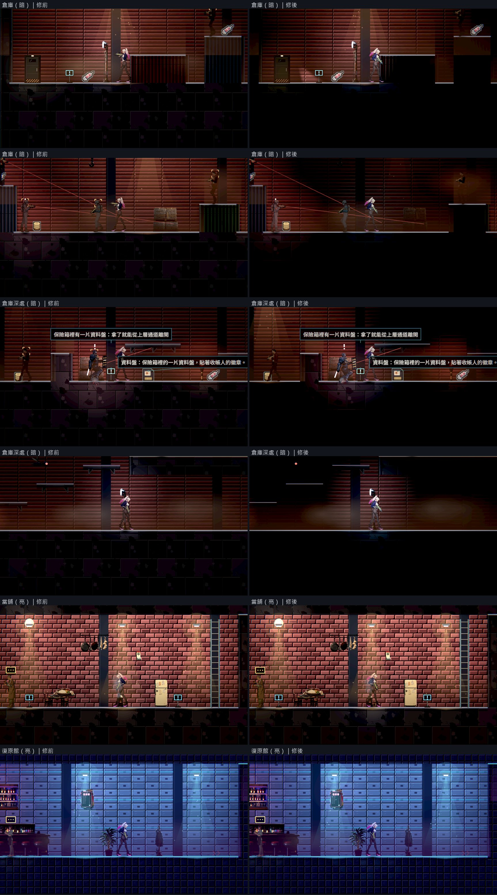
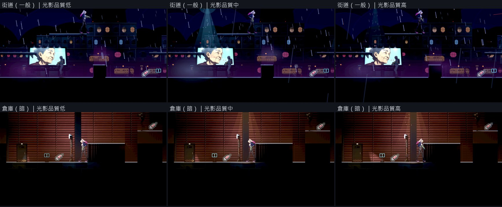
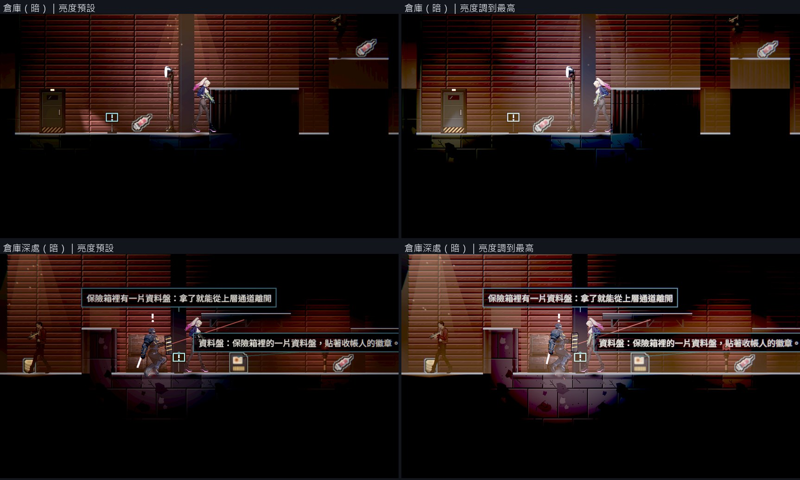

# [BG-33] 訂出光源種類並把整體亮度調暗

> 狀態：審查中

## 內文

### 需求
現在的畫面整體偏亮（第一章各區環境光亮度 0.41～0.51），燈的光池與陰影看不太出來；而且有幾盞光沒有來源：主角身上一盞看不到燈具的全向光、一盞涵蓋全畫面的輪廓光。使用者要光影從光源出發、整體暗一點來凸顯光影，特殊的場景可以比較亮，光源少的場景要靠主角槍械的光。這張票訂出「光只有哪幾種、每一區屬於哪一級亮度」，把第一章調過去；槍燈、牆上的影子、閃爍的燈與敵人的光各自有票。

### 來源
2026-10-11，使用者看完場景與光影那批票之後提出（原話整理在 `pm/user_guide.md` 的「光影要從光源出發，近戰武器要換一批」）。設計與查到的資料見 [光源驅動的光影](../../design/08-lighting/LIGHT_SOURCES.md)。

### 驗收條件
- [x] 每一盞會照亮環境的光都看得到來源（燈具、敵人、武器）；列出一份現有光源的清單，沒有來源的光拿掉或降到只當可讀性保底，清單寫進設計文件
- [x] 第一章每一區標成亮、一般、暗三級之一並調到對應的環境光亮度（亮 0.40～0.55、一般 0.22～0.30、暗 0.08～0.14，實測後可微調並寫回設計文件）
- [x] 一般與暗的區域：路燈或主燈在背牆上形成看得出邊界的光池，光池中心與兩盞燈之間最暗處的牆面亮度相差至少 2 倍（原生畫面量測）
- [x] 亮的區域（當舖、復原館、天亮的店面）進去時明顯比外面亮，當成喘息的地方（麵攤是露天的夜攤，改列一般，亮的是攤車自己的燈）
- [x] 平台頂面的亮邊在三級亮度都看得到（地面邊緣對比維持在門檻以上）；危險物與敵人的攻擊預兆不因調暗而變得不明顯
- [x] 暗場可讀性量測改成符合新玩法（暗的區域在主角的光朝敵人照的狀態下量），第一章全部取樣點在光影品質低、高都達標
- [x] 設定裡的亮度調整照常有效；調到最亮時暗的區域看得到平台與牆，調到預設時光池與暗處的差別明顯
- [x] 原生 Forward+ 修前修後逐區截圖並排；光影品質低、中、高各拍一輪

### 測試流程
1. 原生執行場景巡覽工具拍第一章每一區，修前修後並排
2. 量每一區光池中心與最暗處的牆面亮度
3. 執行暗場可讀性量測（低、高品質）
4. 切換設定的亮度與光影品質各看一次
5. 跑受影響的測試

### 參考
- [Leyla In Veil 的 Steam 商店頁（預告片）](https://store.steampowered.com/app/3904870/)：約 0:22 與 0:45 的房間，一盞主燈、光池外明顯變暗
- [Godot 2D 光影官方文件](https://docs.godotengine.org/en/stable/tutorials/2d/2d_lights_and_shadows.html)
- [玩家對「太暗」的抱怨與校準畫面的限制](https://steamcommunity.com/app/892970/discussions/2/3081016749002505306)
- [Xbox 無障礙準則 102：角色與平台輪廓的對比](https://devdocs.xbox.com/gaming/accessibility/xbox-accessibility-guidelines/102)

現況（BG-30 交付時的第一章）：

---

# 跟其他票的關係

- Blocks：BG-34、BG-35、NE-259
- Blocked by：NE-258
- Related：BG-30、NE-66、BG-27、BG-36

---

---

# Commit-1

## 內文

第一章各區的環境光亮度都在 0.41～0.51，沒被燈照到的牆面也看得很清楚，光池與暗處的差別不明顯；還有一盞涵蓋全畫面、沒有來源的輪廓光把所有東西的邊緣都打亮。

第一章每一區分成三級：街道、屋頂、電話亭巷、麵攤是「一般」（環境光 0.25～0.28），倉庫與倉庫深處是「暗」（0.12），當舖、復原館、天亮的店面是「亮」（0.43～0.47，維持原本的亮度）。復原館原本和街道共用同一份光影，街道調暗後分出自己的一份；麵攤是露天的夜攤，改成和街道同一片夜色，亮的是攤車自己的燈。沒有來源的輪廓光降到原本的一半以下；主角身上那盞全向光已經在 NE-258 換成槍燈。暗的區域裡，沒被光照到的敵人很難看見，被槍燈或場景燈照到就會明顯亮起來（敵人對光的反應調得比主角強，主角維持原本的上限，白頭髮不會過曝）。現有光源的清單與每一區的等級寫進了設計文件。

原生畫面逐區修前修後並排，三種光影品質各拍一輪。量得到的燈，燈下的牆面比光池外亮 11～28 倍；這個倍數修前就有 5～28 倍，分不出修前修後，實際變暗的是光池外的牆面（線性亮度 0.0025～0.015 降到 0～0.006）。暗場可讀性量測改成符合新玩法：主角的槍燈朝著敵人；倉庫閘門廳原本的取樣位置敵人站在關著的閘門另一邊（槍燈與子彈都被擋住），換到同一側。第一章 14 個取樣點在光影品質低、高各跑兩輪都全過，數字相同；舊兩關 16 點也全過。平台頂面的亮邊對比最低 3.3（門檻 1.0）。設定的亮度調到最高時，倉庫的牆與平台都看得到。街道與電話亭巷大部分的燈飄在半空、下方沒有牆，量不到光池，要等 BG-36 把燈裝到牆上或桿子上。

### 測試結果

| 項目 | 結果 |
|---|---|
| 暗場可讀性，第一章 14 點（低、高各兩輪） | 14／14；敵人 0.52～2.03（門檻 0.45），主角 0.62～2.67（門檻 0.6） |
| 暗場可讀性，舊兩關 16 點（低、高） | 16／16 |
| 光池中心與光池外的牆面亮度倍數 | 街道 18、倉庫 11 與 22、倉庫深處 18、屋頂 14 與 28（門檻 2；修前同法 18、5 與 25、22、5 與 28）；街道其餘 4 盞與電話亭巷、麵攤的燈下方沒有牆，量不到 |
| 光池外的牆面亮度（線性） | 修前 0.0025～0.015；修後 0～0.006 |
| 亮的區域主角周圍的牆面亮度 | 當舖 0.23～0.25、復原館 0.16、天亮的店面 0.28；街道 0.04、電話亭巷 0.07 |
| 地面頂面亮邊對比（全部巡覽格的最低值） | 3.3 |
| 新增的自動檢查 | 通過：每份光影設定與第一章每一區落在該在的等級、敵人對光的反應比主角強但不超過曝光預算 |
| 受影響測試（79 組） | 84296 項檢查；新失敗 0、已知失敗 0 |

每一區的等級、數值與光源清單見[光源驅動的光影](../../design/08-lighting/LIGHT_SOURCES.md)。分支 `feature/light-sources`；提交見[遠端 main 上本票的提交](https://github.com/deadline314/Nest-Egg/commits/main/pm/Nest-Egg-BG/%5BBG-33%5D%E8%A8%82%E5%87%BA%E5%85%89%E6%BA%90%E7%A8%AE%E9%A1%9E%E4%B8%A6%E6%8A%8A%E6%95%B4%E9%AB%94%E4%BA%AE%E5%BA%A6%E8%AA%BF%E6%9A%97.md)。

### 截圖

