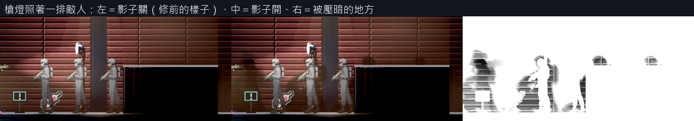
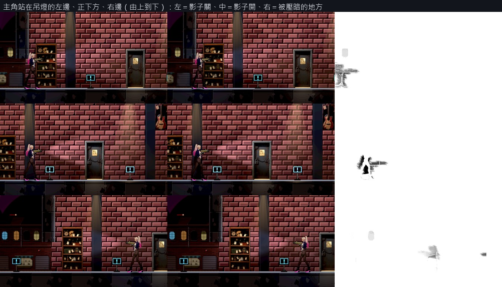

# [BG-34] 讓角色與擺設依光源在背牆投影

> 狀態：審查中

## 內文

### 需求
角色、敵人與擺設現在沒有被燈投出來的影子，只有腳下畫的接觸陰影，看不出光從哪裡來。使用者要敵人與背景的物件都依光源有對應的陰影。參考作品裡，人物的影子落在背後的牆上，偏向遠離燈的一側。

### 來源
2026-10-11，使用者看完場景與光影那批票之後提出（原話整理在 `pm/user_guide.md` 的「光影要從光源出發，近戰武器要換一批」）。設計與查到的資料見 [光源驅動的光影](../../design/08-lighting/LIGHT_SOURCES.md)。

### 驗收條件
- [x] 主角、敵人、人物與站在地上的擺設在背後的牆上有影子；影子偏向遠離光源的方向，離燈越近影子越大、越偏
- [x] 場景燈、槍燈、敵人自己的光都會產生影子；燈熄滅或被關掉時，它造成的影子跟著消失；同時有兩盞燈時看得到兩個方向的影子
- [x] 沒有背牆的地方（露天的天空）不出現影子；影子不畫在角色自己身上，也不蓋住子彈、特效與介面
- [x] 腳下的接觸陰影保留；牆上的影子與接觸陰影在腳邊接得起來，不會出現兩個分開的黑塊
- [x] 畫面上有 12 個敵人時每影格耗時不高於修前的 108%（同機、關垂直同步）；光影品質「低」關掉牆上的影子、只留接觸陰影
- [x] 反覆進出關卡 10 次，節點數與貼圖記憶體不累積
- [x] 原生 Forward+ 截圖：主角站在路燈左邊、正下方、右邊各一張；槍燈照著一排敵人一張；修前修後並排

### 測試流程
1. 原生進街道與倉庫，站在燈的不同側拍照
2. 用槍燈掃過敵人拍連續畫面
3. 切到光影品質低確認只剩接觸陰影
4. 量 12 個敵人時的耗時與反覆進出的資源
5. 跑受影響的測試

### 參考
- [Leyla In Veil 的 Steam 商店頁（預告片）](https://store.steampowered.com/app/3904870/)：約 0:45，兩個人物在牆上的影子
- [角色自己掛遮光體會被自己的影子蓋住](https://forum.godotengine.org/t/shadows-go-over-the-sprite-when-using-light2d-and-lightoccluder2d/8349)
- [Dead Cells：動態光從正確方向照亮背景](https://80.lv/articles/interview-with-the-developers-of-dead-cells)
- [角色打光的實用技巧](https://www.gamedeveloper.com/programming/dynamic-2d-character-lighting)

現況（只有腳下的接觸陰影）：

---

# 跟其他票的關係

- Blocks：無
- Blocked by：BG-33
- Related：BG-29、BG-36、NE-258、NE-259

---

# Commit-1

## 內文

角色只有腳下一塊接觸陰影，被燈照到時背後的牆上什麼都沒有；使用者拿槍燈照敵人時問「敵人被照射後的影子呢」。

現在主角、站在地上的敵人、人物，以及標了會投影的擺設（第一章 35 件離牆站著的：推車、桌椅、木箱、機車…）會依光源在背後的牆上投影。影子偏向遠離燈的那一側，離燈越近影子越大；燈在正上方時影子落在腳邊。場景燈、槍燈，以及敵人或擺設身上的燈都算，每次挑對畫面影響最大的幾盞（高品質 4 盞、中品質 2 盞），燈熄滅、閃爍或被關掉時它的影子跟著變，槍燈只在光錐裡有影子。只有背牆的範圍會有影子，露天的天空沒有；影子畫在牆那一層，不會蓋在角色自己身上，也不會蓋住子彈、特效與介面。腳下的接觸陰影照舊。光影品質低時牆上不投影。

實際的樣子要老實說：**槍燈與矮的燈的影子最明顯**，因為光是橫的，影子往旁邊落在牆上；高處的吊燈照理把影子推到地板上（那一部分是腳下的接觸陰影），牆上只在腿邊留一小塊，而且亮的區域（當舖）比暗的區域（倉庫）淡。驗收條件寫的「離燈越近影子越大、越偏」裡，「越大」是做到的；「越偏」指的是同樣的距離下離燈近的放大得多，燈在正上方時不會偏（影子在腳邊）。敵人的頭上標記（驚嘆號、戒備三角）是和身體一起畫的，所以也會有很小的影子。

驗收（Arc B580，原生 Forward+，拍照時把場景停住，所以影子開與關兩張只差在影子）：倉庫裡用槍燈照三個敵人，影子開的那張有 2.1% 的畫面比關的暗兩成以上（中品質 1.4%，低品質 0，兩張完全相同）；當舖的吊燈下主角站在左、正下方、右三張分別是 0.69%、0.53%、0.15%。畫面上 12 個敵人時每影格耗時是關掉影子的 107%（開與關緊接著各量 45 格算一組，60 組取比值的中位數；三次是 1.065、1.071、1.076）。反覆進出倉庫 10 次，節點數每次都是 91，貼圖記憶體在 164～185 MiB 之間來回、沒有往上累積。可讀性在低與高品質都達標。

做之前查了別人的做法（設計文件有連結）：Godot 官方文件與論壇都指出內建的遮光體在側視畫面裡影子是往下掃、角色還會被自己的影子蓋住，社群常見的替代做法是另外畫一份剪影。這裡採用「另外畫一份輪廓」的原則，但整個畫面共用一張低解析度的輪廓圖、由牆去取樣，多個角色與多盞燈都只多畫一遍。Leyla In Veil 的商店頁沒有說明它的做法，只能從預告片看結果。

### 測試結果

| 項目 | 結果 |
|---|---|
| 受影響的測試（`run_tests_changed.sh`） | 通過 84,921 項檢查，新失敗 0 |
| 牆上影子的原生量測（`tools/wall_shadow_probe.tscn`） | 槍燈、吊燈左中右都有影子；低品質沒有；12 個敵人耗時 107%；進出 10 次不累積 |
| 可讀性（第一章 14 點、舊兩關 16 點，低與高） | 全部達標（60 筆）：主角 0.62 以上、敵人 0.50 以上、地面邊緣 1.85 以上 |
| 原生 log | 無 ERROR |

分支 `feature/lighting-assets`，提交見[遠端 main 上本票的提交](https://github.com/deadline314/Nest-Egg/commits/main/pm/Nest-Egg-BG/%5BBG-34%5D%E8%AE%93%E8%A7%92%E8%89%B2%E8%88%87%E6%93%BA%E8%A8%AD%E4%BE%9D%E5%85%89%E6%BA%90%E5%9C%A8%E8%83%8C%E7%89%86%E6%8A%95%E5%BD%B1.md)。

### 截圖

槍燈照著一排敵人（左＝影子關，也就是修前的樣子；中＝影子開；右＝被壓暗的地方）：

主角站在吊燈的左邊、正下方、右邊：

