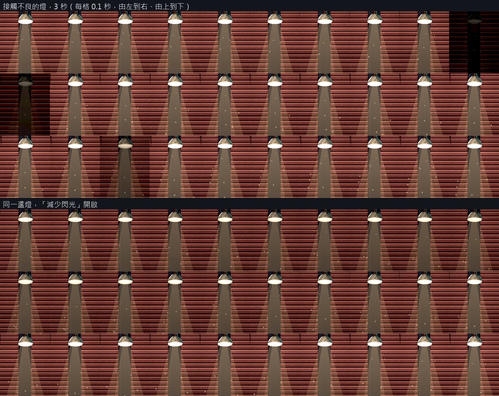
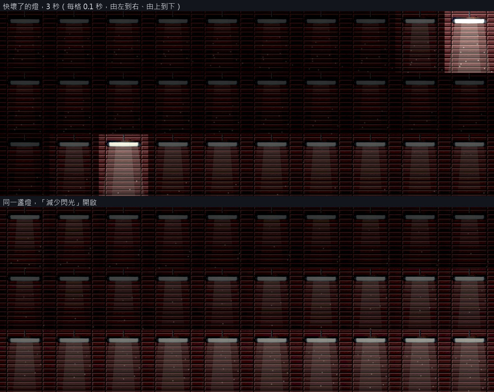

# [BG-35] 在電力不足的區域加上閃爍的燈

> 狀態：審查中

## 內文

### 需求
會閃的燈現在只有一種閃法（隨機暗一下），也沒有「這一區電力不足」的設定。使用者要在下水道或電力不足的地方有會閃爍的燈。

### 來源
2026-10-11，使用者看完場景與光影那批票之後提出（原話整理在 `pm/user_guide.md` 的「光影要從光源出發，近戰武器要換一批」）。設計與查到的資料見 [光源驅動的光影](../../design/08-lighting/LIGHT_SOURCES.md)。

### 驗收條件
- [x] 燈有三種狀態並寫在資料裡：穩定、接觸不良（偶爾連閃幾下）、快壞了（多半是暗的，偶爾亮）；同一盞燈每次進關卡的閃法相同
- [x] 可以把一個區域標成電力不足，這一區大部分的燈是後兩種；第一章的倉庫與倉庫深處套用，街道與安全區維持穩定
- [x] 燈閃的時候，它的光池、它造成的影子與燈具本身的亮度一起變化；不閃的燈不受影響
- [x] 光敏安全：一盞燈的亮暗變化每秒不超過 3 次；設定的「減少閃光」打開時，閃爍改成緩慢的明暗起伏
- [x] 快壞了的燈附帶小聲的電流聲，離遠聽不到；聲音來源是 CC0 並登記授權
- [x] 電力不足的區域裡，燈暗下來的那一刻靠主角的光仍看得到平台與敵人（可讀性量測在燈暗的時刻取樣）
- [x] 原生連拍一盞接觸不良的燈與一盞快壞了的燈各 3 秒；附上「減少閃光」開啟時的對照

### 測試流程
1. 原生進倉庫連拍兩種燈
2. 統計 10 秒內每盞燈的亮暗變化次數
3. 打開「減少閃光」再拍一次
4. 在燈暗的時刻跑可讀性量測
5. 跑受影響的測試

### 參考
- [Quake 與 Half-Life 的閃爍燈做法](https://www.alanzucconi.com/2021/06/15/valve-flickering-lights/)
- [WCAG 2.3.1：一秒內不超過三次閃光](https://www.w3.org/WAI/WCAG22/Understanding/three-flashes-or-below-threshold.html)
- [Game Accessibility Guidelines：避免閃爍、提供關閉選項](https://gameaccessibilityguidelines.com/avoid-flickering-images-and-repetitive-patterns/)

---

# 跟其他票的關係

- Blocks：無
- Blocked by：BG-33、BG-36
- Related：BG-34、BG-25

---

# Commit-1

## 內文

會閃的燈原本只有一種閃法：每一格擲骰，中了就用每秒 15 次的速度忽明忽暗一小段時間，超過光敏安全的上限，設定的「減少閃光」也管不到它；而且沒有「這一區電力不足」的設定，倉庫的 9 盞燈有 6 盞是直接壞掉不亮。

現在燈有三種狀態：穩定、接觸不良（多半亮著，偶爾暗一下或連閃兩下再暗一陣子）、快壞了（多半是暗的，偶爾亮起來）。閃法寫在資料裡，每一步 0.1 秒，同一盞燈每次進關卡都用同一條、從同一個位置開始。區域的供電狀況也寫在資料裡：倉庫與倉庫深處標成電力不足，亮著的燈依序輪到接觸不良、快壞了、穩定，所以大部分的燈會閃；壞掉不亮的比例從三成半降到一成多，原本整盞不亮的現在多半是快壞了。街道、屋頂、巷子、當舖、復原館、天亮的店面維持穩定。燈閃的時候，光池、它造成的影子、光錐與燈具的發光部位一起明暗；幾乎全暗的那段時間不投影，亮回來的那一格影子就回來。光敏安全由資料載入時檢查：任何一秒內亮度明顯變化超過 3 次的閃法不會被採用。設定的「減少閃光」打開時，會閃的燈改成 4 到 7 秒一個來回的緩慢明暗起伏。快壞的燈附帶很小聲的電流聲，整關共用一個聲道，離鏡頭中心約 13 格以外聽不到，停電時沒有聲音。

驗收（Arc B580，原生 Forward+）：倉庫亮著的 4 盞燈是接觸不良 1、快壞了 2、穩定 1，倉庫深處 3 盞是各 1；街道 9 盞、當舖 8 盞、復原館 4 盞全部穩定。每盞燈記錄 10 秒：任何一秒內亮度明顯變化最多 3 次（接觸不良）與 2 次（快壞了）；「減少閃光」開啟時最多 1 次，亮度在 0.72～1.0 與 0.10～0.42 之間緩慢起伏。把所有會閃的燈固定在最暗的那一刻再量可讀性：倉庫四個取樣點主角 1.43 以上、地面邊緣 11 以上、敵人 0.54 以上，低與高品質都達標；平常的可讀性（第一章 14 點、舊兩關 16 點）也全部達標。電流聲來源是 OpenGameArt 的 UnLeeched Sound Effects Pack（作者 orsi，CC0），授權已登記；量到鏡頭在快壞的燈旁邊時音量比例 0.58；音量隨距離的平方衰減，到 210 像素歸零（自動測試檢查），沒有快壞的燈的區域不會有這個聲音。電流聲的音量是照環境音底噪的數值對齊的，沒有用耳朵試聽過。

每影格耗時（修前修後交替各三輪取中位數）：低品質是修前的 99～102%；高品質倉庫 107%、倉庫深處 128%（2.4 → 3.1 毫秒），原因是這兩區亮著的燈從 2、1 盞變成 4、3 盞。

### 測試結果

| 項目 | 結果 |
|---|---|
| 受影響的測試（`run_tests_changed.sh`） | 通過 78,001 項檢查，新失敗 0 |
| 閃法資料檢查（`python tools/assets/lamp_flicker_patterns.py`） | 通過，6 條閃法每秒最多 3 次變化 |
| 10 秒統計（`tools/lamp_flicker_probe.tscn`） | 一秒內最多 3 次；減少閃光時最多 1 次 |
| 可讀性（平常與燈最暗時，低與高） | 全部達標：主角 0.63 以上、敵人 0.49 以上、地面邊緣 1.80 以上 |
| 音訊工具測試 | 通過（增量建置、片段、時間伸縮、位置表） |
| 原生 log | 無 ERROR |

分支 `feature/lighting-assets`，提交見[遠端 main 上本票的提交](https://github.com/deadline314/Nest-Egg/commits/main/pm/Nest-Egg-BG/%5BBG-35%5D%E5%9C%A8%E9%9B%BB%E5%8A%9B%E4%B8%8D%E8%B6%B3%E7%9A%84%E5%8D%80%E5%9F%9F%E5%8A%A0%E4%B8%8A%E9%96%83%E7%88%8D%E7%9A%84%E7%87%88.md)。

### 截圖

接觸不良的燈連拍 3 秒（每格 0.1 秒），下半是同一盞燈在「減少閃光」開啟時：

快壞了的燈連拍 3 秒，下半是「減少閃光」開啟時：

