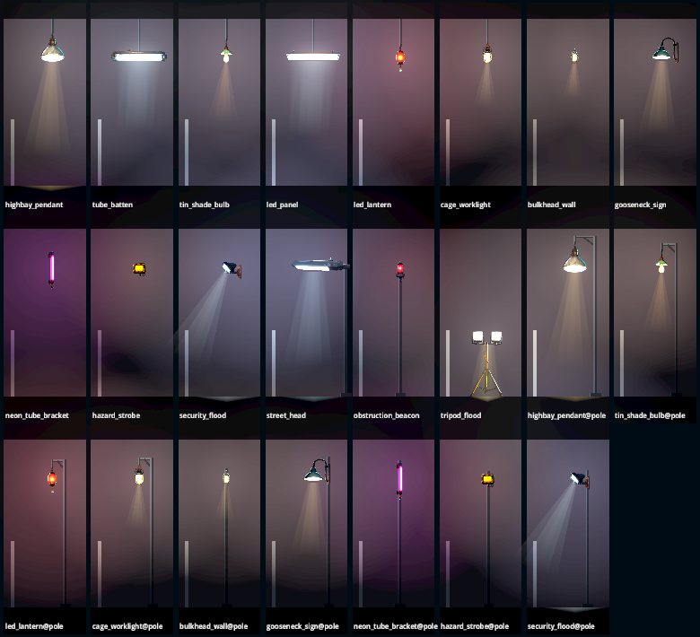
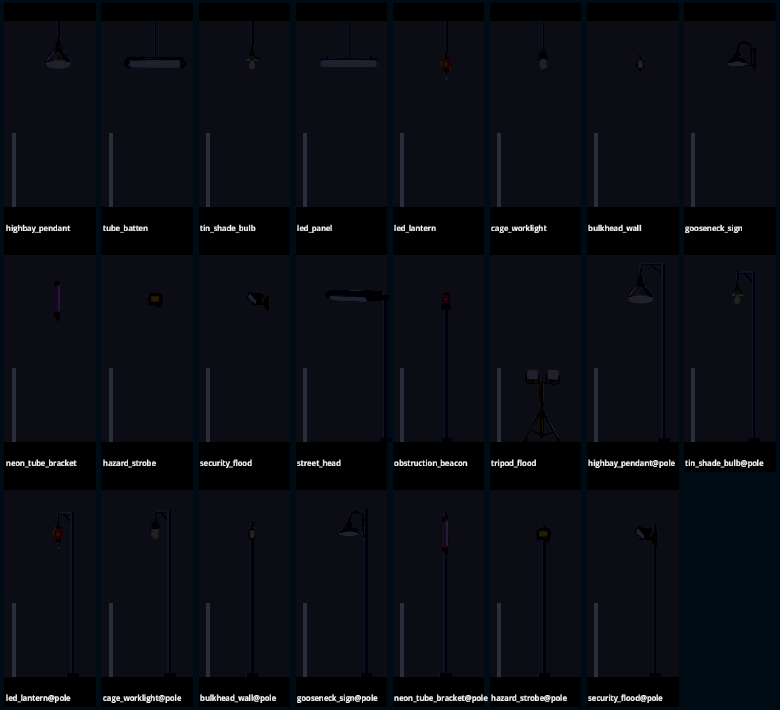
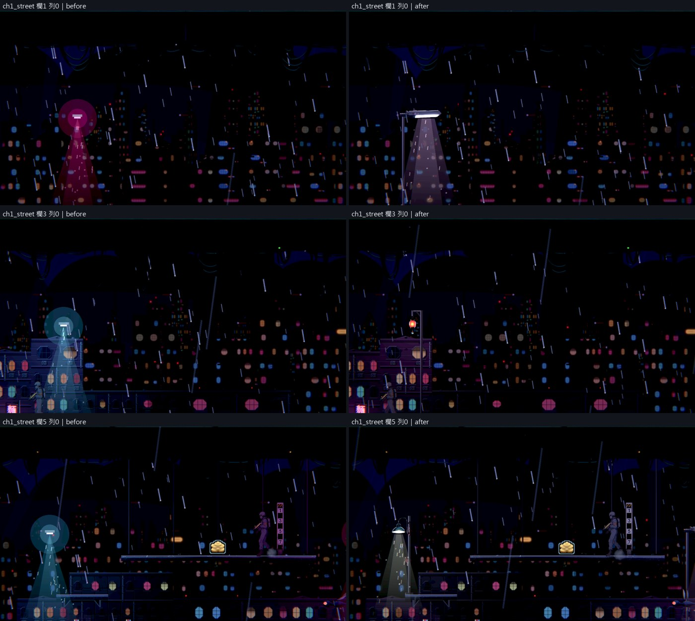
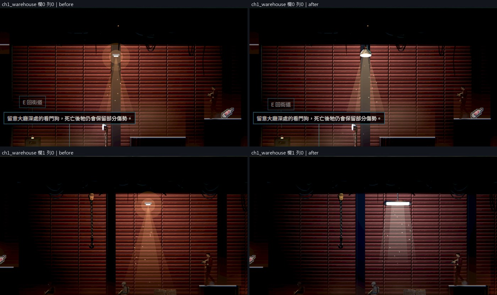
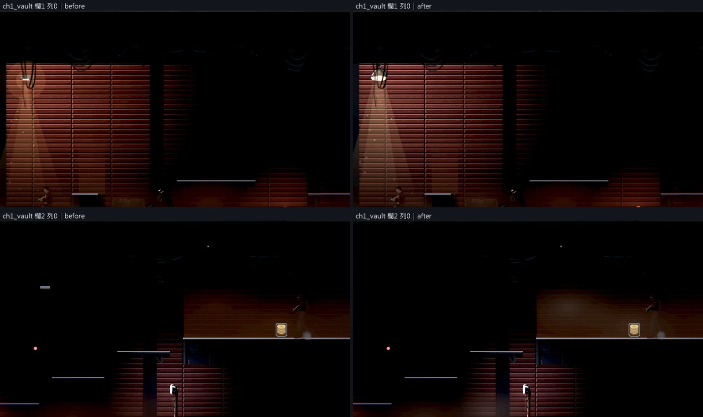
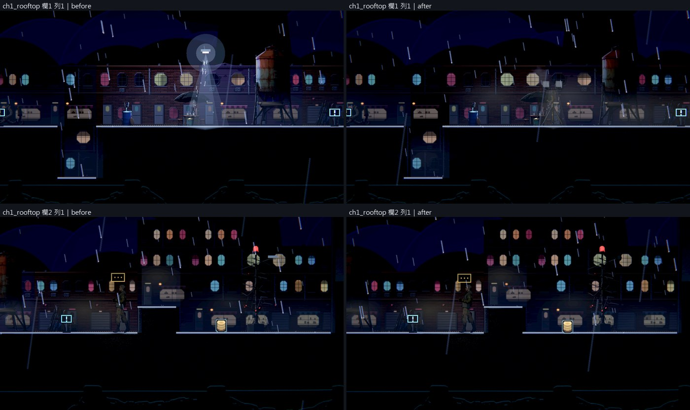
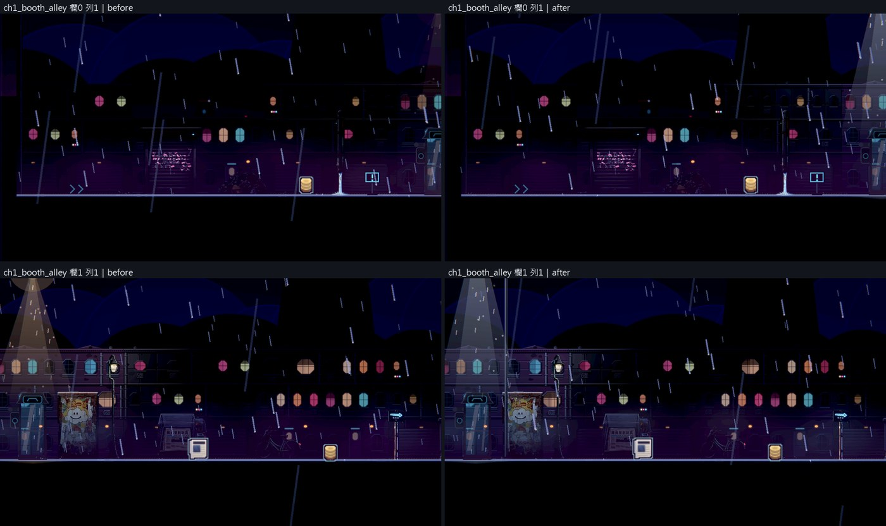
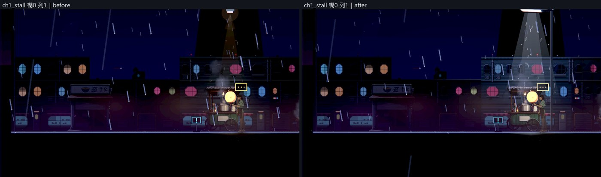
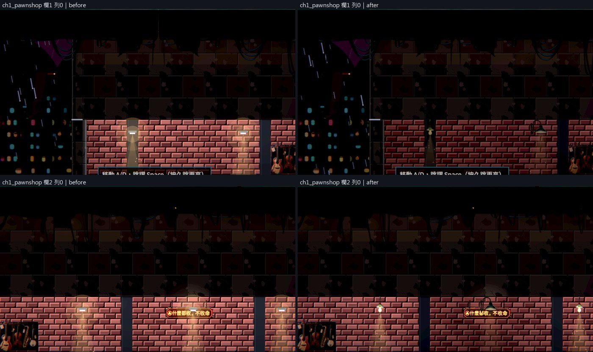
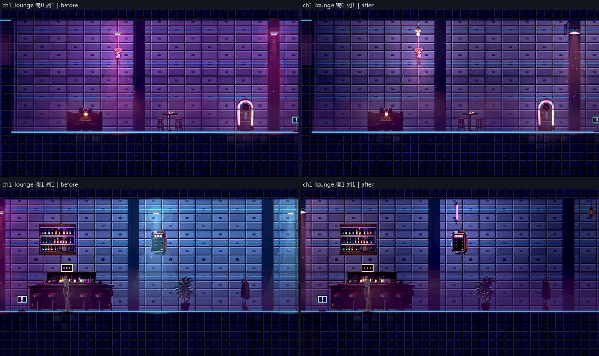

# [BG-36] 把場景燈換成十種以上的賽博龐克燈具

> 狀態：審查中

## 內文

### 需求
場景裡每一盞燈都是程式畫的同一個樣子：一顆白色方塊加一圈光暈與光錐，而且戶外的燈直接飄在半空中，沒有掛在任何東西上。使用者要換成賽博龐克世界裡會出現的燈具，依不同場景至少有 10 種以上的變化，不要每個地方都一樣。

### 來源
2026-10-11，使用者在開票後補充，附了倉庫牆上那盞燈的截圖：「天上的燈可以不要再用這個了嗎？可以改用貼近賽博龐克世界觀會出現的燈源，可以換幾個不一樣的，不要每個地方都一樣，感覺可以至少根據不同場景有 10 種以上的變化」。設計見 [光源驅動的光影](../../design/08-lighting/LIGHT_SOURCES.md) 的「場景燈具換成十種以上的款式」。

### 驗收條件
- [x] 場景燈不再出現白色方塊；全部換成畫出來的燈具，共 10 款以上，畫風與擺設一致（賽璐璐、深色描邊），每一款有自己的發光部位
- [x] 每一盞燈都有支撐：吊在天花板、裝在牆上，或立在桿子上接到地面；沒有任何一盞飄在半空中（第一章每一區逐盞檢查，自動檢查會擋）
- [x] 第一章每一區用的燈具符合場景（倉庫是工礦吊燈與日光燈、市集是燈籠與霓虹管、街道是路燈、屋頂是航空警示燈、復原館是冷白燈板…），同一區至少兩款，相鄰兩盞盡量不同款；同一盞燈每次進關卡都是同一款
- [x] 光的顏色、範圍與形狀跟著燈具走（冷白的日光燈、暖黃的燈泡、橘紅的警示燈…）；燈熄滅、壞掉或停電時，燈具的發光部位跟著變暗
- [x] 燈具的大小符合真實尺寸（和主角身高對照），不蓋住角色、敵人、子彈與提示
- [x] 新增一款燈具只要加圖與一筆資料，不用改程式；圖遺失時退回安全的預設並記錄是哪一款
- [x] 光影品質低、中、高都正常；每影格耗時不高於修前的 105%（同機、關垂直同步）
- [x] 原生 Forward+ 截圖：14 款燈具的一覽圖（亮與熄滅各一張）、第一章每一區修前修後並排

### 測試流程
1. 原生執行場景巡覽工具拍第一章每一區，修前修後並排
2. 拍一張所有燈具亮著與熄滅的一覽圖
3. 觸發停電，看燈具的發光部位有沒有跟著暗
4. 量每影格耗時
5. 跑受影響的測試

### 參考
- [Leyla In Veil 的 Steam 商店頁（預告片）](https://store.steampowered.com/app/3904870/)：約 0:22，畫作上方的壁燈是看得見的燈具，光從它出發
- [Dead Cells：火把從正確的方向照亮旁邊的背景](https://80.lv/articles/interview-with-the-developers-of-dead-cells)
- 使用者指出的現況：倉庫牆上的白色方塊燈（下圖是同一種燈在第一章的樣子）

---

# 跟其他票的關係

- Blocks：BG-35
- Blocked by：無
- Related：BG-33、BG-34、BG-21、NE-263

---

# Commit-1

## 內文

場景裡每一盞燈都是同一顆白色方塊加兩圈圓形的光圈，戶外的燈直接飄在半空中；第一章街道的 9 盞全部沒有任何支撐。

現在場景燈是 14 款畫出來的燈具：工礦吊燈、鐵籠日光燈、鐵罩燈泡、冷白燈板、霓虹燈籠、掛鉤工作燈、壁掛防爆燈、鵝頸招牌燈、直立霓虹管、警示燈箱、感應投光燈、LED 路燈頭、航空警示燈、三腳工作燈。每一盞依周圍的環境決定怎麼裝：頭上有天花板就吊下來，背後有牆就裝在牆上，都沒有就立桿到地面；戶外沒有牆的地方，燈籠、燈泡這類吊燈掛在桿子的橫臂下，壁燈鎖在桿子上，所以街道不會整排都是同一款路燈。桿子那一側是坑洞就換到另一側。光的顏色、光池大小與光錐跟著燈具走（日光燈從整條燈管往下照、投光燈的光錐偏向一邊、燈籠與霓虹管沒有光錐），停電或壞掉時燈具的發光部位一起熄滅。原本疊在燈上的圓形光圈拿掉，改由燈具自己的發光部位加泛光。燈具畫在角色、敵人、子彈與提示後面。靠彩色燈泡營造氣氛的區域（復原館、市集）可以讓燈具的光帶上該區的顏色。

驗收（Arc B580，原生 Forward+）：一覽圖拍了 14 款亮與熄滅，含 9 款掛在桿子上的樣子，白條是主角身高。第一章八個區域共 28 盞燈逐盞有燈具與支撐，兩盞以上的區域都至少兩款，由自動檢查擋。可讀性在光影品質低與高都達標；每影格耗時是修前的 80～98%（高）與 100～102%（低），修前修後交替各量三輪取中位數。量得到光池的燈：街道 14 倍、倉庫 18 與 40 倍、倉庫深處 30 倍、屋頂 3.5 與 15 倍；街道其餘的燈下方是露天，沒有牆可以量。光影品質中、低各拍了街道與倉庫，沒有原生錯誤。

### 測試結果

| 項目 | 結果 |
|---|---|
| 受影響的測試（`run_tests_changed.sh`，73 個套件） | 通過 82,918 項檢查，新失敗 0 |
| 素材檢查 | 通過 |
| 可讀性（第一章 14 點、舊兩關 16 點，低與高） | 全部達標：主角 0.62～5.15、敵人 0.51～2.29、地面邊緣 1.82 以上 |
| 每影格耗時（街道、倉庫、當舖、復原館） | 高 80～98%、低 100～102% |
| 原生 log | 無 ERROR |

分支 `feature/lighting-assets`，提交見[遠端 main 上本票的提交](https://github.com/deadline314/Nest-Egg/commits/main/pm/Nest-Egg-BG/%5BBG-36%5D%E6%8A%8A%E5%A0%B4%E6%99%AF%E7%87%88%E6%8F%9B%E6%88%90%E5%8D%81%E7%A8%AE%E4%BB%A5%E4%B8%8A%E7%9A%84%E8%B3%BD%E5%8D%9A%E9%BE%90%E5%85%8B%E7%87%88%E5%85%B7.md)。

### 截圖

14 款燈具，亮著（下兩列是掛在桿子上的樣子，白條是主角身高）：

熄滅：

第一章逐區，左邊修前、右邊修後：

