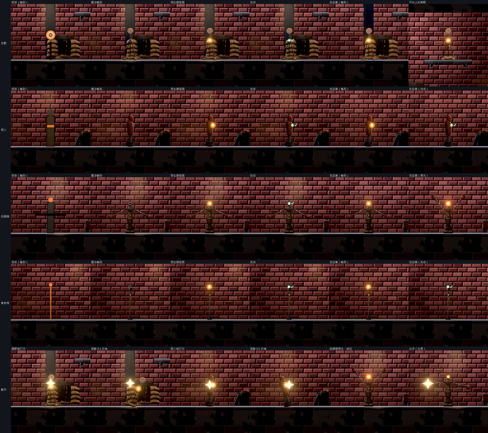
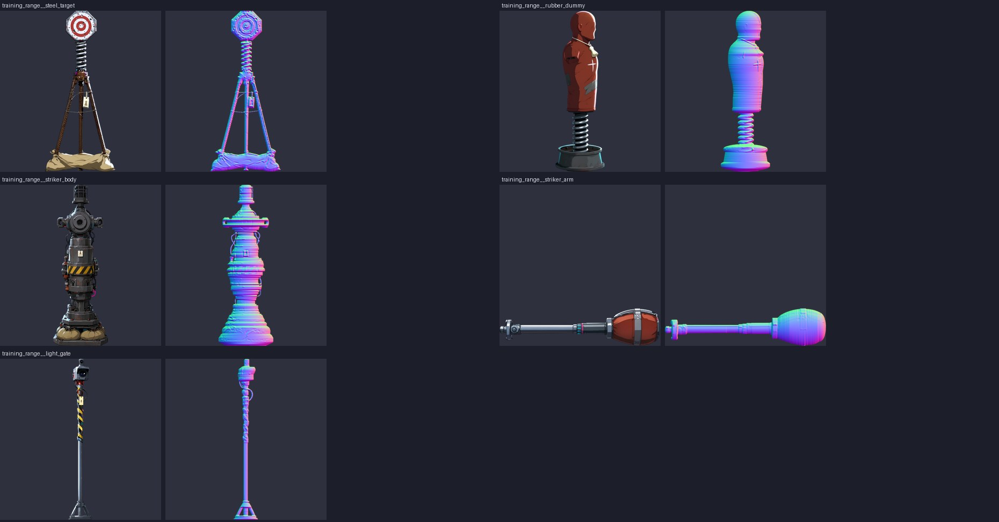

# [BG-37] 把序章試貨器材換成正式素材

> 狀態：審查中

## 內文

### 需求
序章試貨區的器材（低靶、高靶、橡膠靶、訓練器、衝刺線、站位標記）目前是程式畫的圓形加矩形：實際光影下橡膠靶與訓練器只剩一塊深色長方形，靶的支架看不到、靶面像浮在空中，和店裡其他賽璐璐擺設放在一起很突兀。玩家進遊戲第一個操作的東西就是這幾件，要換成和場景同一套畫風、看得出用途的器材，狀態（還沒輪到、現在練這個、完成）仍然一眼分得出來。

### 來源
2026-10-12，場景素材 Session 做 BG-20 序章場景巡覽時發現（原生畫面，見 BG-20 Commit-4）。使用者的美術偏好：少用純矩形與單純弧形，多一點裝飾、特效與動畫（2026-10-03）。

### 驗收條件
- [x] 低靶、高靶、橡膠靶、訓練器、衝刺線各有賽璐璐畫風的器材圖（平塗、深色描邊、硬邊兩色陰影），大小依真實尺寸（公尺）對主角身高合理，底部落在地面或平台上
- [x] 三種狀態用器材上的燈號區分，不靠整件器材變色；色覺辨識不依賴單一顏色（位置或亮滅也不同）
- [x] 訓練器出手前的預兆（手臂後拉、警示燈）與出手看得出來，判定與時機不變
- [x] 被打中有回饋（靶面晃動或橡膠靶後仰再回正），不改命中判定
- [x] 實際光影下，光影品質「低」與「高」各拍一輪：器材輪廓看得清楚、狀態燈不過曝（全白像素比例 ≤ 2%）
- [x] 圖讀不到時退回原本的簡單畫法並記錄路徑，不讓序章壞掉
- [x] 生成素材的提示詞與種子留在清單，可以重現；修前修後原生截圖並排附在票上

### 測試流程
1. 新遊戲進序章，依序走到射擊線、低靶、高靶、橡膠靶、訓練器、衝刺線
2. 每一站確認：器材看得出是什麼、輪到時燈號改變、完成後燈號改變、打中有晃動
3. 光影品質切到「低」再走一次

---

# 跟其他票的關係

- Blocks：無
- Blocked by：無
- Related：BG-20、BG-21、ST-16

---

# Commit-1

## 內文

**問題**：序章試貨區的靶、橡膠靶、訓練器與衝刺線是程式畫的圓形加矩形。實際光影下橡膠靶與訓練器只剩一塊深色長方形，靶的支架看不到、靶面像浮在空中；輪到哪一站是靠整件器材變橘色來表示。

**改動**：
- 五件器材換成賽璐璐畫風的圖，都像老 K 用當進來的東西拼出來的：彈簧鋼靶（八角鋼板、鋼筋三腳架、壓腳的沙包）、橡膠假人（裝在彈簧與舊輪圈上，貼著膠帶）、訓練器（洗衣機滾筒與汽車零件焊成的機身，兩支包著拳墊的手臂）、衝刺計時桿（纏著警示膠帶的感應桿），每件都掛著當舖的紙標籤。大小照真實尺寸：鋼靶 1.8 公尺、假人與訓練器 1.75 公尺、計時桿 1.9 公尺（主角 1.7 公尺），底部落在地面；高靶站在平台上。
- 狀態改用器材上的燈號，器材本身不變色：還沒輪到是暗的空心圈，現在練這個是橘色實心加緩慢起伏的光暈，完成是綠色實心加一個勾。三種狀態形狀不同，不只靠顏色；燈裝在器材上本來會裝燈的地方（訓練器頂端的籠燈、計時桿的感應頭、鋼靶的支架接頭、假人胸口的記號）。
- 鋼靶與假人被打中會繞著底座晃一下再回正；訓練器亮燈預告時兩支手臂往後上方拉開，出手時朝玩家那一側打出去、停一下再收回。命中的閃光從一顆蓋住器材的圓改成拳墊前的小火花。判定與時機都沒有動。
- 器材用哪張圖、燈號與手臂接在哪，都寫在一份資料裡；圖或資料讀不到時退回原本的簡單畫法並記錄是哪一筆。訓練器的機身與手臂分開生成（一張沒有手臂的機身、一張水平的手臂左右鏡像），提示詞與種子留在清單，做法補進素材流程的技能。

**驗收**：在正式的序章地圖用新的器材檢查工具，光影品質「高」與「低」各拍一輪：五站的三種狀態都分得出來，狀態燈周圍的全白像素比例都是 0%（門檻 2%），器材本體的亮度在高、低品質都高於「只剩黑影」的門檻。下圖每一列是一種器材：最左是修前，接著是還沒輪到、現在練這個、完成、低品質；最下面一列是被打中的晃動與訓練器的後拉、出手。用真的按鍵從新遊戲玩完整個序章（走到每一站、射低靶與高靶、近戰打假人、被訓練器打中一次再擋下、衝刺過線、走出店門），每一項練習都靠真的動作完成，沒有失誤。

平行跑整批測試（機器很忙、一格很長）時，鋼靶的晃動幅度算錯；彈簧改成分小步計算，一格再長也不會算爆，並加了這個情況的檢查（單獨跑與六份同時跑都通過）。

### 測試結果

| 項目 | 結果 |
|---|---|
| 器材檢查（5 站 × 高、低品質） | 狀態燈全白比例 0%；本體亮度高品質 0.10～0.22、低品質 0.11～0.25（門檻 0.035）；超標 0 項 |
| 序章真輸入試玩（從新遊戲入口） | 失誤 0；序章沒有記到死亡或首次登記 |
| 新增自動檢查：四種器材都有圖、底部貼在腳底、和主角差不多高、燈號在器材上半部；被打中會晃再停下來且不再每格更新；訓練器手臂後拉、朝玩家那側出手、收回；沒有對應資料的種類退回簡單畫法 | 通過 |
| 受影響範圍的測試（併入最新 main 後） | 89761 項檢查；新失敗 2、已知失敗 0，兩項都是機器忙時的計時檢查、和這張票無關：音效「壓低後平順恢復」（乾淨的 origin/main 單獨跑 6 次也失敗 4 次）、「12 個同時爆炸多花的每格時間」（超出預算 0.83 毫秒，單獨重跑 3 次都過） |

### 截圖

分支 `feature/scene-assets`；提交見[遠端 main 上本票的提交](https://github.com/deadline314/Nest-Egg/commits/main/pm/Nest-Egg-BG/%5BBG-37%5D%E6%8A%8A%E5%BA%8F%E7%AB%A0%E8%A9%A6%E8%B2%A8%E5%99%A8%E6%9D%90%E6%8F%9B%E6%88%90%E6%AD%A3%E5%BC%8F%E7%B4%A0%E6%9D%90.md)。
