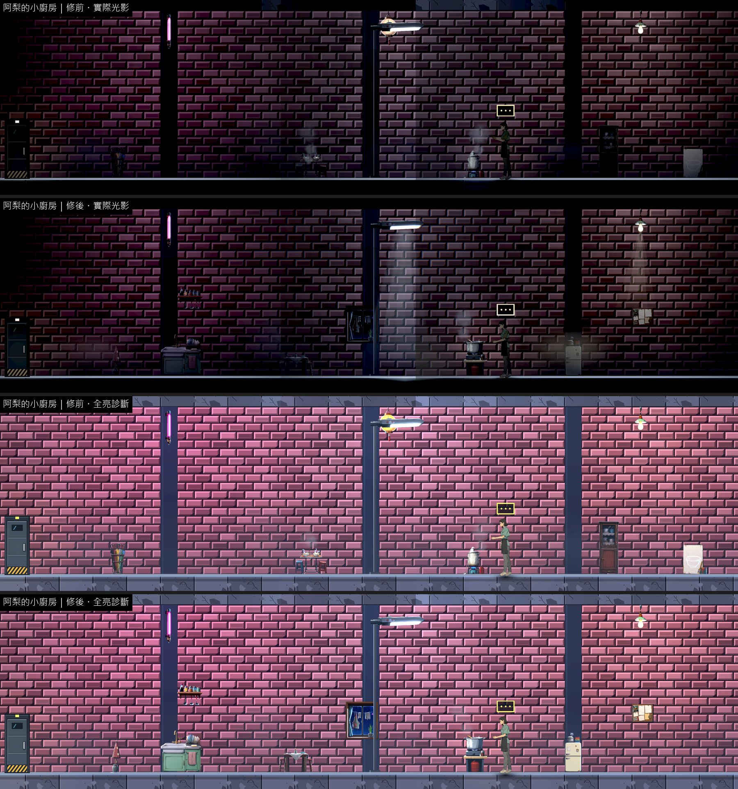
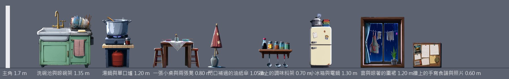
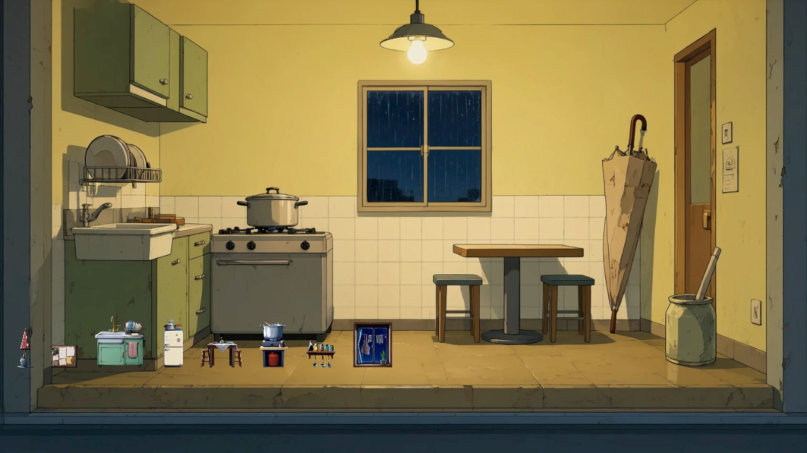

# [BG-38] 補上阿梨的小廚房背景與專屬物件

> 狀態：審查中

## 內文

### 需求
第二章「阿梨的小廚房」沒有自己的場景包：碗櫃借當舖廚房、湯爐與桌子借清晨麵攤，看起來像把別人家的東西搬過來；劇本這一場凜在這裡洗碗、試湯，畫面上卻沒有洗碗池與晾碗架。要有一張屬於這個三樓小廚房的背景與一包專屬物件，讓人一眼看出這是阿梨一個人住的地方。

### 來源
2026-10-12，場景素材 Session 盤點第二、三章場景缺口（使用者要求：先用場景包預覽盤點缺背景與缺物件的場景，一項需求開一張 BG 票，依票補齊）。盤點方法與完整清單見[第二、三章場景缺口盤點](../../design/20-campaign-experience/CH2_CH3_SCENE_GAPS.md)。

### 驗收條件
- [x] 有「阿梨的小廚房」場景背景圖與專屬物件包（至少 8 件），場景包預覽看得到
- [x] 劇本用到的東西都有物件：洗碗池、晾碗架、湯鍋與爐子、一張小桌、門口補過的油紙傘
- [x] 關卡改用這一包，不再借當舖廚房與清晨麵攤的物件；每件東西落在地面、掛在牆上或吊在天花板，寫明支撐
- [x] 新圖是賽璐璐畫風（平塗、深色描邊、硬邊兩色陰影），依真實尺寸（公尺）對主角身高合理；提示詞與種子留在清單，可以重現；素材檢查通過
- [x] 實際光影下，光影品質「低」與「高」各量一次暗場可讀性：主角 ≥ 0.6、敵人 ≥ 0.45、地面邊緣 ≥ 1.0，沒有比改之前差
- [x] 場景巡覽（實際光影與全亮診斷各一組）修前修後並排附在票上；場景檢查 0 錯誤、0 警告

### 測試流程
1. 進第二章，從公眾攤道走後樓外梯到阿梨的小廚房
2. 逐件看擺設：大小、落地、前後遮擋；和阿梨對話時她站在爐子旁

---

# 跟其他票的關係

- Blocks：無
- Blocked by：無
- Related：BG-11、BG-20

---

# Commit-1

## 內文

**問題**：阿梨的小廚房沒有自己的背景與物件，關卡借當舖廚房的碗櫃、清晨麵攤的湯爐與桌子湊成；劇本裡凜洗碗用的洗碗池與晾碗架根本沒有物件。

**改動**：
- 畫了「阿梨的小廚房」場景背景（暖黃的牆、白磁磚腰牆、雨夜的窗、一盞吊燈）與 8 件專屬物件：洗碗池與晾碗架、湯鍋與單口爐、一張小桌與兩張凳、門口補過的油紙傘、牆上的調味料架、小冰箱與電鍋、窗與晾著的圍裙、牆上的手寫食譜與照片。大小照真實尺寸（洗碗池 1.35 公尺、爐台 1.2 公尺、小桌 0.8 公尺、冰箱 1.3 公尺；主角 1.7 公尺）。
- 關卡改用這一包，不再載入當舖廚房、清晨麵攤與港口街三包：落地的 5 件（油紙傘在門口、洗碗池、小桌、湯鍋與爐子、冰箱），掛牆的 3 件（調味料架在洗碗池上方、窗台離地約 1 公尺、食譜貼在視線高度）。阿梨站在爐子旁，鍋子冒蒸汽、爐火有一小圈暖光。
- 關卡的牆面材質仍是原本的紅磚，這張票沒有動地形材質；新背景圖目前用在場景包預覽，之後這個房間要做過場舞台時可以直接用。

**驗收**：同一組格子修前修後各拍一輪（實際光影與全亮診斷）；主角站進每一格量暗場可讀性，光影品質「高」「低」各一次，都高於門檻（主角 0.6、地面邊緣 1.0；這一區沒有敵人）也沒有比修前差。場景檢查 0 錯誤、0 警告；素材檢查通過；提示詞與種子（7101～7108、背景 7190）留在清單。

### 測試結果

| 區域 | 主角對比最低（高品質）修前 → 修後 | 主角對比最低（低品質）修前 → 修後 | 地面邊緣最低（高／低，修後） | 取樣格數 |
|---|---|---|---|---|
| 阿梨的小廚房 | 0.68 → 0.82 | 0.77 → 0.89 | 26.91／25.05 | 6 |

| 項目 | 結果 |
|---|---|
| 場景檢查（第二、三章 19 張地圖） | 0 錯誤、0 警告 |
| 素材檢查 | 通過 |
| 受影響範圍的測試 | 56586 項檢查；新失敗 3、已知失敗 0。三項都是平行跑（14 個程序）時的計時檢查，和這張票無關：「滴水前進」「停電時燈具熄滅」單獨重跑環境測試 6953 項全過；音效「壓低後平順恢復」在乾淨的 main 單獨跑也會失敗 |

### 截圖

分支 `feature/scene-assets`；提交見[遠端 main 上本票的提交](https://github.com/deadline314/Nest-Egg/commits/main/pm/Nest-Egg-BG/%5BBG-38%5D%E8%A3%9C%E4%B8%8A%E9%98%BF%E6%A2%A8%E7%9A%84%E5%B0%8F%E5%BB%9A%E6%88%BF%E8%83%8C%E6%99%AF%E8%88%87%E5%B0%88%E5%B1%AC%E7%89%A9%E4%BB%B6.md)。
